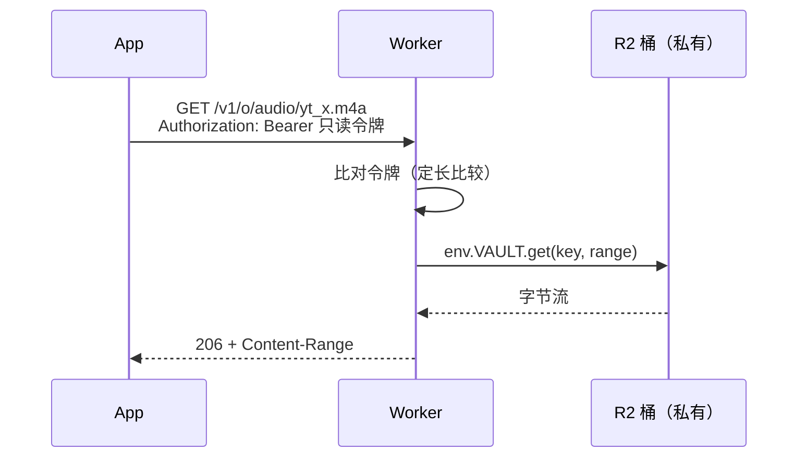
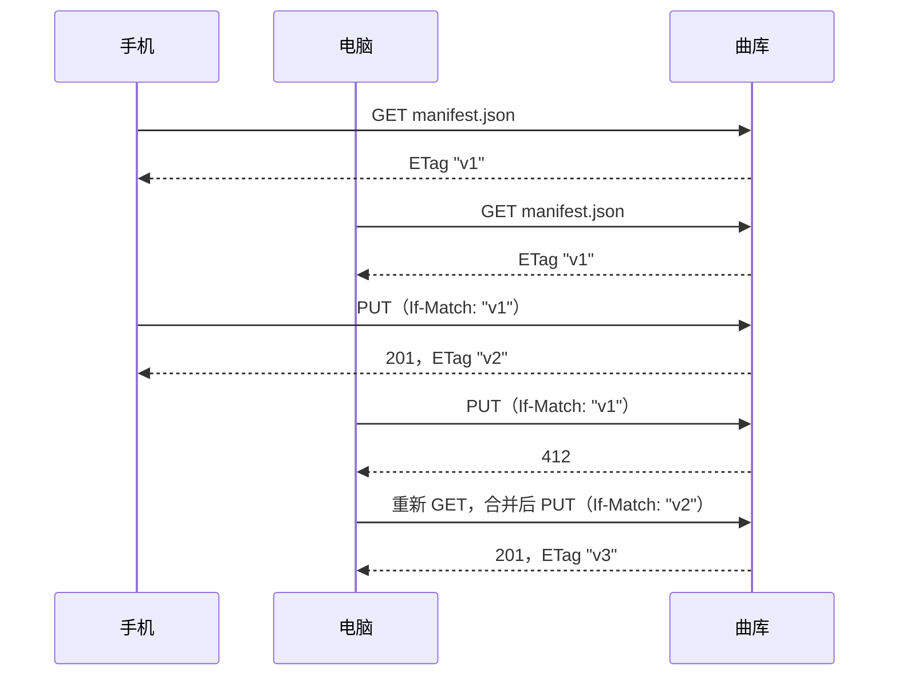

# 对象存储

用户上传的图片、App 安装包、备份文件、音频视频，几乎每个产品都有「一堆文件要放」的需求。把它们放在 VPS 磁盘上，迟早遇到磁盘满、带宽被下载占满、迁移时搬几十 GB 的问题。对象存储（S3、R2、OSS、COS 这一类）是为此而生的服务。本章讲它的数据模型和它与文件系统的区别、三种访问控制方式（以及为什么 hatch-recordwall 的桶不设公共读）、Range 和条件写这些容易被忽略的 HTTP 语义，最后是键的设计和计费维度。

## 数据模型：桶、键、对象

对象存储只有三个概念：

| 概念 | 是什么 | 例子 |
|---|---|---|
| 桶（bucket） | 一个命名空间，访问控制和地域的基本单位 | `recordwall-vault` |
| 键（key） | 对象的名字，一整根字符串 | `audio/yt_abc123.m4a` |
| 对象（object） | 字节内容 + 元数据（Content-Type、ETag、自定义元数据） | 一首 5MB 的歌 |

和文件系统最大的区别：

- **没有目录**。`audio/yt_abc123.m4a` 里的 `/` 只是键的一个字符，控制台显示成文件夹，是按前缀分组的视觉效果。`..` 在这里也只是一个普通的段，不会「回到上一级」
- **对象不可部分修改**。只能整体写入、整体覆盖或删除，不能像文件那样追加一行、改中间几个字节
- **按 HTTP 访问**。读写就是 GET / PUT / DELETE / HEAD，天然支持 Range、ETag、条件请求
- **容量近乎无限，按用量付费**。不用预先分配磁盘

| | 本地文件系统 | 对象存储 | 数据库 |
|---|---|---|---|
| 适合 | 程序运行时的临时文件 | 大块、整体读写的文件 | 结构化、要查询和事务的数据 |
| 修改粒度 | 字节 | 整个对象 | 行 / 字段 |
| 查询 | 按路径 | 按键或前缀列举 | SQL |
| 扩展 | 受磁盘限制 | 几乎无限 | 受实例规格限制 |
| 跨机器共享 | 难 | 天然 | 天然 |

一个常见搭配：**数据库存元数据和键，对象存储存字节**。比如数据库里一行记录「这张单据的原图键是 `receipts/2026/10/xxx.jpg`」，图本身在桶里。

## S3 API：事实标准，但兼容有差异

AWS S3 的接口已经成了事实标准，R2、OSS、COS 都提供 S3 兼容接口，于是同一套 SDK（如 `@aws-sdk/client-s3`）改个 endpoint 就能连不同厂商。但「兼容」的程度不一：某些高级特性（对象锁、部分条件头、某些列举参数）可能不支持或行为不同。依赖某个特性前，查那家厂商的兼容性说明。

一致性方面，S3 和 R2 目前都提供**写后读强一致**：PUT 成功后，紧接着的 GET 一定读到新内容，列举也能看到新对象。其他厂商以各自文档为准。

## 三种访问控制方式

这是对象存储最关键的设计决策。

| 方式 | 怎么做 | 优点 | 风险 |
|---|---|---|---|
| 公共读 | 桶或对象设为任何人可读，地址直接给出去 | 最简单，可直接挂 CDN | 谁拿到地址谁能下；被盗链、被刷流量；私人内容被爬到 |
| 预签名 URL | 服务端用密钥签出一个带过期时间的地址，客户端拿着它直接访问存储 | 字节不经过你的服务；可精确控制单个对象和时效 | 需要一个签名服务；地址在有效期内可被转发 |
| 前置网关 | 桶完全私有，所有请求经过你的服务（如 Worker）鉴权后再读写 | 统一入口：日志、限流、换后端都在一处 | 每个字节都过网关，网关的计费和性能要算进去 |

### 为什么 hatch-recordwall 的桶不设公共读

它的 README 写了两条理由：

- **公共读等于在公网上分发音乐**：谁拿到地址谁都能下，也挡不住被人当图床盗刷流量
- **把桶的访问密钥打进 App 等于把钥匙交出去**：安装包是可以被反编译的

于是钥匙（R2 binding）留在 Worker 里，App 里打包的是一串**只读令牌**；丢了换一把，代价是发一版新 App。能写的令牌根本不进安装包，由 Worker 在发布者输入验证器上的六位动态口令之后才交下去（第 4 章）。



还有一个隐蔽的坑：R2 支持给桶直接绑「自定义域」，绑上后**桶里每个对象都对全世界公开可读**，前面那个 Worker 和它的令牌被整个绕过，而且从 App 那头看一切正常。作者为了测速真绑过一个，后来摘掉了，并在 README 里写下「千万别给桶绑自定义域」。经验是：**检查桶的公开状态要看桶本身的设置**，不能只看你的服务有没有鉴权。

### 预签名 URL 的写法

前置网关不是唯一选择。字节量大、不想让每个字节都经过网关时，用预签名 URL。以 Node 服务端连 R2 的 S3 接口为例：

```ts
import { S3Client, GetObjectCommand, PutObjectCommand } from "@aws-sdk/client-s3";
import { getSignedUrl } from "@aws-sdk/s3-request-presigner";

const s3 = new S3Client({
  region: "auto",
  endpoint: `https://${process.env.R2_ACCOUNT_ID}.r2.cloudflarestorage.com`,
  credentials: {
    accessKeyId: process.env.R2_ACCESS_KEY_ID!,
    secretAccessKey: process.env.R2_SECRET_ACCESS_KEY!,
  },
});

// 下载：10 分钟有效
export function signDownload(key: string) {
  return getSignedUrl(s3, new GetObjectCommand({ Bucket: "my-bucket", Key: key }), { expiresIn: 600 });
}

// 上传：限定键和 Content-Type，客户端必须带同样的 Content-Type 头
export function signUpload(key: string, contentType: string) {
  return getSignedUrl(
    s3,
    new PutObjectCommand({ Bucket: "my-bucket", Key: key, ContentType: contentType }),
    { expiresIn: 300 },
  );
}
```

要点：

- 签名用的访问密钥只在服务端，权限收窄到单个桶、只给需要的读或写
- **键由服务端决定**，不让客户端自己填（否则可能覆盖别人的文件）
- 浏览器直传需要给桶配 CORS；原生 App 不受同源策略限制，不需要
- 有效期越短越好；需要长期可访问的内容，说明它其实该走公共读或网关

## Range：大文件下载的生命线

对象存储天然支持 HTTP Range 请求：`Range: bytes=0-1048575` 只取前 1MB。断点续传、音视频拖动进度条、分段并发下载都靠它。

如果你在存储前面挡了一层网关，**网关必须正确透传 Range**，否则客户端的下载逻辑会整个失效。hatch-recordwall 的下载端一律带 `bytes=0-<末尾>` 或 `bytes=0-` 来请求，Worker 要解析 Range、交给 R2、再回一个正确的 206：

```ts
const want = parseRange(request.headers.get("range"));
const object = await env.VAULT.get(key, want ? { range: want } : undefined);
// ...
const { start, length } = spanOf(want, object.size); // 按自己解析的范围算，并对着对象大小夹一下
headers.set("content-range", `bytes ${start}-${start + length - 1}/${object.size}`);
headers.set("content-length", String(length));
return new Response(object.body, { status: 206, headers });
```

这里踩过一个坑：R2 返回对象上的 `range` 字段，形状和类型声明对不上，照着它算出来的是 `bytes NaN-NaN/5242880`。而 Content-Length 看起来是对的（运行时会按真实流长度覆盖它），所以光看下载下来的字节数根本发现不了。教训：**Content-Range 按自己解析出来的范围算**，并且对客户端要的范围超出对象大小的情况做截断。

## 条件写：防止并发覆盖

对象不可部分修改，意味着「读-改-写」是对象存储上最常见的更新方式：读出一份 JSON，改一个字段，整体写回。两个客户端同时做这件事，后写的会把先写的盖掉，这叫**丢失更新**。

HTTP 早就有解决办法：条件请求。

| 请求头 | 语义 | 不满足时 |
|---|---|---|
| `If-Match: "<etag>"` | 桶里的版本还是我读到的那一版，才写 | 412 Precondition Failed |
| `If-None-Match: *` | 桶里还没有这个键，才写 | 412 |

hatch-recordwall 的目录文件（`index/manifest.json` 和按月分片的曲目列表）就是这样更新的：手机和电脑都能「进货」，读-改-写会互相覆盖，于是 PUT 带条件，撞了的那一方拿到 412，重读、重改、重写。



在 Worker 里，`If-Match` 交给 R2 binding 的 `onlyIf` 原子地判断；条件不满足时 `put` 返回 `null` 而不是抛异常。注意 R2 比较的是**不带引号**的 ETag，而客户端从响应头拿到的是带引号的形式，要先去掉：

```ts
const object = await env.VAULT.put(key, request.body, {
  httpMetadata: type ? { contentType: type } : undefined,
  onlyIf: ifMatch ? { etagMatches: ifMatch.replace(/^W\//, "").replaceAll('"', "") } : undefined,
});
if (!object) return json({ error: "别人刚改过" }, 412);
```

`If-None-Match: *` 在 R2 的 `onlyIf` 里不支持，唱片墙退而求其次：先 `head` 再 `put`。两步之间有个窄缝，只有「两台设备同时创建第一份目录」时才会撞上，作者认了。这种「知道有缝、写下来、接受它」的处理，比假装没有缝更好。

## 键的设计

键名一旦被客户端和数据引用，就很难改。几条原则：

- **确定性**：同一个东西在任何设备上算出同一个键。唱片墙用 `audio/yt_<videoId>.m4a`，并把 ID 里的冒号统一换成下划线
- **按类型分前缀**：`audio/`、`cover/`、`lyrics/`、`index/`，方便按前缀列举、设生命周期规则、统计用量
- **字符集收窄**：只用 `[A-Za-z0-9._/-]`，避免 URL 编码和大小写带来的歧义。唱片墙的网关会拒绝含其他字符、空段、超长的键
- **大列表要分片**：一个越来越大的 JSON 每次都要整体读写。唱片墙的曲目目录按月切成 `index/tracks/<YYYY-MM>.json`，加一份 manifest 记录每片的修改时间，客户端只拉变了的片
- **别把私密信息放进键**：键会出现在日志、URL 和账单明细里

## 大文件与生命周期

- **分片上传**（multipart upload）：大文件拆成多段分别上传，失败只重传一段。各家对单次 PUT 的大小上限和分片规则不同，以文档为准。未完成的分片上传会占用存储，记得配生命周期规则清理
- **生命周期规则**：按前缀和时间自动删除或转存，如「`tmp/` 下超过 7 天的删掉」「`backups/` 下超过 30 天的转低频」
- **存储类别**：标准、低频访问、归档。越冷存储越便宜，但读取要额外收**取回费**，有的还有最短存储时长。备份适合冷存储，用户经常访问的内容不适合

## 计费维度

对象存储的账单通常由这几项组成（具体单价和免费额度看各家定价页）：

| 维度 | 怎么算 | 容易忽略的地方 |
|---|---|---|
| 存储容量 | 按 GB·月 | 旧版本、未完成的分片上传也算 |
| 写类请求 | PUT、POST、LIST、复制等，按次 | LIST 通常算在贵的那一类 |
| 读类请求 | GET、HEAD，按次 | 一次下载拆成多个 Range 请求就是多次 |
| 出网流量 | 从存储流向公网的字节 | 很多厂商这一项最贵；R2 的卖点就是**不收出网费** |
| 取回费 | 冷存储类别的读取 | 选错存储类别时会意外出现 |

R2 把操作分成 A 类（写、列举等）和 B 类（读等）分别计价，不收出网流量费。这让「大文件、读多写少」的场景（如唱片墙）账单主要落在存储容量和读请求上。第 7 章会用这些维度估一笔账。

## 本章要点

- 对象存储 = 桶 + 键 + 对象；没有目录，对象只能整体覆盖
- S3 API 是事实标准，但各家兼容程度不同；S3 和 R2 提供写后读强一致
- 三种访问控制：公共读、预签名 URL、前置网关。私人内容不要公共读，访问密钥不要打进客户端
- 给 R2 桶绑自定义域会让整个桶公开，**检查桶本身的公开状态**
- 网关要正确透传 Range，Content-Range 按自己解析的范围算
- 读-改-写用 `If-Match` / `If-None-Match` 条件写防丢失更新，撞了就重读重写
- 键要确定、分前缀、收窄字符集，大列表分片
- 计费看容量、两类请求、出网流量、取回费
