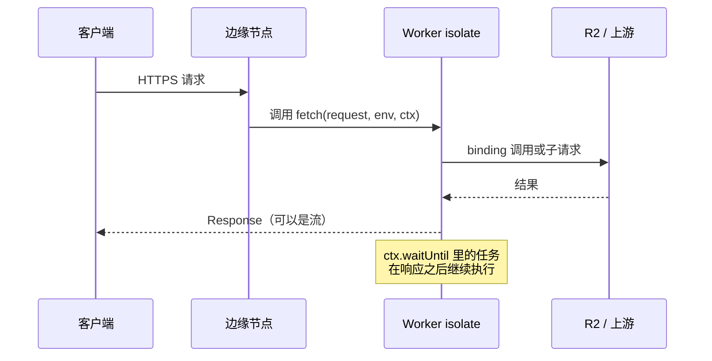
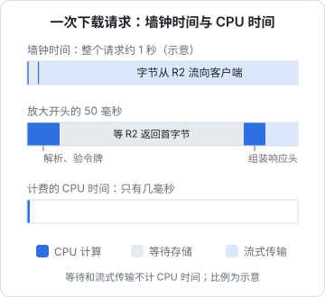

# Cloudflare Workers 运行模型

Workers 看起来像「部署一个函数」，但它的运行方式和 VPS 上的 Node 进程、和传统的容器型函数平台都不一样。不理解运行模型，就会写出「本地好好的、上线偶尔出错」的代码：全局变量串了请求、响应发出去后后台任务被掐断、以为请求会走缓存其实没走。本章讲 Workers 怎么执行你的代码、有哪些限制、按什么计费，再逐段拆解 hatch-recordwall 的曲库 Worker。

> 本章的 API 以 Cloudflare Workers 当前文档为准，示例配置使用 `compatibility_date = "2026-09-18"`（hatch-recordwall 的设置）。具体的限制数值（CPU 时间、内存、子请求数、请求体大小）按套餐不同且会调整，**以官方 Limits 页面为准**。

## isolate：不是容器，也不是进程

传统函数平台给每个函数实例起一个容器或微虚拟机，冷启动要加载整个运行时。Workers 用的是 **V8 isolate**：一个 V8 引擎进程里同时跑着很多互相隔离的 JavaScript 环境，每个 Worker 是其中之一。

| | VPS 上的 Node | 容器型函数平台 | Workers |
|---|---|---|---|
| 隔离单位 | 进程 | 容器 / 微虚拟机 | V8 isolate |
| 启动开销 | 一次，常驻 | 冷启动可达数百毫秒以上 | 很小，通常感觉不到 |
| 跑在哪 | 你选的机房 | 你选的地域 | 离用户最近的边缘节点 |
| 运行时 | 完整 Node | 完整语言运行时 | Web 标准 API + 部分 Node 兼容 |
| 文件系统 | 有 | 有临时目录 | 没有可持久写入的文件系统 |

带来的直接后果：

- **代码在全球的边缘节点执行**，请求从哪来就近在哪跑。但它读写的存储（R2 桶、D1 数据库）有自己的物理位置，离存储远的节点要多走一段（Cloudflare 提供 Smart Placement 之类的机制把 Worker 放到靠近后端的位置，按需开启）
- **一个 isolate 会处理多个请求**，但你不能指望它常驻：它随时可能被回收，不同请求也可能落到不同节点的不同 isolate 上

### 全局变量：会共享，但不可靠

```ts
let counter = 0; // 模块顶层

export default {
  async fetch() {
    counter++;
    return new Response(String(counter)); // 可能是 1、7、1、3……毫无规律
  },
};
```

模块顶层的变量在同一个 isolate 的请求之间**共享**，又会在 isolate 回收时**丢失**。所以：

- 不要把它当存储用（计数、会话、限流状态），要用 KV、D1 或 Durable Objects（第 5 章）
- 不要把某个请求的数据放到全局变量里，否则可能被并发的另一个请求读到
- 可以放的是**只读的、可以重建的东西**：编译好的正则、解析好的配置、复用的客户端对象

## 一个请求的生命周期

Worker 是一个导出了处理函数的 ES 模块。最常用的是 `fetch`：

```ts
export interface Env {
  VAULT: R2Bucket;      // binding：wrangler.toml 里声明，运行时注入
  READ_TOKEN?: string;  // secret：wrangler secret put 灌进去
}

export default {
  async fetch(request: Request, env: Env, ctx: ExecutionContext): Promise<Response> {
    ctx.waitUntil(logSomewhere(request)); // 响应返回后继续跑完
    return new Response("ok");
  },

  // Cron Triggers：在 wrangler.toml 里配 [triggers] crons = ["0 3 * * *"]
  async scheduled(controller: ScheduledController, env: Env, ctx: ExecutionContext) {
    ctx.waitUntil(cleanup(env));
  },
} satisfies ExportedHandler<Env>;
```



三个参数的含义：

- `request`：标准的 Fetch API `Request`
- `env`：所有 binding（R2、KV、D1、Durable Objects、其他服务）、环境变量和 secret。**配置从这里拿，不是 `process.env`**
- `ctx`：`waitUntil(promise)` 让任务在响应发出后继续执行到完成（发日志、写统计）；不用它的话，响应一返回，没等完的 Promise 可能被掐断

除了 `fetch` 和 `scheduled`，还有消费队列的 `queue` 等处理函数，按需使用。

## API：Web 标准优先

Workers 的 API 以 Web 标准为主：`fetch`、`Request` / `Response` / `Headers`、`URL`、`ReadableStream`、`crypto.subtle`、`TextEncoder`。写过浏览器代码或 Node 18+ 的 `fetch` 就能直接上手。

需要 Node 的内置模块（`node:buffer`、`node:crypto`、`node:stream` 等）时，在配置里开 `nodejs_compat` 兼容标志。它覆盖了常用的大部分模块，但不是全部；依赖大量 Node 特性的 npm 包仍可能跑不了，以文档的兼容列表为准。

```toml
compatibility_date = "2026-09-18"
compatibility_flags = ["nodejs_compat"]
```

hatch-recordwall 的 Worker 没开这个标志，全部用 Web 标准 API 完成：SHA-256 摘要、HMAC-SHA1（TOTP）都走 `crypto.subtle`。**能不用 Node 兼容就不用**，包更小，行为也更可预期。

## 限制与计费：CPU 时间不是墙钟时间

Workers 的关键限制和计费都围绕 **CPU 时间**，而不是请求从开始到结束的墙钟时间。



等待 R2 返回、等待上游 API 响应、把流发给客户端，这些 I/O 等待**不消耗 CPU 时间**。所以一个「下载 5MB 文件」的请求，墙钟时间可能是好几秒，CPU 时间却只有几毫秒，因为字节是从 R2 流到客户端的，你的代码没有逐字节处理它。

| 限制项 | 含义 | 怎么避免撞上 |
|---|---|---|
| CPU 时间 | 每个请求能用的 CPU 预算，免费和付费套餐不同 | 不在 Worker 里做重计算；流式转发而不是读进内存再处理 |
| 内存 | 每个 isolate 的内存上限 | 不要 `await response.arrayBuffer()` 大文件 |
| 子请求数 | 单个请求里能发起的 `fetch` 和部分 binding 调用次数 | 批量操作合并请求 |
| 请求体大小 | 上传大小上限，按套餐不同 | 大文件用预签名 URL 直传存储（第 3 章） |
| 脚本大小 | 打包后的代码体积 | 少引大依赖 |

付费套餐的计费主要是**请求数 + CPU 时间**两项（各含一定免费额度）。所以流式转发不只是为了不爆内存，也是为了省钱。

## 缓存：binding 不走缓存，fetch 子请求会

Workers 跑在 CDN 的边缘节点上，很多人因此默认「Worker 的响应会被缓存」。其实要分两种情况：

| 读取方式 | 经过边缘缓存吗 |
|---|---|
| 通过 binding 读 R2（`env.VAULT.get()`） | **不经过**，每次都是一次真的 R2 读 |
| Worker 里 `fetch()` 一个外部地址 | 默认按上游的缓存头进 Cloudflare 缓存 |
| 想缓存自己构造的响应 | 自己调 Cache API（`caches.default`） |

hatch-recordwall 两种都实测过：经过 Worker 读 R2 的响应头里连 `cf-cache-status` 都没有；而代理取封面图时，第二次请求同一张图，响应头里带上了 `age`，说明命中了缓存。

### 该不该自己加缓存：看取用形状

唱片墙**有意没给音频加缓存**，理由不是速度，而是取用形状：每个人把每首歌下载到手机上一次，之后从本地放。同一个人第二次读同一个键几乎不发生；缓存只在人与人之间有收益，而 A 上传、B 两天后下、C 一周后下，等 C 来时边缘缓存早就过期了。一层几乎命不中的缓存，换来的是实打实的复杂度：Cache API 的 `put` 不接受 206 响应，要么缓存整个对象再自己切片，要么按 Range 分键存。

封面图正好相反：同一张图被所有人反复请求，只有几十 KB，**正是缓存最划算的形状**，而它走的是 `fetch` 子请求，不用写代码就有缓存。

需要自己缓存时的写法：

```ts
async fetch(request: Request, env: Env, ctx: ExecutionContext) {
  const cache = caches.default;
  const hit = await cache.match(request);
  if (hit) return hit;

  const res = await buildResponse(request, env); // 必须是 200，且带合适的 Cache-Control
  ctx.waitUntil(cache.put(request, res.clone()));
  return res;
}
```

注意：Cache API 的缓存是**每个数据中心各自一份**，不是全球共享；在平台默认子域名上它的行为可能和自定义域名上不同，上线前在正式域名上验证。

## 拆解 hatch-recordwall 的曲库 Worker

整个 Worker 三个文件：`index.ts`（路由、鉴权、对象读写）、`totp.ts`（动态口令）、`forward.ts`（转发代理）。下面是它的骨架和几个值得学的设计。

### 路由与兜底

```ts
export default {
  async fetch(request: Request, env: Env): Promise<Response> {
    try {
      return await route(request, env);
    } catch (e) {
      console.error("[vault] 没接住", e);
      return json({ error: "金库这边出了点问题" }, 500);
    }
  },
} satisfies ExportedHandler<Env>;

async function route(request: Request, env: Env): Promise<Response> {
  const url = new URL(request.url);
  if (!env.READ_TOKEN && !env.WRITE_TOKEN) {
    return json({ error: "金库还没配令牌" }, 503); // 宁可不干活，也别默默敞着
  }
  const role = await roleOf(request, env);
  if (!role) return json({ error: "令牌不对" }, 401);
  // /v1/ping、/v1/unlock、/v1/o/<键> ……
}
```

两个细节：

- 顶层 `try/catch` 保证任何未处理的异常都变成一个 JSON 500，并留下日志（`wrangler tail` 能看到）
- **令牌一把都没配时整个返回 503**。忘了灌 secret 就上线，是边缘平台最常见的事故之一；默认拒绝比默认放行安全

### 两把令牌与定长比较

（下面的代码省略了图片路由从查询参数取令牌的分支。）

```ts
async function roleOf(request: Request, env: Env): Promise<"reader" | "writer" | null> {
  const head = request.headers.get("authorization") ?? "";
  const got = head.toLowerCase().startsWith("bearer ") ? head.slice(7).trim() : "";
  if (!got) return null;
  // 写令牌排前面：两把配成同一串时按权限大的算
  if (env.WRITE_TOKEN && (await sameSecret(got, env.WRITE_TOKEN))) return "writer";
  if (env.READ_TOKEN && (await sameSecret(got, env.READ_TOKEN))) return "reader";
  return null;
}

async function sameSecret(a: string, b: string): Promise<boolean> {
  const [x, y] = await Promise.all([sha256(a), sha256(b)]);
  let diff = 0;
  for (let i = 0; i < x.length; i++) diff |= x[i]! ^ y[i]!;
  return diff === 0;
}
```

不用 `===` 比较令牌：它在第一个不同的字节就返回，理论上能通过测量响应时间逐字节猜出令牌。先各自做 SHA-256 摘要，再对 32 个字节逐个异或，比较时间与内容无关，长度也不会泄露。

### 写令牌不进安装包：用动态口令换

写令牌能往曲库里写和删，不能打进 App。唱片墙的做法是：发布者在 App 里输入身份验证器上的六位 TOTP 口令，Worker 用 secret 里的 `TOTP_SECRET` 按 RFC 6238 验证（允许前后各一个 30 秒窗口的时钟误差），对上了才把写令牌返回。

为什么在 Worker 里验而不是在手机上验？**验口令用的密钥和写令牌是同一级别的机密**，放进 App 等于把钥匙换个名字发出去。这是边缘平台的一个典型用法：把「需要密钥才能做的判断」放到你控制的服务端。

### 开放代理是最大的风险

曲库还替连不上源站的客户端转发少量 API 请求和图片。任何「替别人转发请求」的服务都要警惕变成**开放代理**：拿到只读令牌的人，就有了一个架在你账号上、能请求任意地址的代理，可以被拿去做 SSRF、刷流量、隐藏攻击来源。

它的防线：

- **目标域名白名单**（`forward.ts` 的两张域名表），是这条路唯一的安全边界；往里加域名前要想清楚
- 只允许 `https:`
- 转发前**摘掉 `authorization`**（那是进曲库的令牌，带给上游等于送出去），以及 `x-forwarded-for`、`cf-connecting-ip` 等会暴露用户真实 IP 的头
- 不把上游的 `set-cookie` 带回客户端

### 不开 CORS

调用方是原生 App，不经过浏览器的同源策略。开了 CORS 等于多一个要记得维护的口子，所以干脆不开。只有浏览器端会直接调用的 Worker 才需要处理 `OPTIONS` 预检和 CORS 头。

## 什么不适合放进 Worker

| 场景 | 原因 | 替代 |
|---|---|---|
| 视频转码、图片批量处理 | CPU 预算不够 | VPS、专门的媒体处理服务 |
| 依赖原生扩展的 npm 包 | 运行时不支持 | VPS / 容器 |
| 需要直连 Postgres 的大量查询 | 每个请求建连接很贵，离数据库可能很远 | Hyperdrive，或把这部分留在 VPS |
| 有状态的长连接 | 普通 Worker 不常驻 | Durable Objects（第 5 章） |

## 本章要点

- Workers 跑在 V8 isolate 里，启动开销极小，在离用户最近的边缘节点执行
- 模块顶层变量会在请求间共享又随时丢失：不能当存储，也不能放请求级数据
- 配置和 binding 从 `env` 拿；响应后的任务用 `ctx.waitUntil`
- API 以 Web 标准为主，`nodejs_compat` 能补上常用的 Node 模块；能不用就不用
- 限制和计费围绕 **CPU 时间**，I/O 等待不算；流式转发既省内存也省钱
- binding 读 R2 **不走边缘缓存**，`fetch` 子请求会；要不要自己加缓存，看取用形状
- 曲库 Worker 的几条可复用设计：顶层兜底、无令牌时 503、定长比较、写令牌用 TOTP 换、代理用白名单并摘掉敏感头

## 动手练习

本章和后面两章的练习都在同一个本地项目 `edge-lab` 里做，只用 `wrangler dev`，不需要 Cloudflare 账号。先搭起来：

```bash
mkdir edge-lab && cd edge-lab && pnpm init && pnpm add -D wrangler @cloudflare/workers-types
mkdir src && printf 'name = "edge-lab"\nmain = "src/index.ts"\ncompatibility_date = "2026-09-18"\n' > wrangler.toml
```

1. **全局变量会共享，也会丢**：把本章「全局变量」一节的计数器写进 `src/index.ts`，`pnpm exec wrangler dev` 起服务后连续请求几次；然后随便改一下源文件保存，再请求。

   验证：`for i in 1 2 3; do curl -s localhost:8787; echo; done` 本地通常输出递增的 `1 2 3`；保存文件触发重载后，下一次请求又从 `1` 开始。

   参考答案：本地只有一个 isolate，所以看起来像个可靠的计数器；重载等于 isolate 被回收，状态就没了。线上请求会分散到不同节点的不同 isolate，还会被随时回收，所以不能把它当存储。

2. **没配令牌就拒绝服务**：实现一个最小的鉴权：两把令牌都没配时返回 503，令牌不对返回 401，对了返回 200，比较用 SHA-256 摘要后逐字节异或。

   验证：不建 `.dev.vars` 时 `curl -s -o /dev/null -w '%{http_code}\n' localhost:8787` 输出 `503`；写入 `READ_TOKEN=dev-read-token` 到 `.dev.vars` 并重启 dev 后，不带头输出 `401`，带 `-H 'Authorization: Bearer dev-read-token'` 输出 `200`。

   参考答案：关键是「没配」时走拒绝分支，而不是让 `undefined` 参与比较。

   ```ts
   const sha = async (s: string) =>
     new Uint8Array(await crypto.subtle.digest("SHA-256", new TextEncoder().encode(s)));
   async function same(a: string, b: string) {
     const [x, y] = await Promise.all([sha(a), sha(b)]);
     let d = 0; for (let i = 0; i < 32; i++) d |= x[i]! ^ y[i]!; return d === 0;
   }
   export default {
     async fetch(req: Request, env: { READ_TOKEN?: string }) {
       if (!env.READ_TOKEN) return new Response("no token configured", { status: 503 });
       const got = (req.headers.get("authorization") ?? "").replace(/^bearer\s+/i, "");
       return (await same(got, env.READ_TOKEN)) ? new Response("ok") : new Response("no", { status: 401 });
     },
   };
   ```

3. **转发接口不能变成开放代理**：加一条 `/fwd?url=<地址>` 路由：只放行 `https:` 和白名单里的 `httpbin.org`，转发前删掉 `authorization` 头。

   验证：`curl -s -o /dev/null -w '%{http_code}\n' 'localhost:8787/fwd?url=https://example.com/'` 和 `url=http://httpbin.org/get` 都被拒（比如 403）；`curl -s -H 'Authorization: Bearer secret' 'localhost:8787/fwd?url=https://httpbin.org/headers'` 返回的 JSON 里没有 `Authorization` 字段。

   参考答案：先 `new URL()` 解析再比 `protocol` 和 `hostname`，不要用字符串前缀匹配（`https://httpbin.org.evil.com` 能绕过前缀检查）；转发时 `new Headers(req.headers)` 后 `delete("authorization")`。
