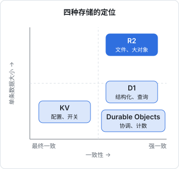
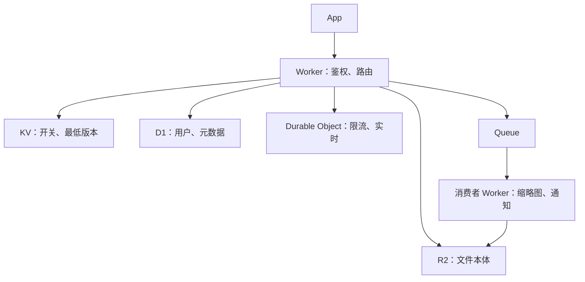

# R2、KV、D1 与 Durable Objects

Worker 本身不保存任何状态，状态都在它绑定的存储里。Cloudflare 提供了四种主要的存储：R2（对象存储）、KV（键值）、D1（SQLite 数据库）、Durable Objects（带状态的单实例对象）。它们不是「同一个东西的四个档次」，而是针对四种完全不同的数据形状和一致性需求设计的。选错了，要么性能和账单出问题，要么出现莫名其妙的「读到旧数据」。本章逐个讲清它们的模型、API 和适用场景，最后给出选型表和组合方式。

> 各服务的容量上限、写入频率限制、计费单价会调整，本章只讲模型和数量级，**具体数值以 Cloudflare 官方文档为准**。代码基于 `compatibility_date = "2026-09-18"` 和 wrangler 4.x。

## 一张图定位



| | R2 | KV | D1 | Durable Objects |
|---|---|---|---|---|
| 数据模型 | 桶 + 键 + 对象 | 键 → 值 | SQLite 表 | 一个对象实例 + 它自己的存储 |
| 适合的数据 | 文件、大块二进制 | 配置、开关、读多写极少的小值 | 结构化数据、要查询 | 需要协调的状态：计数、锁、房间、会话 |
| 一致性 | 强一致 | **最终一致**（全球传播有延迟） | 强一致（写在主库） | 强一致（单实例串行） |
| 典型访问 | 整对象读写、Range | 按键读 | SQL | 方法调用（RPC）、WebSocket |
| 计费主维度 | 容量 + A/B 类操作 | 读写删列次数 + 容量 | 读取行数 + 写入行数 + 容量 | 请求 + 运行时长 + 存储 |

## R2：对象存储

R2 的模型就是第 3 章讲的对象存储，S3 兼容，不收出网费。在 Worker 里通过 binding 直接访问，不需要访问密钥：

```toml
[[r2_buckets]]
binding = "VAULT"            # 代码里用 env.VAULT
bucket_name = "my-vault"     # 先用 wrangler r2 bucket create my-vault 建好
```

```ts
// 读，支持 Range
const obj = await env.VAULT.get("audio/x.m4a", { range: { offset: 0, length: 1024 } });
if (obj) return new Response(obj.body, { headers: { etag: obj.httpEtag } });

// 只看元数据
const meta = await env.VAULT.head("audio/x.m4a"); // 不存在时为 null

// 写，带条件：ETag 对不上返回 null
const put = await env.VAULT.put("index/manifest.json", body, {
  httpMetadata: { contentType: "application/json" },
  onlyIf: { etagMatches: "abc123" },
});

// 列举（分页）
const page = await env.VAULT.list({ prefix: "index/tracks/", limit: 100 });
for (const o of page.objects) console.log(o.key, o.size);
if (page.truncated) { /* 用 page.cursor 继续 */ }

await env.VAULT.delete("tmp/old.bin");
```

几个要点：

- binding 访问**不经过边缘缓存**（第 4 章）
- `writeHttpMetadata(headers)` 把存储时写入的 Content-Type 等元数据写回响应头，省得自己维护
- `list` 算在较贵的 A 类操作里，别在每个请求里列举；需要「有哪些东西」时，像唱片墙那样维护一份 manifest
- 从 Worker 外部（Node 服务、CI、备份脚本）访问用 S3 兼容接口和 API 令牌

## KV：读多写少的全局键值

KV 把数据复制到全球的边缘节点，读取非常快，但**写入要经过一段时间才能传播到所有节点**（官方说明的量级是一分钟左右），同一个键的写入频率也有限制。

```toml
[[kv_namespaces]]
binding = "FLAGS"
id = "<wrangler kv namespace create FLAGS 输出的 id>"
```

```ts
// 读：cacheTtl 让边缘节点在本地多缓存一会儿，读得更快，但看到更新也更慢
const minVersion = await env.FLAGS.get("min_app_version", { cacheTtl: 300 });

// 读 JSON
const cfg = await env.FLAGS.get<{ maintenance: boolean }>("config", "json");

// 写：可以设过期
await env.FLAGS.put("announcement", "周六凌晨维护", { expirationTtl: 86400 });
```

```bash
# wrangler 4 的子命令是空格分隔（3.x 里的 kv:namespace 写法已移除）
npx wrangler kv namespace create FLAGS
npx wrangler kv key put --binding FLAGS min_app_version 1.4.0 --remote
npx wrangler kv key get --binding FLAGS min_app_version --remote
```

**适合**：功能开关、最低支持版本、公告、重定向表、按 API key 查到的租户配置。共同点是读得极多、改得极少、改完晚一分钟生效没关系。

**不适合**：计数器、库存、限流状态、任何「写完马上要读到」的数据。用 KV 做计数，两个节点各自读到 5、各自写回 6，丢一次；再加上传播延迟，数会乱得没法用。这类需求用 Durable Objects。

## D1：托管的 SQLite

D1 是 Cloudflare 托管的 SQLite 数据库。你写的就是 SQLite 方言的 SQL，用迁移文件管理表结构。

```bash
npx wrangler d1 create shelf
npx wrangler d1 migrations create shelf init     # 生成 migrations/0001_init.sql
npx wrangler d1 migrations apply shelf --local   # 本地模拟库
npx wrangler d1 migrations apply shelf --remote  # 线上库
npx wrangler d1 execute shelf --remote --command "SELECT count(*) FROM tracks"
```

```toml
[[d1_databases]]
binding = "DB"
database_name = "shelf"
database_id = "<wrangler d1 create 输出的 id>"
```

```sql
-- migrations/0001_init.sql
CREATE TABLE tracks (
  id         TEXT PRIMARY KEY,
  title      TEXT NOT NULL,
  artist     TEXT NOT NULL,
  month      TEXT NOT NULL,         -- 'YYYY-MM'
  created_at INTEGER NOT NULL
);
CREATE INDEX idx_tracks_month ON tracks(month);
```

```ts
type Track = { id: string; title: string; artist: string };

const { results } = await env.DB
  .prepare("SELECT id, title, artist FROM tracks WHERE month = ? ORDER BY created_at DESC")
  .bind("2026-10")
  .all<Track>();

// 多条语句一次发出，作为一个事务执行
await env.DB.batch([
  env.DB.prepare("INSERT INTO tracks (id, title, artist, month, created_at) VALUES (?, ?, ?, ?, ?)")
    .bind("yt_x", "歌名", "歌手", "2026-10", Date.now()),
  env.DB.prepare("UPDATE stats SET n = n + 1 WHERE k = 'tracks'"),
]);
```

要点：

- **一定用 `prepare().bind()`**，不要拼字符串，防 SQL 注入
- **按读取行数计费**：没有索引的查询会扫全表，每扫一行都算钱。`WHERE` 和 `ORDER BY` 用到的列要建索引，上线前用 `EXPLAIN QUERY PLAN` 看一眼
- 单个数据库有容量上限，D1 的设计思路是「很多个小库」而不是「一个大库」：按用户或租户分库是官方推荐的模式之一
- 写入集中在主库所在的位置，离主库远的 Worker 写入延迟更高；读多的场景可以了解它的读副本功能
- 本地 `wrangler dev` 用的是 `.wrangler/state` 下的模拟库，和线上数据完全分开

Drizzle 支持 D1，熟悉 Drizzle 的话可以沿用同一套 schema 和查询写法（版本兼容以 Drizzle 文档为准）。

## Durable Objects：需要协调的状态

前面三种都是「被动的存储」。Durable Objects（简称 DO）是一个**带代码的有状态对象**：

- 每个 DO 由一个 ID 标识，同一个 ID 在全球**只有一个实例**
- 这个实例**单线程**处理发给它的所有请求，天然没有并发冲突
- 它有自己的持久化存储（新建的 DO 使用基于 SQLite 的存储后端）
- 可以设置闹钟（alarm）在未来某个时间唤醒自己；可以持有 WebSocket 连接

这正好补上了「计数、限流、锁、聊天室、协同编辑」这类需求：所有相关请求都汇聚到同一个实例，它说了算。

### 例子：给口令接口加限流

唱片墙的 `/v1/unlock` 没有限流，理由是调用方只有一台手机、六位口令 30 秒一换，被扫到了换密钥即可。如果要做成多人使用的产品，就该限制尝试次数。用 KV 做不准，用 DO 刚好：

```ts
// src/limiter.ts
import { DurableObject } from "cloudflare:workers";

export class UnlockLimiter extends DurableObject {
  /** 窗口内次数没超就记一次并返回 true */
  async hit(limit: number, windowMs: number): Promise<boolean> {
    const sql = this.ctx.storage.sql;
    const now = Date.now();
    sql.exec("CREATE TABLE IF NOT EXISTS hits (t INTEGER NOT NULL)");
    sql.exec("DELETE FROM hits WHERE t < ?", now - windowMs);
    const { n } = sql.exec<{ n: number }>("SELECT COUNT(*) AS n FROM hits").one();
    if (n >= limit) return false;
    sql.exec("INSERT INTO hits (t) VALUES (?)", now);
    return true;
  }
}
```

```ts
// src/index.ts
import type { UnlockLimiter } from "./limiter";
export { UnlockLimiter } from "./limiter"; // DO 类必须从入口模块导出

export interface Env {
  UNLOCK_LIMITER: DurableObjectNamespace<UnlockLimiter>;
}

// 在 unlock 处理里：按客户端 IP 分实例，每个 IP 每分钟最多 5 次
const ip = request.headers.get("cf-connecting-ip") ?? "unknown";
const stub = env.UNLOCK_LIMITER.get(env.UNLOCK_LIMITER.idFromName(`unlock:${ip}`));
if (!(await stub.hit(5, 60_000))) return json({ error: "试得太频繁了" }, 429);
```

```toml
[[durable_objects.bindings]]
name = "UNLOCK_LIMITER"
class_name = "UnlockLimiter"

# DO 类的新增、改名、删除都要通过迁移声明
[[migrations]]
tag = "v1"
new_sqlite_classes = ["UnlockLimiter"]
```

几点说明：

- `stub.hit(...)` 是 **RPC 调用**：直接调用 DO 类上的公开方法，参数和返回值自动序列化。较早的写法是给 DO 发 `fetch` 请求，现在新代码用 RPC 更清楚
- `idFromName` 把任意字符串映射成固定的 ID。**怎么切分实例是 DO 设计的核心**：按 IP、按用户、按房间。切得太粗（全局一个实例）会成为瓶颈，因为一个实例是单线程的
- DO 实例在第一次被访问时在某个位置创建，之后固定在那里。离它远的请求要多走一段路
- 有 WebSocket 时用它的休眠（hibernation）API，连接空闲时实例可以被移出内存，不按时长计费

## 周边：Queues、Hyperdrive 及其他

| 服务 | 解决什么 | 什么时候用 |
|---|---|---|
| Queues | 异步任务队列，Worker 生产、Worker 消费 | 把慢操作（发邮件、生成缩略图）移出请求路径 |
| Hyperdrive | 从 Worker 连接已有的 Postgres / MySQL，做连接池和查询缓存 | 主库在 VPS 或托管数据库上，又想在边缘查 |
| Cron Triggers | 定时执行 Worker 的 `scheduled` | 清理、对账、定时同步 |
| Workflows | 多步骤、可重试、能睡几天的持久化流程 | 注册后的引导邮件序列、导入任务、等人审批 |
| Containers | 在 Worker 后面按需起容器 | 依赖原生二进制、超出 isolate 限制的代码 |
| Workers AI、Vectorize 等 | 推理和向量检索 | 见 AI 系列的书 |

### Workflows：拆成步骤的长任务

> [!WARNING]
> 本节按 2026 年 11 月 Cloudflare Workflows 官方文档和 changelog 整理：Workflows 于 2025 年 4 月 GA，免费和付费套餐都可用；2026 年 7 月官方宣布计费增加按步骤和存储计费（不早于 2026 年 8 月 10 日开始）。默认重试参数、上限和单价以官方文档为准。

Queue 适合「一件事做一次」；Workflows 适合「一件事分好几步、中间可能等很久」。每一步用 `step.do` 包起来，**成功的步骤结果会被持久化**，后面某一步失败重试时，前面的步骤不会再跑一遍：

```ts
import { WorkflowEntrypoint, WorkflowStep, WorkflowEvent } from "cloudflare:workers";
import { NonRetryableError } from "cloudflare:workflows";

type Params = { userId: string; fileKey: string };

export class ImportFlow extends WorkflowEntrypoint<Env, Params> {
  async run(event: WorkflowEvent<Params>, step: WorkflowStep) {
    const rows = await step.do("解析文件", async () => {
      const obj = await this.env.VAULT.get(event.payload.fileKey);
      if (!obj) throw new NonRetryableError("文件不存在");   // 不重试，直接失败
      return parse(await obj.text());
    });
    await step.do("写入数据库", { retries: { limit: 3, delay: "30 seconds", backoff: "exponential" } },
      async () => { await insertRows(this.env.DB, rows); });
    await step.sleep("等一天再提醒", "1 day");               // 睡眠期间不占 CPU
    await step.do("发提醒", async () => { await notify(event.payload.userId); });
  }
}
```

- 每一步默认重试 5 次、指数退避、单步超时 10 分钟（官方文档的默认值），可以按步覆盖
- **步骤要写成幂等的**：一步可能执行了一半就失败重试，「写入数据库」用 upsert 而不是 insert
- 步骤的返回值会被存下来，所以只返回需要的小数据，别把整个文件内容当返回值
- `step.waitForEvent` 可以停下来等外部事件（Webhook、人工审批），带超时

一个人做产品时，它替代的是「自己在 VPS 上跑一个任务队列 + 状态表 + 定时扫描」那一套。

### Containers：跑不进 isolate 的代码

> [!WARNING]
> 本节按 2026 年 11 月 Cloudflare Containers 官方文档和 changelog 整理：Containers 于 2026 年 4 月 GA，仅限 Workers 付费套餐，按实际使用的 CPU 计费。实例规格、并发上限和单价变化较快，以官方文档为准。

第 4 章说过，isolate 跑不了原生二进制、没有完整的文件系统。用到 ffmpeg 转码、headless 浏览器、Python 的某个库，以前只能另开一台 VPS。Containers 让你在 Worker 后面挂一个容器镜像，**由 Worker 代码决定何时启动、请求发给哪个实例**：

- 每个容器实例对应一个 Durable Object，用 `env.MY_CONTAINER.getByName(id)` 取到实例再转发请求；同一个名字总落到同一个实例上，适合「每个用户一个沙箱」
- 实例按需启动、空闲后休眠，不用时不计 CPU；冷启动是秒级，不是 Worker 的毫秒级
- 配置里写镜像（Dockerfile 路径或镜像地址）、实例规格和 `max_instances`，`wrangler deploy` 负责构建和推送

它不是「便宜的 VPS」：长期满载的服务按秒计费会比一台包月 VPS 贵，也不适合放数据库。适合的是**偶尔跑、跑一下就停**的重活。常驻的、要磁盘的仍然放 VPS（第 1 章的判断顺序）。

## 选型

| 需求 | 选 | 理由 |
|---|---|---|
| 用户上传的图片、音频、安装包 | R2 | 大对象、无出网费 |
| 功能开关、最低版本、公告 | KV | 读极多写极少，晚一分钟生效可以接受 |
| 用户、订单、曲目这类结构化数据 | D1 | 要查询、要事务 |
| 计数器、限流、库存扣减 | Durable Objects | 要强一致的读-改-写 |
| 聊天室、协同、实时推送 | Durable Objects + WebSocket | 一个房间一个实例 |
| 已有的 Postgres | Hyperdrive | 不搬数据也能在边缘用 |
| 一份经常读-改-写的小 JSON | R2 + 条件写，或 D1 | 唱片墙用前者：数据量小、写入稀疏，`If-Match` 足够 |

最后一行值得多说：唱片墙的曲目目录完全可以放进 D1，但作者选了「R2 里的几份 JSON + 条件写」。理由是曲库 Worker 被刻意设计成**哑的对象仓库**：它只管鉴权和存取字节，不认识「曲目」这个概念，数据的形状由 App 两端自己约定。一旦引入 D1，表结构就得在 Worker 里定义一份，等于同一份类型在两个运行时里各写一遍。**选存储不只看数据形状，也看你想让服务端知道多少业务**。

### 一个典型组合



一开始不需要全部用上。唱片墙只用了 R2 一种，就够了。

## 本章要点

- 四种存储针对四种数据形状：R2 放大对象、KV 放读多写少的小值、D1 放结构化数据、DO 放需要协调的状态
- KV 是**最终一致**的，不能用来计数或做任何「写完马上读」的事
- D1 是 SQLite，用迁移管表结构；按读取行数计费，**索引直接影响账单**
- DO 同一个 ID 全球只有一个单线程实例，天然串行；实例怎么切分是设计核心
- 新代码用 RPC 调 DO，用 SQLite 存储后端，迁移里声明 `new_sqlite_classes`
- 选存储也看你想让服务端知道多少业务：唱片墙为了保持「哑仓库」，用 R2 + 条件写代替了数据库
- 分多步、要重试、要等待的流程用 Workflows，步骤写成幂等；跑不进 isolate 的偶发重活用 Containers，常驻服务仍放 VPS

## 动手练习

继续用[第 4 章练习](04-workers-runtime.md#动手练习)里的 `edge-lab` 项目，`wrangler dev` 会在本地模拟 R2 和 D1，数据在 `.wrangler/state/` 下，可以随便写删。本地练习时配置里的 `database_id` 填任意占位字符串即可，所有命令都带 `--local`。

1. **R2 条件写撞出 412**：在 `wrangler.toml` 加一个 `[[r2_buckets]]`（binding 为 `VAULT`，桶名随意），实现 `GET /m` 返回 `index/manifest.json` 及其 `etag`，`PUT /m` 读取 `If-Match` 头交给 `onlyIf`，条件不满足时返回 412。

   验证：先 `curl -X PUT -d '{"v":1}' localhost:8787/m` 写入，`curl -si localhost:8787/m` 记下 `etag`；然后用同一个 etag 连续 PUT 两次：第一次 `200`，第二次 `412`。

   参考答案：请求体先 `arrayBuffer()` 再写（直接传长度未知的流，R2 的 `put` 会报错）；引号要去掉。

   ```ts
   if (req.method === "PUT") {
     const m = req.headers.get("if-match");
     const obj = await env.VAULT.put("index/manifest.json", await req.arrayBuffer(), {
       onlyIf: m ? { etagMatches: m.replace(/^W\//, "").replaceAll('"', "") } : undefined,
     });
     return obj ? new Response("ok", { headers: { etag: obj.httpEtag } }) : new Response("stale", { status: 412 });
   }
   const o = await env.VAULT.get("index/manifest.json");
   return o ? new Response(o.body, { headers: { etag: o.httpEtag } }) : new Response("none", { status: 404 });
   ```

2. **看索引怎么改变 D1 的读取行数**：在配置里加一个 D1 binding，用本章的 `tracks` 建表语句但**先不建索引**，然后看查询计划，再建索引看一次。

   ```bash
   pnpm exec wrangler d1 execute shelf --local --command "CREATE TABLE tracks (id TEXT PRIMARY KEY, title TEXT, artist TEXT, month TEXT, created_at INTEGER)"
   pnpm exec wrangler d1 execute shelf --local --command "EXPLAIN QUERY PLAN SELECT id FROM tracks WHERE month = '2026-10'"
   ```

   验证：建索引前计划里是 `SCAN tracks`；执行 `CREATE INDEX idx_tracks_month ON tracks(month)` 后再看，变成 `SEARCH tracks USING INDEX idx_tracks_month (month=?)`。

   参考答案：`SCAN` 意味着读遍每一行，D1 按读取行数计费，表越大这条查询越贵；`SEARCH ... USING INDEX` 只读命中的行。

3. **给四个需求选存储**：（a）App 启动时读的「强制升级最低版本号」；（b）每个用户每天最多领 3 次的优惠券计数；（c）用户头像；（d）可以按标签、日期筛选的笔记列表。为每个选 R2 / KV / D1 / DO 之一，并说出排除其他选项的一条理由。

   验证：答案里每一项都要能对上本章选型表的一行，并点出一致性或数据形状上的理由。

   参考答案：（a）KV，读极多写极少，晚一分钟生效可以接受；（b）DO，按用户切实例，强一致的读-改-写，KV 会丢计数；（c）R2，大块二进制；（d）D1，要按条件查询，记得给筛选列建索引。
