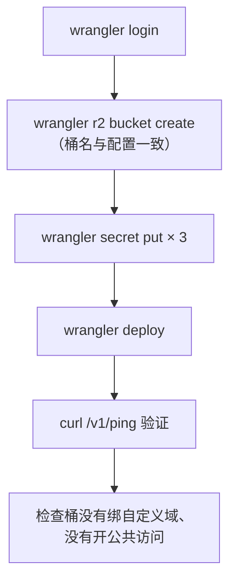

# wrangler 与部署

wrangler 是 Cloudflare 的命令行工具：建资源、本地开发、灌密钥、部署、看日志、回滚，全靠它。它的价值在于**把 Worker 的全部配置写成一个进仓库的文件**：路由、binding、兼容日期、定时任务都在 `wrangler.toml` 里，部署就是把这份声明推上去，而不是去控制台点。本章以 hatch-recordwall 的曲库 Worker 为例，走一遍从零到上线的完整流程，以及几个真实踩过的坑。

> **版本说明**：本章基于 **wrangler 4.x**。hatch-recordwall 的 `package.json` 声明的是 `wrangler@^4.40.0`，写作时锁定安装的是 4.135.0；兼容日期为 `compatibility_date = "2026-09-18"`。wrangler 大版本之间有破坏性变更（例如 3.x 的 `kv:namespace` 写法在 4.x 中已改为 `kv namespace`），照抄网上的旧命令前先看版本。

## 安装：作为项目依赖

不要全局安装 wrangler，把它装进 Worker 所在的包，版本跟着锁文件走：

```bash
pnpm -C apps/vault add -D wrangler @cloudflare/workers-types typescript
pnpm -C apps/vault exec wrangler --version
pnpm -C apps/vault exec wrangler login   # 浏览器里授权，凭据存在本机
```

唱片墙的 `package.json` 里只有几条脚本：

```json
{
  "scripts": {
    "dev": "wrangler dev --ip 0.0.0.0",
    "ship": "wrangler deploy",
    "tail": "wrangler tail",
    "typecheck": "tsc --noEmit -p tsconfig.json"
  }
}
```

注意部署脚本叫 `ship` 而不是 `deploy`，后面会讲为什么。

## 配置文件

wrangler 4 同时支持 `wrangler.toml` 和 `wrangler.jsonc` 两种格式，内容等价；Cloudflare 新的项目模板倾向于用 `jsonc`。已有项目用哪种都行，别两种同时放。下面是唱片墙配置的结构（桶名和域名换成了示例值）：

```toml
name = "my-vault"                 # Worker 的名字，也是控制台里的名字
main = "src/index.ts"             # 入口，wrangler 自己打包 TS，不需要单独的构建步骤
compatibility_date = "2026-09-18" # 运行时行为锁定在这一天

# binding 名是代码里 env.VAULT 认的名字，改了代码就找不到
[[r2_buckets]]
binding = "VAULT"
bucket_name = "my-vault"

# 令牌不写在这里（这个文件进仓库），用 wrangler secret put 灌进去

# 用自己的域名，不用 *.workers.dev
[[routes]]
pattern = "vault.example.com"
custom_domain = true
```

等价的 `wrangler.jsonc`：

```jsonc
{
  "name": "my-vault",
  "main": "src/index.ts",
  "compatibility_date": "2026-09-18",
  "r2_buckets": [{ "binding": "VAULT", "bucket_name": "my-vault" }],
  "routes": [{ "pattern": "vault.example.com", "custom_domain": true }]
}
```

### compatibility_date：把运行时钉住

Cloudflare 会不断修正运行时的行为（有些修正会改变现有代码的结果）。`compatibility_date` 告诉平台「按这一天的行为运行我的代码」，之后的行为变更不会自动影响你。

- 新项目写当天的日期
- 升级时改日期，对照官方的兼容性变更列表看中间改了什么，本地跑一遍再部署
- `compatibility_flags` 用来单独开关某项行为，最常用的是 `nodejs_compat`（第 4 章）

### custom_domain 与 routes

`custom_domain = true` 让这个域名完整地指向 Worker：部署时 wrangler 会自动创建 DNS 记录并签发证书，不用去控制台操作。前提是这个域名的 DNS 托管在同一个 Cloudflare 账号下。另一种写法 `pattern = "example.com/api/*"` 加 `zone_name`，是把一个已有站点的部分路径交给 Worker。

关于 `*.workers.dev`：它是平台给的默认地址，适合临时测试，不适合做正式地址（第 2 章）。不需要时可以在配置里写 `workers_dev = false` 关掉它，少一个入口。

这里也要再强调第 3 章那个坑：**Worker 的自定义域和 R2 桶的自定义域是两回事**。前者后面站着你的 Worker 和它的鉴权；后者把桶直接公开到 CDN 上。唱片墙的配置文件里专门写了注释区分两者。

## 密钥：secret 与 .dev.vars

| 类型 | 放哪 | 进仓库吗 | 例子 |
|---|---|---|---|
| 普通变量 | 配置文件的 `[vars]` | 进 | 日志级别、功能开关的默认值 |
| 线上 secret | `wrangler secret put` | 不进 | 令牌、API 密钥、TOTP 密钥 |
| 本地 secret | `.dev.vars` | 不进（`.gitignore`） | 本机开发用的假令牌 |

唱片墙的三样 secret：

```bash
pnpm -C apps/vault exec wrangler secret put READ_TOKEN    # 交互式输入，不进 shell 历史
pnpm -C apps/vault exec wrangler secret put WRITE_TOKEN
pnpm -C apps/vault exec wrangler secret put TOTP_SECRET
pnpm -C apps/vault exec wrangler secret list               # 只列名字，看不到值
```

令牌值自己随机生成：

```bash
node -e 'console.log(crypto.randomBytes(32).toString("base64url"))'
```

用 base64url 是为了省事：只读令牌在一条路由里会出现在 URL 查询参数中（锁屏封面由操作系统直接请求，挂不了自定义请求头），base64url 不需要转义。

本地开发读 `.dev.vars`，格式和 `.env` 一样：

```text
READ_TOKEN=dev-read-token
WRITE_TOKEN=dev-write-token
TOTP_SECRET=JBSWY3DPEHPK3PXP
```

这里的值都是**公开的占位值**（那串 TOTP 密钥是广为流传的示例值），只用于本机。线上 secret 和本地值必须不同。

几条规矩：

- secret **设置后立即生效**，不需要重新部署
- 配置文件里绝不写任何密钥；仓库里的配置文件只有资源名
- 代码要能识别「secret 没配」的情况，并选择**拒绝服务**而不是敞开：唱片墙在两把令牌都没配时整体返回 503
- 一个 secret 如果要同时灌到两个地方（唱片墙的只读令牌既在 Worker，也打包进 App），要写清楚「两边必须逐字一致」，对不上时客户端只会看到一路 401

## 本地开发

```bash
pnpm -C apps/vault dev   # 即 wrangler dev --ip 0.0.0.0，默认监听 8787
```

`wrangler dev` 在本机用 workerd（Workers 的开源运行时）跑你的代码，R2、KV、D1、DO 都在本地模拟，数据存在 `.wrangler/state/` 下（要加进 `.gitignore`）。几个实用点：

- `--ip 0.0.0.0` 让同一局域网的真机也能连上；iOS 模拟器和 Mac 共用网络栈，用 `localhost` 即可
- 本地模拟的存储和线上**完全隔离**，可以放心地写和删
- 需要连线上真实资源调试时用 `wrangler dev --remote`，此时读写的是生产数据，要小心
- D1、KV 的命令行操作同样要区分 `--local` 和 `--remote`，线上操作一定显式写 `--remote`

## 类型

`env` 里有哪些 binding，TypeScript 需要知道。两种做法：

| 做法 | 怎么做 | 特点 |
|---|---|---|
| 手写 `Env` + `@cloudflare/workers-types` | tsconfig 里 `"types": ["@cloudflare/workers-types"]`，自己写 `interface Env` | 唱片墙的做法；简单直接，Env 要和配置手动保持一致 |
| `wrangler types` 生成 | 按配置文件和兼容日期生成 `worker-configuration.d.ts` | 类型和配置自动一致，运行时类型也按兼容日期生成 |

用生成的方式时，把 `wrangler types` 加进脚本，改完配置跑一次，生成文件进仓库，类型检查时就能发现「代码用了一个配置里没有的 binding」。

## 部署

```bash
pnpm -C apps/vault ship   # 即 wrangler deploy
```

`wrangler deploy` 做的事：打包 `main` 入口、上传、应用配置里的 binding 和路由、创建自定义域的 DNS 记录和证书，然后让新版本接管全部流量。通常几秒钟完成。

### 坑：脚本不能叫 deploy

唱片墙的 README 里记着一次真实事故：`pnpm deploy` 是 **pnpm 自己的内置命令**（用于把 workspace 里的某个包连同依赖导出到一个目录），同名的 package.json 脚本根本不会被执行；再加上 `--version` 之类的参数又是 pnpm 的全局参数，整条命令可能变成「打印 pnpm 的版本号」并以退出码 0 结束。看起来部署成功了，其实什么都没发生。

教训有两条：

- 脚本名避开包管理器的内置命令，唱片墙因此叫 `ship`
- **退出码 0 不等于部署成功**。部署后要有一个独立的验证步骤，比如请求 `/v1/ping` 看返回的角色和版本

```bash
curl -s -H "Authorization: Bearer $READ_TOKEN" https://vault.example.com/v1/ping
# {"ok":true,"role":"reader"}
```

### 第一次上线的完整流程



```bash
pnpm -C apps/vault exec wrangler r2 bucket create my-vault
pnpm -C apps/vault exec wrangler r2 bucket list
# 往桶里放一个测试对象（--remote 表示线上桶）
pnpm -C apps/vault exec wrangler r2 object put my-vault/test/hello.txt --file ./hello.txt --remote
```

## 版本、灰度与回滚

每次 `wrangler deploy` 都会产生一个新的**版本**（version），以及一次把流量指向它的**部署**（deployment）。这两件事也可以分开做：

```bash
# 只上传新版本，不接流量
pnpm -C apps/vault exec wrangler versions upload --message "range 修复"

# 查看版本列表，拿到 version id
pnpm -C apps/vault exec wrangler versions list

# 灰度：新版本 10%，其余流量留给旧版本（格式 <version-id>@<百分比>）
pnpm -C apps/vault exec wrangler versions deploy <新版本id>@10% <旧版本id>@90%

# 看部署历史；出问题回滚到上一个版本
pnpm -C apps/vault exec wrangler deployments list
pnpm -C apps/vault exec wrangler rollback
```

几个注意点：

- 回滚只回滚**代码和配置**，不回滚数据。R2 里写坏的对象、D1 里执行过的迁移，要自己处理。所以数据库迁移要写成向前兼容的（新旧代码都能跑），[《部署与 CI/CD》](../deploy-release/)讲回滚的那一章同样适用
- secret 不跟着版本走，回滚后用的仍是当前的 secret
- 个人项目流量小，灰度意义有限；直接部署 + 部署后验证 + 必要时回滚，已经够用

## 日志与观测

```bash
pnpm -C apps/vault tail   # 实时看线上的 console.log、异常和请求
```

`wrangler tail` 适合排查当下的问题。需要保存和检索历史日志时，在配置里开启 Workers 的观测功能：

```toml
[observability]
enabled = true
head_sampling_rate = 1   # 采样比例，流量大时调低
```

日志里要注意的事和其他服务一样（[《可观测性与性能》](../observability-performance/)）：不打印令牌和个人信息。唱片墙的只读令牌在图片路由里会出现在 URL 中，于是会进访问日志；它在 README 里明确承认这一点，并把这把令牌定位为「低价值、丢了就换」，真正的机密（写令牌、TOTP 密钥）从不出现在 URL 里。

## 在 CI 里部署

唱片墙是手动部署的（作者明确写了「没有 CI，不为了看起来完整先搭起来」）。需要 CI 时，核心只有两件事：一个权限最小的 API 令牌，和 `wrangler deploy`。

```yaml
# .github/workflows/vault.yml
name: deploy vault
on:
  push:
    branches: [main]
    paths: ["apps/vault/**"]
jobs:
  deploy:
    runs-on: ubuntu-latest
    steps:
      - uses: actions/checkout@v4
      - uses: pnpm/action-setup@v4
      - uses: actions/setup-node@v4
        with:
          node-version: 22
          cache: pnpm
      - run: pnpm install --frozen-lockfile
      - run: pnpm -C apps/vault typecheck
      - run: pnpm -C apps/vault exec wrangler deploy
        env:
          CLOUDFLARE_API_TOKEN: ${{ secrets.CLOUDFLARE_API_TOKEN }}
          CLOUDFLARE_ACCOUNT_ID: ${{ secrets.CLOUDFLARE_ACCOUNT_ID }}
```

API 令牌在 Cloudflare 控制台创建，从「编辑 Workers」一类的模板开始，**只勾选需要的权限和账号**，不要用全局 API Key。Cloudflare 也提供官方的 `wrangler-action`，做的事情相同。

## 多环境

需要预发环境时，用配置里的 `env` 段：

```toml
name = "my-vault"
main = "src/index.ts"
compatibility_date = "2026-09-18"

[[r2_buckets]]
binding = "VAULT"
bucket_name = "my-vault"

[env.staging]
name = "my-vault-staging"
[[env.staging.r2_buckets]]
binding = "VAULT"
bucket_name = "my-vault-staging"
```

```bash
pnpm -C apps/vault exec wrangler deploy --env staging
pnpm -C apps/vault exec wrangler secret put READ_TOKEN --env staging
```

binding 类配置**不会从顶层继承**到环境里，每个环境要写全；secret 也要按环境分别灌。预发环境用独立的桶和数据库，绝不和生产共用。唱片墙的 README 里有同样的隔离思路：曲库不和另一个项目的生产资源放在同一个账号的同一组资源下，也不挂在那个项目的域名下面。

## 本章要点

- 本章基于 wrangler 4.x；wrangler 作为项目依赖安装，版本跟着锁文件
- 配置文件（`wrangler.toml` 或 `wrangler.jsonc`）进仓库，只写资源名，不写密钥
- `compatibility_date` 把运行时行为钉在某一天，升级时对照变更列表
- 线上密钥用 `wrangler secret put`，本地用 `.dev.vars`；secret 没配时代码要拒绝服务
- `wrangler dev` 在本地完整模拟存储；操作线上数据的命令一律显式加 `--remote`
- 部署脚本别叫 `deploy`（会被 pnpm 内置命令吞掉）；部署后用独立请求验证
- 版本和部署可以分开，`wrangler rollback` 只回滚代码不回滚数据
- CI 里用最小权限的 API 令牌；多环境的 binding 和 secret 要逐个环境配全

## 动手练习

继续用[第 4 章练习](04-workers-runtime.md#动手练习)里的 `edge-lab` 项目，三道题都只在本机跑，不会部署任何东西。

1. **复现「脚本叫 deploy」的坑**：在 `edge-lab/package.json` 的 `scripts` 里加 `"deploy": "echo DEPLOYING"`，分别运行 `pnpm deploy` 和 `pnpm run deploy`；再把脚本改名为 `ship`，运行 `pnpm ship`。

   验证：`pnpm deploy` 的输出里**没有** `DEPLOYING`（出现的是 pnpm 自己的 deploy 命令的报错或用法提示）；`pnpm run deploy` 和 `pnpm ship` 都打印出 `DEPLOYING`。

   参考答案：`pnpm <名字>` 遇到内置命令时执行内置命令，不会去找同名脚本；显式的 `pnpm run` 才一定跑脚本。所以脚本名避开内置命令，部署后还要用一个独立请求验证。

2. **让类型检查发现配置和代码不一致**：在 `edge-lab` 里运行 `pnpm exec wrangler types`，看生成的 `worker-configuration.d.ts`；然后把 `wrangler.toml` 里的 R2 binding 名从 `VAULT` 改成 `STORE`，重新生成，再跑 `pnpm exec tsc --noEmit`（tsconfig 的 `types` 指向生成的文件，代码里的 `env` 用生成的 `Env` 类型）。

   验证：第一次生成后 `grep VAULT worker-configuration.d.ts` 能看到 `VAULT: R2Bucket`；改名后 `tsc` 报错，指出 `VAULT` 在 `Env` 上不存在。

   参考答案：把 `wrangler types` 放进脚本、生成文件进仓库，binding 改名这类错误就在类型检查阶段暴露，而不是上线后 `env.VAULT` 为 `undefined`。

3. **验证 binding 不从顶层继承**：在 `wrangler.toml` 末尾加一段只有名字的 `[env.staging]`（`name = "edge-lab-staging"`），不写 `r2_buckets`；用 `pnpm exec wrangler dev --env staging` 启动，请求一次读 R2 的路由。

   验证：请求返回 500，终端里能看到类似 `Cannot read properties of undefined` 的错误，指向 `env.VAULT`；把 `[[env.staging.r2_buckets]]` 补上后恢复正常。

   参考答案：顶层的 `[[r2_buckets]]` 不会进入 `env.staging`，每个环境要把 binding 写全，并指向独立的桶。
