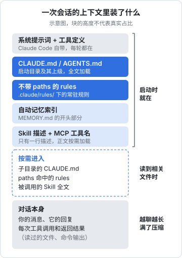
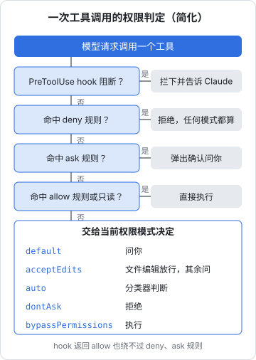
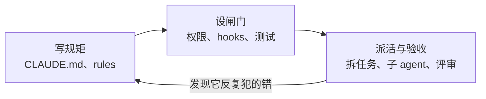

# 编码 agent 怎么工作

这本书讲怎么把编码 agent 用成一个靠得住的帮手：它到底是怎么干活的，规矩该写在哪儿、怎么写，哪些事要用机器强制而不是靠嘱咐，怎么派活、怎么并行、怎么验收。主要例子是 Claude Code，真实案例取自本书架作者自己的三个项目：hatch-shelf（Expo 离线书架）、hatch-counter（NestJS + Postgres 的门店管理）和 hatch-recordwall（Expo / Electron / Cloudflare Worker 播放器）。

**适合谁**：已经在用 Claude Code、Cursor、Codex 这类工具写代码，觉得它「有时候很神、有时候很蠢」，想把成功率稳定下来的开发者。读过[《大模型原理科普》](../llm-fundamentals/)和[《Agent 原理与设计》](../agent-principles/)更好，没读过也不影响。

**怎么读**：第 1 章建立心智模型，第 2–4 章是「写规矩、设闸门」的三件套（CLAUDE.md、按路径加载的 rules、hooks），第 5–7 章讲派活、管 monorepo 和验收，第 8 章是踩坑合集。每章都能单独查，但第 1 章建议先读。

> 本书按 2026 年 11 月的 Claude Code 编写。它迭代很快，命令、配置字段和默认值会变，动手前以官方文档（code.claude.com 上的 Claude Code 文档）和会话里的 `/help` 为准。本书尽量讲清「为什么」，这部分不太会过时。

## 它不是更聪明的自动补全

自动补全看你光标前后几十行，猜下一段代码。编码 agent 不一样：它拿到一个任务，**自己决定读哪些文件、跑哪些命令、改哪几处，再看结果决定下一步**，直到它认为做完了。

| | 自动补全 | 聊天问答 | 编码 agent |
|---|---|---|---|
| 输入 | 光标附近的代码 | 你贴过去的片段 | 整个仓库 + 终端 |
| 能动手吗 | 只能建议 | 只能建议 | 能读写文件、跑命令 |
| 谁决定下一步 | 你 | 你 | 它自己 |
| 出错怎么发现 | 你看 | 你看 | 它跑命令看报错，或者你看 |

最后一行是关键。agent 的价值不在「写得快」，而在于**它能自己闭环**：改完跑类型检查、跑测试、看报错、再改。闭环越完整，你越能放手；闭环断了（没有测试、命令跑不起来、报错不说人话），它就只是一个会打字很快的实习生。

## agent loop：一圈一圈地转

所有编码 agent 的核心都是同一个循环：模型决定调用一个工具（读文件、搜符号、改代码、跑命令），程序执行后把结果原样塞回上下文，模型据此决定下一圈干什么，直到它不再调用工具。循环的结构和停止条件见[《Agent 原理与设计》第 2 章](../agent-principles/02-agent-loop.md#循环的骨架)。

这意味着两件事：

1. **它看到的世界 = 它的上下文**。没读过的文件它不知道，没跑过的命令它不知道结果。它说「我已经确认过了」，要看它是否真的调用过工具去确认
2. **每一圈都要花上下文**。读一个 2000 行的文件，这 2000 行就留在上下文里。任务越大、读得越多，上下文越挤，后面就越容易「忘事」

## 工具箱

Claude Code 内置的主要工具：

| 工具 | 做什么 | 备注 |
|---|---|---|
| `Read` | 读文件（也能看图片、PDF） | 读工作目录内的文件默认不需要审批 |
| `Edit` / `Write` | 精确替换一段文本 / 整个写入文件 | 默认要你批准 |
| `Bash` | 跑 shell 命令 | 除一小撮只读命令外默认要批准 |
| `Glob` / `Grep` | 按文件名找文件 / 按内容搜索 | 只读 |
| `WebFetch` / `WebSearch` | 抓网页 / 搜索 | 查最新文档靠它 |
| `Agent` | 派一个子 agent 去干活 | 第 5 章细讲 |
| `Skill` | 加载一个 Skill 的完整说明 | 第 3 章会和 rules 对比 |

此外还可以通过 MCP 接入外部工具（数据库、浏览器、设计工具等），这属于[《工具设计与 MCP》](../tools-and-mcp/)的话题。

工具名有实际用途：权限规则、hooks 的匹配条件都按工具名写，比如 `Bash(pnpm test *)`、`Edit|Write`。后面几章会反复用到。

## 上下文里装了什么

每次会话开始，Claude Code 会先往上下文里放一批东西，然后才轮到你的第一句话：



几点值得记住：

- **CLAUDE.md 每一轮都在**。写进去的每一行都在消耗上下文、稀释注意力。所以官方建议单个文件控制在 200 行以内（2026 年 11 月的 memory 文档原话是「target under 200 lines」，更长会多占上下文、降低遵守率），这是第 2 章的主题
- **有些东西是按需进来的**：子目录里的 CLAUDE.md、带 `paths` 的 rules、Skill 的正文，都在 agent 碰到相关文件或任务时才加载。这是第 3 章的主题
- **自动记忆**（auto memory）是 Claude 自己记的笔记，存在 `~/.claude/projects/<项目>/memory/` 下，每次启动加载索引文件 `MEMORY.md` 的开头一部分（前 200 行或 25KB，以先到者为准）。比如书架作者的记忆里就有一条「提交信息不加 AI 署名」——这是他纠正过一次之后 Claude 自己记下的
- **对话本身才是大头**。读过的文件、跑过的命令输出全在里面。上下文快满时，Claude Code 会做压缩（compaction），把前面的对话总结成摘要，细节可能丢失

会话里输入 `/context` 可以看到各部分大概占了多少。养成习惯：觉得它开始犯糊涂时，先看一眼上下文是不是已经很满了。

## 权限：它能做什么、要不要问你

agent 能跑命令，就意味着它能 `rm -rf`、能 `git push --force`、能把 `.env` 读出来。Claude Code 用**权限模式 + 权限规则**两层来控制。

### 权限模式

> [!WARNING]
> 本节的模式名、默认模式和切换方式按 2026 年 11 月 code.claude.com 的「Choose a permission mode」文档整理（对应 Claude Code v2.1.28x），这部分改动频繁，以官方文档和 `claude --help` 为准。

| 模式 | 行为 | 什么时候用 |
|---|---|---|
| `default`（界面上叫 Manual） | 只有读文件不用问，编辑、跑命令前都问你 | 刚接触一个项目、做有风险的事 |
| `acceptEdits` | 自动接受工作目录内的文件编辑和 `mkdir`、`mv` 这类常见文件操作，其他命令照样问 | 日常写代码 |
| `plan` | 只读、只规划，不改源码，计划给你批了才动手；可用 auto 模式时，分类器认可的命令也能跑 | 大改动之前先对齐方案 |
| `auto` | 不逐条问你，由后台分类器判断每个动作是否符合你的请求 | 信任度高、任务边界清楚时 |
| `dontAsk` | 凡是需要询问的一律拒绝，只做预先允许的事 | 无人值守的脚本、CI |
| `bypassPermissions` | 跳过权限提示 | 只在容器、虚拟机这类隔离环境里用 |

交互会话里按 `Shift+Tab` 在模式之间切换，状态栏会显示当前模式（`manual mode on`、`accept edits on`、`plan mode on`、`auto mode on` 等）。默认的循环是 `default` → `acceptEdits` → `plan`，`auto` 可用时排在最后；`bypassPermissions` 只有用相应参数启动后才进循环，`dontAsk` 从不出现在循环里，只能用 `--permission-mode dontAsk` 指定。启动时指定模式：`claude --permission-mode plan`，CLI 也接受 `manual` 作为 `default` 的别名。

几个容易想当然的地方：

- **新会话默认从哪个模式开始**。v2.1.283 起，在终端或 VS Code 里新开的会话，内置默认是 `auto`（模型或组织设置不支持 auto 时退回 Manual）；`claude -p` 和 Agent SDK 的运行默认仍是 Manual。想固定成别的，在 settings 里写 `permissions.defaultMode`。注意项目级 `.claude/settings.json` 里写 `auto` 或 `bypassPermissions` 不生效，防止 clone 来的仓库替你打开
- **`auto` 不是放任**。分类器默认拦下 force push、`curl | bash`、生产部署和迁移、`git reset --hard` 这类动作，被拦多了会退回逐条询问。但往当前仓库的分支推送、开 PR 在 auto 下默认是放行的，想留一道人工关卡就写 `ask` 规则。它降低的是审批疲劳，不是风险本身
- **有些动作任何模式都不自动放行**：命中显式 `ask` 规则的调用、需要你回答的 `AskUserQuestion`、对关键路径的 `rm`。deny 规则在所有模式下都生效，包括 `bypassPermissions`

### 权限规则

规则写在 settings 文件里，分 `allow`、`ask`、`deny` 三组，**按 deny → ask → allow 的顺序匹配**，先命中的说了算。所以宽泛的 deny 会压过具体的 allow，allow 没法在 deny 上开口子。

```json
{
  "permissions": {
    "allow": [
      "Bash(pnpm typecheck)",
      "Bash(pnpm test *)",
      "Bash(pnpm lint)",
      "Bash(git diff *)",
      "Bash(git status *)"
    ],
    "deny": [
      "Bash(git push *)",
      "Read(./.env)",
      "Read(./.env.*)"
    ]
  }
}
```

模式和规则怎么叠在一起，可以按下图的顺序理解（简化示意，省略了「任何模式都不自动放行」的那几类例外）：



Bash 规则里 `*` 是通配，**要放在子命令后面**：`Bash(git log *)` 只放行 `git log`，`Bash(git *)` 就放行了所有 git 命令。`&&`、`;`、`|` 连起来的复合命令，每一段都要被允许才会自动放行。

settings 文件有好几层，从高到低：组织下发的 managed 设置 → 命令行参数 → 项目本地 `.claude/settings.local.json`（不入库）→ 项目共享 `.claude/settings.json`（入库）→ 用户级 `~/.claude/settings.json`。你在提示框里选「Yes, and don't ask again」时，规则会被写进 `.claude/settings.local.json`。

## 一次完整会话长什么样

以给书架的 `@shelf/spec` 加一条校验为例，一个顺利的会话大概是这样：

```text
你：book.yaml 的 tags 现在允许重复，改成不允许，App 和 CLI 都要生效

Claude：（Read packages/spec/src/schema.ts）
        （Grep "bookManifestSchema" —— 找到 App 导入管线和 shelf-pack 的调用处）
        （Read packages/spec/src/manifest.test.ts）
        计划：在 schema 里给 tags 加去重校验，补两条测试；App 和 CLI 都调用
        同一个 schema，不用各改一遍。
        （Edit schema.ts）（Edit manifest.test.ts）
        （Bash pnpm typecheck）通过
        （Bash pnpm test）通过，新增 2 条
        改好了：……
```

注意它做对了的几件事：先读再改；发现「App 和 CLI 共用 spec」所以只改一处——这正是仓库 CLAUDE.md 里写的原则；改完跑了 CLAUDE.md 要求的检查。这些都不是模型天生就会的，是**你写下的规矩 + 可执行的检查**换来的。

## 你的角色变了

用好编码 agent 之后，你的工作重心会从「写代码」挪到三件事上：



- **写规矩**：把项目里「不说就会做错」的东西写下来，让每个新会话都知道（第 2、3、6 章）
- **设闸门**：把「绝对不能错」的东西变成机器检查，不靠它记住（第 4、7 章）
- **派活与验收**：把任务拆成它能闭环的大小，并行跑，最后由你验收（第 5、7 章）

这个循环的最后一条箭头最重要：**它犯了一次的错，是给你的信号**。同一个错犯第二次，就该落到规矩或闸门里，而不是在聊天里再纠正一遍。

## 本章要点

- 编码 agent 的核心是 agent loop：思考 → 调用工具 → 看结果 → 再思考，直到它认为做完了
- 它看到的世界就是它的上下文：没读过的不知道，没跑过的不确定；每读一个文件都在消耗上下文
- 启动时加载的东西（CLAUDE.md、常驻 rules、记忆索引、Skill 描述）每轮都在，要精简；子目录 CLAUDE.md、按路径的 rules、Skill 正文按需进入
- 权限分模式和规则两层，规则按 deny → ask → allow 匹配；新版终端会话默认从 `auto` 开始，`claude -p` 默认 Manual；`bypassPermissions` 只该在隔离环境里用
- 你的工作变成写规矩、设闸门、派活与验收；同一个错出现第二次，就该沉淀成规矩或闸门

## 动手练习

1. **预测权限规则的判定**：在一个测试仓库的 `.claude/settings.json` 里写下 allow `Bash(git log *)`、`Bash(pnpm test *)` 和 deny `Bash(git push *)`，用 `claude --permission-mode default` 启动。先预测，再让 Claude 依次执行：`git log --oneline -3`、`git status`、`git push origin main`、`git log -1 && touch x.txt`。

   验证：第一条直接执行；第二条弹出确认；第三条被拒绝，Claude 收到拒绝原因；第四条也弹出确认。

   参考答案：规则按 deny → ask → allow 匹配；`git status` 不在任何规则里，交给模式决定，Manual 下要问；复合命令要每一段都被允许才自动放行，`touch` 那段没被允许。

2. **看上下文怎么被吃掉**：在一个测试仓库里生成一个大文件 `seq 1 3000 > big.txt`，开一个新会话先输入 `/context` 记下各部分占用，然后让 Claude「读一下 big.txt 并告诉我最后一行」，再输入一次 `/context`。

   验证：第二次对话（messages）那一栏明显变大，其余几栏（系统提示词、工具、记忆文件）基本不变。

   参考答案：读进来的文件内容会一直留在对话里，后面每一轮都带着它；这就是长会话越用越挤的原因，也是第 5 章把大量读取交给子 agent 的理由。

3. **plan 模式只规划不动手**：在一个测试仓库里用 `claude --permission-mode plan` 启动，让它「把 utils.ts 里的 formatDate 改名为 formatDay，所有调用处一起改」。

   验证：它读文件、列出计划和受影响的文件，但没有改任何东西，`git status` 显示工作区干净；你批准计划后它才开始编辑。

   参考答案：plan 模式把「想清楚」和「动手」分开，适合影响面大的改动；批准前顺便核对它列出的调用处是否齐全。
