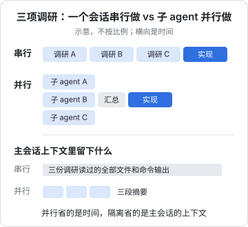
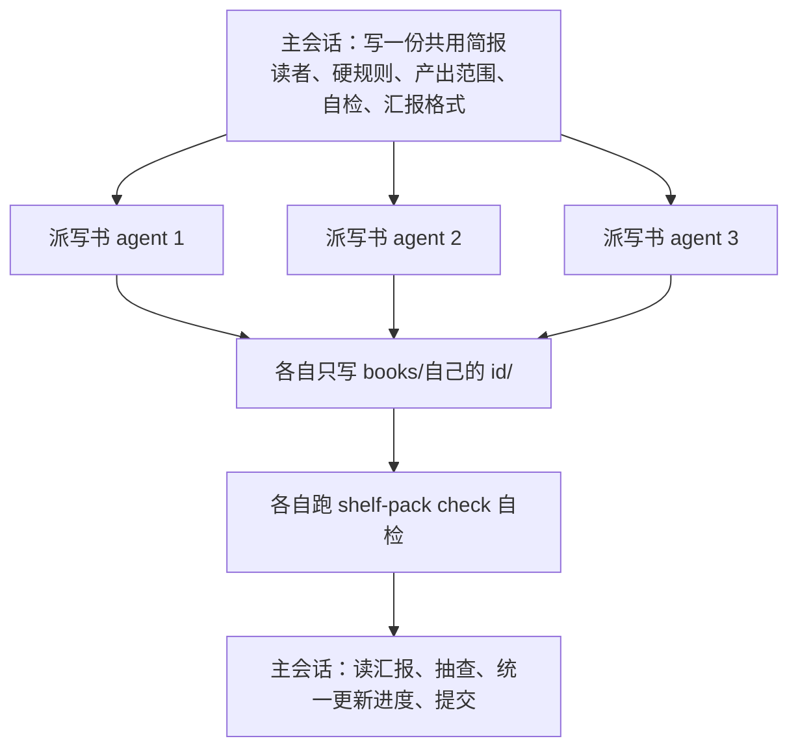

# 子 agent 与并行

一个会话就是一条上下文。让它先调研三个方向、再动手实现，三份调研读过的文件会全部堆在上下文里，实现阶段反而被挤得记不住重点。子 agent 解决的就是这个问题：**把一段工作交给一个独立的上下文去做，只把结论拿回来**。顺带地，几个子 agent 可以同时跑。这一章讲子 agent 怎么用、怎么自定义，以及怎么用 git worktree 让多个 agent 并行改代码而不打架。

## 子 agent 是什么

在 Claude Code 里，主会话可以通过 `Agent` 工具派出子 agent。每个子 agent：

- 有**自己全新的上下文**，看不到主会话的对话历史
- 拿到的输入是：它自己的系统提示词、主会话写给它的任务描述、项目的 CLAUDE.md、一份 git 状态快照。内置的 Explore 和 Plan 例外：为了快和省，它们启动时不带 CLAUDE.md 和 git 状态，所以派它们去查时，项目规矩要写进任务描述里
- 干完活后**只把最终总结**交回主会话，中间读过的文件、跑过的命令都留在它自己的上下文里



这张图说明了子 agent 的两个收益，它们是独立的：

- **隔离**：主会话的上下文保持干净，这在长任务里比速度更重要
- **并行**：几个互不依赖的子任务同时跑，墙钟时间缩短

代价也很明确：子 agent 只知道你写给它的那段任务描述，**交接会丢信息**。它的结论也只是一段文字，你看不到它的推理过程。

## 内置的几种

Claude Code 自带几个子 agent：

| 名称 | 能做什么 | 适合 |
|---|---|---|
| Explore | 只读，快速搜索和分析代码 | 「找出所有调用 X 的地方」「这个模块怎么工作」 |
| Plan | 只读，plan 模式下为规划收集信息 | plan 模式自动使用 |
| general-purpose | 全部工具，能读能改 | 复杂的多步任务 |

最常见的用法就是直接说：

```text
用子 agent 查一下 reader-web 里所有往 RN 发消息的地方，
列出消息类型和发送位置，对照 app/src/reader/bridge.ts 看有没有没定义的类型。
```

主会话会派一个子 agent 去扫，拿回一张清单。你的主会话里只多了这张清单，而不是十几个文件的内容。

## 自定义子 agent

子 agent 定义是一个带 frontmatter 的 Markdown 文件，放在 `.claude/agents/`（项目级，可入库）或 `~/.claude/agents/`（个人级）：

```markdown
---
name: diff-reviewer
description: 评审当前未提交的改动，找正确性问题和违反项目规矩的地方。改完代码、提交之前使用。
tools: Read, Grep, Glob, Bash
model: sonnet
---

你是这个仓库的代码评审。先读 CLAUDE.md 和相关的 .claude/rules/，
然后运行 `git diff HEAD` 看改动。

逐条检查：
1. 正确性：边界条件、错误处理、异步有没有漏 await
2. 项目规矩：有没有在规定位置之外写了本该集中的逻辑
3. 绕过：有没有 eslint-disable、any、被删掉或跳过的测试

只报告问题，每条写清文件、行号、问题、建议。没有问题就说没有。不要修改任何文件。
```

几个关键字段：

| 字段 | 作用 |
|---|---|
| `name` | 唯一标识，调用时用它 |
| `description` | **主会话据此决定什么时候派它**，要写清「做什么 + 什么时候用」 |
| `tools` | 允许的工具；不写则继承全部。评审类 agent 不给 Edit / Write |
| `model` | `sonnet`、`opus`、`haiku`、`inherit` 等；简单的搜索可以用便宜的模型 |
| `isolation` | 设为 `worktree` 时在独立的 git worktree 里运行（见下文） |

调用方式：自然语言（「用 diff-reviewer 看一下」），或者用 `@` 提及确保一定派它。

**评审为什么适合交给子 agent？** 因为它没有参与写代码，没有被主会话的推理过程「带偏」。主会话自己检查自己写的代码，很容易沿着原来的思路觉得没问题；一个只看 diff 和规矩的新上下文，更可能发现盲点。给它代码，别给它你的结论。

## 什么时候该派子 agent

| 适合 | 不适合 |
|---|---|
| 要读很多文件、但只需要结论的调研 | 需要你和它来回讨论的设计 |
| 几个互不依赖的子任务 | 前后强依赖、一步要看上一步结果的任务 |
| 需要「新眼睛」的评审、核实 | 一两次工具调用就能搞定的查询 |
| 会产生大量输出的操作（跑全量测试、扫日志） | 需要主会话上下文才能做对的事 |

最后一条是最常见的误用：主会话里已经讨论了半小时的约束和取舍，派一个子 agent 去实现，它一样都不知道。要么把约束完整写进任务描述，要么就在主会话里做。

## 写好任务描述

子 agent 只知道你写给它的东西，所以任务描述就是它的全部世界。一份好的描述包含：

```text
目标：给 shelf-pack 的 check 命令加一条警告：assets/ 下有图片没被任何章节引用。
背景：判断书籍结构的逻辑只能写在 packages/spec，CLI 只调用它。
      现有规则的写法参考 packages/spec/src/lint.ts 和 lint.test.ts。
已排除：「引用的图片不存在」和「远程图片」两条规则已经有了，不用重复。
范围：只改 packages/spec 和对应测试，不要动 app/。
完成标准：pnpm typecheck 和 pnpm test 通过。
汇报：改了哪些文件、新规则的错误信息原文、测试结果。
```

目标、背景、已排除的方向、范围、完成标准、汇报格式——和给人类同事派活一样。范围写得越窄，结果越可控。

## 并行改代码：git worktree

子 agent 并行**读**没有问题，并行**写**就会打架：两个 agent 同时改同一个工作目录，文件互相覆盖、测试结果互相污染。解决办法是 git worktree：同一个仓库检出多个独立的工作目录，各在各的分支上。

### 手动开并行会话

> [!WARNING]
> `--worktree` 的目录、分支和清理规则按 2026 年 11 月 code.claude.com 的 Worktrees 文档整理，以官方文档为准。

```bash
# 终端 1
claude --worktree reader-toc
# 终端 2
claude --worktree import-zip
```

每条命令（简写 `-w`）会在仓库根的 `.claude/worktrees/<名字>/` 下建一个 worktree，分支名是 `worktree-<名字>`，然后在里面启动 Claude。记得把 `.claude/worktrees/` 加进 `.gitignore`。

两个默认行为要知道：

- **从哪儿分出来**：默认从远端默认分支（通常是 `origin/main`）分出，而不是你当前的 `HEAD`，所以本地没推送的提交、正在做的功能分支不会带过去。想从当前进度分出，在 settings 里设 `"worktree": { "baseRef": "head" }`
- **退出时怎么清理**：worktree 里没有改动、没有新提交时，未命名的会话自动删掉 worktree 和分支，命名过的会话会先问你；有改动就问你保留还是删除，保留的下次用退出时打印的 `claude --worktree <名字> --resume` 回来。`claude -p` 没有退出提示，它建的 worktree 不会自动清理

hatch-counter 的 `.claude/worktrees/` 下就留着一个这样的 worktree，是某次会话结束时选择保留的。

### 让子 agent 自动隔离

在子 agent 定义里加 `isolation: worktree`，它每次运行都会拿到一个临时 worktree，没改动就在结束时自动删掉，有改动的留在磁盘上，等定期清理：

```markdown
---
name: refactorer
description: 跨多个文件做机械性重构，然后跑测试汇报结果
isolation: worktree
---

把要求的重构应用到所有受影响的文件，跑 pnpm typecheck 和 pnpm test，汇报结果。
```

也可以直接对主会话说「每个子 agent 用独立的 worktree」。

### worktree 的几个坑

- **依赖要重新装**。worktree 是一份全新的检出，`node_modules` 不在里面。pnpm 的全局 store 让重装很快，但仍要执行一次 `pnpm install`
- **被 gitignore 的文件不会跟过来**，比如 `.env`。在仓库根放一个 `.worktreeinclude`，用 `.gitignore` 的语法列出要复制的文件：

  ```text
  .env
  apps/api/.env
  ```

- **端口会冲突**。两个 worktree 都起 `pnpm dev`，会抢同一个端口。hatch-recordwall 的 `.claude/launch.json` 里把 Metro、Worker、Electron 渲染进程分别固定在不同端口，并行时要给其中一个改端口
- **生成目录要重新生成**。hatch-shelf 的阅读器 HTML 和示例书模块不入库，新 worktree 里要先跑 `pnpm app build:assets`
- **最后要合并**。几个分支各自改完，合并回来时仍可能冲突。并行之前就把任务按文件边界切开，冲突最少

## 案例：这套书是怎么写出来的

你正在读的这本书就是并行子 agent 的产物。书架作者的做法：



几个让它跑得稳的设计，都可以照搬到代码任务上：

- **一份共用简报**。所有子 agent 读同一份说明：读者是谁、必读哪些文件、硬规则、怎么自检、汇报不超过几行。规矩只写一次
- **写入范围互不重叠**。每个 agent 只能写自己那本书的目录，「不要改任何其他文件」。范围不重叠，就不需要 worktree，也不会冲突
- **共享状态只由主会话改**。路线图的进度表、导读里的进度页，子 agent 一律不碰，由主会话最后统一更新。否则几个 agent 同时改同一个文件，必然打架
- **不让子 agent 跑 git**。提交是不可逆的协作动作，留给主会话一次性做
- **每个 agent 自带验收**。必须跑通 `shelf-pack check` 才算完成，主会话收到的是「已经过机器检查」的结果
- **汇报要短、要列出拿不准的点**。主会话据此决定哪些地方需要人复核

## 成本

并行不是免费的。每个子 agent 都要重新加载系统提示词和 CLAUDE.md，重新读它需要的文件，token 消耗是实打实的。几条经验：

- 一两次搜索就能回答的问题，自己查，别派子 agent
- 简单的搜索类子 agent 用便宜的模型（`model: haiku`）
- 一次派五个子 agent 去做同一件事再挑最好的，只在结果很重要、且能客观比较时才值得
- 后台运行的子 agent 不会阻塞你，但仍在消耗额度；按 `Ctrl+B` 可以把正在运行的任务转到后台

## 本章要点

- 子 agent 在独立上下文里干活，只交回总结；收益是隔离（主会话干净）和并行（省时间），代价是交接丢信息
- 内置 Explore（只读搜索）、Plan、general-purpose；自定义的放在 `.claude/agents/`，`description` 决定何时被派出
- 评审、核实适合交给子 agent：新上下文没有被原思路带偏；给它代码，别给它结论
- 任务描述写清目标、背景、已排除、范围、完成标准、汇报格式
- 并行写代码用 git worktree：`claude --worktree <名>` 或 `isolation: worktree`；注意依赖、`.env`、端口和生成文件
- 并行稳定的关键是写入范围不重叠、共享状态只由主会话改、每个子任务自带验收
