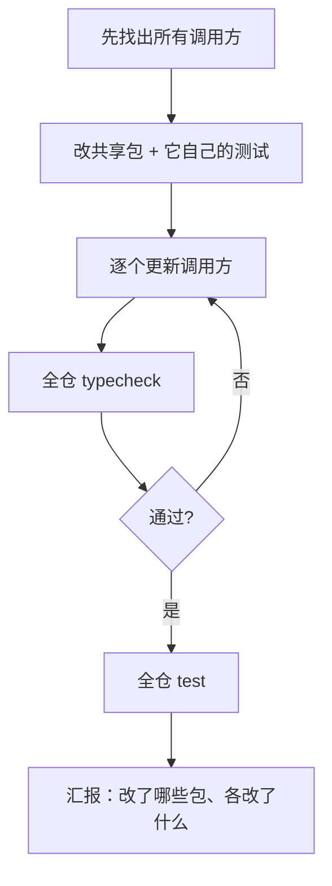

# 用 agent 管理 monorepo

一人公司的代码很容易长成 monorepo：前端、后端、移动端、共享包、几个脚本工具，放在一个 pnpm workspace 里，改一处就能全仓类型检查。monorepo 对 agent 来说既是好事也是挑战：好处是所有相关代码都在眼前，一次改动能跨端闭环；挑战是仓库大、边界多，agent 很容易在离手最近的包里加逻辑，把边界悄悄打穿。这一章讲怎么让 agent 在 monorepo 里守住边界、跑对命令、做好跨包改动。

## monorepo 里 agent 最常犯的错

| 错误 | 例子 | 后果 |
|---|---|---|
| 在错误的包里写逻辑 | 在 App 里重新写了一遍 book.yaml 的校验 | 两处规则慢慢不一致 |
| 共享包引入平台依赖 | 在共享包里 `import fs from 'node:fs'` | 移动端打包时才炸 |
| 在包目录里跑错命令 | 在根上 `pnpm add` 装了本该在 app 里的依赖 | 依赖布局错乱 |
| 改了共享包没改调用方 | 改了函数签名，只改了一个 app | 另一个 app 编译失败，或者运行时才错 |
| 跑了局部检查就收工 | 只在改动的包里跑了测试 | 依赖它的包坏了没发现 |

这些错的共同点是：**agent 不知道包和包之间的关系**。解决办法就是把关系写清楚，再用检查守住。

## 第一步：在 CLAUDE.md 里画地图

三个项目的根 CLAUDE.md 都以一张 workspace 地图开头。hatch-counter 用一段话列出了全部包，每个后面跟一句括号说明：

```markdown
pnpm workspace：`apps/web`（网页端，店主在电脑浏览器里用的那一端，Vite + React）、
`apps/api`（NestJS + Postgres + Drizzle）、`apps/mobile`（Expo，看数为主、现场几件事能办）、
`packages/core`（`@counter/core`，多端共用的业务口径）、`tools/*`（发版、传包、群通知这些工具）；
`deploy/` 是线上那台机器的编排和 nginx 配置，不是 workspace 包。
```

最后半句「不是 workspace 包」很关键：agent 看到 `deploy/` 目录，可能以为它也要跑类型检查、也有 package.json。把例外说出来。

地图要回答三个问题：**有哪些包、各管什么、谁依赖谁**。依赖方向最好显式写出来，hatch-shelf 的写法是：

```markdown
| `packages/spec/` | `@shelf/spec`：book.yaml 的 zod schema、容错解析、导入安全规则。
                     App 与 CLI 共用，**不得依赖 Node 或 RN 专有 API** |
```

## 第二步：把边界写成「只在某处」

monorepo 的架构其实就是一组「某类逻辑只住在某个地方」的约定。把它们一条条写下来：

| 项目 | 边界规则 |
|---|---|
| hatch-shelf | 判断书籍结构的逻辑（容错规则、扩展名白名单、zip slip 检查）只写在 `@shelf/spec`，App 和 CLI 调用它 |
| hatch-shelf | RN ↔ WebView 通信的消息类型只在 `app/src/reader/bridge.ts` 定义 |
| hatch-counter | 口径只写一处：纯判定在 core，跟 SQL 方言绑着的在服务端 `business/*-sql.ts` |
| hatch-counter | 读法一律从 core 取，移动端一个都别重算——同一个店主在两块屏幕上看到的必须是同一个数 |
| hatch-recordwall | `packages/core` 里不许 import 任何 RN / Expo / Electron 的东西，也别直接调全局 `fetch`，走 `platform().fetch` |

注意最后一条后面跟着原因：桌面端渲染进程的 fetch 受同源策略管，而曲库不开 CORS。有了原因，agent 遇到「我就在这儿调一下 fetch 很方便」的诱惑时，才知道为什么不行。

hatch-counter 还把「新东西放哪儿」写成了规矩：「一个业务一个目录、对外只有 `src/index.ts`……**新东西放进它那个业务的目录**，别往顺手的那个文件里塞」。agent 最大的坏习惯就是「往顺手的文件里塞」，直接点名。

## 第三步：把边界变成测试

写在 CLAUDE.md 里的边界仍然只是请求。真正守得住的是测试。hatch-counter 的 core 里有一份 `tests/structure.test.ts`，开头的注释说明了它存在的原因：

```ts
/**
 * core 的目录怎么分、谁能引谁。tsc 和 ESLint 都不管这几条，只能在这儿守。
 * ……
 * - base/ 只引 base/：地基一旦认了业务，业务又离不开地基，圈就回来了；
 * - 目录之间、文件之间都不绕圈。
 */
```

它扫描 core 里所有的相对 import，检查 `base/` 有没有引业务目录、目录之间有没有循环依赖。agent 一旦违反，`pnpm test` 就红，它会自己看报错修好。

同样的思路可以守 hatch-shelf 的「spec 不得依赖 Node 或 RN API」。一份很短的 vitest 测试就够了：

```ts
// packages/spec/src/boundary.test.ts
import { readdirSync, readFileSync } from 'node:fs';
import { join } from 'node:path';
import { fileURLToPath } from 'node:url';
import { describe, expect, it } from 'vitest';

// spec 要同时跑在 RN 和 Node 里，引了任何一边的专有模块，另一边就会在运行时崩。
const SRC = fileURLToPath(new URL('.', import.meta.url));
const FORBIDDEN = /from\s+['"](node:[^'"]+|fs|path|os|child_process|react-native[^'"]*|expo[^'"]*)['"]/;

describe('@shelf/spec 的平台边界', () => {
  const files = readdirSync(SRC).filter((f) => f.endsWith('.ts') && !f.endsWith('.test.ts'));
  for (const f of files) {
    it(`${f} 不依赖 Node 或 RN 专有模块`, () => {
      expect(readFileSync(join(SRC, f), 'utf8')).not.toMatch(FORBIDDEN);
    });
  }
});
```

测试文件本身用了 `node:fs`，所以要把 `*.test.ts` 排除在扫描之外。这类测试还有一个好处：**它是可执行的文档**。下一个读代码的人（或 agent）看到它，就知道这条边界是认真的。

hatch-counter 里还有好几份同类测试：`tests/ipc-channels.test.ts` 检查通道表里每一条都有实现，`tests/palette.test.ts` 守着指令面板和页面动作的对应关系，服务端的 `tests/rls.test.ts` 扫描每张带 `store_id` 的表是否都有行级安全策略。规律是：**rules 里每写下一条「漏了不报错」的规矩，就问一句能不能写成测试**。能写的都写，rules 里留下的就只是真正无法机器检查的。

## 第四步：让命令无歧义

agent 在 monorepo 里跑错命令，多半是因为不知道「在哪儿跑、用什么跑」。

### 给常用包挂短名

hatch-counter 在根 `package.json` 里给每个能起来的 app 挂了短名：

```json
{
  "scripts": {
    "typecheck": "pnpm -r typecheck",
    "test": "pnpm -r test",
    "api": "pnpm -C apps/api",
    "web": "pnpm -C apps/web",
    "mobile": "pnpm -C apps/mobile"
  }
}
```

CLAUDE.md 里一句话说明：「`pnpm <短名> <脚本>` 就是 `pnpm -C <目录> <脚本>`」。于是 agent 永远在仓库根执行 `pnpm api dev`、`pnpm web build`，不用 `cd` 来 `cd` 去，也不会在错误的目录里执行。hatch-shelf 的 `pnpm app ios` 是同一个思路（它用的是 `pnpm --filter app`）。

### 全仓检查用递归

`pnpm -r typecheck`、`pnpm -r test` 会在每个包里各跑各的。完成标准写全仓命令，而不是某个包的命令，这样改了共享包、坏了下游，一定能发现。

### 安装依赖的规矩

monorepo 里装依赖最容易出事。把规矩写死：

```markdown
- 依赖用 `npx expo install <pkg>`（在 `app/` 下执行）安装，以获得与 SDK 匹配的版本
```

这是 hatch-shelf 的写法：指定命令、指定目录、说明原因。Expo 项目尤其要这样，因为 `pnpm add` 装的版本可能和当前 SDK 不匹配，而 agent 的训练数据里常见的是 `npm install`。

依赖布局本身也要写进去。hatch-shelf 用 `node-linker=hoisted`，hatch-counter 和 hatch-recordwall 用 `shamefully-hoist=true`，三者在 `.npmrc` 里都用注释写明了为什么（RN 的 Metro、autolinking 在 pnpm 严格的符号链接布局下踩过坑，现有布局是验过能跑通的）。hatch-counter 的 `build.md` rule 更进一步：「`.npmrc` 留在仓库根……不改：改它等于整仓的依赖布局重排一遍」。agent 遇到奇怪的模块解析错误时，第一反应往往是「改一下 `.npmrc` 试试」，这条规矩正好拦住。

## 跨包改动的工作流

改共享包是 monorepo 里风险最大的操作。推荐让 agent 按这个顺序走：



第一步最容易被跳过。可以直接在任务里要求：

```text
改 @shelf/spec 的 resolveBook 签名之前，先列出 app 和 tools 里所有调用它的地方，
给我看一下影响范围，确认后再动手。
```

这是 plan 模式最适合的场景：按 `Shift+Tab` 切到 plan 模式，让它只读、只规划，把影响范围和步骤列给你，你确认后再放它改。

hatch-counter 的「客户端版本线」是跨包改动的一个极端例子：服务端接口的破坏性改动必须分四步走（先只做加法 → 发客户端 → 看铺开情况 → 抬线并删老路），而且「最低版本线必须跟那次破坏性改动同一个提交走」。这种跨越多次发版的流程，agent 自己绝对想不到，只能写进 rules，并用 `tests/min-version.test.ts` 兜底。

## 大仓库的上下文管理

monorepo 大了以后，上下文会成为瓶颈：

- **按包分层写说明**。根 CLAUDE.md 只写全局的东西；各包的细则放子目录 CLAUDE.md 或带 `paths` 的 rules。改服务端的会话不用加载移动端的规矩
- **指向文档，而不是复制文档**。hatch-counter 的 CLAUDE.md 里几乎每条规矩后面都跟着「见 `docs/现行/xxx.md`」，正文只留一句话
- **调研交给子 agent**。「这个改动会影响哪些地方」这种需要扫很多文件的问题，派 Explore 子 agent 去做，主会话只接收结论
- **启动目录有讲究**。只改一个包时，可以在那个包的目录里启动 Claude，它会加载那个目录及其上级的 CLAUDE.md；但完成标准里的全仓命令仍然要在根上跑。一般来说，在仓库根启动最省心
- **排除别人的说明**。如果 monorepo 里有和你无关的子项目带着自己的 CLAUDE.md，可以在 `.claude/settings.local.json` 里用 `claudeMdExcludes` 按路径排除

## 本章要点

- monorepo 里 agent 最常见的错是不知道包之间的关系：在错误的包里写逻辑、给共享包引入平台依赖、改了共享包漏了调用方
- 根 CLAUDE.md 开头画 workspace 地图：有哪些包、各管什么、谁依赖谁、哪些目录不是包
- 架构边界写成「某类逻辑只在某处」，带上原因；再尽量写成测试，比如扫 import 的结构测试
- 命令要无歧义：根上挂短名、完成标准用 `pnpm -r` 全仓检查、安装依赖指定命令和目录
- 跨包改动先列影响范围（适合 plan 模式），再改共享包、逐个改调用方、全仓检查
- 大仓库按包分层写说明，指向文档而非复制文档，调研交给子 agent
