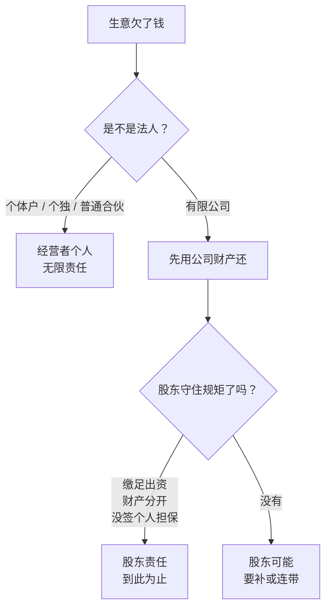

# 公司是什么

很多人第一次认真想「开公司」这件事，脑子里浮现的是一串手续：核名、执照、刻章、开户、报税。手续当然要办，但它们只是入口。真正需要先弄明白的是另一个问题：**营业执照一拿到手，你和这家公司之间是什么关系，你从此要为什么负责，又不必为什么负责。**

这本书只讲这件事。手续怎么办，书架上的[《国内合规实务》](../opc-compliance-cn/)已经写过；这里讲的是手续背后的规则：公司是什么、有限责任到哪里为止、注册资本意味着什么、公司里每个角色要担什么、合伙怎么分股权、公司出了事会怎样落到你头上，以及一家公司怎样收场。

> [!NOTE]
> 本书讲的是框架和常见情形，不是法律意见。书中涉及的法律以 2024 年 7 月 1 日起施行的新《公司法》和现行《民法典》等为准，但法律会修订、司法解释会更新、各地执行口径也不完全一样。遇到具体纠纷、大额出资、股权安排，请找律师。法律原文可以在国家法律法规数据库（flk.npc.gov.cn）免费查到。

## 这本书怎么读

| 章 | 回答的问题 |
|---|---|
| 1 公司是什么 | 法人、独立财产、有限责任分别是什么意思 |
| 2 有限责任的边界 | 什么情况下股东要替公司还债 |
| 3 注册资本 | 认缴的钱什么时候必须拿出来，能不能改小 |
| 4 公司里的角色 | 股东、董事、监事、经理、法定代表人、财务负责人各担什么 |
| 5 合伙与股权 | 股权怎么分，有人要走怎么办 |
| 6 日常义务与信用 | 不年报、地址失联会怎样，信用怎么修 |
| 7 公司出事时 | 公司被告、被执行，你个人会受什么影响 |
| 8 公司的终点 | 转让、歇业、注销、被吊销各是什么结果 |

第 1、2 章是地基，建议按顺序读。第 3 到第 8 章可以按需要跳着读，但第 4 章「不要给别人挂名」那一节，即使不打算开公司也值得看一眼：它是普通职场人最容易在不知情中卷进去的风险。

## 三个概念：法人、独立财产、有限责任

### 法人：法律造出来的「人」

法律上能享有权利、承担义务的「人」有两类：一类是**自然人**，就是你我这样的活人；另一类是**法人**，是法律承认的、能以自己名义做事的组织。公司是最常见的法人。

「以自己名义做事」具体是指：

- 公司可以用自己的名字签合同，合同的一方是「某某有限公司」，不是老板本人
- 公司可以拥有财产：银行存款、电脑、商标、房产，登记在公司名下
- 公司可以起诉别人，也可以被别人起诉，被告一栏写的是公司
- 公司要自己纳税，有自己的统一社会信用代码，相当于它的身份证号

可以把公司想成一个没有身体的人。它不会自己说话，需要有人替它开口（法定代表人、董事、经理），这些人在第 4 章讲。但它说的话、签的字、欠的钱，**算它自己的**。

### 独立财产：公司的钱不是你的钱

新《公司法》规定，公司有独立的法人财产，以其全部财产对公司的债务承担责任。

这句话的另一面，是很多老板直觉上不太接受的：**你把钱投进公司以后，这笔钱就是公司的，不再是你的。** 你拥有的是公司的股权，不是公司账上的钱。

举个例子。假设你出资 10 万元设立了一家只有你一个股东的设计公司，公司做了一年，账上有 30 万元。这 30 万元不能想用就转到自己卡上。你要拿钱，只能走有名目的路：发工资（代扣个税）、分红（先交企业所得税，再交个人所得税）、报销真实的公司费用、或者向公司借款并按时归还。这四条路的细节在[《财务与税务》第 5 章](../opc-finance/05-separate-money.md#钱从公司到个人只有四条路)。

如果公司有不止一个股东，随手把公司的钱转给自己，性质会更严重：在多人公司里，这可能构成侵占公司财产，其他股东可以起诉要你返还。

### 有限责任：亏损封顶在出资额

新《公司法》规定，有限责任公司的股东以其**认缴的出资额**为限对公司承担责任。

还是那家设计公司。假设第二年接了一个大项目，垫付了外包费，客户却破产了，公司欠下外包方 50 万元，账上只剩 5 万元。结果是：

- 公司用全部财产（5 万元）还债，还不上的部分，公司可以破产或被强制执行到没有财产为止
- 你作为股东，已经把认缴的 10 万元全部缴进去了，**就不再对剩下的 45 万元负责**
- 外包方不能直接去执行你的房子、你的存款

这就是有限责任：你最多损失你答应投进去的钱。它不是说你什么都不会损失，而是说损失**有上限**。

这里有一个后面会反复出现的细节：上限是「认缴」的出资额，不是「已经实缴」的。如果你认缴 100 万、只缴了 10 万，那么在公司还不上债时，剩下没缴的 90 万你仍然可能要拿出来。第 3 章专门讲这个。

## 公司和老板是两个「人」

理解了上面三个概念，很多日常情境就有了答案。下面这张表把「公司的事」和「你的事」分开：

| 情境 | 是谁的事 | 说明 |
|---|---|---|
| 公司欠供应商货款 | 公司 | 原则上与你个人无关，例外情形见第 2、3、7 章 |
| 你自己的房贷、信用卡 | 你 | 与公司无关，银行不能去扣公司账户 |
| 公司欠税 | 公司 | 但法定代表人可能被阻止出境，见第 7 章 |
| 公司账上的钱 | 公司 | 你要拿，走工资、分红、报销、借款 |
| 你用个人名义借钱给公司周转 | 你借出，公司欠你 | 要有借款协议，公司按约归还 |
| 你替公司签合同 | 公司 | 前提是你有权代表公司，并以公司名义签 |
| 你以个人名义为公司贷款作担保 | 你 | 这是你自己承诺的债务，有限责任挡不住，见第 7 章 |

最后一行值得先记住：**有限责任保护的是「股东身份」带来的责任，挡不住你以个人身份另外签下的承诺。**

反过来也成立：你个人欠了钱，你的债权人不能直接去划公司账户，但可以执行你持有的股权，比如申请法院冻结、拍卖你的股权。公司是独立的，你的股权却是你的财产。

## 为什么人类发明了有限责任

有限责任不是自古就有的。很长一段历史里，做生意的人以全部身家对生意的债务负责，生意赔了，房子、田地、家产都要拿去抵。这种规则很公平，但有一个后果：**愿意把钱投给别人去冒险的人很少。**

设想 17 世纪一支远洋贸易船队，需要几百个人凑钱。如果每个出钱的人都要为船队的全部债务负责，那么一个只出了一点钱的小投资人，可能因为船沉了、船长欠了一大笔钱而倾家荡产。他还得去盯着船长怎么花钱、跟谁签约，这根本做不到。于是只有少数大商人敢参与。

有限责任改变了这道算术：**你最多损失投进去的那部分**。损失可以预知、有上限，于是更多人愿意拿出闲钱参与，陌生人之间也能大规模合作。欧洲的特许贸易公司和后来各国的公司立法，一步步把有限责任从少数特许变成了任何人都能申请的普通制度。今天的上市公司、创业公司、街角的小店公司，都建立在这个制度上。

但有限责任也有代价：**风险没有消失，而是转给了债权人。** 公司还不上钱时，供应商、员工、客户、房东要自己承担剩下的损失。所以法律在给股东有限责任的同时，也设了一组约束，防止它被滥用：

- **公示**：公司的股东、注册资本、出资情况、年度报告要公开，让交易对方能查到（第 6 章）
- **资本规则**：认缴了要缴，不能抽回，减资要通知债权人（第 3 章）
- **人格否认**：股东滥用公司独立地位逃债的，要对公司债务承担连带责任（第 2 章）
- **董事和管理者的义务**：替公司做决定的人要忠实、勤勉，否则要赔（第 4 章）

把这几条连起来看，就能理解整本书的逻辑：**有限责任是一份交换，你得到了风险上限，代价是要守一套规矩。** 守住了，它保护你；守不住，它会被拿走。

## 四种经营主体在责任上的区别

国内一个人或几个人做生意，常见的主体有四种：个体工商户、个人独资企业、合伙企业、有限责任公司。怎么选主体，要考虑税、开票、平台资质、成本等很多因素，这些在[《国内合规实务》第 1 章](../opc-compliance-cn/01-entity-choice.md)讲过，做自媒体的读者可以看[《自媒体与短剧合规财税》里的这一章](../media-compliance/09-entity.md)。这里**只比较一件事：生意欠了钱，谁来还，还到什么程度。**

> [!WARNING]
> 本节对各类主体责任的概括依据《民法典》《个人独资企业法》《合伙企业法》《公司法》整理，是一般规则，个案中可能有例外。各法原文请在国家法律法规数据库（flk.npc.gov.cn）核对。

| 主体 | 是不是法人 | 债务怎么承担 | 一句话 |
|---|---|---|---|
| 个体工商户 | 不是 | 个人经营的，以个人财产承担；家庭经营的，以家庭财产承担；分不清的，以家庭财产承担 | 执照是你的，债也是你的 |
| 个人独资企业 | 不是 | 投资人以个人财产承担无限责任；设立时明确以家庭共有财产出资的，以家庭共有财产承担 | 有企业名称，责任仍是你个人的 |
| 普通合伙企业 | 不是 | 合伙企业财产先还；不足的，全体普通合伙人承担无限连带责任 | 合伙人欠的债，债权人可以只找你一个人要全部 |
| 有限合伙企业 | 不是 | 普通合伙人无限连带；有限合伙人以认缴出资额为限 | 至少要有一个人兜底 |
| 有限责任公司 | 是 | 公司以全部财产承担；股东以认缴出资额为限 | 前提是守住第 2、3 章的规矩 |

用一个数字例子把差别算出来。假设一门生意因为一单大项目失败，对外欠了 80 万元，生意本身的财产（账上的钱、设备）只值 20 万元，还差 60 万元：

| 主体 | 剩下 60 万谁来还 |
|---|---|
| 个体工商户（个人经营） | 你用个人财产还，存款、房子、车都可能被执行 |
| 个人独资企业 | 同上；而且企业解散后，债权人在 5 年内仍可以找你要 |
| 普通合伙企业（你和朋友各占一半） | 你们两人承担无限连带责任：债权人可以只找你要 60 万，你还完后再向朋友追偿他那一半 30 万，朋友没钱，这 30 万就落在你身上 |
| 有限责任公司（注册资本 50 万，已缴足） | 股东不再承担，剩下的 60 万由债权人自己承担损失 |
| 有限责任公司（注册资本 50 万，只缴了 10 万） | 股东可能要在未缴的 40 万范围内补上，见第 3 章 |

> [!WARNING]
> 个人独资企业「解散后 5 年」的规定出自《个人独资企业法》，以最新法律原文为准。

这张表也说明，有限公司的保护**不是自动生效的**。它取决于你有没有把认缴的钱缴足，有没有把公司的钱和自己的钱分开，有没有以个人身份为公司签担保。这三件事分别在第 3、2、7 章展开。

## 有限责任不是「免责」

有些人把开公司理解成「出了事有公司扛着」，这个理解只对了一半。下面这些情况，开了公司也照样落到你个人头上，后面各章会逐一展开：

1. **你滥用公司独立地位逃债**：公私财产混在一起，或者把公司当成转移资产的工具，股东要对公司债务承担连带责任（第 2 章）
2. **你认缴了没缴**：公司还不上债时，债权人可以要求你提前缴纳尚未到期的出资（第 3 章）
3. **你作为董事、经理有过错**：故意或者重大过失给他人造成损害，要赔（第 4 章）
4. **你作为法定代表人**：公司被执行时，你个人会被限制高消费，可能被限制出境（第 7 章）
5. **你签了个人担保**：这是你自己的债，与公司无关（第 7 章）
6. **你个人违法**：公司名义下的违法行为，很多同时追究直接负责的人，包括刑事责任（第 4 章）

所以更准确的说法是：**有限公司把「经营失败」的风险和你的个人财产隔开了，但没有把「违规」和「个人承诺」的风险隔开。** 生意做砸了，可以体面地收场；规矩没守住，就不一定了。

## 本章要点

- 公司是法人：能以自己名义签合同、拥有财产、起诉和被诉、纳税
- 投进公司的钱属于公司，你拥有的是股权；拿钱要走工资、分红、报销、借款
- 有限公司股东以**认缴**出资额为限承担责任，不是以实缴额为限
- 有限责任把风险转给了债权人，所以法律配了一组约束：公示、资本规则、人格否认、管理者义务
- 个体户、个人独资企业、普通合伙人都对生意的债务承担无限责任；有限公司股东原则上不承担，但要守住规矩
- 有限公司隔开的是经营失败的风险，隔不开违规和个人担保的风险
