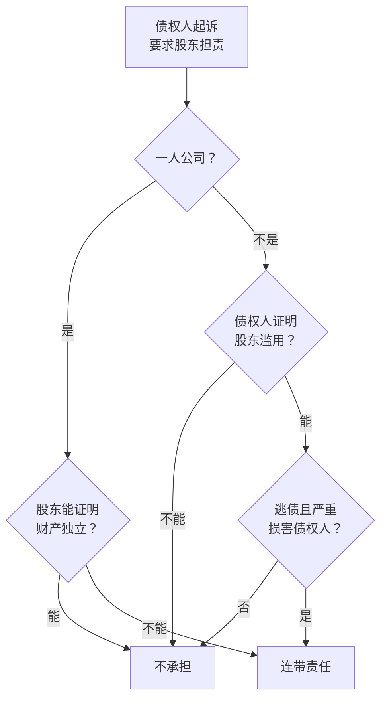

# 有限责任的边界

上一章说，有限责任是一份交换：股东得到风险上限，代价是守一套规矩。这一章讲最重要的那条规矩被破坏时会发生什么：**法院会无视公司的独立地位，让股东直接替公司还债。** 法律上叫「公司法人人格否认」，实务里更常听到的说法是「刺破公司面纱」。

先说结论，免得读完心里发慌：人格否认是**例外**，不是常态。正常经营、账目清楚、没有拿公司当工具逃债的股东，生意失败了，法院不会因为「公司还不上钱」就让你个人还。被刺破的，几乎都是在日常操作里留下了明显把柄的情况。这一章的目的，就是让你知道把柄长什么样。

## 人格否认是什么

> [!WARNING]
> 本节依据新《公司法》关于法人人格否认的规定和最高人民法院 2019 年发布的《全国法院民商事审判工作会议纪要》（通常称「九民纪要」）整理。纪要不是法律，但对各级法院审理有很强的指导作用。法律原文以国家法律法规数据库（flk.npc.gov.cn）为准，纪要原文可在最高人民法院官网查阅。

新《公司法》把人格否认写成了三层：

1. **纵向否认**：股东滥用公司法人独立地位和股东有限责任，逃避债务，严重损害公司债权人利益的，应当对公司债务承担连带责任
2. **横向否认**：股东利用其控制的两个以上公司实施上面的行为的，各公司应当对任一公司的债务承担连带责任
3. **一人公司举证倒置**：只有一个股东的公司，股东不能证明公司财产独立于股东自己的财产的，应当对公司债务承担连带责任

第 1 条是基础规则，看的是三个要素同时成立：

- **有滥用行为**：股东做了破坏公司独立性的事
- **有逃债的结果**：这些行为导致公司还不上债
- **严重损害债权人利益**：不是一点点损失，而是债权人因此拿不到钱

这三个要素意味着几件事：

- **只追究滥用的股东**。一家公司有三个股东，只有一个人把公司的钱当自己的钱用，那就只有他承担连带责任，另外两个不承担
- **只在个案里否认**。法院判你对某一笔债务承担连带责任，不等于公司从此不存在，也不等于你对公司所有债务都要负责
- **谨慎适用**。九民纪要明确要求法院审慎适用，不能因为「公司没钱、股东有钱」就否认

下面按九民纪要归纳的三类典型情形分别讲。

## 情形一：财产混同

财产混同是最常见、也最容易在不知不觉中做出来的一类。法院会看公司和股东的财产是不是分不清，典型表现有：

- 股东无偿使用公司的钱或财产，不做财务记录
- 用公司的钱还股东个人的债，或者把公司的钱给关联公司无偿使用，不做记录
- 公司的账和股东个人的账不分，分不清哪些是公司的、哪些是股东的
- 股东自己的收入和公司的盈利不加区分，双方利益不清
- 公司的财产记在股东名下，由股东占有、使用

除了财产，法院还会参考**业务混同**（同样的业务，有时以公司名义做，有时以个人名义做）、**人员混同**（公司员工和股东另一家公司的员工是同一批人）、**办公地址混同**。但这些只是补强，**核心是财产分不分得清**。

用一个假设的例子感受一下。

> 老陈是平面设计师，开了一家一人有限公司接品牌设计项目。为了方便，客户付款有时打到公司账户，有时直接转到老陈的微信；公司账户里的钱，他会随手转一笔到个人卡上还信用卡，不记账也不写名目；公司的电脑和相机是用老陈个人的卡买的，发票开的是公司抬头。
>
> 两年后，一个印刷供应商起诉公司要 18 万元货款，公司账上只有 2 万元。供应商申请追加老陈承担连带责任。老陈拿不出公司的规范账簿，也说不清个人微信里哪些钱是公司的。

在这个例子里，老陈的每一个动作单独看都「没伤害谁」，但合起来就是教科书式的财产混同。更麻烦的是，老陈的公司只有他一个股东，适用举证倒置（下面会讲），他要自己证明财产是独立的，而他证明不了。

公私怎么分才算分清，[《财务与税务》第 5 章](../opc-finance/05-separate-money.md#一套照着做的规则)有一套照着做的规则，这里不重复。

## 情形二：过度支配与控制

这一类说的是：股东对公司的控制强到公司**完全丧失了独立意志**，变成了股东的工具或躯壳。控制本身不违法，大股东决定公司的事很正常。问题在于用这种控制去损害公司、坑债权人。典型做法有：

- **利益输送**：母子公司之间、兄弟公司之间进行明显不公平的交易，把利润和资产从一家公司搬到另一家，留下债务
- **收益和亏损随意分配**：赚钱的业务放在这家公司，亏钱和欠债的放在那家，不讲任何商业理由
- **「金蝉脱壳」**：先从原公司抽走资金、设备、客户合同，再成立一家经营目的相同或类似的新公司，原公司只剩债务
- **先解散、再复活**：先解散公司，再用原公司的场所、设备、人员和相同的经营目的另设一家公司，逃避原公司的债务

这一类在一人公司里不常见，在「一个老板控制好几家公司」的结构里比较多。如果你以后公司做多了，想把业务拆到几家公司，要记住拆分必须有真实的商业理由，并且每家公司之间的交易按正常的价格和合同来做。

## 情形三：资本显著不足

资本显著不足指的是：公司设立后，股东实际投入的资本和公司经营所面临的风险**明显不匹配**。股东用很少的资本做着风险很高的生意，实际上是把投资风险转嫁给了债权人。

> 假设某人设立一家工程公司，注册资本 10 万元，实际只缴了 1 万元，却去承接一个合同额 2000 万元、需要大额垫资、出现质量问题要承担巨额赔偿的工程。公司资不抵债后，债权人可能主张股东以「资本显著不足」承担责任。

九民纪要对这一类的态度最谨慎，因为「资本够不够」很难有客观标准，而且通常会和其他滥用行为一起考察。实务中单独因为资本显著不足被否认的不多。但它提示了一个道理：**注册资本不必大，但要和你要做的事大体相称**。第 3 章会再讲注册资本怎么定。

## 关联公司之间的横向否认

前面说的都是「刺穿公司、找到股东」，是纵向的。还有一种是横向的：同一个人控制的几家公司之间，财产、业务、人员混在一起，法院会让这几家公司相互承担连带责任。

> [!WARNING]
> 下文提到的最高人民法院指导案例 15 号，是 2013 年发布的关于关联公司人格混同的指导性案例，案情概括凭整理，具体以最高人民法院官网公布的案例原文为准。

最高人民法院的指导案例 15 号是这类案件的代表：一家公司和另外两家关联公司由同一批人控制，三家公司共用人员、业务交叉、财务混在一起，法院认定三家公司人格混同，对其中一家公司的债务承担连带责任。新《公司法》把这种处理方式写进了法律。

对普通创业者，横向否认最常见的情形是这样的：

> 一位做市场咨询的创业者先开了 A 公司，后来为了「分开业务线」又开了 B 公司。两家公司共用一个办公室、同一批员工，劳动合同签在 A，工资有时从 B 发；客户合同签哪家看心情；钱在两家公司账户之间来回转，没有合同，也没有记账。
>
> A 公司欠下一笔房租和装修款后，房东可以主张 B 公司承担连带责任。

所以，开第二家公司之前先问自己：**两家公司真的需要分开吗？** 如果需要，就按两个独立的人来对待它们：各自的员工、各自的账户、各自的合同，相互之间的交易签合同、开发票、按市场价结算。

## 一人公司：举证责任在你

只有一个股东的公司，适用的是更严格的规则：发生纠纷时，不是债权人证明你混同了财产，而是**你要证明没有混同**；证明不了，就要对公司债务承担连带责任。这条规则在[《国内合规实务》第 1 章](../opc-compliance-cn/01-entity-choice.md#一人有限公司隔离风险但要真的隔离)和[《财务与税务》第 5 章](../opc-finance/05-separate-money.md)都讲过，能拿出来的最有力的证据是：独立的对公账户、规范的账簿、每年的财务报告，有条件的做年度审计。

这里只补一个容易被忽略的情况：**夫妻两个人开的公司**。

> [!WARNING]
> 夫妻公司能否按一人公司处理，法律没有明文规定，各地法院的做法并不统一。以下只是对已有判例倾向的概括，遇到具体问题请咨询律师。

很多夫妻创业时，两个人各占一部分股权，以为这样就不是一人公司了。但实务中，有法院认为：夫妻在婚后用共同财产设立的公司，股权实际上都来自夫妻共同财产，利益高度一致，**实质上相当于一人公司**，从而适用举证倒置。也有法院不这么认为。既然存在这种可能，夫妻公司就按一人公司的标准管财务，是更稳妥的做法。

## 常见的被「刺破」场景

把前面的内容换成日常场景，大多数风险集中在下面这些动作上：

| 场景 | 为什么出问题 | 怎么做 |
|---|---|---|
| 客户的钱打到老板个人微信、支付宝 | 公司收入进了个人账户，财产混同的直接证据 | 经营收入一律走对公账户，个人收款码不用于公司业务 |
| 公司账户随手转钱给自己，不写名目 | 股东无偿使用公司资金 | 只走工资、分红、报销、借款四条路，每笔有凭证 |
| 用公司的钱付家里的开支 | 公私不分 | 私人开支不走公司，误付了就记成股东借款并归还 |
| 不记账、没有年度财务报告 | 一人公司无法自证 | 委托代账，每年出财务报表 |
| 一个老板几家公司，共用员工、账户、合同主体 | 横向人格混同 | 每家公司独立核算，相互交易签合同 |
| 公司欠了债，把业务和设备搬到新公司 | 典型的过度控制、逃废债务 | 公司经营不下去时走正规清算（第 8 章） |
| 公司欠了债，股东把账上的钱全部转走 | 抽逃资金，还可能被追究其他责任 | 公司有未清偿债务时不分配、不转移 |
| 注册资本 1 万元接几百万的项目，且实缴为零 | 资本显著不足，和其他行为叠加时风险更高 | 资本和业务规模大体相称（第 3 章） |

## 法院怎么判断

最后用一张图把判断思路串起来。实际案件比这复杂得多，但大方向是这样：

两个提醒：

- **普通公司里，举证责任在债权人**，但债权人可以申请法院调取公司和股东的银行流水，所以「对方拿不到证据」不是可以依赖的保护
- **不论哪种公司，最好的防线都在平时**。纠纷发生时再补账、补合同，往往来不及，补出来的材料可信度也低

## 本章要点

- 人格否认是例外：只针对滥用的股东，只在个案中适用，法院会谨慎判断
- 纵向否认要同时满足：有滥用行为、导致逃债、严重损害债权人利益
- 三类典型情形：财产混同（最常见）、过度支配与控制、资本显著不足
- 同一个人控制的几家公司混在一起，会被横向否认，相互承担连带责任
- 一人公司股东要自证财产独立；夫妻公司有被按一人公司处理的可能，按同样标准管财务
- 防线在平时：对公账户、规范记账、有名目的资金往来、关联交易签合同
