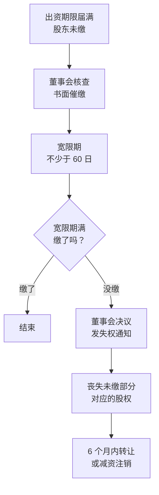

# 注册资本：认了就要缴

营业执照上有一行「注册资本」。很多人第一次注册公司时，这个数字是随手填的：有人觉得写大一点显得有实力，有人听说「认缴制不用真拿钱」，就写个一百万、五百万。

这一章要讲清楚的只有一句话：**注册资本是你对公司、也是对公司的债权人做出的承诺。** 写下去容易，收回来难。

> [!WARNING]
> 本章按 2024 年 7 月 1 日起施行的新《公司法》、《市场主体登记管理条例》及其实施细则整理；出资信息公示、可用于出资的财产范围、股东失权的催缴宽限期、减资的通知和公告期限等，以国家法律法规数据库的法律原文和国家市场监督管理总局、当地登记机关的最新规定为准。

## 认缴和实缴

**认缴**是你承诺要投进公司的钱，写在公司章程里，包括金额和期限。**实缴**是你实际已经投进去的钱。

举个例子：你和朋友设立一家公司，章程写明注册资本 100 万元，你认缴 60 万元，朋友认缴 40 万元，都在 5 年内缴足。公司成立时，你们各自先转了 6 万元、4 万元到公司账户。此时：

- 注册资本 100 万元，认缴 100 万元
- 实缴 10 万元
- 你还欠公司 54 万元出资，朋友还欠 36 万元

「欠公司」这个说法很准确。从法律上看，没缴的出资就是股东对公司的债务，只是还没到期。在公司财务报表上，它可能不会出现，但在债权人眼里，它是公司可以追回的财产。

新《公司法》要求公司通过国家企业信用信息公示系统公示股东认缴和实缴的出资额、出资方式和出资日期等信息，信息发生变化要在规定期限内更新。

这意味着，你的认缴和实缴情况**任何人都查得到**。客户、供应商、未来的合伙人在签约前查一下公示系统，就知道你承诺了多少、兑现了多少。

## 出资方式：钱和不是钱的东西

出资可以用货币，也可以用**能用货币估价、并能依法转让的非货币财产**，比如：

- 实物：设备、车辆
- 知识产权：商标、专利、软件著作权
- 土地使用权
- 股权、债权（新《公司法》明确列出）

用非货币财产出资，要**评估作价**，不能高估；还要**办理财产权的转移手续**，比如把商标转让到公司名下。没有转过去，等于没出资。

不能用来出资的东西，对职场人来说更值得知道：

- **劳务**：「我出力不出钱」不能写成出资
- **信用、个人姓名、商誉**
- **特许经营权**
- **已经设定担保的财产**

这就引出一个现实问题：一个人全职干活、另一个人出钱，出力的那个人的股份从哪来？法律上，他仍然要认缴一定的出资，股权比例可以通过约定调整，常见的做法放在第 5 章讲。

## 五年缴足

新《公司法》规定，有限责任公司全体股东认缴的出资额，应当按照章程规定自公司成立之日起**五年内缴足**。这条规定[《国内合规实务》第 1 章](../opc-compliance-cn/01-entity-choice.md#一人有限公司隔离风险但要真的隔离)已经讲过，它的直接后果是：注册资本写多少，五年内就要真的拿出多少。

下面讲几个还没写过、但同样会落到股东头上的规则。

## 出资加速到期

> [!WARNING]
> 本节依据新《公司法》关于出资加速到期的规定整理。加速到期后股东缴纳的出资是先归入公司、再平等清偿各债权人，还是可以直接清偿提出请求的债权人，学界和实务中存在不同观点，以最新司法解释和裁判为准。

「认缴期限还没到」不是一张永远有效的护身符。新《公司法》规定：**公司不能清偿到期债务的，公司或者已到期债权的债权人，有权要求已认缴出资但未届出资期限的股东提前缴纳出资。**

假设一家咨询公司是这样的：

| 项目 | 数字 |
|---|---|
| 注册资本 | 100 万元 |
| 股东 A 认缴 / 实缴 | 70 万元 / 7 万元 |
| 股东 B 认缴 / 实缴 | 30 万元 / 3 万元 |
| 出资期限 | 成立后第 5 年 |
| 欠房东房租和装修款 | 40 万元，已到期 |
| 公司账上的钱 | 2 万元 |

公司还不上这 40 万元，房东就可以要求两位股东提前缴纳出资。A 还有 63 万元没缴，B 还有 27 万元没缴，合计 90 万元，足够覆盖 38 万元的缺口。每个股东的责任范围是**自己没缴的那部分**，不对别人的出资负责（但设立时出资不足的情形另有规定，见下面）。

这个例子说明了一个反直觉的事实：**注册资本写得越大，公司出事时你潜在要补的钱越多。** 如果当初注册资本只写 10 万元并已缴足，股东在出资层面就没有可以被要求补的钱了。

还有一条和设立有关的规定：**公司设立时，股东没有按章程缴纳出资，或者用作出资的非货币财产实际价额显著低于认缴额的，设立时的其他股东要在出资不足的范围内承担连带责任。** 换句话说，一起创立公司的人，要对彼此的出资多少互相负责。和别人合伙之前，看清对方真的拿得出钱。

## 股东失权

前面讲的是债权人追股东。还有一种情况是**公司追股东**：合伙人到期不缴钱，怎么办？

旧法下，其他股东往往只能干着急。新《公司法》给了一套程序，叫**股东失权**：

几个要点：

- **催缴是董事会的义务**。董事会（不设董事会的公司是董事）应当核查股东出资情况，发现没按期缴的，要书面催缴。董事没有及时催缴，给公司造成损失的，负有责任的董事要承担赔偿责任。这一点第 4 章还会提到
- **失去的只是没缴的那部分**。股东 B 认缴 30 万、实缴 3 万，失权后丧失的是 27 万元对应的股权，已缴的 3 万元对应的股权还在
- **失权的股权要处理掉**。6 个月内依法转让，或者减少注册资本并注销这部分股权；6 个月内没有转让或注销的，由其他股东按出资比例足额缴纳
- **有异议可以起诉**。被失权的股东不服，要在接到失权通知后 30 日内向法院起诉

对合伙创业的人来说，这套程序最大的意义是：**到期不缴出资，不再只是「伤感情」，而是会丢股权。** 这也是第 5 章建议把出资期限、违约后果写清楚的原因。

## 股权转让后，没缴的钱谁来缴

> [!WARNING]
> 本节依据新《公司法》关于股权转让后出资责任的规定整理。对 2024 年 7 月 1 日新法施行前发生的股权转让适用哪套规则，最高人民法院出台过专门的时间效力司法解释和批复，涉及具体纠纷请咨询律师并查阅最高人民法院公布的原文。

有人想：出资期限还没到，我把股权转给别人，没缴的钱就和我无关了。新《公司法》堵上了这条路，分两种情况：

| 情况 | 谁来缴 | 原股东要担什么 |
|---|---|---|
| 转让的股权**出资期限还没到** | 受让人缴 | 受让人到期没缴足的，转让人对没缴的部分承担**补充责任** |
| 转让时**出资期限已到**还没缴足，或者非货币出资的实际价值**显著低于**认缴额 | 转让人和受让人在出资不足范围内承担**连带责任** | 受让人不知道也不应当知道这些情况的，由转让人承担 |

补充责任的意思是：先找受让人，受让人缴不出来，再找你。

一个常见的场景：

> 小吴和朋友合开公司，认缴 30 万元，实缴 3 万元，出资期限还有 3 年。小吴想退出，朋友找了一个熟人以 1 元的价格接手他的股权。三年后出资期限到了，熟人拿不出 27 万元。
>
> 这 27 万元，小吴要承担补充责任。

所以退出一家公司时，**最干净的做法是先把出资问题处理掉**：要么把认缴的缴足再转，要么由公司减资把你没缴的部分减掉，要么确认受让人确实有能力缴纳，并在转让协议里写清责任分担（协议能约束你们之间的追偿，但对抗不了公司和债权人）。

## 减资：把认缴的数改小

如果当初注册资本写大了，可以减资。但减资不是改个数字那么简单，因为它直接减少了债权人能指望的财产。

普通减资的流程大致是：

1. **编制资产负债表和财产清单**
2. **股东会决议**：减资属于特别决议事项，要经代表三分之二以上表决权的股东通过
3. **通知和公告债权人**：自作出决议之日起 10 日内通知债权人，并于 30 日内在报纸上或者国家企业信用信息公示系统公告
4. **债权人可以要求清偿或提供担保**：接到通知的，自接到通知之日起 30 日内；没接到通知的，自公告之日起 45 日内
5. **办理变更登记**

还有两条规则：

- **原则上按比例减资**。新《公司法》规定，减资应当按照股东出资或者持有股份的比例相应减少，法律另有规定、全体股东另有约定或者章程另有规定的除外
- **违法减资要退钱、要赔偿**。违反规定减资的，股东要退还收到的资金，减免的出资要恢复原状；给公司造成损失的，股东和负有责任的董事、监事、高管要承担赔偿责任

另外还有一种**简易减资**：公司用公积金弥补亏损后仍有亏损的，可以减资弥补亏损，这种减资**不能向股东分配，也不能免除股东的出资义务**，所以不能拿来「减掉没缴的钱」。

用一个数字看减资的效果：

> 一家公司注册资本 100 万元，两位股东各认缴 50 万元、各实缴 5 万元。公司经营稳定，但业务规模用不到这么多资本。全体股东同意减资到 10 万元，各 5 万元，正好等于已经实缴的部分。
>
> 走完通知公告、没有债权人要求清偿后，变更登记完成。此后，两位股东在出资层面都没有未缴的义务了。

减资最好在**公司状况良好、没有大额未清偿债务时**做。公司已经欠债还不上了才减资，债权人会要求清偿或担保，而且这种时候的减资很容易被认定为逃避债务。

## 老公司的过渡安排

> [!WARNING]
> 本节依据国务院 2024 年发布的《国务院关于实施〈中华人民共和国公司法〉注册资本登记管理制度的规定》整理。过渡期起止日、调整要求以国务院和国家市场监督管理总局公布的原文为准，可在中国政府网或国家法律法规数据库查阅。

2024 年 7 月 1 日以前设立的公司（下面简称「老公司」），很多章程里写的出资期限是二三十年后，甚至五十年后。对这些公司，国务院的规定给了一个过渡安排：

- **过渡期**：2024 年 7 月 1 日至 2027 年 6 月 30 日
- **有限责任公司**：剩余认缴出资期限自 2027 年 7 月 1 日起超过 5 年的，应当在过渡期内把出资期限调整到 5 年以内，也就是**最晚 2032 年 6 月 30 日前缴足**
- **股份有限公司**：应当在 2027 年 6 月 30 日前缴足
- **出资期限、出资额明显异常的**，登记机关可以依法要求调整

如果你手上已经有一家老公司，或者正准备接手别人的公司，先查清楚章程里的认缴额和期限。注册资本写得很大又不打算真缴的，过渡期内可以考虑减资；如果要接手别人的公司，没缴的出资就是你接过来的义务，第 8 章讲转让时会再提。

## 注册资本怎么定

把这一章的内容收拢，定注册资本时可以这样想：

| 问题 | 怎么判断 |
|---|---|
| 五年内我真能拿出多少 | 上限。写超了，到期缴不出就违约，还可能被失权 |
| 业务要不要资质门槛 | 有些行业许可对注册资本或实缴有要求，打算办就先查门槛 |
| 客户在不在意 | 少数招投标、大客户会看注册资本，多数小生意不看 |
| 业务风险有多大 | 风险越大，资本越应该和它相称，避免「资本显著不足」 |
| 公司出事时我愿意补多少 | 认缴额就是你在出资层面的最大补缴额 |

对普通职场人开的服务型小公司，**写一个够用、已经能缴足或很快能缴足的数**，通常比写一个大数更合理。比如做咨询、设计、培训的一人公司，注册资本 10 万元左右、成立时就缴足，日常周转不够的钱，用股东借款的方式借给公司，签借款协议、按约归还。借款和出资的区别是：借款公司要还，出资不还；公司出事时，股东借款是公司的一笔债，出资则是股东承担责任的上限。

> [!NOTE]
> 注册资本写小了，以后业务需要时可以增资；写大了，减资要走通知债权人的程序。从可逆性看，宁可先写小。

## 本章要点

- 认缴是承诺，实缴是兑现；没缴的出资是股东对公司的债，任何人都能在公示系统查到
- 劳务、信用、商誉不能出资；非货币财产要评估作价并转移到公司名下
- 公司不能清偿到期债务时，债权人可以要求股东提前缴纳尚未到期的出资
- 股东到期不缴，经催缴和宽限期后会丧失未缴部分的股权；催缴是董事的义务
- 转让未缴足的股权不能一走了之：受让人不缴，转让人承担补充责任或连带责任
- 减资要股东会三分之二以上表决权通过、通知并公告债权人；简易减资不能免除出资义务
- 2024 年 7 月 1 日前设立的有限公司，出资期限最晚要在 2032 年 6 月 30 日前到期
- 注册资本写够用、能缴足的数；可逆性上，宁可先写小
