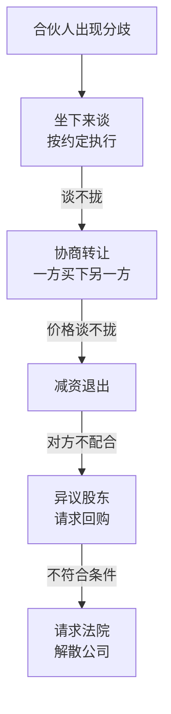

# 合伙开公司与股权

一个人开公司，股权是最简单的事：100% 都是你的。两个人以上，股权就成了整个公司里最难改的东西。产品可以改，客户可以换，办公室可以搬，**股权分出去以后，要收回来几乎都要对方同意。**

这一章讲合伙开公司时的股权问题：要不要合伙、股权怎么分、怎么让「出力」的人的股份和他实际干了多久挂钩、代持为什么危险、章程里该写哪些退出条款，以及吵架散伙时有哪些路可走。

全章用一个假设的例子：林岚做了八年 HR，周舟做了六年 B2B 销售，两人想合开一家给中小企业做招聘和人事外包的公司，暂且叫它「青禾咨询有限公司」。

## 先问：要不要合伙

合伙不是开公司的默认选项。很多小生意一个人做更合适，需要别人的地方，用别的方式合作就行：

| 需要对方的什么 | 不必合伙的做法 |
|---|---|
| 一笔启动资金 | 向对方借款，签借款协议，约定利息和还款期 |
| 某项专业技能，但不是全职 | 按项目付费，或者聘为顾问按月付费 |
| 客户资源 | 按成交额给介绍费或销售提成 |
| 全职一起干，但还不确定能不能长期合作 | 先按合作协议或聘用关系做半年，再谈股权 |

真正适合合伙的情况是：**两个人都要长期全职投入，各自的能力缺一不可，而且彼此已经有足够的了解。** 林岚懂人事、能交付，周舟能找到客户、能签单，两人都准备辞职全职做，缺了谁这门生意都转不起来。这种情况下合伙是合理的。

几个先要聊透的问题，聊不清楚就先别注册公司：

- 每个人投多少钱、投多少时间，是不是全职，什么时候辞职
- 谁做最终决定，意见不一致时怎么办
- 公司赚钱以后，钱是留在公司还是分掉，各自拿多少工资
- 有人想退出，股份怎么处理，按什么价格
- 有人离婚、生病、去世，股份怎么处理

后面几节会把这些问题落到股权和章程上。

## 股权怎么分：出资、出力、资源

股权分配没有标准答案，但有一个常用的思路：**把股权分成「资金股」和「人力股」两部分，分别分配。**

- **资金股**：对应投入的钱，按出资比例分
- **人力股**：对应全职投入的时间、能力和承担的职责，按贡献分，并且要随时间兑现（下一节讲）
- **资源**（客户、渠道、人脉）：原则上不给股权，按成交给提成或介绍费；资源只有在持续、不可替代地投入时，才折算成人力股的一部分

资金股和人力股的比例，看这门生意更依赖钱还是更依赖人。服务型的小公司主要靠人，资金需求小，人力股占大头比较合理。

林岚和周舟的分法：

| 项目 | 林岚 | 周舟 | 合计 |
|---|---|---|---|
| 投入资金 | 20 万元 | 5 万元 | 25 万元 |
| 资金股（总占 30%，按出资比例） | 24% | 6% | 30% |
| 人力股（总占 70%，按职责商定） | 40% | 30% | 70% |
| 合计持股 | **64%** | **36%** | 100% |

人力股里林岚多一些，是因为她负责交付、管理和公司的日常运营，周舟负责销售，两人商量后定了 40% 和 30%。

接下来的问题是：持股比例 64% 和 36%，出资却是 20 万和 5 万，在工商登记上怎么体现？法律上，有限公司股东的持股比例默认按认缴出资比例确定。一个简单的处理方式是：

- 注册资本定为 10 万元，林岚认缴 6.4 万元，周舟认缴 3.6 万元，设立时都缴足
- 林岚多出的 13.6 万元、周舟多出的 1.4 万元，以**股东借款**的方式借给公司，签借款协议，公司有钱时归还

这样，注册资本小而且已缴足（第 3 章），持股比例反映了商定的分配，多投的钱也有明确的归属。也可以把多出的钱计入资本公积，不作为借款，具体怎么做账，问代账会计。

### 比例里的几个关键数字

> [!WARNING]
> 以下表决比例依据新《公司法》对有限责任公司的规定整理，章程可以在法律允许的范围内另行约定，以法律原文和你公司章程的规定为准。

有限公司股东会的决议，有几个和比例有关的规则：

| 事项 | 默认需要的表决权 |
|---|---|
| 修改章程、增加或减少注册资本、合并、分立、解散、变更公司形式 | 三分之二以上 |
| 一般事项（选举和更换董事监事、审议利润分配方案等） | 过半数 |
| 提议召开临时股东会 | 十分之一以上的股东可以提议 |
| 向法院请求解散公司（满足法定条件时） | 十分之一以上的股东可以提起 |

青禾的 64% 意味着：林岚在一般事项上可以自己决定，但改章程、增减资、解散这类事，需要周舟同意。周舟的 36% 意味着他能否决这些重大事项。这是两人有意的安排。

最需要避免的比例是 **50% 对 50%**：任何决议都需要两人一致，一旦有分歧就是僵局，公司什么都做不了。三人平分（33%、33%、34%）也有类似的问题。如果两个合伙人确实贡献相当，也最好让其中一人多出一点，比如 51% 和 49%，并且在章程里约定僵局时的处理办法。

## 人力股与兑现

人力股是对「未来全职投入」的回报。问题在于：股权在登记那天就全部给出去了，而投入是一年一年发生的。如果周舟干了半年就离开，他仍然持有 36% 的股权，林岚此后每一份努力都有三分之一多落在一个不再干活的人身上。

解决这个问题的通用做法叫**兑现**（英文 vesting）：人力股不是一次性「挣到」的，而是按时间逐步挣到；中途离开的人，没挣到的部分要交回。

最常见的安排是「**4 年兑现，1 年悬崖**」：

- 人力股分 4 年（48 个月）兑现
- 第 1 年是「悬崖期」：满 12 个月之前离开，人力股一点都拿不到
- 满 12 个月，一次性兑现 25%
- 此后每个月兑现 1/48，到第 48 个月全部兑现

用周舟的 30% 人力股算几个时点：

| 离开的时间 | 已兑现的人力股 | 加上资金股 6% | 要交回的人力股 |
|---|---|---|---|
| 第 10 个月 | 0 | 6% | 30% |
| 第 12 个月 | 30% × 12/48 = 7.5% | 13.5% | 22.5% |
| 第 18 个月 | 30% × 18/48 = 11.25% | 17.25% | 18.75% |
| 第 36 个月 | 30% × 36/48 = 22.5% | 28.5% | 7.5% |
| 第 48 个月以后 | 30% | 36% | 0 |

兑现规则对两个创始人**同样适用**。林岚的 40% 人力股也按同样的进度兑现，这样才公平，也才说得出口。

### 在国内怎么落地

> [!WARNING]
> 国内法律没有专门的「股权兑现」制度，下面的做法是通过股东协议、章程和股权转让来实现的。有限公司回购自己股权的法定情形有限，以及回购约定在个案中能否得到法院支持，以最新法律、司法解释和裁判为准。股权转让涉及个人所得税，以国家税务总局的规定为准。设计具体方案请找律师。

国内常见的实现方式是：**工商登记时股权一次性登记到位，同时在股东协议里约定：创始人离开时，未兑现部分由其他股东按约定价格回购。**

几个要写清楚的点：

- **什么算「离开」**：主动辞职、因严重过错被解除、因病不能工作、去世，处理可以不一样。主动离开和过错离开，回购价格通常更低；因病、去世，可以更宽厚
- **谁来回购**：有限公司自己回购股权受到法律限制，所以一般约定由**其他股东**按持股比例回购，或者通过减资把这部分股权注销
- **价格**：未兑现部分，常见的约定是按原始出资额回购（周舟交回的 18.75%，对应注册资本 1.875 万元，就按 1.875 万元回购）；已兑现部分，可以约定离开的人保留，也可以约定按净资产或某个估值打折回购
- **配合义务**：约定离开的人要在一定期限内签署转让文件、配合办理变更登记，不配合时承担违约金

按上面的约定，周舟在第 18 个月离开，林岚用 1.875 万元回购 18.75% 股权后，两人的持股变成林岚 82.75%、周舟 17.25%。

## 代持：看起来省事，风险都在暗处

> [!WARNING]
> 本节依据最高人民法院关于适用《公司法》的司法解释中对名义股东与实际出资人关系的规定，以及相关裁判观点整理，以最新司法解释原文为准。

代持是指：钱是 A 出的，股东登记却写 B 的名字。A 叫实际出资人，B 叫名义股东。常见的原因有：A 在体制内或在职不方便、A 不想公开身份、给员工预留股份先放在老板名下等。

法律一般承认代持协议在双方之间有效（存在法定无效情形的除外），但它的问题在于：**对外，法律更相信登记。**

| 风险 | 对实际出资人 A | 对名义股东 B |
|---|---|---|
| 对方擅自处分 | B 把股权卖掉或质押，买方不知道代持的，A 可能拿不回股权，只能找 B 赔 | 无 |
| 对方个人欠债 | B 的债权人可以申请执行 B 名下的股权，A 的主张未必能对抗 | 无 |
| 对方离婚、去世 | 股权可能被当作 B 的财产分割或继承，A 要另外打官司 | 无 |
| 想「显名」 | A 想变成登记股东，一般需要其他股东过半数同意 | 无 |
| 公司欠债、出资未缴 | 无 | B 作为登记股东，债权人可以要求 B 在未缴出资范围内担责，B 再向 A 追偿 |
| 税 | 分红、转让的个税怎么申报、谁来缴，容易说不清 | 同左 |

能不代持就不代持。确实需要代持时，至少做到：

- 签书面代持协议，写清出资来源、权利归属、分红和表决怎么处理、显名和解除的条件
- 出资款由 A 直接打到公司账户，或者能证明 B 的出资款来自 A，保留转账记录
- 让其他股东知情并书面确认，为将来显名做准备
- 不要给你不够信任的人代持，也不要替别人代持（第 4 章「不要给别人挂名」）

## 表决权与分红权可以分开

> [!WARNING]
> 本节依据新《公司法》关于有限公司表决权和利润分配的规定整理，以法律原文为准。

很多人以为持股比例决定一切。实际上，有限公司的表决权、分红权都可以按约定调整：

- **表决权**：股东会会议由股东按照出资比例行使表决权，但**公司章程另有规定的除外**。也就是说，章程可以约定某个股东的表决权多于或少于他的持股比例
- **分红**：有限公司股东按照**实缴的出资比例**分取红利，但**全体股东约定不按出资比例分取的除外**

第二条里有一个容易忽略的细节：**默认按「实缴」比例分红**。如果两个股东认缴各 50%，一个缴足了，一个一分没缴，默认情况下分红全归缴足的那个人。合伙时如果出资进度不一样，要提前约定分红怎么算。

表决权和分红权分开，常见的用途：

- 负责经营的创始人持股不多，但需要稳定的决策权，可以在章程里约定更高的表决权
- 出钱多但不参与经营的股东，想要更多分红而不在意表决权，可以由全体股东约定分红比例

注意：表决权要写在**章程**里，分红约定要**全体股东**同意。一网通办的章程模板通常是标准条款，需要个性化约定时，看当地登记机关是否接受自行起草的章程。

## 章程里该写的退出条款

章程是公司的「宪法」，登记在案，对全体股东有约束力，必要时可以对抗外部。股东协议可以写得更细，但只约束签字的股东。重要的退出安排，**能写进章程的尽量写进章程**，章程放不下的细节放在股东协议里，两者要一致。

> [!WARNING]
> 本节涉及的股权继承、离婚分割股权、对外转让股权和优先购买权规则，依据新《公司法》和最高人民法院关于《民法典》婚姻家庭编的司法解释整理，以法律和司法解释原文为准。

### 离职或违约时的回购

上一节讲的兑现和回购，核心条款最好写进章程，至少写明：触发情形、谁有权回购、价格的计算方式、办理期限。

### 对外转让和优先购买权

新《公司法》下，有限公司股东向股东以外的人转让股权，应当将转让的数量、价格、支付方式和期限等事项书面通知其他股东，其他股东在同等条件下有**优先购买权**；其他股东自接到书面通知之日起 30 日内未答复的，视为放弃。章程对股权转让另有规定的，从其规定。

如果你不希望合伙人随时把股份卖给一个陌生人，可以在章程里约定更严格的转让限制，比如对外转让需经其他股东同意。

### 离婚

婚后取得的股权，其财产价值通常属于夫妻共同财产。离婚分割时，配偶不一定能直接成为股东：一般要其他股东过半数同意、并且放弃优先购买权，配偶才能取得股东资格；否则通常是由持股的一方给配偶经济补偿。

对合伙人来说，可以在章程或股东协议里约定：**股东离婚时，股权原则上由该股东保留，配偶取得经济补偿**；有条件的创始人，可以和配偶签署确认书，确认配偶不主张股东资格。这类安排涉及婚姻家庭，最好由律师起草。

### 继承和去世

新《公司法》规定，自然人股东死亡后，其合法继承人可以继承股东资格；但是，**公司章程另有规定的除外**。

如果不做约定，合伙人去世后，他的继承人（可能是配偶、父母、未成年子女）会成为你的新股东，参与表决和分红。是否接受这个结果，合伙时就要商量好。常见的章程约定是：股东去世的，继承人不继承股东资格，由其他股东按约定价格收购股权，价款付给继承人。

### 丧失能力

股东因病、意外长期不能工作的，人力股的兑现可以约定停止，已兑现部分如何处理也要约定。

### 退出条款清单

| 条款 | 要写清楚的内容 |
|---|---|
| 兑现与回购 | 兑现期、悬崖期、离开的定义、回购方、价格、期限 |
| 转让限制 | 对外转让是否要同意、优先购买权的行使方式 |
| 离婚 | 股权由谁保留、补偿方式 |
| 继承 | 继承人是否继承股东资格、不继承时的收购价格 |
| 丧失能力 | 兑现是否停止、股权如何处理 |
| 竞业 | 在职和离开后一定期间不做竞争业务 |
| 僵局 | 表决僵持时的处理办法，比如一方收购另一方 |

## 吵架散伙时怎么办

合伙人闹翻，是合伙公司最常见的结局之一，不必讳言。分歧出现时，按代价从小到大，大致有这些路：

### 先按约定执行

合伙时把退出条款写清楚，最大的价值就在这里：分歧出现时，不用重新谈价格和方式，照着协议执行就行。没有约定的，谈判的难度会大很多。

### 一方买下另一方

最常见的散伙方式。价格可以参考公司净资产、最近一年的利润、或者请评估机构评估。注意第 3 章讲过的出资问题：如果离开的人还有没缴的出资，要么先缴足，要么在价格里扣除，要么通过减资处理。

### 异议股东请求回购

> [!WARNING]
> 异议股东回购请求权的适用情形和期限依据新《公司法》整理，以法律原文为准。

在某些情形下，对股东会决议投反对票的股东，可以请求公司按照合理的价格收购其股权，比如：

- 公司连续五年不向股东分配利润，而公司该五年连续盈利，并且符合法律规定的分配利润条件
- 公司合并、分立、转让主要财产
- 公司章程规定的营业期限届满或者其他解散事由出现，股东会通过决议修改章程使公司存续

新《公司法》还增加了一种情形：**控股股东滥用股东权利，严重损害公司或者其他股东利益的**，其他股东有权请求公司按照合理的价格收购其股权。

这些情形门槛较高，而且有时间限制，不是想退就能用。

### 请求法院解散公司

这是最后的手段。公司经营管理发生严重困难，继续存续会使股东利益受到重大损失，通过其他途径不能解决的，持有公司**十分之一以上表决权**的股东，可以请求法院解散公司。法院审查很严格，「两个人吵架」本身不够，要证明公司已经陷入僵局，比如长期无法召开股东会、无法形成有效决议、经营管理无法运转。

### 散伙期间别做的事

- **不要抢公章、营业执照、账户 U 盾**。公章争夺在实务里很常见，但抢到公章不等于取得控制权，还会让纠纷升级。公司设立时就约定印章由谁保管、怎么使用
- **不要私自把客户和业务搬走**。这可能违反忠实义务和竞业约定，还可能构成侵权
- **不要私自转走公司的钱**。这是第 2 章讲的财产混同和抽逃，严重的可能构成犯罪

## 本章要点

- 能用借款、项目付费、提成解决的合作，不必合伙；合伙适合长期全职、缺一不可、彼此了解的人
- 股权可以分成资金股和人力股分别分配；资源按成交付费，不轻易给股权
- 避免 50% 对 50%；记住三分之二（重大事项）和过半数（一般事项）两个比例
- 人力股按时间兑现，常用 4 年兑现、1 年悬崖；国内通过股东协议和回购约定落地，回购通常由其他股东或减资完成
- 代持对外以登记为准，双方都有风险，能不代持就不代持
- 表决权可以由章程另行规定；分红默认按实缴比例，全体股东可以另行约定
- 章程和股东协议要写清：回购、转让限制、离婚、继承、丧失能力、竞业、僵局
- 散伙按代价从小到大：按约定执行、协商转让、减资、异议回购、请求解散；不要抢公章、搬业务、转走钱
