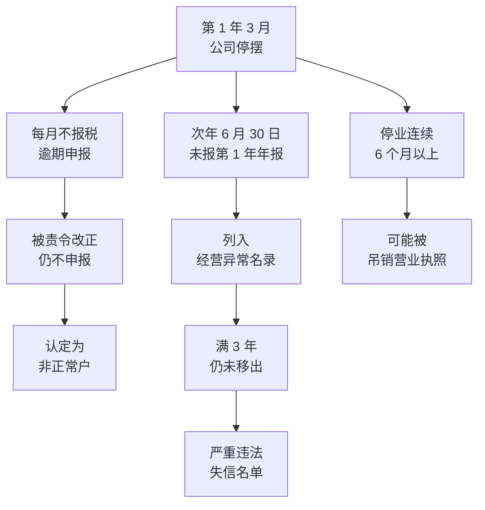

# 日常义务与企业信用

公司注册下来以后，即使一单生意都没做，也有一组固定要做的事：每月或每季报税，每年报年报，信息变了要更新。这些事不难，但很容易忘，尤其是公司业务停下来、老板去忙别的事的时候。

忘了的后果，不是一张罚单那么简单。公司会被列入公开的名单，信用记录跟着公司走，有些还会跟着法定代表人走。这一章讲这些义务背后的「信用」机制：哪些名单、怎么进去、怎么出来、怎么落到你个人身上。

公司注册的完整流程和每年、每月要做的事情清单，在[《国内合规实务》第 2 章](../opc-compliance-cn/02-registration.md#每年和每月要做的事)里已经列过，这里不重复，只讲背后的后果。

> [!WARNING]
> 本章涉及的经营异常名录、严重违法失信名单、信用修复规则，依据《企业信息公示暂行条例》《市场主体登记管理条例》和国家市场监督管理总局的相关管理办法整理；税务部分依据《税收征收管理法》和国家税务总局关于纳税信用、非正常户、重大税收违法失信主体的规定整理。这些规定会修订，期限和情形以国家企业信用信息公示系统、国家市场监督管理总局和国家税务总局公布的最新文本为准。

## 两套信用系统

一家公司在国内有两套主要的「信用档案」，分属两个部门：

| 系统 | 管理部门 | 记录什么 | 在哪查 |
|---|---|---|---|
| 企业信用信息公示 | 市场监管部门 | 登记信息、年报、行政处罚、经营异常名录、严重违法失信名单 | 国家企业信用信息公示系统 |
| 纳税信用 | 税务部门 | 申报、缴税、发票、纳税信用等级、非正常户、重大税收违法失信主体 | 电子税务局；重大税收违法失信案件在税务部门网站公布 |

此外还有法院的失信被执行人名单和限制高消费名单，那是公司被告、被执行以后的事，放在第 7 章讲。

这些系统之间会相互共享。全国信用信息共享平台和「信用中国」网站会归集各部门的失信信息，银行、招投标平台、政府采购、应用市场审核都可能查询。所以「只是没报个年报」，可能会在你完全想不到的地方被看到。

## 年报公示

每家公司每年都要通过国家企业信用信息公示系统报送**上一年度的年度报告**，时间是每年 1 月 1 日至 6 月 30 日。当年设立的公司，从下一年开始报。

年报的内容主要是：

- 公司通信地址、邮编、联系电话、电子邮箱
- 公司存续、开业、歇业、清算等经营状态
- 股东的认缴和实缴出资额、出资时间、出资方式
- 对外投资、网站或网店信息
- 从业人数、资产总额、负债总额、营业收入、利润总额、纳税总额等财务数据
- 社保信息

其中一部分财务数据，公司可以选择是否对外公示；其余的会公开。

年报要**如实**填写。年报信息隐瞒真实情况、弄虚作假的，本身就是被列入经营异常名录的情形之一。另外，年报里的认缴和实缴信息要和实际一致，第 3 章讲过，这是债权人判断你出资情况的依据。

> [!TIP]
> 很多代账公司会代报年报。即使委托了，也要在每年 6 月前自己登录公示系统看一眼「年报状态」，确认已经报送成功。

除了年报，公司还有一类**即时信息**要公示：股东认缴和实缴出资的变化、股权变更、行政许可取得或变更、受到行政处罚等。这些信息要在形成之日起的规定期限内通过公示系统公示，逾期未公示的，同样可能被列入经营异常名录。

## 经营异常名录

经营异常名录是市场监管部门的「黄牌」。公司有下列情形之一的，会被列入：

| 情形 | 常见原因 |
|---|---|
| 未按规定期限报送年度报告 | 忘了，或者以为公司没业务就不用报 |
| 未按规定期限公示即时信息 | 股东实缴了出资、变了股权，没去公示 |
| 公示信息隐瞒真实情况、弄虚作假 | 年报里乱填数字 |
| 通过登记的住所或者经营场所无法联系 | 注册地址是借用的、托管的，到期没续；搬了家没变更；登记的电话停用 |

最后一条在小公司里最常见。很多一人公司用的是园区托管地址、朋友公司的地址，或者自己租的房子。托管合同到期没续、房子退租了，市场监管部门寄去的信件被退回、上门核查找不到人，公司就会被列入经营异常名录。

### 被列入以后

- **公开**：公示系统里会显示「列入经营异常名录」，以及列入的原因和日期，任何人都能看到
- **办事受阻**：银行开户、贷款，招投标、政府采购，部分平台的企业认证，都会查企业状态，异常状态可能直接不通过
- **信用联动**：会被推送到其他部门，作为信用监管的参考

### 怎么移出

列入的原因消除了，就可以申请移出：

- **因为没报年报被列入的**：补报未报年份的年度报告，并公示，然后申请移出
- **因为未公示即时信息被列入的**：补充公示，申请移出
- **因为公示信息弄虚作假被列入的**：更正公示，申请移出
- **因为住所无法联系被列入的**：依法办理住所变更登记，或者提出通过登记的住所可以重新取得联系，申请移出

市场监管部门核实后，会在规定期限内作出移出决定。

## 严重违法失信名单

如果说经营异常名录是黄牌，严重违法失信名单就是红牌。和小公司最相关的列入情形是：

- **被列入经营异常名录满 3 年仍没有移出的**
- 提交虚假材料或者采取其他欺诈手段隐瞒重要事实取得登记、情节严重被撤销登记的
- 其他严重违法行为，按市场监管部门的相关规定处理

也就是说，一家被遗忘的公司，没报年报 → 进经营异常名录 → 3 年没人管 → 自动升级为严重违法失信。

被列入严重违法失信名单的后果明显更重：

- 在政府采购、工程招投标、国有土地出让、授予荣誉称号等方面依法被限制或禁止
- 被列为重点监管对象，抽查比例和频次提高
- **对个人的影响**：按照相关规定，被列入严重违法失信名单的企业的**法定代表人、负责人**，在一定期限内不得担任其他企业的法定代表人、负责人

最后一条是关键。它意味着一家被你遗忘的公司，可能让你在几年内没法再当另一家公司的法定代表人，包括你后来认真经营的那一家。

## 信用修复

信用修复是给有过失信记录的主体一个纠错的通道：改正了违法失信行为、履行了相关义务后，可以申请提前移出名单或者停止公示相关信息。

市场监管领域的信用修复，大致是这几步：

1. **先改正**：补报年报、补充公示、变更地址、缴纳罚款，把导致失信的问题本身解决掉
2. **在国家企业信用信息公示系统或当地市场监管部门提出申请**，提交改正的材料和信用承诺书
3. **市场监管部门审核**，符合条件的作出修复决定，移出名单或停止公示

几点要注意：

- **不是所有记录都能修复**，有些严重的违法行为有最短公示期，期满前不能申请
- **修复要先改正**，单纯申请没有用
- **市场监管、税务、法院是三套系统**，各自修复，修复了一个不代表另一个也自动修复
- 信用修复**不收费**。有中介声称收费「删除失信记录」「快速洗白」的，要警惕

## 税务上的异常

税务这边，和小公司最相关的有三种状态，从轻到重：

### 逾期申报

公司没有在申报期内申报，就是逾期申报。即使这期没有收入，也要**零申报**。逾期申报会产生罚款，并影响纳税信用评价。

### 非正常户

公司没有按期申报，经税务机关责令限期改正后仍不申报，而且税务机关查无下落的，会被认定为**非正常户**。

被认定为非正常户以后：

- 公司的发票会被停止使用
- 公司的纳税信用会受到严重影响
- 公司的法定代表人、财务负责人等相关人员，在办理其他涉税事项时可能受到限制，比如以他们为法定代表人的新公司办理税务事项会被关注
- 想恢复，要补申报、补缴税款、滞纳金和罚款，解除非正常户状态

### 纳税信用 D 级与重大税收违法失信主体

纳税信用每年评一次，分为 A、B、M、C、D 等级。D 级是最低的一档，会在发票领用、出口退税、税务检查频次等方面受到严格管理。按照纳税信用管理的规定，D 级纳税人的直接责任人员，在其注册登记或者负责经营的其他纳税人里，纳税信用也可能被直接判为 D 级。

更严重的是被确定为**重大税收违法失信主体**，比如偷税、逃避追缴欠税、虚开发票达到一定标准的。税务机关会对外公布公司的信息，以及负有直接责任的法定代表人、财务负责人等人员的信息，并推送给其他部门联合惩戒。

每月报税的具体做法和代账的选择，见[《国内合规实务》第 2 章](../opc-compliance-cn/02-registration.md)和[《财务与税务》](../opc-finance/)。

## 一家被遗忘的公司会怎样

把市场监管和税务的后果放在一条时间线上看。下面是一家假设的一人公司，从某一年（下面叫第 1 年）的 3 月起老板去上班了，公司不再经营，也没人管：

这三条线是同时走的，任何一条都可能先到。吊销营业执照的后果放在第 8 章，这里只说一句：**吊销不是注销，公司还在，问题也还在。**

这家公司的老板以为自己「只是不做了」，几年后可能发现：

- 自己名下的公司是非正常户，自己是法定代表人
- 公司在严重违法失信名单上，自己一定期限内不能担任其他企业的法定代表人
- 公司被吊销了营业执照，还需要自己去清算注销

所以第 8 章会反复强调：**不做了，就正式地关掉它，不要放着。**

## 这些后果怎么落到你个人身上

把这一章的内容按「你」的角度整理一遍：

| 公司的状态 | 对法定代表人 | 对财务负责人 | 对股东 |
|---|---|---|---|
| 经营异常名录 | 公司办事受阻，你也要出面处理 | 一般无直接影响 | 一般无直接影响 |
| 严重违法失信名单 | 一定期限内不得担任其他企业的法定代表人、负责人 | 一般无直接影响 | 一般无直接影响 |
| 非正常户 | 以你为法定代表人的其他企业办税受影响 | 同左 | 一般无直接影响 |
| 纳税信用 D 级 | 你负责经营的其他企业可能被直接判 D 级 | 同左（直接责任人员） | 是直接责任人员时同左 |
| 重大税收违法失信主体 | 被公布，可能被阻止出境、联合惩戒 | 被公布 | 是实际负责人时被公布 |
| 被吊销营业执照 | 负有个人责任的，一定期限内不得担任董监高（第 8 章） | 一般无直接影响 | 要组织清算（第 8 章） |

一个人可能同时是好几家公司的法定代表人或股东。**任何一家出问题，都可能影响到其他几家。** 这是不要给别人挂名（第 4 章）、不要放着公司不管（第 8 章）的又一个理由。

## 一年里要盯的事

> [!WARNING]
> 表中年报和汇算清缴的时间按 2025 年前后的规定整理，纳税申报期限由税务机关确定，以电子税务局显示的期限、国家税务总局和国家企业信用信息公示系统的最新规定为准。

对一家正常经营的小公司，下面这张表足够覆盖信用方面的风险。具体的申报操作交给代账，你负责「确认它们被做了」：

| 时间 | 事项 | 怎么确认 |
|---|---|---|
| 每月或每季申报期 | 纳税申报，没收入也零申报 | 电子税务局查看申报记录 |
| 每年 1 月 1 日至 6 月 30 日 | 报送上一年度年报 | 公示系统查看年报状态 |
| 每年 5 月底前 | 企业所得税汇算清缴 | 电子税务局查看 |
| 注册地址合同到期前 | 续租或续签托管协议，或者办理住所变更 | 合同到期日放进日历 |
| 出资、股权、人员、地址变化后 | 办变更登记，公示即时信息 | 公示系统核对登记信息 |
| 每年一次 | 查一次自己公司的公示信息和纳税信用等级 | 公示系统、电子税务局 |
| 每年一次 | 在个税 App 里查看任职受雇信息 | 确认没有陌生单位 |

## 本章要点

- 公司有市场监管和税务两套信用档案，再加上法院的执行名单；各部门的失信信息会共享
- 每年 1 月 1 日至 6 月 30 日报送上一年度年报；即时信息变化也要按期公示
- 没报年报、未公示即时信息、弄虚作假、注册地址联系不上，会被列入经营异常名录；改正后可以申请移出
- 在经营异常名录里满 3 年没移出，会升级为严重违法失信名单，法定代表人一定期限内不能担任其他企业的法定代表人
- 信用修复要先改正再申请，三套系统各自修复，不收费
- 税务上：逾期申报 → 非正常户 → 纳税信用 D 级、重大税收违法失信主体，越往后对法定代表人和财务负责人的影响越大
- 一家被遗忘的公司会沿着几条线同时恶化；不做了就正式关掉
