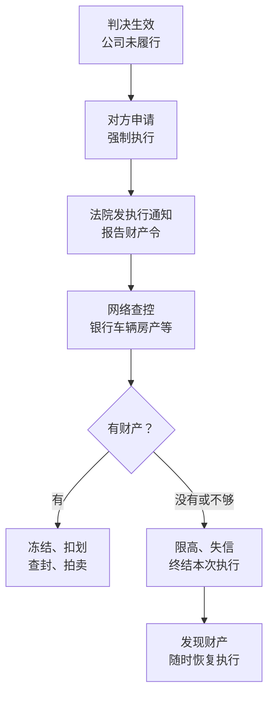

# 公司出事的时候

前面几章讲的是规矩，这一章讲后果：公司欠了钱还不上，被人告了，判了以后还是还不上，会发生什么？哪些落在公司身上，哪些落在你身上？

先把最重要的一句话放在前面：**公司欠钱和你欠钱是两回事。** 公司被告、被执行，原则上执行的是公司的财产。但有几种情况会让公司的问题变成你的问题，其中最常见、也最容易在签字时被忽略的，是**个人担保**。

怎么催款、怎么打官司、仲裁还是诉讼，[《合同与法律文书》](../contracts-legal/)一书从债权人的角度讲过。这一章站在另一边：**你的公司是被告、是被执行人时。**

## 公司欠钱和你欠钱

| 问题 | 公司欠钱 | 你欠钱 |
|---|---|---|
| 被告是谁 | 公司 | 你 |
| 执行谁的财产 | 公司账户、公司名下的车和设备、公司的应收账款、公司持有的股权 | 你的存款、房产、车、工资、你持有的股权 |
| 进失信名单的是谁 | 公司 | 你 |
| 被限制高消费的是谁 | 公司，以及法定代表人、主要负责人、影响债务履行的直接责任人员、实际控制人 | 你 |
| 你的房子会不会被执行 | 原则上不会，例外见下表 | 会 |

「原则上不会」的例外，前面几章都讲过，这里汇总：

| 例外情形 | 结果 | 在哪章 |
|---|---|---|
| 股东滥用公司独立地位逃债；一人公司股东不能证明财产独立 | 股东对公司债务承担连带责任 | 第 2 章 |
| 股东认缴的出资没缴，公司不能清偿到期债务 | 股东在未缴出资范围内承担责任 | 第 3 章 |
| 股东抽逃出资 | 股东在抽逃范围内承担责任 | 第 3 章 |
| 董事、高管故意或重大过失给他人造成损害 | 董事、高管个人赔偿 | 第 4 章 |
| 公司注销时承诺「没有债务」不实，或未清算就注销 | 股东、清算义务人承担责任 | 第 8 章 |
| **你以个人名义为公司的债务签了担保** | **你作为保证人承担保证责任** | 本章 |

## 被起诉：别不理

公司被起诉时，法院会把起诉状副本、应诉通知书、开庭传票等文书送达给公司。送到哪里？首先是**公司登记的住所**，也会按照合同里约定的送达地址、法定代表人的联系方式送达。

这里有一个和第 6 章相连的风险：**注册地址联系不上，不等于你收不到判决。** 法院有一套送达规则，地址无效的，可以按约定地址送达、邮寄送达，必要时公告送达。公告期满就视为送达，公司缺席，法院照样可以审理、判决。很多老板第一次知道公司被告，是在银行账户被冻结的时候。

所以：

- **公司登记的地址和联系电话要一直有效**
- **合同里约定的送达地址要真实**，搬家了要书面通知对方
- **收到法院文书，按期处理**：在答辩期内提交答辩状、准备证据，必要时请律师。不理会只会让对方的主张更容易成立

## 判决之后：强制执行

> [!WARNING]
> 本节和下面几节涉及的强制执行、限制高消费、失信被执行人、限制出境、追加被执行人的规则，依据《民事诉讼法》以及最高人民法院关于限制被执行人高消费、公布失信被执行人名单信息、民事执行中变更和追加当事人等司法解释整理。这些规定会修订，以国家法律法规数据库（flk.npc.gov.cn）和最高人民法院公布的最新文本为准。

判决生效后，公司在规定的期限内没有履行，对方可以申请强制执行。执行的大致过程：

几个容易误解的地方：

- **报告财产令必须如实回应**。公司要按法院要求如实报告财产情况。拒绝报告或者虚假报告，本身就是被列入失信名单的情形之一，情节严重的还可能被罚款、拘留
- **「终结本次执行」不是案子结束了**。法院查不到可供执行的财产时，会裁定终结本次执行程序，但债务还在，限制高消费等措施通常还在；只要发现财产，申请执行人随时可以申请恢复执行
- **执行期间转移财产是红线**。在诉讼或执行期间把公司的钱转走、把设备过户给别人，可能构成拒不执行判决、裁定罪（第 4 章）

申请执行的期限、执行费用等，从债权人角度的说明见[《合同与法律文书》第 8 章](../contracts-legal/08-collections-disputes.md#判了不给强制执行)。

## 限制高消费

公司被执行而没有按执行通知履行，法院可以对公司采取限制消费措施。对**单位**被执行人，被限制的不只是公司，还包括它的**法定代表人、主要负责人、影响债务履行的直接责任人员、实际控制人**。

被限制后，这些人不能有以下以财产支付费用的行为，主要包括：

- 乘坐交通工具时，选择飞机、列车软卧、轮船二等以上舱位
- 乘坐 G 字头动车组列车全部座位、其他动车组列车一等以上座位
- 在星级以上宾馆、酒店、夜总会、高尔夫球场等场所进行高消费
- 购买不动产或者新建、扩建、高档装修房屋
- 租赁高档写字楼、宾馆、公寓等场所办公
- 购买非经营必需车辆
- 旅游、度假
- 子女就读高收费私立学校
- 支付高额保费购买保险理财产品
- 其他非生活和工作必需的消费行为

几个要点：

- **法定代表人是第一个被限的**。即使你对公司欠的这笔钱一无所知，只要你登记在法定代表人一栏，就会被限
- **因私消费可以申请**。被限的个人因私消费、用个人财产支付上述费用的，可以向执行法院提出申请，法院审查属实的可以准许
- **怎么解除**：公司履行完毕、和申请执行人达成执行和解并履行、提供确实有效的担保，或者申请执行人同意解除的，可以申请解除限制消费措施

> [!NOTE]
> 实务中，法定代表人变更后，原法定代表人可以以「已不再担任法定代表人、且不是影响债务履行的直接责任人员」为由，向执行法院申请解除对自己的限制，法院会审查其是否仍实际控制公司或对债务负有责任。审查标准各地有差异。

## 失信被执行人

限制高消费和失信被执行人是两件不同的事。限高是「有执行案件没履行」时普遍会用的措施；失信被执行人名单（俗称「老赖名单」）针对的是有**特定失信情形**的被执行人：

- 有履行能力而拒不履行生效法律文书确定义务的
- 以伪造证据、暴力、威胁等方法妨碍、抗拒执行的
- 以虚假诉讼、虚假仲裁或者以隐匿、转移财产等方法规避执行的
- 违反财产报告制度的
- 违反限制消费令的
- 无正当理由拒不履行执行和解协议的

被列入失信名单的，一般有一定的期限（比如 2 年），有暴力、威胁抗拒执行等情节严重的可以延长；履行完毕等情形下，法院会删除失信信息。

公司被列入失信名单后：

- 在「中国执行信息公开网」上公开，任何人都能查到
- 法院会把名单推送给各部门联合惩戒：融资、招投标、政府采购、资质审核、荣誉评选等都会受限
- 公司的法定代表人等人员同时被限制高消费

注意区分：**被列入失信名单的是公司，不是法定代表人本人。** 但法定代表人会被限高，公开报道里常常把两者混在一起说。如果你个人也被列为失信被执行人，那是因为你自己是被执行人，比如你签了担保（下面讲），或者被追加成了被执行人。

## 限制出境

两条线都可能限制出境：

- **法院**：被执行人不履行法律文书确定的义务的，法院可以对其采取限制出境措施；被执行人是单位的，可以对其法定代表人、主要负责人或者影响债务履行的直接责任人员限制出境
- **税务机关**：欠缴税款的纳税人或者它的法定代表人需要出境的，应当在出境前结清应纳税款、滞纳金或者提供担保；未结清税款、滞纳金，又不提供担保的，税务机关可以通知出境管理机关阻止其出境

> [!WARNING]
> 税务机关阻止欠税人出境有具体的金额和程序要求，以《税收征收管理法》及国家税务总局关于阻止欠税人出境的最新规定为准。

这对经常出差、有出国计划的人影响很大。有的人在机场才知道自己被限制出境，原因是自己几年前挂名当法定代表人的一家公司欠了税。

## 执行追到股东头上

公司被执行、财产不足时，申请执行人可以申请法院**追加**某些人为被执行人。这些人一旦被追加，就直接成为被执行人，个人财产可以被执行，也可能被限高、被列入失信名单。

和普通股东最相关的几种情形：

| 情形 | 追加谁 | 承担范围 |
|---|---|---|
| 股东未缴纳或未足额缴纳出资 | 该股东 | 在未缴纳出资的范围内 |
| 股东抽逃出资 | 该股东 | 在抽逃出资的范围内 |
| 一人公司财产不足以清偿，股东不能证明公司财产独立于自己的财产 | 该股东 | 对公司债务承担连带责任 |
| 公司未经清算即办理注销，股东无偿接受了公司财产 | 该股东 | 在接受的财产范围内 |
| 公司未经依法清算即注销，股东或其他人书面承诺对公司债务承担责任 | 承诺人 | 按承诺 |

第三行是一人公司股东最需要警惕的：**在执行阶段，债权人不用另行起诉，可以直接申请追加你为被执行人。** 你要在执行程序里证明公司财产独立，证明不了，你的财产就可能被执行。

## 个人担保：把有限变成无限

前面讲的各种例外，都需要满足一定的条件，比如滥用、混同、未缴出资。个人担保不需要任何条件：**你签了字，就是你的债。**

### 它是怎么发生的

小公司向银行贷款，银行几乎都会要求公司的实际控制人、法定代表人或大股东**签署个人连带责任保证**，很多还要求配偶一起签字。房东、供应商、融资租赁公司、大客户，有时也会要求老板个人担保。

> [!WARNING]
> 本节关于保证方式、保证期间、夫妻共同债务的规则依据《民法典》及相关司法解释整理，以法律原文和最新司法解释为准，可在国家法律法规数据库（flk.npc.gov.cn）核对。

### 连带责任保证和一般保证

《民法典》把保证分为两种：

| | 一般保证 | 连带责任保证 |
|---|---|---|
| 债权人能不能直接找你 | 不能。要先就公司的财产起诉、执行，执行不到才能找你（先诉抗辩权） | 能。公司到期没还，债权人可以直接要求你还 |
| 实务中谁在用 | 很少 | 银行贷款、租赁、大多数商业担保 |
| 合同没写清楚是哪种时 | 按一般保证处理 | — |

银行的保证合同几乎都写明是**连带责任保证**。这意味着：公司还款一逾期，银行可以不管公司，直接起诉你，执行你的存款和房子。

### 一个算账的例子

> 王蕾开了一家室内设计公司（假设），注册资本 10 万元，已缴足。开业第二年，公司向银行借了一笔 50 万元、期限 3 年的经营贷款，银行要求王蕾和她的丈夫签署连带责任保证。
>
> 公司按月还款，还了 20 万元本金之后，第四年接连两个大客户拖欠款项，公司现金流断了，贷款开始逾期。

| 项目 | 如果没有个人担保 | 签了个人连带担保 |
|---|---|---|
| 银行能找谁 | 公司 | 公司、王蕾、王蕾的丈夫 |
| 王蕾的最大损失 | 已缴的出资 10 万元（如果没有其他例外情形） | 10 万元出资 + 剩余本金 30 万元 + 利息、罚息、实现债权的费用 |
| 家里的房子 | 原则上不受影响 | 可能被查封、拍卖 |
| 王蕾的个人信用 | 原则上不受影响 | 个人征信记录逾期；被执行时进限高、可能进失信名单 |

有限公司的保护，在这笔贷款上**完全失效**。不是因为王蕾做错了什么，而是因为她签字时就放弃了这层保护。

### 配偶签字的意义

银行要求配偶签字，目的是让这笔担保债务成为**夫妻共同债务**，从而可以执行夫妻共同财产。配偶签字后，配偶本人也是保证人。

这意味着创业的风险不只是你一个人的，还落在你的家庭上。是否签、签多少，是要和配偶一起认真商量的决定，可以参考[《过渡期收入与个人保障》里和家人沟通的那一章](../opc-transition/09-family-expectations.md)。

### 签之前想清楚的事

个人担保有时确实避免不了，尤其是小公司第一次贷款时。但签之前，至少做到：

- **把它当成你个人的借款来评估**：如果公司一分钱都还不上，这笔钱你个人还得起吗？还不起，就不要借这么多
- **看清楚保证方式和范围**：是一般保证还是连带责任保证；担保的是本金，还是本金加利息、罚息、律师费等全部费用；是一笔借款，还是「最高额保证」（在一定期间、一定额度内的所有借款都由你担保）
- **看清楚保证期间**：保证人承担责任的期间有多长。合同没约定或约定不明的，《民法典》规定为主债务履行期限届满之日起 6 个月
- **注意「最高额保证」**：它常常跨越多笔贷款，公司以后续贷、展期的部分可能都在你的担保范围内
- **不要为别人的公司担保**。朋友、前老板、亲戚的公司请你签担保，风险和你自己的公司一样，而你对那家公司毫无控制力
- **个人消费贷用于公司，同样是你的债**。用个人信用卡、个人消费贷款给公司周转，借款人就是你，和公司是否有限责任无关，而且个人消费贷款用于经营本身可能违反借款合同

## 被执行时怎么应对

如果公司已经走到了被执行这一步，可以做的事：

- **主动和申请执行人沟通**。很多债权人要的是钱，而不是让你上失信名单。提出分期还款方案，达成**执行和解**并按约履行，通常可以避免进失信名单，也可以申请解除限高
- **如实报告财产**。不要隐瞒、不要转移，这些行为会让事情从民事问题变成可能的刑事问题
- **区分公司财产和个人财产**。如果你被追加为被执行人，或者你的财产被错误执行，可以依法提出执行异议
- **评估公司还要不要继续**。如果公司已经资不抵债、没有继续经营的可能，继续拖下去只会让各种名单越积越多，可以考虑依法清算，必要时申请破产，第 8 章会讲
- **尽早找律师**。执行阶段的程序性很强，异议、复议都有期限

## 本章要点

- 公司欠钱和你欠钱是两回事；例外是滥用和混同、未缴或抽逃出资、董事高管过错、违规注销，以及个人担保
- 注册地址联系不上不等于收不到判决，法院可以公告送达、缺席判决；收到文书要按期处理
- 公司被执行时，法定代表人、主要负责人、影响债务履行的直接责任人员、实际控制人会被限制高消费；因私消费可以申请
- 失信被执行人名单针对有特定失信情形的被执行人；被列入的是公司，法定代表人被限高
- 法院执行和税务欠税都可能限制法定代表人出境
- 执行中，未缴出资、抽逃出资、不能自证财产独立的一人公司股东，可以被直接追加为被执行人
- 个人连带责任保证让有限责任在这笔债上完全失效，配偶签字会把风险带到家庭；签之前按个人借款评估，看清方式、范围、期间
- 被执行时：主动沟通、执行和解、如实报告、不转移财产、尽早找律师
