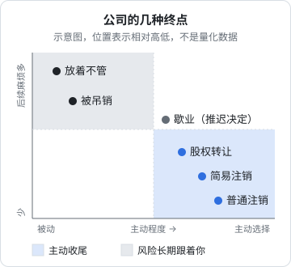
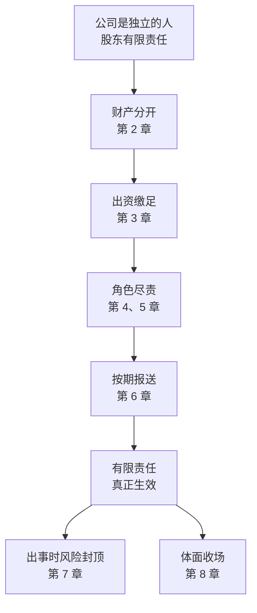

# 公司的终点

开公司时，很少有人会去想它怎么结束。但大多数小公司都会在某一天停下来：生意没做起来，合伙人散了，老板回去上班了，或者生意做得不错、有人愿意接手。

公司停下来的方式有好几种，结果差别很大。有的体面收场，几个月后和你再无瓜葛；有的会跟着你很多年。这一章把几种终点放在一起比较，重点讲两件事：**怎么选**，以及**为什么不能放着不管**。

注销的具体办理步骤（清算、税务注销、登记注销，以及备案、账户等收尾），在[《国内合规实务》第 2 章](../opc-compliance-cn/02-registration.md#注销最好一开始就知道)讲过，这里不重写。

> [!WARNING]
> 本章涉及的歇业、简易注销、普通注销、清算、吊销和强制注销规则，依据新《公司法》《市场主体登记管理条例》及其实施细则整理；股权转让的个人所得税依据国家税务总局的相关规定。公告期、歇业期限、不得任职的年限等数字以国家法律法规数据库（flk.npc.gov.cn）、国家市场监督管理总局和国家税务总局公布的最新规定为准，各地的办理要求以当地市场监管和税务部门为准。

## 不做了，有几条路

| 方式 | 适合什么情况 | 公司还在吗 | 债务怎么办 | 对你个人的影响 |
|---|---|---|---|---|
| 股权转让 | 有人愿意接手，公司还有价值 | 在，换了老板 | 公司的债仍由公司承担 | 你退出了，但未缴出资、历史问题仍可能追到你（见下文） |
| 歇业 | 暂时经营困难，以后还想继续 | 在，暂停经营 | 照常存在 | 歇业期间仍要履行部分义务 |
| 简易注销 | 没有债权债务，或者已经清偿完毕 | 不在了 | 必须已经没有 | 承诺不实的，股东对注销前的债务承担连带责任 |
| 普通注销 | 有债权债务需要清理 | 不在了 | 清算中清偿；资不抵债的转入破产 | 依法清算后，与你无关 |
| 被吊销营业执照 | 不是你选的，是长期不经营、不年报的结果 | **还在**，但不能经营 | 照常存在 | 负有个人责任的法定代表人、董事、经理一定期限内不能任职；仍要清算 |
| 放着不管 | 不是一种「方式」 | 在，状态持续恶化 | 照常存在 | 第 6 章讲的几条线同时恶化，最后多半走到吊销 |

## 股权转让：把公司交给别人

如果公司还有价值，比如有稳定的客户、有资质、有品牌，可以把股权转让给愿意接手的人。转让以后，公司照常存在，只是股东换了。

转让前后要处理好几件事：

**出资问题**。第 3 章讲过，你转让的股权如果出资没缴足，受让人不缴时你要承担补充责任；如果出资期限已到还没缴，你和受让人承担连带责任。最干净的做法是转让前把出资问题处理掉。

**职务变更**。股权转让不会自动变更法定代表人、董事、监事、经理。如果你同时担任这些职务，要一并办理变更登记。只转了股权、法定代表人还是你，新老板用公司做的事，公司出事时你仍然是第一个被限高的人。

**历史问题**。公司在你经营期间的债务、税务问题，转让以后仍由公司承担。如果你作为原股东、原董事在那段时间里有第 2 至第 4 章讲的问题，比如财产混同、抽逃出资、违反忠实勤勉义务，也不会因为转让而消失。转让协议里可以约定双方之间的责任分担，但约束不了公司的债权人。

**税**。自然人转让股权，转让收入减去股权原值和合理费用后的余额，要按「财产转让所得」缴纳个人所得税。转让价格明显偏低又没有正当理由的，税务机关可以核定转让收入。办理股权变更登记前，通常要先完成相关的个税申报。

> [!CAUTION]
> 不要把公司「卖」给你不了解的人，尤其是在网上收购空壳公司、成套公司资料（执照、公章、对公账户、U 盾）的人。这类收购常被用于虚开发票、电信诈骗、洗钱，公司出事后，警方和税务机关会顺着登记信息找回来。转让必须走正式的股权变更登记，并把法定代表人等职务一并变更。

## 歇业：按下暂停键

歇业是《市场主体登记管理条例》设立的一种制度：因自然灾害、事故灾难、公共卫生事件、社会安全事件等原因造成经营困难的，公司可以自主决定在一定时期内歇业。

几个要点：

- **要备案**。歇业前要向登记机关办理备案，备案信息会在国家企业信用信息公示系统公示
- **有期限**。歇业的期限最长不超过 3 年
- **要处理好员工**。歇业前要和员工依法协商劳动关系的处理等有关事项
- **可以不保留经营场所**。歇业期间，可以用法律文书送达地址代替原来登记的住所
- **义务没有全部暂停**。歇业期间，年报一般仍要报送；税务上的申报义务如何处理，要向主管税务机关确认
- **恢复或注销**。歇业期间开展经营活动的，视为恢复营业；期满不恢复的，要及时办理注销

歇业适合「现在做不下去，但确定以后还要做」的情况。如果只是不想做了，歇业只是推迟了决定，到期还是要注销。

## 简易注销

简易注销是给「干净」的公司准备的快速通道：公司**没有发生债权债务，或者已经把债权债务清偿完结**，全体股东书面承诺这一点，就可以申请简易注销。

大致流程：

1. 在国家企业信用信息公示系统发布简易注销公告，公告期 **20 日**
2. 公告期内没有人提出异议的，在公告期满之日起的规定期限内向登记机关申请注销登记
3. 税务方面，符合条件的可以走简化流程；有未结清的税务事项的，要先处理

不能走简易注销的常见情形包括：被列入经营异常名录或严重违法失信名单的（要先移出）、股权被冻结或者存在其他限制、正在被立案调查、还有未结清的债权债务等。各地的具体口径以登记机关的要求为准。

简易注销最需要注意的是那份**承诺**：全体股东承诺「没有债务或债务已经清偿」。**承诺不实的，股东要对注销登记前的债务承担连带责任。** 也就是说，注销以后如果冒出一笔公司没还的欠款，比如一张没付的服务器账单、一个客户的退款请求、一笔欠缴的税，债权人可以直接找股东。

所以在承诺之前，把公司的账认真过一遍：应付账款、预收款、员工工资和社保、税款、各种平台的未结费用。不确定的，走普通注销。

## 普通注销

公司有债权债务需要清理时，走普通注销。核心是**清算**：把公司的财产清点清楚，用来还债，还完以后有剩余的再分给股东，然后办理注销。

和前面各章相关的几条规则：

- **董事是清算义务人**。公司出现解散事由后，董事应当在规定期限内（新《公司法》规定为 15 日内）组成清算组进行清算。清算组一般由董事组成，章程另有规定或股东会另选他人的除外
- **清算义务人怠于履行义务要赔**。清算义务人没有及时履行清算义务，给公司或者债权人造成损失的，要承担赔偿责任
- **通知和公告债权人**。清算组要在规定期限内通知债权人，并在报纸上或者国家企业信用信息公示系统公告，给债权人申报债权的时间
- **先还债，后分配**。公司财产在支付清算费用、职工工资和社保费用、法定补偿金，缴纳所欠税款，清偿公司债务后，剩余的才能按出资比例分给股东。没清偿债务之前分给股东的，股东要退还
- **资不抵债的，转为破产**。清算中发现公司财产不足以清偿债务的，清算组应当依法向法院申请破产清算

普通注销耗时较长，但它是最彻底的：依法清算、注销以后，公司的债务原则上随公司消灭，你作为股东不再承担责任。

> [!NOTE]
> 有些小公司走到最后，账上没钱、还欠着少量的供应商或房东的钱，老板觉得「破产」这个词太重，不愿意走。实际上，依法破产清算正是有限责任设计的那条出口：公司财产还完能还的，剩下的由债权人承担，股东依法清算后免于继续追索。和放着不管相比，它对你个人要安全得多。是否适合走破产程序，请咨询律师。

## 被吊销：最不体面的结局

吊销营业执照是一种行政处罚，常见的原因有：

- 公司成立后无正当理由超过 6 个月未开业，或者开业后自行停业连续 6 个月以上
- 提交虚假材料等方式取得登记，情节严重的
- 其他违法经营行为情节严重的

对一人公司和小公司来说，第一条最常见。老板不再经营、不报税、不年报，第 6 章那条时间线走到最后，就是吊销。

### 吊销不等于注销

这是最常见的误解。吊销以后：

- **公司的法人资格还在**。它不能再经营，但仍然是一个存在的法人，仍然可以被起诉、被执行
- **债务还在**。公司的债权人仍然可以向公司主张权利，追加股东的那些规则（第 7 章）仍然适用
- **清算义务还在**。吊销是法定的解散事由之一，董事作为清算义务人要组织清算，不清算给债权人造成损失的，要承担赔偿责任
- **对个人的任职限制**。担任因违法被吊销营业执照、责令关闭的公司的法定代表人，并负有个人责任的，自被吊销之日起一定期限内（新《公司法》规定为 3 年）不得担任其他公司的董事、监事、高级管理人员

### 强制注销

新《公司法》增加了强制注销制度：公司被吊销营业执照、责令关闭或者被撤销，满 3 年未向登记机关申请注销登记的，登记机关可以通过国家企业信用信息公示系统予以公告，公告期限不少于 60 日；公告期满后没有异议的，登记机关可以注销公司登记。

但要注意：**被强制注销的，原公司股东、清算义务人的责任不受影响。** 也就是说，强制注销只是让登记上的公司消失，不会替你清掉本该承担的清算责任。

## 放着不管的长期风险

把前面几章的内容合起来，一家放着不管、最后被吊销又没有清算的公司，会给它的股东、法定代表人、董事留下这些长期风险：

| 风险 | 来源 | 持续多久 |
|---|---|---|
| 法定代表人被限高、可能被限制出境 | 公司被执行（第 7 章） | 直到公司履行或申请解除 |
| 一定期限内不能担任其他企业的法定代表人、董监高 | 严重违法失信名单（第 6 章）、吊销（本章） | 按规定的期限 |
| 非正常户、纳税信用 D 级关联 | 税务（第 6 章） | 直到解除 |
| 股东被追加为被执行人 | 未缴出资、一人公司财产混同（第 2、3、7 章） | 只要债权还在 |
| 清算义务人赔偿责任 | 不清算给债权人造成损失（本章） | 只要债权人主张 |
| 未缴出资在公司登记里一直挂着 | 第 3 章 | 直到缴足、减资或依法注销 |

对比一下，一家依法注销的公司，在注销完成以后，这一整张表上的风险原则上都不再产生。注销要花几个月和一些代账、公告的费用，但换来的是确定的结束。

## 收尾清单

不论走哪条路，公司停下来时，下面这些事都要一并处理。具体操作见[《国内合规实务》第 2 章](../opc-compliance-cn/02-registration.md#注销最好一开始就知道)：

| 事项 | 要做什么 |
|---|---|
| 员工 | 依法解除或终止劳动合同，结清工资和补偿，办理社保减员 |
| 客户 | 提前通知，处理预收款和未完成的服务，导出或交接客户数据 |
| 合同 | 逐一终止或转让在履行的合同：房租、服务器、软件订阅、外包 |
| 税务 | 结清税款，缴销发票，完成税务注销或清税 |
| 银行 | 注销对公账户 |
| 备案和账号 | 网站和 App 备案、开发者账号、平台店铺、商标的处理 |
| 档案 | 会计凭证、账簿、合同等资料按规定期限保存，注销后也可能被查 |

最后一项容易被忽略。公司注销以后，税务机关、法院、原来的债权人在一定期间内仍可能需要查看公司的账和合同。留着它们，是保护你自己。

## 全书回顾

八章的内容，可以收拢成一条线：前面几条规矩都守住了，有限责任才真正生效。

几条贯穿全书的判断，最后再列一遍：

1. **公司和你是两个「人」**。公司的钱不是你的钱，公司的债原则上不是你的债
2. **有限责任是一份交换**。你得到风险上限，代价是守规矩：财产分开、出资到位、按期报送、角色尽责
3. **注册资本是承诺**。写够用、能缴足的数；写大了，公司出事时就是你要补的钱
4. **名字有分量**。法定代表人、董事、监事、股东，每个名字都对应着责任。不要给别人挂名
5. **合伙先谈退出**。股权分出去容易收回来难，兑现、回购、离婚、继承，在关系好的时候写下来
6. **个人担保是有限责任的例外**。签字前把它当成你个人的借款来评估
7. **不做了，就正式结束**。注销或者依法破产，不要放着不管

## 本章要点

- 公司的终点有股权转让、歇业、简易注销、普通注销、被吊销几种，主动选择的都比被动吊销好
- 股权转让后公司照常存在，未缴出资和历史问题不会因转让消失；法定代表人等职务要一并变更；转让收入要缴个税；不要把公司卖给来路不明的人
- 歇业要备案，最长 3 年，年报等义务不全停，适合确定以后还要做的情况
- 简易注销要全体股东承诺没有债务，公告 20 日；承诺不实的，股东对注销前的债务承担连带责任
- 普通注销的核心是清算：董事是清算义务人，先还债后分配，资不抵债转破产
- 吊销不等于注销：法人资格、债务、清算义务都还在，负有个人责任的法定代表人一定期限内不能任职；强制注销不免除股东和清算义务人的责任
- 公司停下来时，员工、客户、合同、税务、银行、备案和账号、档案要一并收尾

## 接下来读什么

这本书讲的是公司这个「容器」：它是什么、要守什么规矩、怎么收场。容器里装什么生意，是另外的问题。

- 想看看自己手里的职场技能能做成什么生意，接着读本系列的下一本[《把职场技能变成生意》](../skills-to-business/)，它讲不写代码的服务型一人公司
- 如果你还没读过本系列的第一本[《商业常识》](../business-basics/)，它从员工视角讲到生意视角，适合和本书互相对照
- 确定要注册公司时，手续看[《国内合规实务》](../opc-compliance-cn/)，记账、税和公私分开看[《财务与税务》](../opc-finance/)，合同和催款看[《合同与法律文书》](../contracts-legal/)
- 业务主要面向海外的，主体和收款看[《出海实务》](../going-global/)
- 想系统地了解一个人怎么做一门生意，看[《一人公司方法论》](../opc-playbook/)
