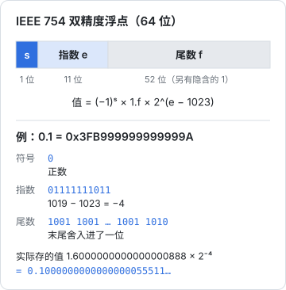

# 数据的表示

写上层代码的人很少直接和比特打交道，但比特会以别的样子找上门来：`0.1 + 0.2` 不等于 `0.3`，数据库里的 `bigint` 到了 JS 里末尾几位变了，一个 emoji 的 `length` 是 2，`varchar(10)` 存不下十个字。这些都不是 bug，而是「数据在机器里怎么表示」的直接后果。这一章从整数讲到浮点再讲到字符编码，每一节都落回到你写 TS 时真会碰到的场景。

## 关于这本书

这本书写给已经在写 TypeScript、React、Node 的全栈开发者。你不需要去写操作系统，但会不断碰到操作系统和硬件在背后做的决定：Node 为什么能用一个线程扛住几千个连接、Postgres 提交一笔事务为什么要等磁盘、容器里的程序为什么报「找不到共享库」。读懂这些，排查问题时就知道该往哪一层看。

全书九章，从下往上：

| 章 | 内容 | 落到哪 |
|---|---|---|
| 1 | 数据的表示 | JS Number、`bigint` 列、UTF-8 与 UTF-16 |
| 2 | CPU 与指令执行 | 流水线、分支预测、arm64 与 x86-64 |
| 3 | 内存层次与缓存局部性 | 实测访存延迟、遍历顺序、TypedArray |
| 4 | 虚拟内存 | RSS、容器内存上限、OOM、fork 写时复制 |
| 5 | 进程与线程 | Node 的线程、Postgres 每连接一进程、Electron |
| 6 | 并发与同步原语 | 单线程 JS 里的竞态、锁、Atomics |
| 7 | I/O 模型 | 阻塞、非阻塞、epoll、io_uring，Node 事件循环 |
| 8 | 文件系统与持久化 | 页缓存、fsync、原子替换、数据库 WAL |
| 9 | 链接、加载与可执行文件 | 动态链接、glibc 与 musl、原生模块 |

书里的实验数字大多在一台 Apple M3 Pro（arm64，macOS）上用 Node 22 实测，换一台机器数字会变，但量级关系通常不变。Linux 命令和工具的用法见[《Linux 实战》](../linux-essentials/)，Node 运行时本身的细节见[《TS 与 Node 进阶》](../ts-node-advanced/)，两本书讲过的这里只点到为止。

## 一切都是比特，含义由解释决定

内存里的一段字节本身没有类型。同样四个字节 `0x42 0x28 0x00 0x00`，当成 32 位大端整数是 1109917696，当成 32 位浮点数是 42.0，当成 ASCII 是字符 `B(` 加两个空字节。类型是程序约定的「怎么读这段字节」。

JS 里可以直接看到这件事：

```ts
const buf = new ArrayBuffer(4);
const view = new DataView(buf);
view.setFloat32(0, 42.0);             // 默认大端写入

console.log(view.getUint32(0).toString(16)); // 42280000
console.log(view.getInt32(0));               // 1109917696
console.log(new Uint8Array(buf));            // Uint8Array(4) [ 66, 40, 0, 0 ]
```

`ArrayBuffer` 是一段原始字节，`Uint8Array`、`Float32Array`、`DataView` 是「用某种方式解释它」的视图。理解了这一点，后面的整数溢出、浮点误差、乱码都只是「写的人和读的人对解释方式的约定不一致」。

### 字节序

多字节的数在内存里先放高位还是先放低位，叫字节序（endianness）。x86-64 和 arm64（包括 Apple Silicon 和手机）都是**小端**：低位字节在低地址。网络协议和很多文件格式约定用**大端**。

```ts
const b = new Uint8Array(new Uint32Array([0x11223344]).buffer);
console.log(b); // Uint8Array(4) [ 68, 51, 34, 17 ]，即 0x44 0x33 0x22 0x11：小端
```

`TypedArray` 用的是本机字节序，`DataView` 的读写方法默认大端、最后一个参数传 `true` 才是小端。解析二进制格式（zip、PNG、MP3 的帧头）时用 `DataView` 并显式写出字节序，代码换到哪台机器上都对。hatch-shelf 解压书包用的 fflate 读 zip 头时就是逐字节按小端拼的，zip 格式规定所有整数字段都是小端。

## 整数：补码与溢出

### 补码

有符号整数在几乎所有现代 CPU 上都用**补码**（two's complement）表示：最高位权重是负的。8 位时，`1000_0000` 是 -128，`1111_1111` 是 -1。补码的好处是加减法不用区分正负，同一个加法电路就能算。

$$
\text{value} = -b_{n-1} \cdot 2^{n-1} + \sum_{i=0}^{n-2} b_i \cdot 2^i
$$

n 位补码的范围是 $[-2^{n-1}, 2^{n-1}-1]$，所以 32 位有符号整数最大是 2147483647，再加 1 就绕到 -2147483648。

### JS 里藏着的 32 位整数

JS 的 `number` 是 64 位浮点，但位运算会先把操作数转成 **32 位有符号整数**，算完再转回来：

```ts
console.log(2 ** 31 | 0);        // -2147483648
console.log((2 ** 32 + 5) | 0);  // 5：高位直接丢掉
console.log(0xffffffff >> 0);    // -1
console.log(0xffffffff >>> 0);   // 4294967295：>>> 0 是「当无符号解释」
console.log(~~3.7);              // 3：常见的取整写法，超过 2^31 就错
```

这就是为什么网上有人用 `x | 0` 取整、用 `~~x` 代替 `Math.trunc`：它们只对 32 位范围内的数正确。时间戳（毫秒级早已超过 2^31）、文件大小、自增 id 都可能超出，取整老老实实用 `Math.trunc`。

哈希函数里用位运算是对的，因为那里本来就要 32 位截断的语义。`Math.imul` 做 32 位整数乘法、`>>> 0` 转无符号，是写 FNV、MurmurHash 这类函数的标准写法：

```ts
// FNV-1a 32 位：所有运算都在 32 位整数里绕
export function fnv1a(bytes: Uint8Array): number {
  let h = 0x811c9dc5;
  for (const b of bytes) {
    h ^= b;
    h = Math.imul(h, 0x01000193);
  }
  return h >>> 0;
}
```

### 64 位整数与 bigint 列

Postgres 的 `bigint`（`int8`）是 64 位有符号整数，最大约 $9.22 \times 10^{18}$。JS 的 `number` 只能**精确**表示到 $2^{53}-1$（下一节解释原因），超过就开始丢精度：

```ts
console.log(Number.MAX_SAFE_INTEGER);       // 9007199254740991
console.log(2 ** 53 + 1);                    // 9007199254740992：加的 1 没了
console.log(JSON.parse('{"id":9007199254740993}').id); // 9007199254740992
```

所以 node-postgres（`pg`）默认把 `int8` 列**解析成字符串**而不是 `number`：宁可让你多写一步转换，也不悄悄改掉你的 id。Drizzle 的 `bigint` 列要求显式选 `mode: "number"` 或 `mode: "bigint"`，也是同一个原因。

几条实际做法：

- 自增主键在可预见的未来不会超过 $2^{53}$，用 `mode: "number"` 省事；但要知道这是一个假设
- 雪花 id、外部系统给的 64 位 id、纳秒时间戳，一律当字符串或 `bigint` 处理，**接口 JSON 里也传字符串**。前端 `JSON.parse` 会在你看不到的地方把它截断
- 金额用整数「分」存（理由见下一节和[《数据库原理与实战》的类型选择](../database-practice/01-modeling.md#类型选择存储约定)），一个门店系统的金额累计离 $2^{53}$ 分（约 900 亿元）还远

JS 的 `bigint` 是任意精度整数，适合做这些 id 和大数运算，代价是不能和 `number` 混算、`JSON.stringify` 默认会抛错、比 `number` 慢得多。它是「需要时才用」的工具，不是 `number` 的替代品。

## 浮点数：IEEE 754 双精度

### 一个 double 的三段

JS 的 `number`、Postgres 的 `double precision`、SQLite 的 `REAL` 都是 IEEE 754 双精度浮点：64 位分成符号、指数、尾数三段。



它表示的值是：

$$
(-1)^{s} \times 1.f \times 2^{e - 1023}
$$

尾数 f 有 52 位，加上隐含的那个前导 1，一共 53 位有效二进制数字。这就是 $2^{53}$ 这个边界的来历：超过它，相邻两个可表示的数之间的间隔就大于 1，整数开始「跳着」表示。

### 间隔随大小变化

浮点数的精度是**相对**的：数越大，相邻两个可表示值之间的间隔（ulp，unit in the last place）越大。间隔等于 $2^{\lfloor \log_2 x \rfloor - 52}$：

| 数值量级 | 相邻可表示值的间隔 | 意味着什么 |
|---|---|---|
| 1 | $2^{-52} \approx 2.2 \times 10^{-16}$ | 就是 `Number.EPSILON` |
| 1000 | $2^{-43} \approx 1.1 \times 10^{-13}$ | 普通金额的小数部分足够精确 |
| $10^{9}$ | $2^{-23} \approx 1.2 \times 10^{-7}$ | 秒级时间戳带小数，精度到百纳秒左右 |
| $1.7 \times 10^{12}$（毫秒时间戳） | $2^{-12} \approx 2.4 \times 10^{-4}$ | 毫秒时间戳还能放下微秒，放不下纳秒 |
| $2^{53}$ | 2 | 奇数开始表示不了 |

这张表解释了 `performance.now()` 为什么返回「从进程启动算起」的毫秒数而不是绝对时间：数小，间隔就小，能保留到微秒以下的精度。

### 0.1 为什么不精确

十进制的 0.1 写成二进制是无限循环小数 $0.000110011001100\ldots_2$，52 位尾数只能截断（舍入）。存进去的其实是离 0.1 最近的那个 double：

```ts
console.log((0.1).toFixed(20));  // 0.10000000000000000555
console.log(0.1 + 0.2);          // 0.30000000000000004
console.log(0.1 + 0.2 === 0.3);  // false
```

0.1 和 0.2 各有一点向上的误差，加起来恰好舍入到了 0.3 旁边的那个 double，而字面量 0.3 被舍入到了另一个。打印时 JS 用「能唯一还原出这个 double 的最短十进制」，于是你看到了那串 4。

这类误差会在最不想要的地方出现：

```ts
console.log(1.005.toFixed(2));               // "1.00"，不是 "1.01"
console.log(Math.round(1.005 * 100) / 100);  // 1
```

1.005 存进去其实是 1.00499999999999989…，四舍五入当然得 1.00。**结论是：钱不要用浮点数算。** 用整数分存、整数分算，只在显示时除以 100；需要按比例分摊（比如把一笔开支摊到 12 个月）时，先算整数部分，再把余下的几分逐个分给前几项，保证总和不变：

```ts
/** 把 total 分（整数）按份数分摊，余数从前往后每份多给 1 分，总和严格等于 total */
export function splitCents(total: number, parts: number): number[] {
  if (!Number.isSafeInteger(total) || !Number.isInteger(parts) || parts <= 0) {
    throw new RangeError("total 必须是安全整数，parts 必须是正整数");
  }
  const base = Math.trunc(total / parts);
  let rest = total - base * parts;
  return Array.from({ length: parts }, () => {
    if (rest > 0) { rest--; return base + 1; }
    if (rest < 0) { rest++; return base - 1; }
    return base;
  });
}

console.log(splitCents(10000, 3)); // [ 3334, 3333, 3333 ]
```

### 比较浮点数

非金额的浮点计算（坐标、比例、统计值）无法避免误差，比较时就不能用 `===`，而要看差值是否落在容差内。容差要和数值量级相关：

```ts
export function nearlyEqual(a: number, b: number, rel = 1e-9, abs = 1e-12): boolean {
  return Math.abs(a - b) <= Math.max(abs, rel * Math.max(Math.abs(a), Math.abs(b)));
}
```

只用绝对容差（`Math.abs(a - b) < 1e-9`）在数值很大时等于要求严格相等，在数值很小时又太宽松。

### 几个特殊值

IEEE 754 为指数全 1 的情况保留了特殊含义：`Infinity`、`-Infinity` 和 `NaN`。还有 `+0` 和 `-0` 两个零。

```ts
console.log(1 / 0, -1 / 0);        // Infinity -Infinity
console.log(NaN === NaN);          // false：NaN 不等于任何值，包括自己
console.log(Object.is(NaN, NaN));  // true
console.log(0 === -0, Object.is(0, -0)); // true false
console.log(JSON.stringify({ a: NaN, b: Infinity })); // {"a":null,"b":null}
```

最后一行值得记住：`NaN` 和 `Infinity` 过一遍 JSON 就变成 `null`。一个统计接口里除以零产生的 `Infinity`，前端收到的是 `null`，图表上那一点直接消失，没有任何报错。在服务端算比率时先处理分母为零的情况。

## 字符编码

### 码点、编码与字节

Unicode 给每个字符分配一个编号，叫**码点**（code point），写作 `U+4E2D`（「中」）、`U+1F44D`（👍）。码点范围是 0 到 0x10FFFF。码点怎么变成字节，由**编码**决定：

| 编码 | 每个码点占多少 | 谁在用 |
|---|---|---|
| UTF-8 | 1–4 字节，ASCII 占 1，汉字多为 3，emoji 4 | 文件、网络、Postgres、SQLite 默认、Linux |
| UTF-16 | 2 或 4 字节（超过 U+FFFF 用两个「代理对」） | JS 字符串、Java、Windows API、iOS 的 NSString |
| UTF-32 | 固定 4 字节 | 很少直接用 |

UTF-8 能成为事实标准，是因为它兼容 ASCII、没有字节序问题、遇到损坏的字节能在下一个字符处重新同步。

### JS 字符串的 length

JS 字符串是 **UTF-16 码元**的序列，`length` 数的是码元个数，不是「字符」个数：

```ts
console.log("中".length, Buffer.byteLength("中"));   // 1 3
console.log("👍".length, [..."👍"].length);           // 2 1
console.log(Buffer.byteLength("👍"));                 // 4

const family = "👨‍👩‍👧";
console.log(family.length);                           // 8
console.log([...family].length);                       // 5：三个人加两个零宽连接符
console.log([...new Intl.Segmenter().segment(family)].length); // 1：用户眼里的一个字
```

同一个「一家三口」，在不同层面分别是 8 个 UTF-16 码元、5 个码点、18 个 UTF-8 字节、1 个字形簇（grapheme cluster）。哪个数是对的，取决于你在问什么：

- **存储和传输的大小**：数 UTF-8 字节，`Buffer.byteLength` 或 `new TextEncoder().encode(s).length`
- **截断显示**：按字形簇截，用 `Intl.Segmenter`；按 `slice` 截可能把代理对劈成两半，留下一个显示成 `�` 的孤儿码元
- **数据库长度限制**：看数据库怎么数（下一小节）

### 数据库里的长度

Postgres 的 `varchar(n)` 和 `char_length` 按**字符**（码点）数，`octet_length` 按字节数。SQLite 的 `length()` 对文本按字符数，对 BLOB 按字节数。所以前端用 `s.length <= 50` 做的校验，和后端 `varchar(50)` 的约束对 emoji 的判断不一致：一个含 30 个 emoji 的昵称，`length` 是 60，前端拦了，数据库其实放得下。

让前后端用同一个口径：

```ts
// 和 Postgres varchar(n) 的计数方式一致：按码点
export const codePointLength = (s: string) => {
  let n = 0;
  for (const _ of s) n++;
  return n;
};
```

zod 的 `.max()` 用的是 `length`，要按码点限制就写成 `.refine((s) => codePointLength(s) <= 50)`。

### 乱码从哪来

乱码只有一个原因：**写入时用的编码和读取时假设的编码不一样**。常见场景：

- Windows 上的 Excel 导出 CSV 默认用本地编码（简体中文系统是 GBK），用 UTF-8 去读就是一片乱码。反过来，UTF-8 的 CSV 用 Excel 打开也乱，要在文件开头加 BOM（`EF BB BF`）它才认
- 从 `Buffer` 按固定大小切块，再逐块 `toString("utf8")`，切点落在一个汉字的三个字节中间，两边各出现一个 `�`。流式处理文本要用 `TextDecoder` 的 `stream: true` 模式，或者 Node 的 `string_decoder`，它们会把半个字符留到下一块

```ts
const decoder = new TextDecoder("utf-8");
const chunks = [new Uint8Array([0xe4, 0xb8]), new Uint8Array([0xad, 0x41])]; // 「中」被切开，后面跟 A
let out = "";
for (const c of chunks) out += decoder.decode(c, { stream: true });
out += decoder.decode();
console.log(out); // 中A
```

hatch-shelf 的局域网传书服务收到的上传请求就是一块块到达的字节（第 7 章会讲它的解析器），请求头和 multipart 分段头里的文件名可能是中文。它先把字节攒齐（请求头攒到空行为止，请求体攒满 `Content-Length`），再整体解码，而不是来一块解一块。

### 规范化

同一个字形可能有多种码点序列：「é」可以是单个码点 `U+00E9`，也可以是 `e` 加组合重音符 `U+0301`。两者显示一样，`===` 却不等。macOS 的文件系统 API 返回的文件名历史上倾向于分解形式（NFD），从 Mac 上传到 Linux 服务器的文件名，在数据库里查不到，常常就是这个原因。比较或建唯一索引之前，统一做 `s.normalize("NFC")`。

## 本章要点

- 字节本身没有类型，类型是解释方式；`ArrayBuffer` 是字节，各种 `TypedArray` 和 `DataView` 是视图
- x86-64 与 arm64 都是小端；解析二进制格式用 `DataView` 并显式写字节序
- JS 位运算在 32 位有符号整数上进行，`| 0`、`~~` 超过 $2^{31}$ 就错
- `number` 只能精确表示到 $2^{53}-1$；`int8` 列、64 位外部 id 用字符串或 `bigint`，JSON 里传字符串
- 浮点精度是相对的，0.1 无法精确表示；金额用整数分，分摊时把余数分出去保证总和不变
- `NaN`、`Infinity` 经过 JSON 变成 `null`
- JS 字符串的 `length` 数 UTF-16 码元；存储看 UTF-8 字节，截断看字形簇，和数据库对齐看码点
- 乱码是编解码约定不一致；流式解码要保留半个字符，比较文本前先 `normalize`
