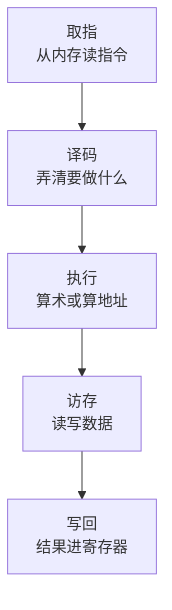
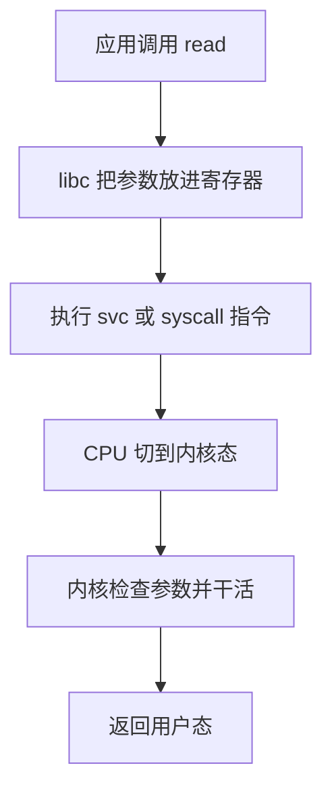

# CPU 与指令执行

你写的每一行 TS，最终都会变成 CPU 一条条执行的机器指令。大多数时候你不需要关心这些指令长什么样，但有几件事值得知道：CPU 为什么能一个时钟周期做好几件事、为什么同样的循环数据排过序就快几倍、为什么在 Mac 上构建的镜像到服务器上跑不起来、为什么一次系统调用比一次函数调用贵上百倍。这一章把 CPU 当成一台「按顺序读指令、尽量并行干活」的机器来看，讲到够用为止。

## 从 TS 到机器码

TS 先被擦掉类型变成 JS，JS 交给 V8：解析成字节码由解释器 Ignition 执行，热点函数再被优化编译器编译成机器码（细节见[《TS 与 Node 进阶》的 V8 编译管线](../ts-node-advanced/05-v8-pipeline-hidden-classes.md)）。不管中间经过多少层，CPU 最后看到的只有机器码。

为了看清机器码长什么样，用一段 C 最直接。下面是一个对整数数组求和的函数：

```c
long sum(const int *a, long n) {
  long s = 0;
  for (long i = 0; i < n; i++) s += a[i];
  return s;
}
```

在 Apple Silicon 上用 `clang -O1 -S sum.c` 编译，去掉汇编器指令后，核心是这几行 arm64 汇编：

```text
_sum:
	cmp	x1, #1            ; n 和 1 比较
	b.lt	LBB0_4            ; n < 1 就跳到末尾返回 0
	mov	x8, #0            ; s = 0
LBB0_2:
	ldrsw	x9, [x0], #4      ; 从地址 x0 读 4 字节有符号整数到 x9，然后 x0 += 4
	add	x8, x8, x9        ; s += x9
	subs	x1, x1, #1        ; n -= 1，并设置条件标志
	b.ne	LBB0_2            ; 结果不为 0 就跳回循环开头
	mov	x0, x8            ; 返回值放在 x0
	ret
LBB0_4:
	mov	x8, #0
	mov	x0, x8
	ret
```

从这段汇编能看出 CPU 的基本工作方式：

- **寄存器**：`x0`、`x1`、`x8` 是 CPU 内部的几十个高速存储位置。参数从寄存器传进来（`x0` 是数组地址，`x1` 是长度），返回值也放在寄存器里。arm64 有 31 个 64 位通用寄存器，x86-64 有 16 个
- **内存访问是单独的指令**：`ldrsw` 从内存读，`add` 只在寄存器之间算。这是 RISC 风格的「load/store 架构」
- **控制流就是条件跳转**：`for` 循环变成了「比较、设标志、按标志跳转」。`if`、`while`、`switch`、函数调用，在机器层面都是跳转

编译器还做了一个变换：它没有维护 `i`，而是直接让 `n` 递减到 0、让指针 `x0` 每次加 4。源代码描述的是「要什么结果」，编译器可以用任何等价的指令序列实现它。V8 的优化编译器做的也是这类事情。

## 指令集：arm64 与 x86-64

CPU 认识哪些指令、有哪些寄存器、怎么编码，由**指令集架构**（ISA）规定。现在你会碰到的主要是两种：

| | x86-64（amd64） | arm64（aarch64） |
|---|---|---|
| 典型设备 | 大多数云服务器、Intel/AMD 电脑 | Apple Silicon Mac、所有 iPhone 和绝大多数安卓手机、AWS Graviton 等 ARM 服务器 |
| 指令长度 | 变长，1–15 字节 | 定长，4 字节 |
| 风格 | CISC，一条指令可以直接操作内存 | RISC，只有 load/store 访问内存 |
| 通用寄存器 | 16 个 | 31 个 |

两者的机器码互不兼容。这件事在日常开发里有几个直接后果：

- **Docker 镜像要分架构**。在 M 系列 Mac 上 `docker build` 默认产出 arm64 镜像，推到 x86-64 服务器上就跑不起来，报 `exec format error`。解决办法是用 `docker buildx` 指定 `--platform linux/amd64` 或构建多架构镜像，见[《容器技术》的多架构一节](../docker-containers/07-registry.md#多架构mac-构建服务器跑不起来)
- **原生模块要分架构**。`better-sqlite3`、`sharp` 这类带 `.node` 二进制的包，npm 安装时按当前机器下载预编译文件。把 Mac 上的 `node_modules` 整个拷进 Linux 容器，里面的二进制既不是 Linux 格式也可能不是对的架构（第 9 章细讲）
- **iOS 模拟器和真机**。Apple Silicon Mac 上的 iOS 模拟器跑的是 arm64 代码，真机也是 arm64，但两者链接的系统库不同（一个是模拟器 SDK，一个是设备 SDK），所以 Xcode 仍然要分别构建

Mac 上能跑 x86-64 程序，靠的是 Rosetta 2：它把 x86-64 机器码**翻译**成 arm64 机器码再执行。Docker Desktop 也可以借它跑 amd64 镜像，能用，但比原生慢，原生模块和 JIT 密集的程序（比如 Node 本身）尤其明显。

## 一条指令的执行：流水线

最朴素的 CPU 每条指令依次做完「取指、译码、执行、访存、写回」再开始下一条。现代 CPU 把这些阶段做成**流水线**：第 1 条指令在执行时，第 2 条在译码，第 3 条在取指，像工厂流水线一样每个阶段同时在处理不同的指令。



在这之上，现代 CPU 还做了两件事：

- **超标量**：每个周期同时取、译、发射好几条指令。Apple M 系列的性能核一个周期大约能译码 8 条指令
- **乱序执行**：如果第 2 条指令要等内存数据，而第 3、4 条和它无关，CPU 会先执行 3、4，最后按原顺序「提交」结果。对程序来说看起来仍然是按顺序执行的

所以衡量 CPU 效率的指标不只是主频，而是**每周期执行的指令数**（IPC）。一个 3 GHz 的核，IPC 为 4 时每秒执行 120 亿条指令；如果每条指令都在等内存，IPC 可能掉到 0.1 以下。第 3 章会看到，「等内存」恰恰是现代程序最常见的瓶颈。

## 分支预测

流水线有个问题：遇到条件跳转（`b.ne`），在条件算出来之前，CPU 不知道下一条该取哪条指令。等它算出来，流水线已经空转了十几个周期。

CPU 的办法是**猜**。分支预测器记录每个跳转过去的走向，按历史规律预测下一次，然后沿着猜的方向继续往下执行（投机执行）。猜对了没有任何损失；猜错了就把投机执行的结果全部丢掉，从正确的方向重来，代价是十几到二十几个周期。

循环的跳转规律极强（前 n-1 次都跳回去），几乎总能猜对。真正猜不中的是**依赖随机数据的分支**。用 Node 做个实验：

```js
// branch.mjs：对 1000 万个 0–255 的随机整数，只累加 >= 128 的
const N = 10_000_000;
const data = new Int32Array(N);
for (let i = 0; i < N; i++) data[i] = Math.floor(Math.random() * 256);

function sumBig(arr) {
  let s = 0;
  for (let i = 0; i < arr.length; i++) {
    if (arr[i] >= 128) s += arr[i];
  }
  return s;
}

function run(label, arr) {
  sumBig(arr); // 预热，让 V8 先把函数优化编译
  const t = performance.now();
  for (let k = 0; k < 10; k++) sumBig(arr);
  console.log(label, ((performance.now() - t) / 10).toFixed(1), "ms");
}

run("随机", data);
run("排序后", data.slice().sort());
```

```text
$ node branch.mjs
随机 34.3 ms
排序后 8.2 ms
```

同样的数据、同样的计算量，排过序之后快了 4 倍。排序后的数组前一半全部小于 128、后一半全部大于等于 128，分支预测器只在中间猜错一次；随机数据下它有一半的概率猜错。

这不是让你在业务代码里为分支预测排序，那几乎总是得不偿失。它的意义在于：**同样的算法，数据的规律性本身会影响速度**，而且影响可以是数倍。做性能实验时如果用全零或递增的测试数据，可能测出一个在真实数据上永远达不到的结果。

> 编译器有时会把这种简单的 `if` 变成不跳转的条件选择指令（arm64 的 `csel`、x86 的 `cmov`），那时随机和有序就一样快了。V8 在这个例子里没有这样做，换一个 Node 版本结果可能不同，实验的意义在于看到差距可以有多大。

## 用户态与内核态

CPU 至少有两种特权级别。应用程序跑在**用户态**，不能直接访问硬件、不能修改页表、不能关中断；操作系统内核跑在**内核态**，什么都能做。读文件、发网络包、创建线程、申请内存，这些事应用自己做不了，只能请内核代办，方式是**系统调用**（syscall）：



系统调用比普通函数调用贵得多：要切换特权级、保存和恢复寄存器、内核要检查参数的合法性，切换还会污染缓存和分支预测器的状态。在 Mac 上粗测一下：

```js
// sys.mjs
import { openSync, fstatSync } from "node:fs";

const fd = openSync(process.argv[1], "r");
const N = 1_000_000;

let t = performance.now();
for (let i = 0; i < N; i++) fstatSync(fd);
console.log("fstatSync", ((performance.now() - t) * 1e6 / N).toFixed(0), "ns/次");

const o = { size: 1 };
let s = 0;
t = performance.now();
for (let i = 0; i < N; i++) s += o.size;
console.log("读属性", ((performance.now() - t) * 1e6 / N).toFixed(2), "ns/次", s > 0);

t = performance.now();
for (let i = 0; i < N; i++) Date.now();
console.log("Date.now", ((performance.now() - t) * 1e6 / N).toFixed(0), "ns/次");
```

```text
$ node sys.mjs
fstatSync 421 ns/次
读属性 1.23 ns/次 true
Date.now 27 ns/次
```

`fstatSync` 的 421 纳秒里包括 Node 自己构造 `Stats` 对象的开销，但量级已经说明问题：一次系统调用加包装，相当于几百次普通的属性读取。`Date.now()` 也要问操作系统要时间，却只要 27 纳秒，因为 Linux 的 vDSO 和 macOS 的 commpage 把时间映射到了用户态可读的内存里，根本不进内核。

由此得到几条实用的结论：

- **批量胜过逐个**。逐行 `fs.writeSync` 写日志，每行一次系统调用；攒成一块再写，系统调用次数降几个数量级。Node 的 `fs.createWriteStream` 和 pino 这类日志库的缓冲就是为此
- **流式读文件时块不要太小**。Node 可读流默认每次读 64 KB，改成 1 KB 会让系统调用多 64 倍
- **观察系统调用**：Linux 上 `strace -c -p <pid>` 能统计一个进程各种系统调用的次数和耗时，排查「CPU 不高但就是慢」时很有用

## 中断与时间片

CPU 怎么从一个正在死循环的程序手里拿回控制权？靠**中断**。定时器硬件每隔几毫秒向 CPU 发一个中断信号，CPU 不管在执行什么，都会暂停下来跳到内核的中断处理程序。内核借这个机会看看当前进程用完时间片没有，用完了就换另一个进程上来。这叫**抢占式调度**。

网卡收到数据包、磁盘完成一次读写，也是通过中断通知 CPU 的。第 7 章讲 I/O 模型时会看到，「数据到了」这件事最初就是一个硬件中断，经过内核层层传递，最后变成 Node 事件循环里的一个回调。

对 JS 来说，抢占发生在操作系统层面，**不会打断 JS 代码本身的执行顺序**：Node 主线程被换下 CPU 一会儿再换回来，JS 看到的仍然是连续执行。这也是为什么一段同步死循环会让 Node 整个进程失去响应：操作系统照样在调度，只是轮到 Node 的时候它还在跑那个循环，事件循环永远转不到下一轮。

## 多核

单核频率在 2005 年前后就基本到头了，之后性能增长主要靠**多核**。一台服务器有 2 到 128 个核，M3 Pro 有 6 个性能核加 6 个能效核。

多核只对**能并行的工作**有用。一个 Node 进程的 JS 只在一个线程上跑，给它 8 个核，JS 部分也只用得上一个（libuv 线程池和 V8 的 GC 线程会用到其他核）。想让 Node 服务吃满多核，要开多个进程（`node:cluster`、PM2 或者多个容器实例），或者用 `worker_threads` 把计算分出去，第 5 章展开。

### 容器里的核数

> [!WARNING]
> 本小节关于容器内 CPU 核数可见性的描述按 Node 22、cgroup v2 的常见行为整理，不同 Node / libuv 版本和容器运行时的处理方式可能不同，以 Node 官方文档中 `os.availableParallelism()` 的说明和所用 libuv 版本的发行说明为准。

在容器里要注意「看到的核数」和「能用的核数」不一定一致。`docker run --cpus=1` 限制的是 CPU 时间配额（每 100 毫秒最多用 100 毫秒的 CPU 时间），而不是隐藏其他核。程序如果按 `os.cpus().length` 开线程池或 worker，可能在一个只有 1 核配额的容器里开出几十个线程，互相抢那一点配额。`os.availableParallelism()` 比 `os.cpus().length` 更合适，但它是否考虑了 cgroup 配额取决于版本，最稳妥的做法是**把并发数做成配置项**，由部署方根据实际配额显式设定。

## SIMD：一条指令算一组数

还有一种并行发生在单条指令内部：**SIMD**（单指令多数据）。arm64 的 NEON、x86-64 的 SSE/AVX，一条指令可以同时对 4 个 32 位整数或 2 个 64 位浮点数做同样的运算。

你很少直接写 SIMD，但经常间接受益：`memcpy`、`Buffer.indexOf`、JSON 解析器（simdjson 的名字就来自它）、图片处理库 `sharp` 底层的 libvips、编码转换，都大量使用 SIMD。这也是「大块数据的处理交给原生库」通常比手写 JS 循环快一个数量级的原因之一。

## 本章要点

- 所有代码最终都变成机器指令；寄存器、load/store、条件跳转是它的基本形状
- arm64 与 x86-64 的机器码互不兼容：镜像、原生模块都要分架构构建
- 流水线、超标量、乱序执行让一个核每周期执行多条指令；衡量效率看 IPC，不只看主频
- 分支预测猜错代价十几个周期；数据的规律性会让同一个算法快慢差几倍，性能测试要用接近真实的数据
- 系统调用要切到内核态，比函数调用贵上百倍；I/O 要批量、块不要太小
- 定时器中断让内核能抢占进程，但不会打断 JS 的执行顺序；同步死循环会卡死整个事件循环
- Node 的 JS 只用一个核；容器里的 CPU 配额和看到的核数可能不一致，并发数做成配置
