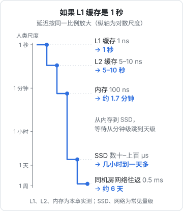

# 内存层次与缓存局部性

上一章说 CPU 一个周期能执行好几条指令，前提是数据已经在手边。如果数据在内存里，一次读取要等一百纳秒左右，够 CPU 执行几百条指令。现代 CPU 的大部分晶体管和设计精力，都花在「让数据尽量已经在手边」这件事上，这就是缓存。这一章用几个 Node 实验测出缓存的效果，再看它怎么影响 JS 的数据结构选择、数据库的页设计和主键选型。

## 速度的鸿沟

过去几十年，CPU 的运算速度增长远快于内存的访问速度。结果是今天的 CPU 一个周期不到半纳秒，而一次内存访问要上百纳秒。为了填这个坑，CPU 和内存之间放了好几层越来越小、越来越快的缓存：

| 层级 | 容量（M3 Pro 性能核） | 一次访问大约多久 | 谁管理 |
|---|---|---|---|
| 寄存器 | 几百字节 | 不到 1 个周期 | 编译器 |
| L1 数据缓存 | 128 KB（每核） | 约 1 ns | 硬件 |
| L2 缓存 | 16 MB（性能核共享） | 约 5–10 ns | 硬件 |
| 内存（DRAM） | 18 GB | 约 100 ns | 操作系统 |
| SSD | 数百 GB 起 | 数十到上百 µs | 操作系统、文件系统 |
| 同机房网络往返 | | 约 0.5 ms | 你的代码 |

> 表里 L1、L2、内存的延迟是下一节在这台机器上实测的；SSD 和网络是常见量级，具体取决于设备和网络环境。容量来自 `sysctl hw.perflevel0`。x86 服务器通常还有一层几十 MB 的 L3，Apple Silicon 在 L2 和内存之间有一层系统级缓存（SLC），作用类似。

每往下一层，容量大一个数量级，速度也慢一个数量级左右。一个程序跑得快不快，很大程度上取决于它的数据有多少能命中上面那几层。

纳秒、微秒这些单位很难产生体感。下图做一个换算：假设一次 L1 访问是 1 秒，其他层级按同样的比例放大：



换算后就很直观：从 L1 到内存是「等一会儿」，到 SSD 和网络就是「等到明天」甚至「等一周」。

## 缓存行：一次搬一块

缓存和内存之间不是按字节搬数据，而是按**缓存行**（cache line）整块搬。x86-64 上缓存行通常是 64 字节，Apple Silicon 是 128 字节（`sysctl hw.cachelinesize` 输出 128）。你读一个 4 字节的整数，CPU 会把它所在的整个 128 字节都搬进 L1。

这带来了缓存起作用的两个前提，合称**局部性**：

- **时间局部性**：刚访问过的数据，很可能马上又被访问。循环里反复用的变量、热点函数的代码都是这样
- **空间局部性**：访问了一个地址，很可能马上访问它旁边的地址。顺序遍历数组就是典型

此外，CPU 的**硬件预取器**会观察访问模式：发现你在顺序读，就提前把后面几行搬进来。顺序访问几乎感觉不到内存延迟，随机访问则每次都要付全价。

## 实验：测出缓存的台阶

怎么测出每一层的延迟？关键是让每次访问都**依赖上一次的结果**，这样 CPU 没法乱序、预取器也猜不到下一个地址。做法是在数组里建一个随机顺序的环，每个元素存着下一个要访问的下标，然后沿着环一直走（指针追逐）：

```js
// chase.mjs：随机指针追逐，测每次访存的平均延迟
function bench(bytes) {
  const n = bytes / 4;          // Uint32Array 每项 4 字节
  const stride = 32;            // 每 128 字节只用一个元素，每一步都落在不同的缓存行
  const m = Math.floor(n / stride);

  // 随机打乱访问顺序
  const order = Array.from({ length: m }, (_, i) => i);
  for (let i = m - 1; i > 0; i--) {
    const j = Math.floor(Math.random() * (i + 1));
    [order[i], order[j]] = [order[j], order[i]];
  }
  // next[a] = b：从 a 走到 b，串成一个环
  const next = new Uint32Array(n);
  for (let i = 0; i < m; i++) next[order[i] * stride] = order[(i + 1) % m] * stride;

  let p = 0;
  for (let i = 0; i < m; i++) p = next[p]; // 先走一圈，把数据装进缓存
  const steps = 10_000_000;
  const t0 = process.hrtime.bigint();
  for (let i = 0; i < steps; i++) p = next[p]; // 每一步都要等上一步的结果
  const t1 = process.hrtime.bigint();
  return { ns: Number(t1 - t0) / steps, p };
}

bench(1 << 20); bench(1 << 20); // 预热 JIT
for (const kb of [32, 96, 256, 1024, 4096, 8192, 32768, 262144]) {
  const best = Math.min(...Array.from({ length: 7 }, () => bench(kb * 1024).ns));
  console.log(`${kb} KB\t${best.toFixed(2)} ns`);
}
```

结果画成图：


台阶非常清楚：

- **96 KB 以内**：全在 128 KB 的 L1 里，每次约 1.2 纳秒，大约 4 个时钟周期
- **256 KB 到 8 MB**：落到 L2，5 到 11 纳秒，随着工作集变大，TLB（第 4 章）也开始不够用，延迟缓慢爬升
- **32 MB 以上**：超出所有缓存，每次都要去内存，100 纳秒以上，是 L1 的近百倍

16 MB 附近是过渡区，多次测量在 34 到 86 纳秒之间跳，图里没有画。M 系列芯片有性能核和能效核，进程被调度到哪种核上也会影响结果，所以每个规模取 7 次中的最小值。

这张图的意义是：**同一句 `p = next[p]`，在不同规模的数据上可以差一百倍**。性能分析工具告诉你某一行很慢时，原因可能根本不是计算，而是它在等内存。

## 遍历顺序

把一个 4096 × 4096 的矩阵（128 MB 的 `Float64Array`）按行存储，分别按行和按列求和：

```js
// matrix.mjs
const N = 4096;
const a = new Float64Array(N * N).fill(1);

function rowMajor() {
  let s = 0;
  for (let i = 0; i < N; i++) for (let j = 0; j < N; j++) s += a[i * N + j];
  return s;
}
function colMajor() {
  let s = 0;
  for (let j = 0; j < N; j++) for (let i = 0; i < N; i++) s += a[i * N + j];
  return s;
}

for (const f of [rowMajor, colMajor, rowMajor, colMajor]) {
  const t = performance.now();
  f();
  console.log(f.name, (performance.now() - t).toFixed(0), "ms");
}
```

```text
$ node matrix.mjs
rowMajor 18 ms
colMajor 111 ms
rowMajor 12 ms
colMajor 104 ms
```

计算量完全一样，按列慢了 8 倍多。按行遍历时，一个 128 字节的缓存行装着 16 个相邻的 double，一次搬运用满 16 次，预取器也能提前准备；按列遍历时，相邻两次访问相距 32 KB，每个缓存行只用了 1 个数就被挤出去了。

在业务代码里，二维数组本身不常见，但同样的道理处处适用：**数据怎么存，就怎么读**。表格数据要按列做统计，就按列存；要逐行渲染，就按行存。

## JS 对象与 TypedArray

JS 的普通数组里放对象时，数组本身只存**指向对象的指针**，对象散落在堆上的各处。遍历这样的数组，每一步都是一次随机访存。同样的数据放在 `Float64Array` 里则是紧挨着的一段原始数字。

```js
// aos.mjs：200 万个点，对象数组 vs 两个 TypedArray
const N = 2_000_000;
const pts = Array.from({ length: N }, () => ({ x: Math.random(), y: Math.random(), label: "p" }));
// 打乱顺序：真实程序里对象的分配顺序和访问顺序往往不一致
for (let i = N - 1; i > 0; i--) {
  const j = Math.floor(Math.random() * (i + 1));
  [pts[i], pts[j]] = [pts[j], pts[i]];
}

const xs = new Float64Array(N);
const ys = new Float64Array(N);
for (let i = 0; i < N; i++) { xs[i] = pts[i].x; ys[i] = pts[i].y; }

function sumObj() { let s = 0; for (let i = 0; i < N; i++) s += pts[i].x * pts[i].y; return s; }
function sumTyped() { let s = 0; for (let i = 0; i < N; i++) s += xs[i] * ys[i]; return s; }
```

```text
sumObj 36.2 ms
sumTyped 1.6 ms
```

二十多倍的差距，几乎全部来自内存访问模式。前一种写法叫「结构体数组」（array of structs），后一种叫「数组结构体」（struct of arrays）。

这不是说业务代码都要改成 TypedArray。一个页面上几百条订单用对象数组完全没问题，可读性更重要。值得换的场景是**大量同构数值的批量计算**：图表的数据点、音频采样、图片像素、统计聚合、地图坐标。一个播放器要画音频波形，处理的是成千上万个采样值，这类数据天然就该放在 `Float32Array` 里，Web Audio 的 `AudioBuffer.getChannelData()` 本身返回的就是它。

V8 自己也在利用这一点：一个只放小整数的普通数组，V8 会用紧凑的「元素种类」存储（见[《TS 与 Node 进阶》数组的元素种类](../ts-node-advanced/05-v8-pipeline-hidden-classes.md#数组的元素种类)），一旦混进一个对象或字符串，就退化成指针数组。

## 伪共享：多核下的缓存行

多核各有自己的 L1。两个核同时读同一个缓存行没问题，但只要一个核要写，硬件的**缓存一致性协议**就要让其他核里的副本失效。两个核轮流写同一个缓存行，这一行就在两个核之间来回搬运。

麻烦在于，即使两个线程写的是**不同的变量**，只要它们恰好在同一个缓存行里，也会互相拖累。这叫**伪共享**（false sharing）。用两个 worker 各自对一个 `SharedArrayBuffer` 里的计数器做 5000 万次原子加：

```js
// falseshare.mjs
import { Worker, isMainThread, workerData } from "node:worker_threads";

const ITER = 50_000_000;
if (isMainThread) {
  for (const stride of [1, 32]) {
    const sab = new SharedArrayBuffer(4 * 64);
    const t = performance.now();
    await Promise.all([0, 1].map((k) => new Promise((res) => {
      // 第 k 个 worker 写下标 k * stride：stride 为 1 时两个计数器相邻，为 32 时相距 128 字节
      const w = new Worker(new URL(import.meta.url), { workerData: { sab, idx: k * stride } });
      w.on("exit", res);
    })));
    console.log(stride === 1 ? "相邻（同一缓存行）" : "隔开 128 字节", (performance.now() - t).toFixed(0), "ms");
  }
} else {
  const a = new Int32Array(workerData.sab);
  for (let n = 0; n < ITER; n++) Atomics.add(a, workerData.idx, 1);
}
```

```text
$ node falseshare.mjs
相邻（同一缓存行） 1335 ms
隔开 128 字节 301 ms
```

两个线程之间没有任何逻辑上的共享，仅仅因为计数器挨在一起，就慢了 4 倍多。日常的 Node 代码很少用到 `SharedArrayBuffer`，但如果你用 worker 做并行统计、每个 worker 往共享数组里写自己的结果，记得让每个 worker 的槽位之间隔开至少一个缓存行。

## 数据库：为局部性设计的结构

数据库是把局部性用到极致的软件，理解了缓存行，就容易理解它的很多设计。

**页**。Postgres 以 8 KB 的页为单位读写和缓存数据，SQLite 默认 4 KB。磁盘、操作系统页缓存、数据库缓冲池都按块工作，原因和缓存行一样：一次搬一块，顺带的数据很可能马上就要用。

**B+ 树**。索引用 B+ 树而不是二叉树，是因为一个 8 KB 的页能装几百个键，树只有三四层高。查找一个键只需要读三四个页，而且上面几层几乎总在内存里。这和上面「每次访存要么命中要么付全价」是同一个逻辑，只是层级从「缓存与内存」换成了「内存与磁盘」。原理展开见[《数据库原理与实战》的索引一章](../database-practice/02-indexes.md#为什么是树为什么是页)。

**主键的局部性**。用随机的 UUIDv4 做主键，每次插入都落在 B+ 树的随机位置，要把一个随机的叶子页读进内存、改掉、再写回；表大到索引放不进内存时，插入速度会明显下降，写入的 WAL 也会变多。用自增整数或按时间排序的 UUIDv7，新数据总是插在树的最右边，热的只有那几个页。同样是 16 字节的 UUID，v7 比 v4 对缓存友好得多。

**顺序扫描不一定慢**。执行计划里看到 `Seq Scan` 不必紧张：顺序读一张几千行的小表，预取和页缓存让它比走索引后再随机回表更快。优化器也知道这一点，这也是为什么小表上它经常不用你建的索引。

## 写代码时能做什么

大多数业务代码的瓶颈在 I/O（数据库、网络），而不在缓存。但下面几条成本很低，值得养成习惯：

- **批量处理数值数据时用 TypedArray**，并按访问顺序存放
- **遍历按存储顺序**；多维数据想清楚是按行用还是按列用
- **热数据小一点**：一个被频繁访问的 `Map`，值里只放热路径要用的字段，大字段另存
- **主键用有序的值**：自增或 UUIDv7，别用 UUIDv4
- **测性能时注意工作集**：用 1000 条数据测出来的结果，放大到 1000 万条时可能换了一层缓存，结论完全不同

## 本章要点

- CPU 和内存的速度相差上百倍，中间靠多层缓存填补；每层容量大一个量级、速度慢一个量级
- 缓存按缓存行搬数据（x86-64 通常 64 字节，Apple Silicon 128 字节）；时间局部性和空间局部性决定命中率
- 实测：L1 约 1.2 ns，L2 约 5–11 ns，内存 100 ns 以上；同一行代码在不同数据规模下可差百倍
- 按存储顺序遍历；对象数组是指针数组，大量数值计算用 TypedArray 可快一个数量级
- 多线程写同一缓存行里的不同变量会产生伪共享，槽位之间要隔开
- 数据库的页、B+ 树、顺序扫描都是为局部性设计的；主键用自增或 UUIDv7，避免 UUIDv4 的随机插入

## 动手练习

1. **工作集变小，差距就变小**：运行本章的 `matrix.mjs`，记下按行、按列的耗时；再把 `N` 改成 512（矩阵 2 MB，能放进 L2）并把每个函数各跑 100 次计时。

   验证：`N = 4096` 时按列慢好几倍；`N = 512` 时两者的比值明显缩小。

   参考答案：矩阵放得进缓存后，按列访问挤出去的缓存行很快又被用到，不必每次都去内存。遍历顺序的影响和工作集大小绑在一起，这也是本章最后一条「测性能时注意工作集」的原因。

2. **找出伪共享消失的距离**：把 `falseshare.mjs` 里的 `[1, 32]` 改成 `[1, 4, 8, 16, 32]`，输出改成打印 `stride * 4` 字节，运行一次；再查本机的缓存行大小（macOS `sysctl hw.cachelinesize`，Linux `getconf LEVEL1_DCACHE_LINESIZE`）。

   验证：距离小的几档耗时接近，到某一档突然降到几分之一，之后不再变化。作者的 M3 Pro 上 4、16、32 字节都在 1.2–1.6 秒，64 和 128 字节约 0.3 秒，而 `hw.cachelinesize` 报的是 128。

   参考答案：突降的那一档就是本机上「互不干扰」所需的最小距离，它不一定等于系统报告的缓存行大小（一致性协议跟踪的粒度可能更细）。写代码时按报告的缓存行大小隔开最稳妥，在任何机器上都够。

3. **在曲线上找到 L1 的边界**：运行 `chase.mjs`，把测试规模改成 `[16, 32, 64, 96, 128, 160, 192, 256]` KB，再对照本机 L1 数据缓存的大小（macOS `sysctl hw.perflevel0.l1dcachesize`，Linux `getconf LEVEL1_DCACHE_SIZE` 或 `lscpu`）。

   验证：延迟在 L1 大小附近从 1 纳秒级跳到数纳秒；跳变点和查到的 L1 容量在同一量级。

   参考答案：由于每 128 字节只用一个元素，实际占用的缓存行数是「规模 / 128 字节」，正好用满容量时还会受相联度和其他数据影响，所以跳变常常略早于标称容量，不是一个锐利的点。
