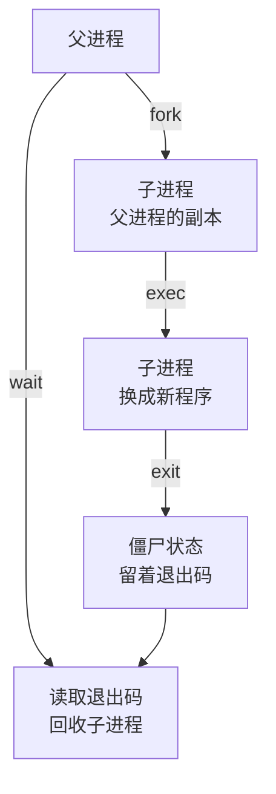

# 进程与线程

「Node 是单线程的」这句话只对了一半：一个 Node 进程启动后就有七八个线程。Postgres 每来一个连接就多一个进程，Electron 应用一开就是四五个进程，iOS 上的 WebView 内容跑在另一个进程里，系统随时可能把它回收。进程和线程是操作系统组织「正在运行的程序」的两种单位，选哪一种、开多少个，决定了隔离性、通信成本和故障的影响范围。这一章讲清楚两者的区别，再看你熟悉的几个运行时分别是怎么选的。

## 进程和线程是什么

**进程**是资源的容器：一个独立的虚拟地址空间（第 4 章）、一张打开的文件描述符表、信号处理方式、用户身份、当前目录、环境变量。**线程**是执行的单位：一组寄存器的值、一个程序计数器、一个栈。一个进程至少有一个线程，也可以有很多个。

| | 进程 | 同一进程内的线程 |
|---|---|---|
| 地址空间 | 各自独立 | 共享 |
| 文件描述符 | 各自一张表（fork 时复制） | 共享 |
| 通信 | 管道、socket、共享内存，需要序列化 | 直接读写同一块内存 |
| 一个崩了 | 只影响自己 | 整个进程一起退出 |
| 创建和切换成本 | 较高 | 较低 |

线程共享内存，通信快，但任何一个线程的野指针、未捕获的致命错误都会带走整个进程；进程之间互相隔离，一个崩了其他的照常运行，代价是通信要走操作系统、数据要序列化。

在 Linux 内核里，进程和线程其实是同一种东西（task），区别只是创建时共享了哪些资源。`ps -eLf` 或者 `ls /proc/<pid>/task` 能看到一个进程下的所有线程。进程的基本操作（查看、信号、退出码）见[《Linux 实战》的进程一章](../linux-essentials/03-processes-signals.md)。

## 进程是怎么创建的

Unix 系统创建新程序分两步：



- **fork** 复制出一个子进程，靠写时复制几乎不花代价（第 4 章）
- **exec** 把子进程的地址空间整个换成另一个程序，文件描述符默认保留，所以 Shell 能在 exec 之前把标准输出重定向到文件
- 子进程退出后，内核保留一小块记录（退出码、资源使用）等父进程来读，这时它叫**僵尸进程**。父进程调用 `wait` 读走后，记录才真正释放

Node 的 `child_process.spawn` 和 `exec` 底层就是这套流程（libuv 在可用时会用 `posix_spawn` 合并这两步）。

### 容器里的 PID 1

僵尸进程在容器里会变成真实的问题。父进程先于子进程退出时，子进程会被**过继**给 PID 1，由 PID 1 负责 `wait` 回收。普通系统上 PID 1 是 systemd，它会尽职地回收；容器里 PID 1 是你的应用，比如 `node dist/main.js`，Node 并不会去回收别人过继来的子进程。如果你的服务会调用外部命令（`ffmpeg`、`pg_dump`、一个 Shell 脚本），而这些命令又派生了孙进程，僵尸就会慢慢堆积。

PID 1 还有第二个特殊之处：内核**不会**对 PID 1 应用信号的默认处理动作。普通进程收到 `SIGTERM` 没有注册处理函数，默认就退出；PID 1 没注册的话，`SIGTERM` 被直接忽略，`docker stop` 只能等 10 秒超时后用 `SIGKILL` 强杀。

两个问题的通用解法是在容器里加一个最小的 init 进程，`docker run --init` 或 compose 里的 `init: true` 会用 tini 当 PID 1，由它转发信号、回收僵尸。另外，Dockerfile 的 `CMD` 要用 exec 形式，避免中间夹一层 `sh` 吞掉信号，细节见[《容器技术》的 CMD 与 ENTRYPOINT](../docker-containers/03-dockerfile.md#cmd-与-entrypointexec-形式和信号)。

## 调度与上下文切换

一台 4 核的机器上同时有几百个线程，内核的**调度器**决定每个时刻哪个线程在哪个核上跑。线程主要有三种状态：

- **运行**：正在某个核上执行
- **就绪**：随时可以跑，在排队等核
- **阻塞**：在等某件事（磁盘、网络、锁、定时器），不参与调度

从一个线程换到另一个叫**上下文切换**：保存当前线程的寄存器、恢复另一个的，如果跨进程还要切换页表。切换本身是微秒级，但隐性成本更大：新线程的数据不在缓存里、TLB 可能要清空，切换后的一段时间里程序跑得明显更慢。

Linux 区分两种切换，`/proc/<pid>/status` 里都有统计：

- `voluntary_ctxt_switches`：线程自己要等 I/O 或锁，主动让出 CPU。数量多说明它经常在等
- `nonvoluntary_ctxt_switches`：时间片用完被抢占。数量多说明 CPU 紧张，线程们在抢核

这解释了为什么「一个请求一个线程」的模型在连接数上万时撑不住：上万个线程意味着上万份栈内存（每个通常预留几 MB 虚拟地址）和频繁的上下文切换。Node 用一个线程加事件循环处理所有连接，绕开的正是这个成本，第 7 章会讲它靠的是什么。

## Node 进程里有哪些线程

在 Mac 上启动一个空跑的 Node 进程，看看它有几个线程：

```bash
node -e 'setTimeout(() => {}, 3000)' &
ps -M $! | tail -n +2 | wc -l    # macOS；Linux 上用 ls /proc/$!/task | wc -l
```

```text
7
```

如果先调用一次 `fs.readFile`，再数一次是 11：多出来的 4 个是 libuv 的线程池，它是懒创建的，第一次有任务进来才启动。一个典型的 Node 进程里：

| 线程 | 数量 | 干什么 |
|---|---|---|
| 主线程 | 1 | 跑事件循环和你的全部 JS |
| V8 平台工作线程 | 若干 | 并发 GC 标记、后台编译优化代码 |
| libuv 线程池 | 默认 4 | 文件 I/O、DNS 解析（`dns.lookup`）、`crypto.pbkdf2` / `scrypt`、zlib |
| 其他 | 若干 | 信号处理、inspector 等 |

「Node 是单线程的」准确的说法是：**你的 JS 代码只在一个线程上执行**。所以 JS 里没有数据竞争，不需要给变量加锁（但这不代表没有竞态，第 6 章会讲）；也所以一段耗时的同步计算会挡住所有请求。线程池的 4 个线程是另一个常见瓶颈，见[《TS 与 Node 进阶》的线程池一节](../ts-node-advanced/04-event-loop-libuv.md#线程池4-个线程的瓶颈)。

## 在 Node 里用上多核

想让 Node 用上多个核，有三种做法：

| 方式 | 是什么 | 共享什么 | 适合 |
|---|---|---|---|
| `worker_threads` | 同一进程里的新线程，各自一个 V8 实例和事件循环 | 只有 `SharedArrayBuffer` 能共享，其余靠消息传递（结构化克隆） | CPU 密集计算：图片处理、解析大文件、加解密 |
| `child_process` | 一个新进程 | 什么都不共享，靠管道或 IPC 通道 | 调用外部程序；需要隔离崩溃的任务 |
| 多实例（`cluster`、PM2、多个容器） | 多个独立的 Node 进程，共同处理请求 | 什么都不共享，状态放数据库 | HTTP 服务横向扩展 |

注意 worker 虽然是线程，但 JS 层面看起来更像进程：每个 worker 有自己的堆、自己的全局对象，传消息要拷贝数据（`ArrayBuffer` 可以转移所有权免拷贝）。V8 的设计决定了同一个堆不能被两个线程同时执行 JS，这让 JS 程序员免于处理数据竞争。

一人维护的服务，一般不需要上来就开多进程。一个 Node 进程在 I/O 密集的业务上能扛住的量通常比你想的大；真正要扩展时，在 compose 里多跑一个实例，比在进程里管理 cluster 更简单，也顺带获得了「一个实例挂了另一个还在」的好处。前提是服务本身无状态，这一点见[《软件架构与系统设计》](../system-design/09-evolution.md)。

## Postgres：每个连接一个进程

Postgres 选择了进程模型：主进程 postmaster 监听端口，每接受一个客户端连接，就 fork 出一个**后端进程**专门服务它，连接断开进程就退出。另外还有一组后台进程：检查点、WAL 写入、自动清理（autovacuum）、统计收集等。在 Postgres 所在的机器上 `ps` 一下就能看到：

```text
postgres: checkpointer
postgres: background writer
postgres: walwriter
postgres: autovacuum launcher
postgres: app counter 172.18.0.5(51234) idle
postgres: app counter 172.18.0.5(51236) idle in transaction
```

进程模型的好处是隔离：一个后端进程因为某个扩展的 bug 崩溃，不会直接破坏其他连接的内存（Postgres 仍会出于谨慎重置所有连接，但数据是安全的）。代价是每个连接都比较重：

- 建立一个连接要 fork 一个进程、做认证、初始化，耗时毫秒级，比一次简单查询还慢
- 每个后端进程都有自己的私有内存，排序、哈希时还会按 `work_mem` 额外申请
- 连接数多了，进程间的调度和锁争用会让整体吞吐下降

这就是为什么应用和 Postgres 之间总是隔着一个**连接池**：

- 应用侧：`pg` 的 `Pool`、Drizzle 或 TypeORM 底下的连接池，一个应用实例维持固定数量的长连接，请求来了借一个、用完还回去
- 中间层：多个应用实例、或者 Serverless 函数这种连接数不可控的场景，再加一层 PgBouncer

连接池开多大？**不是越大越好**。数据库真正能并行执行的查询数受 CPU 核数和磁盘限制，一台 4 核的数据库，几十个同时活跃的查询就已经在互相抢资源了。一个经验起点是每个应用实例 10 个左右，所有实例加起来远低于 `max_connections`，再根据监控里的等待时间调整。

还有一个和进程模型相关的坑：`idle in transaction`。一个连接开了事务却迟迟不提交（比如代码在事务里调了一个慢的外部 HTTP 接口），这个后端进程就一直占着，它持有的锁也一直不放，还会阻止 VACUUM 清理旧版本。事务要短的理由见[《数据库原理与实战》](../database-practice/04-transactions.md#事务要短)。

## Electron 与 React Native：进程即边界

客户端运行时同样在用进程划分边界。

**Electron** 一个应用至少有一个主进程和每个窗口一个渲染进程，外加 GPU 进程、网络等 utility 进程。主进程能访问 Node 和系统 API，渲染进程跑网页内容。把网页放进单独的进程，是为了让一个页面里的漏洞或崩溃不至于拿到整个应用的权限。各进程该放什么、怎么通信，见[《Electron 桌面应用》的进程模型](../electron-desktop/01-process-model.md)。

**React Native** 的 App 是一个进程，里面主要有两个线程：**主线程**（UI 线程）负责原生视图的布局和触摸事件，**JS 线程**跑你的 React 代码。JS 线程被一段重计算卡住时，界面还能滚动（因为滚动由主线程处理），但按钮点了没反应；反过来，主线程卡住时整个界面冻结。动画库 Reanimated 把动画逻辑放到 UI 线程上跑，就是为了不受 JS 线程繁忙的影响。

**WKWebView** 有一个容易被忽略的细节：网页内容跑在系统的另一个进程里（WebContent 进程），不在你的 App 进程中。App 退到后台、或者系统内存紧张时，iOS 可能把这个进程回收掉，WebView 就变成一片空白，而你的 App 进程毫发无损。hatch-shelf 的阅读器就跑在 WKWebView 里，它专门处理了这种情况：

```tsx
<WebView
  // ...
  // 进程被系统回收后重新加载，ready 后会重新发 load
  onContentProcessDidTerminate={() => {
    setWebReady(false);
    setRendered(false);
    webRef.current?.reload();
  }}
/>
```

收到「内容进程已终止」的回调后，它把状态重置为「未就绪」，重新加载阅读器页面；阅读器初始化完成后会再发一次就绪消息，RN 侧据此把当前章节重新发过去。用户最多看到一次短暂的重新排版，而不是一个永远空白的页面。这是「进程是故障边界」在客户端的一个具体体现：边界那一侧的进程可能随时消失，这一侧要能把它重新拉起来。

## 优雅退出

无论哪种进程模型，进程都会被要求退出：部署新版本、容器缩容、系统关机。规范的流程是先发 `SIGTERM`，给一段宽限时间，再发 `SIGKILL`。服务要在宽限期内做完这几件事：

1. 停止接受新连接
2. 等正在处理的请求完成
3. 把内存里攒着的数据落盘（比如批量写入的统计事件）
4. 关闭数据库连接池
5. 退出

NestJS 里调用 `app.enableShutdownHooks()` 后，收到 `SIGTERM` 会依次触发各模块的 `onModuleDestroy`、`beforeApplicationShutdown`、`onApplicationShutdown` 钩子，在里面做清理：

```ts
import { Injectable, OnApplicationShutdown } from "@nestjs/common";

@Injectable()
export class EventBuffer implements OnApplicationShutdown {
  private pending: AppEvent[] = [];

  push(e: AppEvent) {
    this.pending.push(e);
  }

  async flush() {
    const batch = this.pending.splice(0);
    if (batch.length > 0) await this.repo.insertMany(batch);
  }

  // 收到 SIGTERM 后由 Nest 调用：把最后一批写进去再退出
  async onApplicationShutdown(signal?: string) {
    await this.flush();
  }
}
```

宽限期要和外面的配置对上：`docker stop` 默认等 10 秒（compose 里用 `stop_grace_period` 调整），systemd 默认 90 秒（`TimeoutStopSec`）。如果清理可能超过 10 秒，就要把容器的宽限期调长，否则清理到一半就被 `SIGKILL` 了。

## 本章要点

- 进程是资源容器，线程是执行单位；线程共享内存、通信快，进程互相隔离、一个崩了不影响其他
- 进程通过 fork + exec 创建；退出后由父进程 wait 回收，否则成为僵尸
- 容器里的 PID 1 要负责回收僵尸、且默认忽略 SIGTERM：用 `init: true`，CMD 用 exec 形式
- 上下文切换有直接和间接（缓存、TLB）成本，一连接一线程撑不住上万连接
- Node 进程有多个线程，但 JS 只在主线程执行；多核靠 worker、子进程或多实例
- Postgres 每连接一个进程，连接贵，必须用连接池，池子不是越大越好；避免 idle in transaction
- Electron、RN、WKWebView 都用进程或线程划分边界；WebView 内容进程可能被系统回收，要能重新拉起
- 优雅退出：SIGTERM 后停止接收、等请求、落盘、关连接池，宽限期要和容器配置对上

## 动手练习

1. **线程池是懒创建的**：用本章的方法数一个空跑 Node 进程的线程数，再数一个先调用过一次 `fs.readFile` 的 Node 进程（`node -e 'require("fs").readFile("/etc/hosts", () => {}); setTimeout(() => {}, 3000)' &`）。

   验证：在作者的 Mac 上分别是 7 和 11；你的数字可能不同，但第二个应该比第一个多出 libuv 线程池的 4 个（设了 `UV_THREADPOOL_SIZE` 则是那个数）。

   参考答案：线程池在第一次有任务时才启动。用 `UV_THREADPOOL_SIZE=8` 再跑一次第二条命令，差值会变成 8。

2. **PID 1 不理 SIGTERM**：只在 Docker 里做。运行 `docker run -d --name p1 node:22-alpine node -e 'setInterval(() => {}, 1000)'`，用 `time docker stop p1` 计时；再加上 `--init` 换个名字重复一次。

   验证：不加 `--init` 时 `docker stop` 约 10 秒才返回，`docker inspect -f '{{.State.ExitCode}}' p1` 是 137；加 `--init` 后不到 1 秒返回。做完 `docker rm` 掉两个容器。

   参考答案：没有注册 `SIGTERM` 处理函数的 PID 1 不会被默认动作杀掉，只能等宽限期结束被 `SIGKILL`。tini 当 PID 1 时会把信号转给 Node，Node 作为普通进程按默认动作退出。

3. **优雅退出的最小版**：写一个每个请求要 3 秒才返回的 HTTP 服务，收到 `SIGTERM` 时 `server.close()` 并在回调里退出。启动后先 `curl` 一个请求（放后台），0.5 秒后对服务 `kill -TERM`，再立刻 `curl` 一次。

   验证：第一个请求仍然拿到响应；第二个 `curl` 连接被拒（退出码 7）；服务在第一个请求完成后打印退出信息并退出。

   参考答案：

   ```js
   import http from "node:http";
   const server = http.createServer((req, res) => {
     setTimeout(() => res.end("done\n"), 3000);
   }).listen(8099);
   process.on("SIGTERM", () => {
     server.close(() => process.exit(0)); // 不再接收新连接，等已有请求结束
   });
   ```
