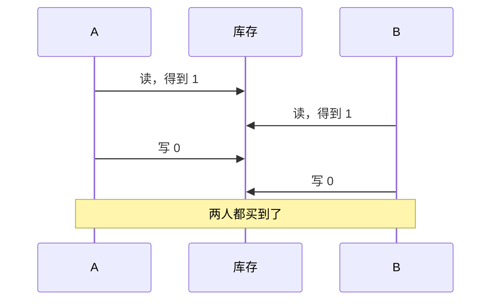

# 并发与同步原语

「JS 是单线程的，所以不用担心并发问题」，这是 JS 开发者最常见的误解之一。单线程只保证了两段同步代码不会**同时**执行，却不保证一个 `async` 函数从头到尾不被别人插队。只要有 `await`，就有交错；只要有交错，就有竞态。这一章从 CPU 层面的原子操作讲起，经过锁、信号量、死锁，最后落到你真正要面对的场景：单进程里的 `await` 交错、多实例共享一个数据库。

## 竞态的本质：读、改、写

几乎所有竞态都是同一个形状：**读出一个值，基于它算出新值，再写回去**。如果在读和写之间，别人也读了同一个旧值并写回，其中一次修改就丢了。

在多线程的 C 程序里，`counter++` 就是这样一个三步操作（load、add、store），两个线程同时执行，结果可能只加了 1。在 JS 里，同步代码里的 `counter++` 不会被打断，但只要读和写之间隔着一个 `await`，情况就和多线程一模一样：

```ts
const sleep = (ms: number) => new Promise((r) => setTimeout(r, ms));

let stock = 1; // 只剩一件
async function getStock() { await sleep(5); return stock; }       // 模拟查库
async function setStock(v: number) { await sleep(5); stock = v; } // 模拟写库

async function buy(who: string) {
  const s = await getStock();
  if (s <= 0) return `${who}：卖完了`;
  await setStock(s - 1);
  return `${who}：买到了`;
}

console.log(await Promise.all([buy("A"), buy("B")]), "剩余", stock);
```

```text
[ 'A：买到了', 'B：买到了' ] 剩余 0
```

一件商品卖给了两个人。A 在 `await getStock()` 处让出了执行权，B 趁机也读到了 1；两人都判断有货，都写回了 0。



在 NestJS 服务里，两个请求就是两个这样的 `buy`。它们跑在同一个线程上，但每个 `await` 查询都是一个让出点。所以**单线程的 Node 服务同样有竞态**，和多线程程序的区别只在于让出点是显式的：你能在代码里看到每一个 `await`，而多线程程序在任何两条指令之间都可能被打断。

## 硬件提供的原子操作

要从根上解决读改写问题，需要一个**不可分割**的操作：读、改、写一次完成，中间不可能被别人插进来。CPU 提供了这样的指令：

- **原子加**：一条指令完成「读出、加上、写回」，比如 x86 的 `lock xadd`、arm64（ARMv8.1 起）的 `ldadd`
- **比较并交换**（CAS，compare-and-swap）：「如果这个地址现在的值还是 A，就把它改成 B，并告诉我成没成功」。几乎所有更高级的同步结构都可以建在 CAS 之上

用 CAS 实现「读改写」的通用模式是**乐观重试**：

```text
循环：
  旧值 = 读取
  新值 = 根据旧值计算
  如果 CAS(地址, 旧值, 新值) 成功：结束
  否则：别人抢先改了，重来
```

这个模式值得记住，因为你会在更高的层次反复遇到它：数据库里的乐观锁（`UPDATE ... WHERE version = $旧版本`）、HTTP 的条件请求（`If-Match: <etag>`），都是同一个思路。

JS 通过 `Atomics` 对象把这些指令暴露给 `SharedArrayBuffer`：

```ts
const sab = new SharedArrayBuffer(4);
const a = new Int32Array(sab);

Atomics.add(a, 0, 1);                        // 原子加
const old = Atomics.compareExchange(a, 0, 1, 5); // 如果是 1 就改成 5，返回原来的值
console.log(old, Atomics.load(a, 0));        // 1 5
```

第 3 章伪共享的实验里，两个 worker 用的就是 `Atomics.add`。如果换成普通的 `a[i]++`，两个 worker 写同一个下标时就会丢计数。

### 可见性与重排序

多线程还有一个更隐蔽的问题：一个线程写入的值，另一个线程**什么时候能看到**、**以什么顺序**看到。为了性能，编译器和 CPU 都会在不改变单线程语义的前提下重排读写；arm64 的内存模型比 x86-64 更宽松，重排得更多。一段在 x86 服务器上「一直没出过问题」的无锁代码，移到 ARM 服务器上可能就出错了。

对 JS 来说，规则很简单：在 `SharedArrayBuffer` 上，**凡是要和其他线程协调的读写，都用 `Atomics` 的方法**，它们是顺序一致的，自带必要的内存屏障。普通的下标读写只适合「已经通过 `Atomics` 同步过之后」再读的数据。

## 互斥锁

原子操作只能保护一个字。要保护一段代码（读库存、判断、写库存），需要**互斥锁**（mutex）：同一时刻只允许一个执行者进入临界区，其他人排队。

操作系统的互斥锁建在原子操作之上：先用 CAS 尝试把锁的状态从「空闲」改成「占用」，成功就进入；失败就让内核把自己挂起，等持有者释放时唤醒（Linux 的 futex 就是干这个的，JS 里对应的是 `Atomics.wait` 和 `Atomics.notify`）。

在单线程的 Node 里，我们要排队的不是线程而是 `async` 函数，所以需要一个**异步互斥锁**。它可以很短：

```ts
export class Mutex {
  private tail: Promise<void> = Promise.resolve();

  /** 排在前一个任务之后执行 fn；fn 抛错也会释放锁 */
  async run<T>(fn: () => Promise<T>): Promise<T> {
    const prev = this.tail;
    let release!: () => void;
    this.tail = new Promise<void>((r) => (release = r));
    await prev;
    try {
      return await fn();
    } finally {
      release();
    }
  }
}
```

每次 `run` 把自己接在队尾，等前一个结束再执行。`finally` 保证 `fn` 抛错时锁也会释放，否则后面的人会永远等下去。用它包住上面的 `buy`：

```ts
const m = new Mutex();
console.log(await Promise.all([m.run(() => buy("A")), m.run(() => buy("B"))]));
// [ 'A：买到了', 'B：卖完了' ]
```

实际项目里很少需要一把全局锁，更常见的是**按键加锁**：同一个用户、同一本书的操作排队，不同的可以并行。用一个 `Map<string, Mutex>` 就能做到，记得在没人排队时把键删掉，否则这个 `Map` 会无限增长。

> [!IMPORTANT]
> 进程内的锁只在**一个进程内**有效。服务一旦跑两个实例，A 实例的锁对 B 实例的请求毫无作用。服务端的数据一致性应该交给数据库（见后面的[多实例：让数据库来管](#多实例让数据库来管)），进程内锁只用来保护进程内的状态，比如一个本地文件、一份内存缓存的刷新。

### hatch-shelf 里的串行化

客户端反而是进程内锁最合适的地方，因为整个 App 只有一个进程。hatch-shelf 的导入就是一个例子：用户可能连着 AirDrop 过来好几个文件，或者一边 AirDrop 一边从「文件」App 选书，几个文件几乎同时交给导入管线。管线处理一本书要读文件、解压、校验、整体替换 `books/<id>/`、清理过期的阅读进度、重建 SQLite 索引，中间有好几个 `await`。两次导入同一个 id 的书交错执行，就可能出现文件是新版、索引是旧版的情况。

它的做法和上面的 `Mutex` 是同一个思路，只是更短，直接把每次导入接在一条 Promise 链的末尾：

```ts
let chain = Promise.resolve();
const seen = new Set<string>();

/** 依次导入，避免两个文件同时写同一本书 */
function enqueue(url: string) {
  if (seen.has(url)) return; // 同一个文件重复送进来，只导一次
  seen.add(url);
  chain = chain.then(async () => {
    showImportResult(await importFile(url));
    seen.delete(url);
  });
}
```

这条链能工作有一个前提：`importFile` 自己捕获了所有错误、总是正常返回一个结果对象。如果链上某一环抛出异常，`chain` 就变成了一个被拒绝的 Promise，之后接上去的 `.then` 回调全都不会执行，导入会悄无声息地停掉。通用的 `Mutex` 用 `finally` 释放，就是为了不依赖这个前提。

另外，整体替换书目录的那一步（`writeBookAtomically`）全程是同步调用，中间没有 `await`，所以它在 JS 层面本身就不可能被别的导入插队。

串行导入意味着同一时刻只处理一本书，但手机上导入书不是高频操作，这点代价可以忽略，换来的是不必推理任何交错。这个判断的依据是：**并发度要不要高，取决于这件事的频率和耗时，而不是能不能做到**。

## 信号量：限制并发度

互斥锁是「最多 1 个」，**信号量**是「最多 N 个」。它维护一个计数，进入时减一，减到 0 就排队，离开时加一并唤醒一个等待者。

在 Node 里，信号量最常用来限制对外部资源的并发：同时最多发 5 个请求给第三方 API、同时最多处理 3 个图片缩放任务。不加限制的 `Promise.all(items.map(...))` 会一次性发出成千上万个请求，打满对方的限流、或者耗尽自己的 socket 和内存。

```ts
export class Semaphore {
  private waiters: (() => void)[] = [];
  private permits: number;

  constructor(permits: number) {
    this.permits = permits;
  }

  private async acquire() {
    if (this.permits > 0) {
      this.permits--;
      return;
    }
    await new Promise<void>((r) => this.waiters.push(r));
  }

  private release() {
    const next = this.waiters.shift();
    if (next) next();      // 名额直接交给下一个等待者
    else this.permits++;
  }

  async run<T>(fn: () => Promise<T>): Promise<T> {
    await this.acquire();
    try {
      return await fn();
    } finally {
      this.release();
    }
  }
}

// 给 1000 张图片生成缩略图，同一时刻最多 3 个在跑
const sem = new Semaphore(3);
await Promise.all(images.map((img) => sem.run(() => makeThumbnail(img))));
```

`release` 里把名额直接交给下一个等待者，而不是先加回计数再让大家去抢，这样排队是公平的先来先得。社区里的 `p-limit` 做的是同一件事。

连接池本质上也是信号量：池子里有 N 个连接，第 N+1 个查询要排队等别人还回来。第 5 章说连接池不是越大越好，换个角度看就是：这个信号量的上限应该由下游（数据库）的承受能力决定，而不是由上游的请求量决定。

## 死锁

两个执行者各自持有一把锁，又都在等对方手里的那一把，就会永远等下去，这是**死锁**。死锁要同时满足四个条件：互斥、持有并等待、不可抢占、循环等待。破坏任何一个就能避免，实践中最常用的是破坏**循环等待**：**所有人都按同一个顺序加锁**。

数据库里的死锁最常见。两个事务分别更新同两行，但顺序相反：

```sql
-- 事务 1                          -- 事务 2
UPDATE stock SET qty = qty - 1      UPDATE stock SET qty = qty - 1
  WHERE item_id = 'A';                WHERE item_id = 'B';
UPDATE stock SET qty = qty - 1      UPDATE stock SET qty = qty - 1
  WHERE item_id = 'B';  -- 等事务 2     WHERE item_id = 'A';  -- 等事务 1
```

Postgres 会检测到这个环（默认等待 1 秒后开始检测，由 `deadlock_timeout` 控制），选一个事务报错 `deadlock detected` 回滚掉，另一个继续。解决办法就是统一顺序：一个订单里有多个商品要扣库存时，先按 `item_id` 排序再逐个更新。

异步代码里也会有死锁，最常见的形式是**锁重入**：一个持有锁的函数，又调用了另一个需要同一把锁的函数。上面那个 `Mutex` 不可重入，第二次 `run` 会排在自己后面，永远等不到。避免的办法是只在最外层加锁，内部函数假设调用者已经持有锁。

## 多实例：让数据库来管

回到服务端。只要服务可能跑多个实例（哪怕只是滚动发布时新旧版本重叠的那几十秒），保护共享数据的锁就必须放在所有实例都能看到的地方，通常就是数据库本身。数据库提供了从轻到重的几种手段：

**1. 把读改写合成一条 SQL**。这是首选，相当于数据库层面的原子操作：

```ts
import { and, eq, gte, sql } from "drizzle-orm";

// 对应 SQL：UPDATE stock SET qty = qty - 1 WHERE item_id = $1 AND qty >= 1 RETURNING qty
// 有货才扣，扣成功返回新库存；没有返回行就是卖完了
const rows = await db
  .update(stock)
  .set({ qty: sql`${stock.qty} - 1` })
  .where(and(eq(stock.itemId, itemId), gte(stock.qty, 1)))
  .returning({ qty: stock.qty });
if (rows.length === 0) throw new SoldOutError(itemId);
```

判断和修改在同一条语句里，由数据库的行锁保证原子性，不需要任何应用层的锁。

**2. 行锁 `SELECT ... FOR UPDATE`**。当判断逻辑复杂到写不进一条 SQL 时，在事务里先锁住要改的行，再读、算、写：

```ts
await db.transaction(async (tx) => {
  // SELECT ... FROM stock WHERE item_id = $1 FOR UPDATE
  const [row] = await tx.select().from(stock).where(eq(stock.itemId, itemId)).for("update");
  // 这里可以做任意复杂的判断，其他事务想锁同一行会在上面那句等着，直到本事务提交
  const next = computeNext(row);
  await tx.update(stock).set({ qty: next.qty }).where(eq(stock.itemId, itemId));
});
```

**3. 乐观锁**。给行加一个 `version` 列，更新时带上读到的版本，`UPDATE ... SET ..., version = version + 1 WHERE id = $1 AND version = $2`，影响行数为 0 就说明被别人改过，重读重试。这就是前面说的 CAS 模式，适合冲突少、不想长时间持锁的场景。

**4. 咨询锁**（advisory lock）。要保护的东西不是某一行，比如「同一时刻只能有一个实例在跑月结任务」，可以用 Postgres 的咨询锁，它锁的是一个你自己定义的整数：

```sql
-- 拿不到就立刻返回 false，不等待；事务结束自动释放
SELECT pg_try_advisory_xact_lock(hashtext('monthly-settlement'));
```

**5. 队列里的 `SKIP LOCKED`**。多个 worker 从一张任务表里抢任务，`SELECT ... FOR UPDATE SKIP LOCKED LIMIT 1` 让每个 worker 跳过别人已经锁住的行，各取各的，互不等待。用 Postgres 表做任务队列的完整做法见[《软件架构与系统设计》的队列一章](../system-design/04-queues-jobs.md)。

这几种手段和隔离级别的关系，以及丢失更新的更多变体，见[《数据库原理与实战》的事务一章](../database-practice/04-transactions.md#丢失更新读出来算好写回去)。

## 选哪一种

| 要保护的东西 | 范围 | 手段 |
|---|---|---|
| 一个计数器、一个标志位 | 线程之间 | `Atomics` |
| 进程内的状态（内存缓存、本地文件） | 单进程内的 `async` 交错 | 异步 Mutex，按键加锁 |
| 对外部服务的并发数 | 单进程 | 信号量 |
| 数据库里的一行 | 所有实例 | 条件 UPDATE；不行再 `FOR UPDATE` 或乐观锁 |
| 一件事同时只能一个实例做 | 所有实例 | 咨询锁 |
| 任务分发 | 所有 worker | `FOR UPDATE SKIP LOCKED` |

规律是：**锁放在能看到所有竞争者的最低一层**。竞争者只在一个进程里，锁就放在进程里；竞争者分布在多个实例，锁就放在它们共享的数据库里。放得太低（多实例用进程内锁）会失效，放得太高（单进程的状态也去用数据库锁）只是多了一次网络往返。

## 本章要点

- 竞态的形状是「读、改、写」中间被插队；单线程 JS 里每个 `await` 都是让出点，同样有竞态
- 硬件提供原子加和 CAS；CAS 加重试的乐观模式在数据库乐观锁、HTTP 条件请求里反复出现
- 共享内存上需要协调的读写一律用 `Atomics`，它负责可见性和顺序
- 异步 Mutex 用 Promise 链排队，`finally` 里释放；进程内锁只在一个进程内有效
- 信号量限制并发度，适合控制对外部服务的请求数；连接池就是一个信号量
- 死锁靠统一加锁顺序避免；Postgres 会检测死锁并回滚其中一个事务
- 多实例时把一致性交给数据库：条件 UPDATE 优先，其次行锁、乐观锁、咨询锁、SKIP LOCKED
