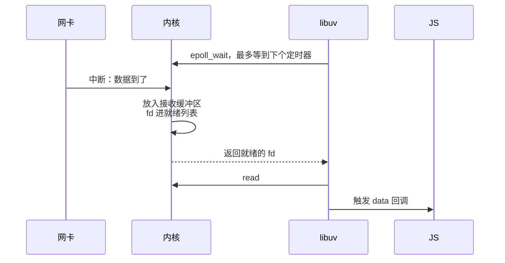

# I/O 模型

一个 Node 进程用一个线程就能同时维持上万个 WebSocket 连接，而一个同步读文件的调用就能让它对所有请求失去响应。这两件事看起来矛盾，其实是同一个设计的两面：Node 把网络 I/O 交给了操作系统的事件通知机制（Linux 上是 epoll），而文件 I/O 没法这么做，只能交给线程池。这一章从文件描述符讲起，依次看阻塞、非阻塞、多路复用和 io_uring 这几种 I/O 模型，最后把它们对应到 Node 的事件循环和 hatch-shelf 手写的局域网 HTTP 服务上。

## 文件描述符

在 Unix 里，进程打开的每一个 I/O 对象都用一个小整数表示，叫**文件描述符**（file descriptor，fd）。普通文件、目录、TCP 连接、监听中的 socket、管道、终端，甚至 epoll 实例本身，都是 fd。0、1、2 分别是标准输入、标准输出、标准错误。

```bash
# Linux 上看一个进程打开了哪些 fd
ls -l /proc/<pid>/fd
# 或者用 lsof，能看到 fd 对应的文件路径和网络连接
lsof -p <pid>
```

每个进程能打开的 fd 数量有上限（`ulimit -n`，很多发行版默认 1024）。一个维持大量长连接的服务、或者一个忘了关文件的程序，会撞上 `EMFILE: too many open files`。调整方法见[《Linux 实战》的资源限制](../linux-essentials/03-processes-signals.md#资源限制ulimit)。

读写 fd 的基本系统调用是 `read(fd, buf, n)` 和 `write(fd, buf, n)`。对 socket 来说，内核为每个连接维护一个**接收缓冲区**和一个**发送缓冲区**：网卡收到的数据先进接收缓冲区，`read` 把它拷到你的缓冲区；`write` 把你的数据拷进发送缓冲区，内核再按 TCP 的节奏发出去。理解这两个缓冲区，就理解了 I/O 模型要解决的问题：**缓冲区里没数据可读、或者没空间可写的时候，调用者该怎么办**。

## 阻塞 I/O

最直接的答案是**等**。默认情况下 fd 是阻塞的：接收缓冲区为空时 `read` 不返回，线程被挂起，直到数据到达才被唤醒。

阻塞 I/O 的代码最好写，逻辑是从上往下的：

```text
conn = accept(listen_fd)       # 等一个新连接
request = read(conn)           # 等客户端发请求
response = handle(request)
write(conn, response)          # 发送缓冲区满了也会等
```

问题是一个线程在等一个连接时，什么别的都做不了。要同时服务一万个连接，就要一万个线程，第 5 章已经说过这样的代价。早期的 Apache（prefork / worker 模式）和传统的 Java Servlet 容器就是这个模型，它在连接数不多、每个请求都很快结束时工作得很好，在长连接和慢客户端多的时候撑不住，这就是 2000 年前后著名的 **C10K 问题**（单机一万并发连接）。

## 非阻塞 I/O

把 fd 设成非阻塞（`O_NONBLOCK`）后，`read` 在没有数据时不再等待，而是立刻返回错误 `EAGAIN`（「现在没有，稍后再试」）。这样一个线程就可以照看很多连接：挨个问一遍，谁有数据就处理谁。

但「挨个问一遍」本身是个问题：一万个连接里可能只有三个有数据，为了找到这三个要做一万次系统调用；如果都没数据，线程就在空转，白白烧 CPU。非阻塞只解决了「不被一个连接卡住」，没解决「怎么知道该去处理哪个」。

## I/O 多路复用：select、poll、epoll

**多路复用**的思路是：把「哪些 fd 准备好了」这个问题交给内核，用一次系统调用等很多个 fd，内核在其中任何一个就绪时返回。

最早的 `select` 和后来的 `poll` 都是这样工作的，但它们有个结构性的缺陷：**每次调用都要把整个 fd 列表传给内核，内核也要逐个检查一遍**。一万个连接，每次等待都是一万次检查，开销和连接总数成正比，而不是和活跃连接数成正比。

Linux 2.6 引入的 **epoll** 把这件事拆成了两步：

- `epoll_ctl`：**注册一次**。告诉内核「帮我盯着这个 fd 的可读事件」，内核把它挂进一个红黑树，并在这个 fd 的数据到达时（由网卡中断一路触发）把它放进一个**就绪列表**
- `epoll_wait`：**只取就绪的**。返回就绪列表里的 fd，没有就绪的就睡眠等待，可以带超时

等待的成本只和就绪的 fd 数量有关，和总连接数无关。这就是一个线程能管住上万连接的关键。一个用 epoll 写的最小回显服务器的骨架：

```c
int ep = epoll_create1(0);
struct epoll_event ev = { .events = EPOLLIN, .data.fd = listen_fd };
epoll_ctl(ep, EPOLL_CTL_ADD, listen_fd, &ev);

struct epoll_event ready[64];
for (;;) {
  int n = epoll_wait(ep, ready, 64, -1);         // 睡到有 fd 就绪为止
  for (int i = 0; i < n; i++) {
    int fd = ready[i].data.fd;
    if (fd == listen_fd) {                        // 新连接
      int c = accept4(listen_fd, NULL, NULL, SOCK_NONBLOCK);
      struct epoll_event cev = { .events = EPOLLIN, .data.fd = c };
      epoll_ctl(ep, EPOLL_CTL_ADD, c, &cev);
    } else {                                      // 已有连接上有数据
      char buf[4096];
      ssize_t r = read(fd, buf, sizeof buf);
      if (r <= 0) { close(fd); continue; }        // 0 表示对方关闭了连接
      write(fd, buf, r);
    }
  }
}
```

这个循环就是**事件循环**的雏形：等事件、分发事件、处理完回去接着等。Node 的事件循环、nginx 的 worker、Redis 的主循环、Go 运行时的网络轮询器，核心都是它。

其他系统有各自的同类机制：macOS 和 BSD 上是 **kqueue**，Windows 上是 **IOCP**。libuv 的作用之一就是把它们统一成一套接口，所以同一份 Node 代码在 Mac 上开发、在 Linux 上部署，底层分别用的是 kqueue 和 epoll。

### 水平触发与边缘触发

epoll 有两种通知方式：

- **水平触发**（level-triggered，默认）：只要缓冲区里还有数据，每次 `epoll_wait` 都会报告这个 fd。没读完下次还会提醒你
- **边缘触发**（edge-triggered，`EPOLLET`）：只在状态**变化**时（从没数据到有数据）通知一次。收到通知后必须一直读到 `EAGAIN` 为止，否则剩下的数据不会再被提醒，连接就「卡住」了

边缘触发能减少重复通知，但更容易写错。这类细节由 libuv、nginx 处理，你写应用时不会直接碰到，但「读到 `EAGAIN` 为止」这个约束会以另一种形式出现：TCP 是字节流，一次 `data` 事件给你的不一定是完整的一条消息。

## 就绪模型与完成模型

epoll 告诉你的是「**可以读了**」，真正的 `read` 还要你自己调用，数据从内核缓冲区拷到用户缓冲区这一步仍然在你的线程里同步完成。这叫**就绪模型**（readiness）。

另一种思路是**完成模型**（completion）：你告诉内核「把数据读到这块缓冲区，读完通知我」，然后去做别的；通知到来时数据已经在你的缓冲区里了。Windows 的 IOCP 是这种模型，Linux 上的 io_uring 也是。


## 文件 I/O 是另一回事

上面的一切都是关于 socket 和管道的。**普通文件不能用 epoll**：对普通文件的 fd 调用 `epoll_ctl` 会返回 `EPERM`。原因是在内核看来，普通文件「永远是就绪的」：`read` 一个文件不需要等外部事件，数据要么已经在页缓存里，要么内核去磁盘读，读磁盘的那段等待是在 `read` 调用内部发生的，非阻塞标志对它不起作用。

这就是 Node 用线程池处理文件 I/O 的根本原因：既然没法让内核通知「文件可读了」，就只好让一个后台线程去做阻塞的 `read`，做完再通知主线程。于是 Node 的 I/O 实际上分两条路：

| 操作 | 底层方式 | 占线程池吗 |
|---|---|---|
| TCP、HTTP、WebSocket、管道 | epoll / kqueue 通知，主线程读写 | 不占 |
| `fs.readFile`、`fs.stat` 等文件操作 | 线程池里做阻塞调用 | 占 |
| `dns.lookup`（`http.get` 默认用它） | 线程池里调 `getaddrinfo` | 占 |
| `dns.resolve*` | c-ares 发网络请求，走事件通知 | 不占 |
| `crypto.pbkdf2`、`scrypt`、zlib 异步方法 | 线程池里计算 | 占 |

这张表解释了几种常见的「莫名变慢」：大量并发读文件或做密码哈希时，线程池的 4 个线程被占满，连 DNS 解析也要排队，于是对外的 HTTP 请求跟着变慢，尽管它们自己并不需要线程池。

### 事件循环的 poll 阶段

把 epoll 放回 Node 的事件循环里看：事件循环转到 **poll 阶段**时，libuv 计算出离最近一个定时器到期还有多久，以这个时间为超时调用 `epoll_wait`。



线程池完成一个文件读取后，会通过一个内部的管道或 eventfd 写一个字节来「唤醒」主线程，这个 fd 也注册在 epoll 里。所以从事件循环的角度看，**所有完成通知最后都汇聚成了 epoll 上的一个就绪事件**。事件循环各个阶段的顺序和验证方法见[《TS 与 Node 进阶》的事件循环一章](../ts-node-advanced/04-event-loop-libuv.md#事件循环的阶段)。

这也说明了为什么一段同步代码会让整个服务失去响应：主线程在执行 JS 时，没有人去调用 `epoll_wait`，内核那边的就绪列表越积越长，所有连接都在等。

## TCP 是字节流：一个手写的 HTTP 服务

hatch-shelf 的「传书」页面会在手机上开一个局域网 HTTP 服务，电脑浏览器打开地址就能把书拖进来。RN 里没有 Node 的 `http` 模块，它用 `react-native-tcp-socket` 拿到原始的 TCP 连接，HTTP 解析是自己写的。这让「数据怎么一块块到达」变得清清楚楚：

```ts
socket.on("data", (chunk) => {
  if (done) return;
  const bytes = typeof chunk === "string" ? strToU8(chunk) : new Uint8Array(chunk);
  const r = parser.push(bytes);       // 每来一块就喂给解析器
  report();                            // 顺便更新上传进度
  if (r.type === "continue") socket.write(CONTINUE_RESPONSE);
  else if (r.type === "error") reply(jsonResponse(r.status, { ok: false, error: r.message }));
  else if (r.type === "complete") {
    handle(r.request).then(reply, (e: Error) => reply(jsonResponse(500, { ok: false, error: e.message })));
  }
});
```

每次 `data` 事件给的是「这次从接收缓冲区读到的那些字节」，大小由网络状况和缓冲区决定，和 HTTP 的结构毫无关系。一个 10 MB 的书包可能分成几百块到达，第一块里可能只有半个请求头，也可能请求头加上一段正文。所以解析器（`RequestParser`）被写成一个**增量状态机**，`push` 每次返回当前的状态：

- **还在收请求头**：把新块拼到已收的字节后面，找 `\r\n\r\n`。找不到就返回 `incomplete`，等下一块；累计超过 16 KB 还没找到就返回 431 错误，防止恶意客户端用无穷无尽的请求头耗尽内存
- **请求头收齐了**：解析出 `Content-Length`，超过上限直接拒绝（413），否则**一次性分配好**正文大小的缓冲区，把同一块里剩下的字节放进去
- **正文没收完**：每来一块就 `set` 到缓冲区的对应位置，收满了返回 `complete`

几个设计决定都和本章的内容有关：

- **先看长度再分配**：拿到 `Content-Length` 就知道要多少内存，预先分配一次，比每来一块就拼接一次（每次都要复制前面全部的数据）省得多
- **不支持分块传输**：`Transfer-Encoding: chunked` 的正文长度事先未知，要再写一层状态机。它直接返回 411，让浏览器提供 `Content-Length`。浏览器上传文件时本来就会带上长度，这个限制在实际使用中不会碰到
- **处理 `Expect: 100-continue`**：有些客户端发大文件前先只发请求头，等服务器回 `100 Continue` 再发正文。解析器在收完请求头、正文还没到时返回 `continue`，服务端回一行状态，客户端才继续

如果你用过 Node 的 `http` 模块，它替你做的就是这些事（底层用的是 llhttp 这个 C 写的增量解析器）。自己写一遍的价值在于明白：网络编程里不存在「收到一条消息」这回事，只有「收到一些字节」。

## 背压

读的方向说完，再看写的方向。发送缓冲区是有限的，对方读得慢（手机网络差、浏览器标签页在后台）时，缓冲区会被填满。在非阻塞模式下，`write` 这时只写进去一部分，或者返回 `EAGAIN`。

Node 把这件事暴露为 `writable.write()` 的返回值：返回 `false` 表示内部缓冲已经超过 `highWaterMark`，你应该暂停写入，等 `drain` 事件再继续。如果无视这个信号一直写，数据会在 Node 进程的内存里无限堆积。这就是**背压**，它是「缓冲区满了怎么办」在应用层的投影。用 `pipeline` 串起流就能自动处理它，见[《TS 与 Node 进阶》的 Stream 与背压](../ts-node-advanced/07-streams-backpressure.md)。

## io_uring

> [!WARNING]
> 本节关于 io_uring 在 libuv / Node、Docker 和 Postgres 中支持状态的描述凭 2025 年前后的情况整理，这几个项目都在快速变化，具体行为以 libuv 与 Node 的发行说明、Docker 默认 seccomp 配置文档、PostgreSQL 官方文档中 `io_method` 的说明为准。

**io_uring** 是 Linux 5.1（2019 年）引入的新一代异步 I/O 接口，属于完成模型。它在内核和用户进程之间共享两个环形队列：

- **提交队列**（SQ）：进程往里放请求（「从这个 fd 的这个位置读 4 KB 到这块内存」），可以一次放很多个
- **完成队列**（CQ）：内核往里放结果，进程直接从共享内存里取

因为队列在共享内存里，批量提交和收取结果时可以不做系统调用，或者一次系统调用处理很多个请求。更重要的是，它**对普通文件也有效**，弥补了 epoll 在文件 I/O 上的空白。

它在你会用到的软件里的状态大致是：

- **libuv / Node**：libuv 曾用 io_uring 加速部分文件操作，后来出于安全和兼容性考虑收紧，部分能力改为需要显式开启（环境变量 `UV_USE_IO_URING`）。对一般 Web 服务，网络 I/O 仍然走 epoll
- **Docker**：较新版本的默认 seccomp 配置禁止了 io_uring 相关的系统调用，容器里的程序调用会失败并回退到其他方式
- **Postgres**：18 版引入了异步 I/O 子系统，配置项 `io_method` 可选 `worker`（默认，后台进程代为读取）或 `io_uring`（需要编译时支持）

io_uring 被一些安全团队限制，是因为它是一个很大的新内核攻击面，历史上出过多个提权漏洞。作为应用开发者，你不需要直接使用它，知道它是「把 epoll 管不到的文件 I/O 也变成异步」的那块拼图就够了。

## 零拷贝

最后一个优化方向是减少拷贝。把一个文件发给网络的朴素做法是 `read` 到用户缓冲区、再 `write` 到 socket，数据在内核和用户态之间来回拷了两次。`sendfile` 系统调用让内核直接把页缓存里的文件数据送进 socket，用户态完全不经手。

nginx 的 `sendfile on;` 就是开这个功能，这是静态文件交给 nginx 而不是 Node 来发的原因之一。Node 的 `fs.createReadStream().pipe(res)` 会把数据读进 JS 的 Buffer 再写出去，对中小文件完全够用，大文件下载量大时让 nginx 或对象存储来发更合适。

## 本章要点

- 一切 I/O 对象都是文件描述符；socket 有内核接收和发送缓冲区，I/O 模型要解决的是缓冲区空或满时怎么办
- 阻塞 I/O 一个线程只能等一个连接；非阻塞 I/O 不等但不知道该处理谁
- epoll 注册一次、只返回就绪的 fd，等待成本与活跃连接数相关，是事件循环的基础；macOS 用 kqueue
- 就绪模型（epoll）告诉你可以读了；完成模型（IOCP、io_uring）告诉你读完了
- 普通文件不能用 epoll，所以 Node 的文件操作、`dns.lookup`、部分 crypto 走线程池
- TCP 是字节流，`data` 事件不对应消息边界，协议解析要写成增量状态机
- 发送缓冲区满了要停下来，`write()` 返回 `false` 时等 `drain`
- io_uring 用共享环形队列批量提交，对文件也有效，但在 Node、Docker 里的支持受限

## 动手练习

1. **一个请求到底分几块到**：用 `node:net` 写一个 TCP 服务，在 `data` 事件里数块数和总字节数、`end` 时打印。然后 `head -c 10000000 /dev/urandom | curl -s --data-binary @- localhost:<端口>` 发一个 10 MB 的请求（curl 收不到 HTTP 响应，加 `-m 3` 让它超时退出即可）。

   验证：打印的块数是几十到几百，总字节数比 10000000 多出一百多字节（那是 HTTP 请求头）；多跑几次，块数不完全一样。

   参考答案：块的边界由接收缓冲区和网络节奏决定，和 HTTP 的结构无关，所以本章的解析器要写成增量状态机。

   ```js
   import net from "node:net";
   net.createServer((s) => {
     let n = 0, total = 0;
     s.on("data", (c) => { n++; total += c.length; });
     s.on("end", () => console.log("chunks", n, "bytes", total));
   }).listen(8098);
   ```

2. **看见线程池的 4 个槽位**：同时发起 8 个 `crypto.pbkdf2("pw", "salt", 300_000, 32, "sha256", cb)`，在每个回调里打印从开始到完成的毫秒数；再用 `UV_THREADPOOL_SIZE=8` 运行一次。

   验证：默认设置下完成时间分成两拨，后 4 个大约是前 4 个的两倍；设成 8 后 8 个的完成时间挤在一起。作者的 M3 Pro 上是约 35 ms 和约 65 ms 两拨。

   参考答案：线程池只有 4 个线程，第 5–8 个任务要等前面的做完才能开始。同一时刻如果还有 `fs` 或 `dns.lookup` 的任务，它们也排在这条队里。

3. **撞上 fd 上限**：在一个子 shell 里把上限调小再打开文件：`bash -c 'ulimit -n 64; node -e "const fs=require(\"fs\"); const a=[]; try { for (let i=0;i<100;i++) a.push(fs.openSync(\"/etc/hosts\",\"r\")) } catch (e) { console.log(e.code, a.length) }"'`。

   验证：输出 `EMFILE` 和一个比 64 小的数（作者机器上是 53）。

   参考答案：Node 启动时自己已经占用了十来个 fd（标准输入输出、epoll / kqueue 实例、唤醒用的管道等），所以能再打开的比上限少。生产服务报 `EMFILE` 时，先用 `lsof -p <pid> | wc -l` 看是不是有 fd 没关，再考虑调高上限。
