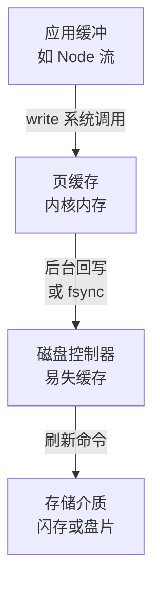

# 文件系统与持久化

`fs.writeFile` 的回调触发了，数据就在磁盘上了吗？不一定。它只说明数据进了操作系统的页缓存，这时断电，文件可能是空的、可能是旧的、也可能是新旧各一半。数据库为了确认「这笔事务提交了」要专门等磁盘，一次要等毫秒级，比写内存慢上千倍，所以才有 WAL、组提交、`synchronous_commit` 这些设计。这一章顺着一次写入从应用到磁盘的路径往下走，讲清楚每一层的承诺是什么，再看 Postgres、SQLite 和 hatch-shelf 分别是怎么取舍的。

## 文件系统的骨架

文件系统把一块磁盘组织成目录树。几个核心概念：

- **inode**：文件的元数据（大小、权限、时间戳、数据块在磁盘上的位置），不包含文件名
- **目录**：一种特殊的文件，内容是「名字 → inode 编号」的列表
- **数据块**：文件内容所在的磁盘块，通常 4 KB

文件名只存在于目录里，所以一个 inode 可以有多个名字（硬链接），重命名只是改目录里的一条记录，不动数据。这一点是本章后面所有「原子替换」技巧的基础。inode 和链接的日常用法见[《Linux 实战》的文件系统一章](../linux-essentials/02-filesystem-permissions.md#inode硬链接与软链接)。

现代文件系统（Linux 的 ext4、XFS，macOS 和 iOS 的 APFS）都带**日志**（journal）或写时复制机制：修改元数据前先把要做的修改记下来，崩溃后重放或丢弃，保证文件系统本身的结构不会损坏。但要注意，它们默认保护的是**元数据**的一致性（目录树不会坏、不会出现指向垃圾的 inode），而不是你**文件内容**的完整性。

## 一次写入经过哪些层



每一层都可能是数据停留的地方：

1. **应用缓冲**：Node 的可写流、日志库会先在进程内存里攒一攒，再一次 `write`。进程崩溃，这部分就丢了
2. **页缓存**：`write` 系统调用把数据拷进内核的页缓存，标记为「脏页」，然后**立刻返回**。这时其他进程 `read` 已经能读到新内容，但磁盘上还是旧的。Linux 默认会在脏页存在约 30 秒后、或者脏页总量超过一定比例时，由后台线程写回磁盘
3. **磁盘的易失缓存**：SSD 和硬盘自己也有 DRAM 缓存。数据进了这里，设备就可能报告「写完了」，但断电仍会丢失，除非设备有掉电保护（企业级 SSD 通常有电容）
4. **介质**：真正持久了

所以「写完了」至少有三种含义，取决于你要防范的是哪种故障：

| 故障 | 丢什么 | 要防范得做什么 |
|---|---|---|
| 进程崩溃、被 OOM 杀掉、App 被系统终止 | 只丢应用缓冲 | `write` 出去就够了，页缓存由内核保管 |
| 内核崩溃、断电、云主机被强制重启 | 页缓存里还没写回的脏页 | `fsync` |
| 磁盘损坏 | 所有数据 | 备份、多副本 |

这张表很重要，因为它决定了你需不需要付 `fsync` 的代价。一个 App 被系统杀掉，它最后 `write` 的东西是完好的；只有整台设备掉电或内核崩溃，才需要 `fsync` 来保证。

## fsync：要求真正落盘

`fsync(fd)` 要求内核把这个文件所有的脏页写到磁盘，并让磁盘把自己的缓存刷到介质上，全部完成后才返回。`fdatasync` 类似，但如果只是内容变了、大小没变，可以省掉一次元数据写入。

它的代价可以直接测出来：

```js
// fsync.mjs：1000 次 100 字节的追加写
import { openSync, writeSync, fsyncSync, closeSync, rmSync } from "node:fs";

function run(label, sync) {
  const fd = openSync("bench.log", "w");
  const line = Buffer.from("x".repeat(100) + "\n");
  const n = 1000;
  const t = performance.now();
  for (let i = 0; i < n; i++) {
    writeSync(fd, line);
    if (sync) fsyncSync(fd);
  }
  const ms = performance.now() - t;
  closeSync(fd);
  rmSync("bench.log");
  console.log(label, ((ms / n) * 1000).toFixed(1), "µs/次");
}

run("只 write", false);
run("write + fsync", true);
```

```text
$ node fsync.mjs
只 write 3.4 µs/次
write + fsync 2577.4 µs/次
```

在这台 Mac 的内置 SSD 上，加了 `fsync` 之后每次写入慢了 700 多倍，从几微秒变成 2.5 毫秒。换句话说，如果每次写都要真正落盘，一秒最多只能做 400 次左右。这就是数据库性能调优里「每秒事务数」的物理上限之一，也是后面各种「攒一批再 fsync」设计的出发点。

### macOS 上的 fsync

> [!WARNING]
> 本小节关于 macOS 上 `fsync` 语义和 libuv 实现方式的描述凭记忆整理，可能随 macOS 与 libuv 版本变化，以 Apple 的 `fsync(2)`、`fcntl(2)` 手册页和 libuv 源码中 `uv_fs_fsync` 的实现为准。

macOS 有个特殊之处：它的 `fsync` 系统调用只保证数据交给了磁盘，**不保证**磁盘把自己的缓存刷到介质，要做到这一点需要 `fcntl(fd, F_FULLFSYNC)`。libuv 在 Apple 平台上实现 `fs.fsync` 时会优先使用 `F_FULLFSYNC`，所以上面测出的 2.5 毫秒是「真正落盘」的代价。如果你在 Mac 上用别的语言测 `fsync`，可能会得到快得多的数字，那不代表数据更安全。同样，在 Linux 云主机上测出的数字会因磁盘类型（本地 NVMe、网络块存储）差别很大。

### fsync 失败了怎么办

2018 年 Postgres 社区发现了一个后来被称为「fsyncgate」的问题：在 Linux 上，`fsync` 因为磁盘 I/O 错误返回失败后，内核可能已经把那些脏页标记成了「干净」并丢弃。程序如果像通常那样「失败了就重试」，第二次 `fsync` 会返回成功，但数据其实已经丢了。

Postgres 的应对是：**`fsync` 失败就直接让数据库崩溃（PANIC）**，重启后从 WAL 重放，而不是相信重试的结果。对应用开发者的启示是：`fsync` 的错误不能当成一个普通的、可以重试的错误吞掉；遇到它说明存储层已经出了问题。

## 原子地替换一个文件

另一个常见需求是**更新**一个文件（配置、缓存、导出的 JSON）时，绝不能让读者看到写了一半的内容。直接 `writeFile` 覆盖原文件是做不到的：它会先把原文件截断为 0，再写入新内容，任何时刻崩溃都可能留下一个空文件或半截文件。

标准做法是借助 `rename` 的原子性：POSIX 规定，在同一个文件系统内 `rename(旧名, 新名)` 是原子的，新名字要么还指向原来的文件，要么已经指向新文件，不存在中间状态。于是：

1. 把新内容写到同一目录下的一个临时文件
2. 对临时文件 `fsync`，确保内容已经落盘
3. `rename` 临时文件到目标文件名
4. 对**所在目录** `fsync`，确保「目录里这一项指向新文件」这个修改也落盘

```ts
import { randomBytes } from "node:crypto";
import { open, rename, rm } from "node:fs/promises";
import { basename, dirname, join } from "node:path";

/** 原子且持久地写入文件：读者要么看到旧内容，要么看到完整的新内容 */
export async function writeFileDurable(path: string, data: string | Uint8Array) {
  const dir = dirname(path);
  // 临时文件必须和目标在同一个目录（同一个文件系统），rename 才是原子的
  const tmp = join(dir, `.${basename(path)}.${randomBytes(4).toString("hex")}.tmp`);

  const fh = await open(tmp, "w");
  try {
    await fh.writeFile(data);
    await fh.sync(); // 第 2 步：内容落盘
  } catch (e) {
    await fh.close();
    await rm(tmp, { force: true });
    throw e;
  }
  await fh.close();

  try {
    await rename(tmp, path); // 第 3 步：原子切换
  } catch (e) {
    await rm(tmp, { force: true });
    throw e;
  }

  const dh = await open(dir, "r");
  try {
    await dh.sync(); // 第 4 步：目录项落盘（Windows 上不支持对目录 fsync）
  } finally {
    await dh.close();
  }
}
```

第 2 步经常被省略，但它很关键。没有它，一些文件系统可能先把 `rename` 这个元数据修改持久化，而文件内容还在页缓存里，断电后你得到一个名字正确、内容为空的文件。ext4 曾因为这个问题引起过广泛讨论，之后对「写临时文件再 rename 覆盖」的模式加了一些启发式保护，但不应该依赖它。

`rename` 跨文件系统时会失败（`EXDEV`），所以临时文件不能放在 `/tmp` 下，Docker 里如果目标路径是一个挂载卷，临时文件也必须在同一个卷里。

## 案例：hatch-shelf 替换一整本书

hatch-shelf 的书以目录形式存在 `books/<id>/` 下。重新导入同一本书时，要用新版本替换整个目录。`rename` 能原子替换文件，但对目录有限制：目标是**非空目录**时，`rename` 会失败。所以它的写法分了几步：

```ts
export function writeBookAtomically(id: string, files: BookFile[], hash?: string) {
  if (!booksDir.exists) booksDir.create({ intermediates: true });
  const tmp = new Directory(booksDir, `.tmp-${id}`);
  if (tmp.exists) tmp.delete();
  tmp.create();
  for (const f of files) {
    const file = new File(tmp, f.path);
    file.create({ intermediates: true, overwrite: true });
    // SDK 58 起 write() 是异步的；必须同步写完，下面的 rename 才不会抢在写入之前
    if (f.bytes !== undefined) file.writeSync(f.bytes);
    else if (f.base64 !== undefined) file.writeSync(f.base64, { encoding: "base64" });
    else file.writeSync(f.text ?? "");
  }
  // ……写入内容指纹文件，略

  const target = bookDir(id);
  const old = new Directory(booksDir, `.old-${id}`);
  if (old.exists) old.delete();
  if (target.exists) target.rename(old.name); // ① 旧目录挪开
  tmp.rename(id);                              // ② 新目录就位
  if (old.exists) old.delete();                // ③ 删掉旧的
}
```

用本章的框架来看它的保证：

- **完整写好再切换**：新版本先完整写进 `.tmp-<id>/`，任何读者都不会看到写了一半的书。以点开头的目录在扫描书架时会被跳过（`index-books.ts` 里过滤了 `startsWith(".")`），所以半成品不会出现在书架上
- **同步写入**：注释里那句话很重要。写入如果是异步的，`rename` 可能在数据真正写进文件之前就执行了。全部用 `writeSync`，保证 `rename` 时内容至少已经交给了内核
- **没有 fsync**：这是一个取舍。手机上最常见的故障是 App 被系统终止或崩溃，这时页缓存里的数据由内核保管，不会丢；只有整机突然断电才会丢，而手机有电池，内核在电量耗尽前会正常关机。原始的书包也还在用户的电脑上，最坏情况是重新传一次
- **①和②之间有一个窗口**：旧目录已经挪走、新目录还没就位的那一瞬间，`books/<id>/` 是不存在的。如果 App 恰好在这两次 `rename` 之间被杀掉，下次启动时这本书会从书架上消失，而它的完整旧版本留在 `.old-<id>/` 里

最后一点值得展开，它说明了「原子」这个词要具体到操作层面去验证。两次各自原子的 `rename`，合起来并不原子。补救的办法有两种：

- **启动时恢复**：App 启动扫描书目录时，如果发现 `.old-<id>/` 存在而 `<id>/` 不存在，就把它改回去；如果两者都在，说明上次是在③之前中断的，删掉 `.old-<id>/` 即可
- **用平台提供的原子交换**：APFS 支持 `renamex_np` 的 `RENAME_SWAP` 标志，Linux 有 `renameat2` 的 `RENAME_EXCHANGE`，都能一步交换两个目录。但这需要原生代码，Expo 的文件系统 API 没有暴露它

这个窗口只有几微秒，实际触发的概率极低，书的原始文件也随时可以重传，所以「知道它在那里、需要时补一个启动恢复」是一个合理的态度。数据库就不能这么想了，下面会看到。

## 数据库：WAL 与组提交

数据库要承诺的是：**事务一旦提交成功，即使下一秒断电也不会丢**。每次提交都把修改过的数据页全部 `fsync` 太慢了（一个事务可能改了散落在各处的几十个页），所以几乎所有数据库都用**预写日志**（Write-Ahead Log，WAL）：

1. 事务的修改先以紧凑的日志记录形式**顺序追加**到 WAL 文件
2. 提交时只 `fsync` WAL 文件，这是一次顺序写，比随机写一堆数据页快得多
3. 数据页的修改留在内存里，之后由后台的检查点（checkpoint）慢慢写回数据文件
4. 崩溃后重启，从上一个检查点开始重放 WAL，把数据页恢复到最新状态

即使只 `fsync` WAL，每次提交也要等一次落盘。按上面测到的 2.5 毫秒，一秒最多 400 个事务。Postgres 用**组提交**突破这个限制：同一时刻有多个事务在等提交时，一次 `fsync` 把它们的 WAL 记录一起刷下去，大家共享这一次等待。并发越高，平摊到每个事务的 `fsync` 越少。

Postgres 有几个和持久化直接相关的配置，理解了本章就能看懂它们的含义：

| 配置 | 默认 | 含义 |
|---|---|---|
| `fsync` | `on` | 关掉就是不再调用 fsync，断电可能导致数据库损坏，生产环境绝对不能关 |
| `synchronous_commit` | `on` | 设为 `off` 时提交不等 WAL 落盘就返回。断电可能丢最近几百毫秒提交的事务，但**数据库不会损坏** |
| `wal_sync_method` | Linux 上为 `fdatasync` | 用哪个系统调用刷 WAL |
| `full_page_writes` | `on` | 检查点后第一次修改某页时把整页写进 WAL，防止断电时一个 8 KB 页只写了一半（撕裂写） |

`synchronous_commit` 可以按事务设置，这是一个很实用的开关：订单、账务这类数据保持默认；访问日志、使用统计这类丢几条也无所谓的写入，可以在事务里 `SET LOCAL synchronous_commit = off`，换来更低的延迟。

WAL 解决的是「提交了就不丢」，而「并发的读写各自看到哪个版本」是 MVCC 的事，见[《数据库原理与实战》的 MVCC 一章](../database-practice/05-mvcc.md)；SQLite 在 WAL 模式下怎么实现读写互不阻塞也在那一章。

### SQLite 的 WAL 与 synchronous

SQLite 默认用**回滚日志**：修改数据库文件之前，先把原始页复制到 `-journal` 文件，崩溃后用它恢复。hatch-shelf 打开数据库时设置了 `journal_mode = WAL`（原因见[《数据库原理与实战》的 SQLite 一章](../database-practice/08-sqlite-local-first.md#打开数据库两条-pragma)），改成和 Postgres 类似的预写日志：修改追加到 `-wal` 文件，定期检查点合并回主文件。

SQLite 的 `PRAGMA synchronous` 控制什么时候 `fsync`：

- `FULL`：每次提交都 `fsync` WAL 文件，断电也不丢已提交的事务
- `NORMAL`：WAL 模式下提交时不 `fsync`，只在检查点时 `fsync`。断电可能丢最近提交的事务，但数据库文件不会损坏
- `OFF`：完全不 `fsync`，断电可能损坏数据库

> [!NOTE]
> SQLite 编译时的默认值是 `FULL`，但不同平台和封装库可能改了默认，以实际 `PRAGMA synchronous;` 查询的结果为准。

WAL 模式加 `synchronous = NORMAL` 是移动端和桌面端很常见的组合：手机上的阅读进度、设置这类数据，「断电时丢掉最后一秒的进度」完全可以接受，而每次翻页都等一次 `fsync` 会白白耗电。这和 Postgres 的 `synchronous_commit = off` 是同一个取舍：**放弃最近一点数据的持久性，保留一致性**。

还有一个移动端特有的坑：SQLite 在 WAL 模式下有三个文件（主文件、`-wal`、`-shm`）。备份或导出数据库时只复制主文件，最近的修改可能还在 `-wal` 里没合并，拿到的是旧数据。要么先执行 `PRAGMA wal_checkpoint(TRUNCATE)`，要么用 SQLite 的备份 API 或 `VACUUM INTO` 生成一个完整的副本。

## 容器里的数据

最后把这一章放进容器的语境：容器的可写层在容器删除时就没了，数据库的数据目录必须放在卷（volume）里，这是常识。值得补充的是持久化层面的两点：

- **卷的持久性取决于宿主机的磁盘**。卷只是宿主机上的一个目录，Postgres 在容器里调用 `fsync`，作用于宿主机的文件系统，保证的强度和宿主机磁盘一样。云主机的系统盘、数据盘通常是网络块存储，`fsync` 延迟比本地 SSD 高，这会直接限制单实例的提交吞吐
- **备份不能直接复制运行中的数据目录**。数据库的数据文件在运行时一直在被修改，复制出来的是一个各个文件处于不同时刻的混合体。用 `pg_dump` 做逻辑备份，或者用 `pg_basebackup` 加 WAL 归档做物理备份，见[《容器技术》的存储一节](../docker-containers/05-network-storage.md#存储数据放在哪里)

## 本章要点

- 文件名只存在于目录里，`rename` 改的是目录项，在同一文件系统内是原子的
- 一次写入要经过应用缓冲、页缓存、磁盘缓存、介质；`write` 返回只代表进了页缓存
- 进程崩溃不丢页缓存，断电和内核崩溃才丢；按要防的故障决定要不要 fsync
- fsync 慢几百倍（这台 Mac 实测约 2.5 ms 一次）；它的失败不能简单重试
- 原子替换文件：写临时文件、fsync、rename、fsync 目录，临时文件和目标在同一文件系统
- 两次各自原子的 rename 合起来不原子；hatch-shelf 替换书目录时有一个微秒级窗口，可以用启动恢复兜底
- 数据库用 WAL 把随机写变成顺序追加，用组提交分摊 fsync；`synchronous_commit = off` 和 SQLite 的 `NORMAL` 是「丢一点、不损坏」的取舍
- SQLite WAL 模式备份要先做检查点；容器卷的持久性取决于宿主机磁盘，运行中的数据目录不能直接复制
