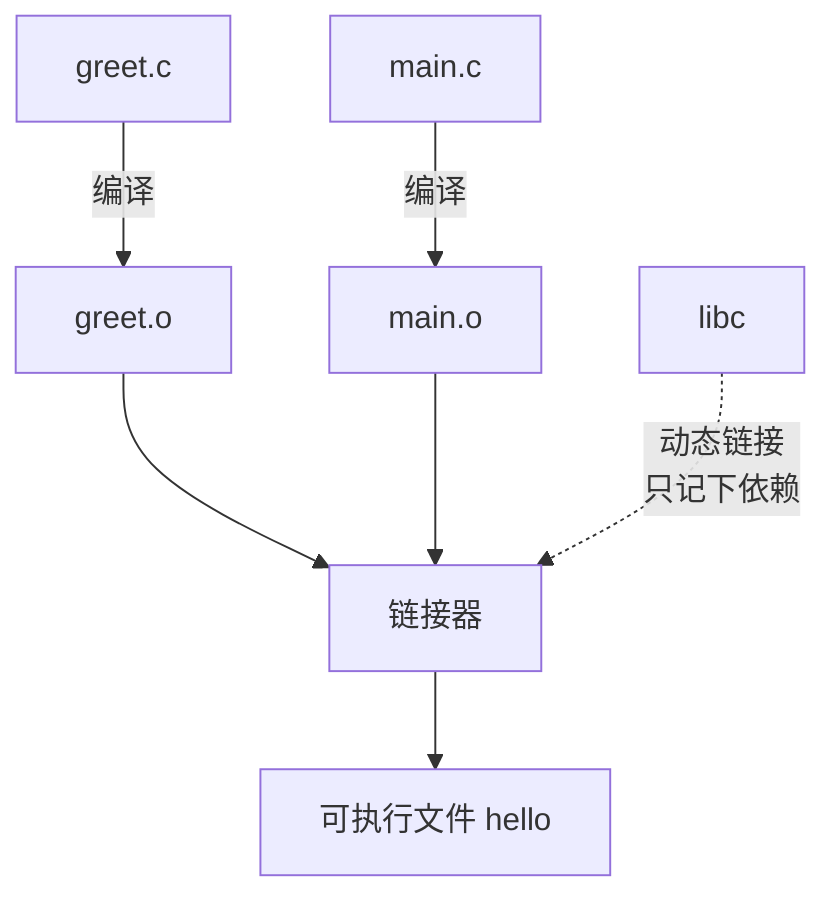
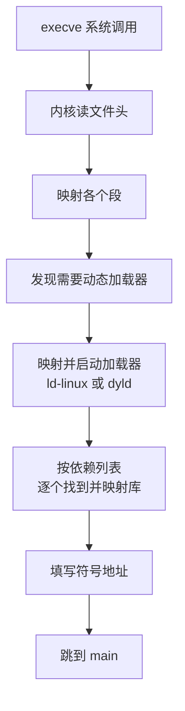

# 链接、加载与可执行文件

`Error loading shared library ld-linux-x86-64.so.2`、`GLIBC_2.34 not found`、`was compiled against a different Node.js version`、`exec format error`，这几个报错有一个共同点：代码本身没有问题，问题出在「一个程序怎么找到并装进它依赖的其他代码」。这一章讲编译后的代码怎么被链接成可执行文件、操作系统怎么把它加载进内存、动态库在运行时怎么被找到。读完你会知道 Alpine 镜像里的原生模块为什么跑不起来、Electron 为什么要重编原生依赖，以及 `node_modules` 为什么不能从 Mac 直接拷进 Linux 容器。

## 从源码到可执行文件

C、C++、Rust、Go 这类编译型语言，从源码到能运行的程序要经过两步：**编译**把每个源文件单独翻译成一个**目标文件**（`.o`），**链接**把多个目标文件和用到的库合并成一个可执行文件。



为什么要分两步？因为编译一个文件时，编译器只看得到这个文件。用两个文件做个实验：

```c
// greet.c
#include <stdio.h>

int greet_count = 0;

void greet(const char *name) {
  greet_count++;
  printf("你好，%s\n", name);
}
```

```c
// main.c
void greet(const char *name);  // 只有声明，没有实现
extern int greet_count;

int main(void) {
  greet("shelf");
  greet("counter");
  return greet_count == 2 ? 0 : 1;
}
```

分别编译后，用 `nm` 看两个目标文件里的**符号表**（去掉了编译器生成的局部符号）：

```text
$ clang -c greet.c main.c
$ nm greet.o
0000000000000000 T _greet
0000000000000078 S _greet_count
                 U _printf
$ nm main.o
                 U _greet
                 U _greet_count
0000000000000000 T _main
```

`T` 表示「我定义了这个函数」，`S` 表示「我定义了这个数据」，`U` 表示「我用到了它，但不知道它在哪」（undefined）。macOS 上 C 符号名前会加一个下划线，Linux 上没有。

`main.o` 调用 `greet` 的那条跳转指令，目标地址暂时是空的，旁边记着一条**重定位**项：「这里要填 `_greet` 的地址」。链接器的工作就是：把所有目标文件的代码和数据拼在一起，为每个符号分配最终地址，再回头把所有重定位的空填上。

只链接 `main.o` 会失败，因为有符号找不到定义：

```text
$ clang main.o -o x
Undefined symbols for architecture arm64:
  "_greet", referenced from:
      _main in main.o
```

两个都给它就成功了。注意 `printf` 在两个文件里都没有定义，它来自系统的 C 库，链接器没有把它的代码拷进来，只是记下「运行时去某个库里找」。这就是下面要讲的动态链接。

这个过程和你熟悉的 JS 打包很像：每个模块单独解析，`import` 是「未定义符号」，打包器（esbuild、Rollup）负责把它们解析到具体模块、拼成一个或几个文件；`external` 的依赖不打进去，运行时再找。区别在于 JS 的「链接」是按名字在运行时查对象属性，而原生代码链接完就是写死的机器地址。

## 可执行文件里有什么

链接器输出的文件有固定的格式，不同系统各不相同：

| 系统 | 格式 | 动态库扩展名 | 查看依赖的命令 |
|---|---|---|---|
| Linux、Android | ELF | `.so` | `ldd`、`readelf -d` |
| macOS、iOS | Mach-O | `.dylib`、`.framework` | `otool -L` |
| Windows | PE | `.dll` | `dumpbin /dependents` |

格式不同，内容的组织方式大同小异，都分成若干**段**：

- **代码段**（`.text`）：机器指令，只读、可执行
- **只读数据段**（`.rodata`）：字符串字面量、常量表
- **数据段**（`.data`）：有初始值的全局变量，比如上面的 `greet_count = 0`（实际上初值为 0 的会放进下一项）
- **BSS 段**：初值为 0 的全局变量，文件里只记大小、不占空间，加载时由内核分配清零的页
- **符号表、重定位表、动态链接信息、调试信息**等元数据

每个段在文件里的偏移和在内存里的地址都按**页大小对齐**，因为加载时是按页 `mmap` 进来的（第 4 章），不同段需要不同的页权限（代码可执行不可写、数据可写不可执行）。第 4 章提到 Android 要求原生库按 16 KB 对齐，说的就是这个对齐值：一个按 4 KB 对齐编译的 `.so`，在 16 KB 页的设备上无法按段设置正确的页权限，加载会失败。

`file` 命令能快速判断一个二进制是什么格式、什么架构，排查「这个文件能不能在这台机器上跑」时先用它：

```text
$ file hello
hello: Mach-O 64-bit executable arm64
$ file node_modules/better-sqlite3/build/Release/better_sqlite3.node
...: ELF 64-bit LSB shared object, x86-64, ...      # 这才能在 x86-64 Linux 上加载
```

## 静态链接与动态链接

库可以以两种方式进入程序：

- **静态链接**：把库的代码直接拷进可执行文件，生成一个自给自足的大文件
- **动态链接**：只在可执行文件里记下「需要 `libc.so.6`」，运行时由加载器找到这个库、映射进内存

| | 静态链接 | 动态链接 |
|---|---|---|
| 部署 | 一个文件拷过去就能跑 | 目标机器上要有对的库和对的版本 |
| 体积 | 每个程序都带一份库 | 库在磁盘和内存里只有一份，多进程共享 |
| 安全更新 | 库有漏洞要重新编译每个程序 | 更新系统库，所有程序一起修好 |
| 典型 | Go 默认、Rust 的 musl 目标 | 大多数 Linux 发行版里的软件、Node 本身 |

Go 程序能直接放进一个 `FROM scratch` 的空镜像里运行，因为它默认静态链接（不用 cgo 时）。Node 不行，它动态链接了 C 库和 C++ 标准库，所以 Node 的基础镜像至少要带上这些库。

用 `otool -L` 看 Mac 上的 Node 依赖哪些动态库：

```text
$ otool -L $(which node)
/Users/jarvis/.nvm/versions/node/v22.23.1/bin/node:
	/System/Library/Frameworks/CoreFoundation.framework/Versions/A/CoreFoundation (...)
	/System/Library/Frameworks/Security.framework/Versions/A/Security (...)
	/usr/lib/libc++.1.dylib (...)
	/usr/lib/libSystem.B.dylib (...)
```

在 Linux 上对应的命令是 `ldd $(which node)`，输出里会有 `libc.so.6`、`libstdc++.so.6`、`libm.so.6` 和动态加载器 `ld-linux-x86-64.so.2`（arm64 上是 `ld-linux-aarch64.so.1`）。

## 加载：程序是怎么跑起来的

执行一个动态链接的程序时，发生的事情比看起来多：



关键的一步是：内核自己不处理动态库，它只看 ELF 头里写着的**解释器路径**（`/lib64/ld-linux-x86-64.so.2`），把这个加载器也映射进来并先运行它。加载器再按可执行文件的依赖列表，在一系列目录（`/lib`、`/usr/lib`、`LD_LIBRARY_PATH`、可执行文件里记录的 rpath）里找到每个 `.so`，映射进内存，把程序里对外部符号的引用指向它们。

macOS 上这个角色叫 dyld。iOS 也用 dyld，但出于安全和启动速度考虑限制很多：App 只能加载随自己一起签名打包的动态库，不能在运行时下载新的原生代码来加载。这也是为什么 Expo 里新增原生依赖必须重新构建 dev client，而纯 JS 的改动只要重新加载 bundle。

### 那个最常见的报错

理解了加载过程，Alpine 镜像里的经典报错就不神秘了：

```text
Error: Error loading shared library ld-linux-x86-64.so.2: No such file or directory
  (needed by /app/node_modules/better-sqlite3/build/Release/better_sqlite3.node)
```

这个 `.node` 文件是为 glibc 系统编译的，它的依赖里写着 glibc 的动态加载器 `ld-linux-x86-64.so.2`。Alpine 用的是另一个 C 库 **musl**，加载器叫 `ld-musl-x86_64.so.1`，系统里根本没有 glibc 的那个文件。

## glibc 与 musl

Linux 上的程序几乎都通过 C 库和内核打交道，最常见的两个实现：

| | glibc | musl |
|---|---|---|
| 用在哪 | Debian、Ubuntu、RHEL 及其衍生镜像（`node:22`、`node:22-slim`） | Alpine（`node:22-alpine`） |
| 特点 | 功能全、兼容性最好、体积较大 | 小而简洁，适合静态链接 |
| 二进制兼容 | 为一方编译的动态链接二进制，一般不能在另一方上运行 | |

除了加载器不同，两者在一些行为上也有差异：DNS 解析的实现、线程默认栈大小（musl 小得多，深递归的原生代码可能栈溢出）、`malloc` 的性能特征。纯 JS 的 Node 应用几乎感觉不到，带原生模块的应用就要小心。基础镜像的选择建议见[《容器技术》的基础镜像一节](../docker-containers/02-images-layers.md#基础镜像怎么选)。

### glibc 的版本

glibc 内部用**符号版本**保持向后兼容：在旧 glibc 上编译的程序，能在新 glibc 上运行；反过来不行。在 Ubuntu 24.04 上编译的二进制，拿到 Debian 11 上运行，会看到：

```text
/lib/x86_64-linux-gnu/libc.so.6: version `GLIBC_2.34' not found
```

意思是这个二进制用到了 glibc 2.34 才引入的某个符号版本，而目标系统的 glibc 更旧。所以原生模块的预编译包通常在**尽量旧**的发行版上构建，以覆盖更多的目标系统；你自己在 CI 里编译原生代码时，编译环境的发行版版本也不应该比运行环境新。

## Node 原生模块

`better-sqlite3`、`sharp`、`bcrypt` 这类包里有一个 `.node` 文件。它就是一个普通的**动态库**（Linux 上是 ELF 共享对象，Mac 上是 Mach-O bundle），`require` 它的时候，Node 用 `dlopen` 把它加载进进程，调用它导出的初始化函数注册 JS 可见的方法。

这意味着它同时受三方面约束：

1. **操作系统和架构**：Linux x86-64 的 `.so` 不能在 macOS arm64 上加载，反之亦然
2. **C 库**：glibc 编的不能在 musl 上用
3. **Node 的 ABI**：模块和 Node 之间怎么调用函数、对象怎么布局

第 3 点有两种情况。直接用 V8 和 Node 内部 C++ API 写的老式模块，每个 Node 大版本 ABI 都会变，用 `NODE_MODULE_VERSION` 这个数字标识。版本对不上就会报：

```text
Error: The module '.../better_sqlite3.node'
was compiled against a different Node.js version using
NODE_MODULE_VERSION 115. This version of Node.js requires
NODE_MODULE_VERSION 127.
```

用 **Node-API**（N-API）写的模块则只依赖一层稳定的 C 接口，跨 Node 大版本二进制兼容，升级 Node 不用重编。新写的原生模块应该都用 Node-API。

Electron 内嵌了自己的 Node，它的 `NODE_MODULE_VERSION` 和同版本号的 Node 不同，所以非 Node-API 的原生模块要针对 Electron 重编，这就是 `@electron/rebuild` 存在的原因（打包时怎么处理见[《Electron 桌面应用》的 electron-vite 一章](../electron-desktop/04-electron-vite.md)）。

### 预编译包是怎么选的

为了让用户不用装编译工具链，原生模块的作者会为常见平台预先编译好二进制。分发方式主要有两种：

- **安装时下载**：`postinstall` 脚本（`prebuild-install` 等）按当前平台从 GitHub Releases 下载对应的 `.node`；下载不到就退回用 `node-gyp` 现场编译，这时需要 Python、make 和 C++ 编译器
- **按平台拆成可选依赖**：主包在 `optionalDependencies` 里列出每个平台一个子包，每个子包在 `package.json` 里用 `os`、`cpu`、`libc` 字段声明自己适用的平台，包管理器只安装匹配当前机器的那一个。`esbuild`（`@esbuild/linux-x64` 等）和新版 `sharp`（`@img/sharp-linux-x64`、`@img/sharp-linuxmusl-x64` 等）都是这种方式

两种方式都是**在安装的那台机器上**做选择。所以：

- **不要把宿主机的 `node_modules` 拷进镜像**。在 Mac 上装出来的是 darwin-arm64 的二进制，进了 Linux 容器就是 `exec format error` 或者干脆找不到模块。`.dockerignore` 里排除 `node_modules`，在 Dockerfile 里重新安装
- **安装和运行要在同一种环境**。在 `node:22` 的构建阶段装依赖、再把 `node_modules` 拷进 `node:22-alpine` 的运行阶段，也会因为 glibc 和 musl 不同而出错。多阶段构建的每个阶段都要用同一种 C 库的基础镜像

hatch-counter 的服务端镜像选了 Alpine，能这么选的前提是服务端的依赖里没有原生模块；桌面端用到的 `better-sqlite3` 在 Dockerfile 里被 `--filter` 挡在了外面，安装时根本不会进镜像（见[《容器技术》的多阶段构建一章](../docker-containers/04-multi-stage.md#hatch-counter-的真实-dockerfile)）。这是一个清楚的思路：**先弄清楚哪些依赖带原生代码，再选基础镜像**，而不是先选了 Alpine、再一个个去解决报错。

### 为别的平台安装依赖

> [!WARNING]
> `supportedArchitectures` 的写法和所在的配置文件随 pnpm 版本变化，以 pnpm 官方文档中 `supportedArchitectures` 的说明为准。

有时你确实需要在一台机器上为另一个平台装依赖，比如在 Mac 上生成一个给 Linux 服务器用的离线依赖包。pnpm 可以通过 `supportedArchitectures` 声明「除了当前平台，也把 linux、x64、musl 的可选依赖装上」：

```yaml
# pnpm-workspace.yaml
supportedArchitectures:
  os: [current, linux]
  cpu: [current, x64]
  libc: [current, musl]
```

## 移动端：链接是构建时的事

iOS 不允许 App 在运行时加载随包之外的原生代码，所以移动端所有的链接都在构建时完成。一个 Expo 应用构建时：

- 每个带原生代码的依赖（`expo-sqlite`、`react-native-webview`、`react-native-tcp-socket`……）提供 Objective-C、Swift 或 C++ 源码，由 CocoaPods 编成库
- 这些库和 React Native、Hermes 一起被链接进 App 的可执行文件，或者作为 framework 打包进 `.app` 目录
- 每一个可执行文件和动态 framework 都要用开发者证书签名，系统加载时校验签名

JS 部分则完全不同：Metro 把所有 JS 打成一个 bundle，Hermes 在构建时把它编译成字节码，运行时由 Hermes 解释执行。新增一个纯 JS 的依赖只改变 bundle；新增一个带原生代码的依赖要重新走 CocoaPods 和 Xcode 的编译链接，这就是为什么 hatch-shelf 的开发约定里写着「新增原生依赖后要重新构建」dev client，而不能只重启 Metro。

## 排查工具一览

| 想知道 | Linux | macOS |
|---|---|---|
| 这是什么格式、什么架构 | `file <文件>` | `file <文件>` |
| 依赖哪些动态库 | `ldd <文件>` | `otool -L <文件>` |
| 导出、引用了哪些符号 | `nm -D <文件>` | `nm <文件>` |
| 段和对齐方式 | `readelf -l <文件>` | `otool -l <文件>` |
| 进程实际加载了哪些库 | `cat /proc/<pid>/maps` | `vmmap <pid>` |
| 加载器在哪找、为什么找不到 | `LD_DEBUG=libs <命令>` | `DYLD_PRINT_LIBRARIES=1 <命令>` |

> [!CAUTION]
> 不要对不信任的二进制运行 `ldd`。在某些实现里，`ldd` 会实际执行被检查程序的加载过程，恶意构造的二进制可以借此执行代码。检查来路不明的文件时用 `readelf -d` 或 `objdump -p`，它们只解析文件不运行。

## 全书回顾

九章从比特一路走到了可执行文件，每一章都是一层抽象和它的代价：

- 数字和字符在机器里有固定的表示方式，`number` 的精度、字符串的长度都是这些表示的直接后果
- CPU 靠流水线和预测并行执行指令，靠多层缓存掩盖内存的慢；数据的规律性和局部性决定了同一段代码的快慢
- 操作系统用虚拟内存给每个进程一个独立的世界，用进程和线程划分执行和故障的边界，用 epoll 让一个线程照看上万个连接，用页缓存和 fsync 在速度与持久性之间做取舍
- 链接和加载把分散的代码拼成可以运行的程序，平台、架构、C 库、ABI 任何一项不匹配都会让它跑不起来

写上层代码的时候，这些层通常是隐形的。它们露出来的时候，往往以一个莫名的报错或一个说不清的性能问题的形式出现。知道下面有哪几层、每层做了什么承诺，就知道该往哪里查。

## 本章要点

- 编译把每个源文件变成目标文件，链接器解析未定义符号、填写重定位，拼成可执行文件
- ELF、Mach-O、PE 分别是 Linux、Apple 平台、Windows 的格式；段按页对齐，Android 16 KB 页要求重新对齐原生库
- 静态链接部署简单、体积大；动态链接共享库、方便更新，但依赖目标机器的环境
- 内核把动态加载器映射进来先运行，由它查找并映射各个动态库；iOS 只能加载随 App 签名打包的原生代码
- glibc 和 musl 的二进制不通用；glibc 向后兼容，新系统编的二进制可能在旧系统上缺符号版本
- Node 原生模块是动态库，受系统、架构、C 库和 ABI 约束；Node-API 模块跨 Node 大版本兼容，Electron 需要重编非 Node-API 模块
- 预编译包在安装的机器上选择：不要拷宿主机的 `node_modules` 进镜像，构建和运行阶段用同一种 C 库
- 先弄清哪些依赖带原生代码，再选基础镜像

## 动手练习

1. **亲手当一次链接器的客户**：把本章的 `greet.c`、`main.c` 存下来（Mac 需要 Xcode 命令行工具，Linux 用 `gcc` 替换 `clang`），依次执行 `clang -c greet.c main.c`、`nm main.o`、`clang main.o -o x`、`clang greet.o main.o -o hello && ./hello; echo $?`。

   验证：`nm main.o` 里 `_greet`、`_greet_count` 前是 `U`（Linux 上没有下划线）；只链接 `main.o` 报 `Undefined symbols`（Linux 上是 `undefined reference to 'greet'`）；完整链接后打印两行问候，退出码 0。

   参考答案：链接器要为每个 `U` 找到一个定义；`printf` 也是 `U`，但它由系统 C 库在运行时提供，不需要你给。

2. **看加载器找到了哪些库**：对上一题的 `hello` 运行 `otool -L hello` 和 `DYLD_PRINT_LIBRARIES=1 ./hello`（Linux 上是 `ldd hello` 和 `LD_DEBUG=libs ./hello`）。

   验证：`otool -L` 只列出 `libSystem.B.dylib` 一项；`DYLD_PRINT_LIBRARIES` 打印出的库多得多（`libSystem` 自己又依赖一串 `/usr/lib/system/` 下的库）。Linux 上 `ldd` 能看到 `libc.so.6` 和 `ld-linux-*.so.*` 加载器。

   参考答案：可执行文件里只记直接依赖，加载器递归地把依赖的依赖也映射进来。

3. **复现 Alpine 的那条报错**：只在 Docker 里做，在一个空目录里先用 glibc 镜像安装：`docker run --rm -v "$PWD":/app -w /app node:22 npm i better-sqlite3`，再用 Alpine 镜像加载它：`docker run --rm -v "$PWD":/app -w /app node:22-alpine node -e 'require("better-sqlite3")'`。之后对 `node_modules/better-sqlite3/build/Release/better_sqlite3.node` 运行 `file`。

   验证：Alpine 那条命令报错，信息里提到找不到 `ld-linux-` 开头的动态加载器（或类似的共享库加载失败）；`file` 显示它是 `ELF 64-bit LSB shared object`，架构和你的 Docker 架构一致。在 Alpine 镜像里重新 `npm i` 后再加载就正常了。

   参考答案：`.node` 是为 glibc 编译的动态库，依赖 glibc 的加载器，而 Alpine 只有 musl 的。安装和运行用同一种 C 库的镜像，问题就不存在。顺带用 `node -p process.versions.modules` 看本机 Node 的 ABI 编号（Node 22 是 127），和本章报错里的 `NODE_MODULE_VERSION` 对照。
