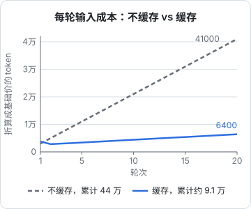
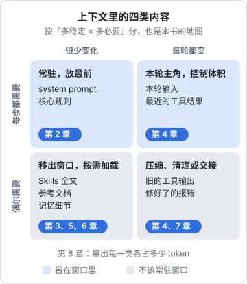

# 上下文窗口是稀缺资源

[《Agent 原理与设计》第 6 章](../agent-principles/06-context-engineering.md)给了上下文工程一张全景图：上下文由哪些部分组成，常用写入、选择、压缩、隔离四种手法。这本书把那一章展开成一整套做法：每一类信息该怎么写、什么时候放进窗口、什么时候拿出来、放不下了怎么办。

这一章先把出发点讲透：既然现在的模型窗口已经到了百万 token 级别，为什么还要把上下文当成稀缺资源来管？

## 这本书讲什么、适合谁、怎么读

**讲什么**：agent 在几十上百轮循环里，每一轮看到的内容是怎么拼出来的，以及怎样拼得又省又准。具体是八个主题：

| 章 | 主题 | 对应的手法 |
|---|---|---|
| 1 | 上下文窗口为什么稀缺 | 目标与度量 |
| 2 | system prompt 的写法 | 写好最稳定的那一层 |
| 3 | 记忆分层 | 写入：把信息存到窗口外 |
| 4 | 压缩与摘要 | 压缩：把已有内容变短 |
| 5 | 按需检索 | 选择：用到时才取进来 |
| 6 | Skills 的渐进式加载 | 选择：先给目录，再给全文 |
| 7 | 长任务的状态管理 | 写入 + 隔离：跨窗口、跨会话 |
| 8 | 度量与调试 | 看见上下文、定位问题 |

ROADMAP 原定七章，这里补了第 8 章「度量与调试」：前七章讲怎么做，最后一章讲怎么知道自己做对了没有。

**适合谁**：已经在用 Claude Code 这类编码 agent、或者在自己的产品里写 agent loop 的开发者。默认你读过[《Agent 原理与设计》](../agent-principles/)（尤其第 5、6、8 章）和[《大模型应用工程》](../llm-app-engineering/)里 prompt、工具调用、prompt 缓存三章。涉及 `CLAUDE.md` 和 rules 的具体写法，[《编码 Agent 实战》](../coding-agents/)第 2、3 章已经讲过，这里只在需要时引用。

**怎么读**：第 1、2 章是基础，建议按顺序读；第 3 到第 7 章相对独立，可以挑当前最痛的那个先读；第 8 章适合在你调过一两个 agent 之后再回来看。代码示例用 TypeScript 和官方 `@anthropic-ai/sdk`，原理对其他厂商的 API 同样适用。

## 窗口有多大，和能用好多大是两回事

窗口（context window）是模型一次调用能处理的 token 上限，输入和输出共享这个额度。几年前主流是几千到几万 token，现在主力模型已经到百万级别，具体数字随模型变化，以官方模型文档为准。

窗口变大以后，一个自然的想法是：都塞进去，让模型自己挑。实践中这条路走不通，原因有三个，可以概括为三种稀缺：

| 稀缺的是 | 为什么 | 体现在哪 |
|---|---|---|
| 钱 | 每一轮都按输入 token 计费，历史越长每轮越贵 | 账单 |
| 时间 | 输入越长，首个 token 出来得越晚 | 延迟 |
| 注意力 | 模型对每个 token 的「关注」是此消彼长的 | 质量 |

前两种好算，第三种最隐蔽，也最要命。

## 稀缺之一：钱

agent 每一轮都要把完整的消息历史重新发一遍（循环的结构见[《Agent 原理与设计》第 2 章](../agent-principles/02-agent-loop.md)），单轮输入随轮数线性增长，累计输入按二次方增长。算一笔账：假设 system 加工具定义 3000 token，每轮新增约 2000 token（模型输出加工具结果），第 $n$ 轮的输入约为 $3000 + 2000(n-1)$，20 轮累计输入约 44 万 token。

prompt 缓存能大幅改写这笔账。缓存命中的前缀按基础价的约十分之一计费，写入缓存的部分按约 1.25 倍计费。读取倍率因模型而异：Claude Opus 5.5 的缓存读取是输入价的 1/20（每百万 token 输入 4 美元、读取 0.2 美元），下面的估算仍按较保守的十分之一来算（倍率以官方定价页为准）。同样的 20 轮任务，如果每轮只有新增的 2000 token 是「新写入」，其余都命中缓存：



折算成「基础价 token」：

- 不缓存：$\sum_{n=1}^{20}\left(3000+2000(n-1)\right)=440000$
- 缓存：第 1 轮写入 3000 × 1.25；之后每轮读取前缀 × 0.1、写入新增的 2000 × 1.25，合计约 91150

差了将近五倍。这引出上下文工程的第一条硬约束：**上下文最好只追加、不改写**。缓存是前缀匹配，任何一个字节的改动都会让它后面的缓存全部失效。第 4 章讲压缩时会反复碰到这个张力：压缩能省 token，但每压缩一次，缓存就要重建一次。

## 稀缺之二：时间

模型处理输入（prefill）的时间随输入长度增长。一个塞了几十万 token 的请求，即使输出只有一句话，也要等相当一段时间才开始返回。缓存同样能缓解这部分延迟，但不能消除：没命中的那一段照样要算。

对交互式 agent 来说，延迟会直接改变用法。每一轮都要等很久，你就会倾向于少交互、一次给一大段任务，而这恰恰更依赖上下文质量。

## 稀缺之三：注意力

[《大模型原理科普》](../llm-fundamentals/)讲注意力机制时说过：每个位置对其他位置的关注度经过 softmax 归一化，加起来等于 1。这是一个直观但有用的类比：**注意力是一个固定总量的预算**，放进来的无关内容越多，分到关键信息上的就越少。

实践中观察到的现象和这个类比一致：

- **长上下文中段的信息更容易被忽略**。2023 年斯坦福等机构的论文《Lost in the Middle》发现，在多文档问答里，相关信息放在开头或结尾时模型答得最好，放在中间时明显变差。新模型在这方面改进很多，但「位置有影响」这个结论值得记住
- **上下文越长，整体表现越容易下滑**。业内把这种现象叫作 context rot（上下文腐化）：即使任务本身不变，往上下文里加入无关内容，准确率也会下降，下面会看到两份量化它的研究
- **错误会留在上下文里持续起作用**。agent 前几轮的错误假设、失败的尝试都留在历史里，后面的推理会被它们带偏

### context rot：研究怎么说

「上下文越长越差」不只是经验之谈，有两份公开研究把它量化过。

**Chroma 的《Context Rot》技术报告**（Kelly Hong 等，2025 年 7 月 14 日）测了 18 个模型，包括 GPT-4.1、Claude 4、Gemini 2.5 和 Qwen3 系列。它刻意让任务本身保持简单，只改变输入长度和内容，几个发现对上下文工程很有用：

- **问题和答案「字面不像」时，衰减更快**。要找的那句话和问题的嵌入相似度越低，随着输入变长，准确率掉得越快。真实任务大多属于这种情况：用户问「为什么闪退」，日志里写的是 `NullPointerException`
- **干扰项有害，而且越多越糟**。加入主题相关、但并不回答问题的段落，一段就会拉低表现，四段更低。agent 历史里那些「差一点就是答案」的工具结果，就是这种干扰项
- **聚焦的输入远好于完整的输入**。在 LongMemEval 对话记忆任务上，只给相关的约 300 token 和给出完整的约 11.3 万 token 相比，所有模型家族都是前者得分更高
- **连简单复制都会出错**。让模型原样重复一串越来越长的重复词，到一定长度后各模型都开始出现拒答、乱写和长度错误

**NoLiMa**（Modarressi 等，ICML 2025）换了一个角度：把「大海捞针」里问题和针之间的字面重合去掉，只留语义联系。结果在 32K 长度时，13 个受测模型里有 11 个跌到自己短上下文成绩的一半以下。论文的解释是：字面能匹配时，注意力机制很容易找到目标；需要靠推理把问题和答案联系起来时，长上下文的负担就暴露出来了。

> [!NOTE]
> 这两份研究测的是 2025 年的模型，新模型的长上下文能力在持续改进，具体数字不宜直接套用到今天的模型上。但「无关内容越多越差、聚焦的输入更好」这个方向，在不同研究和不同代模型上都反复出现。

对本书来说，这些研究的意义是给后面几章的做法提供依据：第 4 章的压缩、第 5 章的按需检索、第 6 章的渐进加载，本质上都是在把「完整输入」换成「聚焦输入」。

所以窗口大小只是硬上限，真正的约束是有效注意力。一个经验判断：**窗口用得越满，越要怀疑后面的输出质量**。Claude Code 在接近上限时自动压缩，原因就在这里。

## 上下文工程的目标

把三种稀缺合在一起，目标可以写成一句话：

> 在每一步，用尽量少、尽量准的 token，给模型完成这一步所必需的信息。

注意「每一步」。agent 的上下文不是写一次就完事的 prompt，而是每一轮都在变化的工作区。同一份信息，在第 3 轮必需，在第 30 轮可能就是噪音。

围绕这个目标，可以把上下文里的内容按「多稳定」和「多必要」两个维度分成四类。下图把四类内容和本书对应的章节放在一起，也可以当作全书的地图：



- **稳定且每步都需要**：system prompt、项目核心约定。写精、放最前面、享受缓存。第 2 章
- **稳定但偶尔需要**：参考文档、做事方法、长期记忆的细节。不要常驻，按需加载。第 3、5、6 章
- **多变且每步都需要**：最新的用户输入、刚拿到的工具结果。这是本轮的主角，要从源头控制工具一次返回多少。第 4 章
- **多变且已不再需要**：十轮之前的文件全文、早已修好的报错。该压缩或清理；任务长到装不进一个窗口时，把状态交接到文件里。第 4、7 章

第 8 章讲怎么量出每一类各占多少 token，以及哪一类出了问题。

很多 agent 表现变差，是因为「偶尔需要」那一行的内容在窗口里越堆越多。

## 一个具体的例子

拿你正在读的这套书来说。主会话派出写书 agent 时，需要让它知道的东西很多：读者画像、写书硬规则、配图规范、范文、ROADMAP 条目、相关的已写书、可参考的项目代码。如果主会话把这些全部贴进任务描述，写书 agent 一启动上下文里就是十几万 token 的材料，绝大部分在写某一章时用不上。

实际做法是分层：

| 层 | 内容 | 方式 |
|---|---|---|
| 任务描述 | 书名、编号、要先读哪几本 | 直接给，几十个字 |
| 共用简报 | 读者、产出范围、自检、汇报格式 | 一个文件，启动后自己去读 |
| 规范 | `books/AGENTS.md` 的硬规则与配图规范 | 简报里指向它 |
| 素材 | 范文、相关书、项目代码 | 简报里列路径，写到哪章读哪部分 |

任务描述只有一两句话，但它指向的东西层层展开，写书 agent 需要时才去读。这就是后面几章会反复用到的结构：**常驻的是索引，细节在窗口外，用到时再取**。

## 先学会看上下文

管理上下文的前提是看得见它。几个立刻可以用起来的办法：

- **Claude Code 里输入 `/context`**，看系统提示、工具定义、记忆文件、对话各占多少
- **在自己的 agent 里打印每轮的 `usage`**：`input_tokens`、`cache_read_input_tokens`、`cache_creation_input_tokens`、`output_tokens`，能直接看出历史增长和缓存命中
- **调用前用 token 计数接口估算**：`client.messages.countTokens(...)` 接收和正式请求相同的参数，返回输入 token 数，不产生生成费用

```typescript
import Anthropic from "@anthropic-ai/sdk";

const client = new Anthropic();
const MODEL = "claude-opus-5-5"; // 换成你实际使用的模型

// 发请求前先数一数，超过预算就先压缩（第 4 章）
export async function inputTokens(
  system: string,
  tools: Anthropic.Tool[],
  messages: Anthropic.MessageParam[],
): Promise<number> {
  const res = await client.messages.countTokens({ model: MODEL, system, tools, messages });
  return res.input_tokens;
}
```

第 8 章会在这个基础上做一套完整的度量和排查方法。

## 本章要点

- 窗口大小是硬上限，真正的约束是**钱、时间、注意力**三种稀缺
- 历史每轮重发，累计成本按二次方增长；prompt 缓存能把这笔账压低数倍，前提是上下文**只追加、不改写**
- 注意力是此消彼长的预算：无关内容会稀释关键信息，中段信息更容易被忽略，错误会残留在历史里
- context rot 有量化研究：输入越长、干扰项越多、问题和答案字面越不像，表现掉得越快；聚焦的输入明显好于完整的输入
- 目标：**每一步**用尽量少、尽量准的 token 给出必需信息
- 按「稳定性 × 必要性」给内容分类：稳定必需的写精放前面，偶尔需要的按需加载，过时的及时清理
- 常驻索引、细节在窗口外、用到再取，是贯穿全书的结构
- 先学会看：`/context`、`usage` 字段、token 计数接口

## 动手练习

1. **把缓存账算到底**：按本章的假设（system 加工具 3000 token，每轮新增 2000 token，写入按 1.25 倍、读取按 0.1 倍）用一行 Node 算出 20 轮的折算成本；再把读取倍率换成 Opus 5.5 的 0.05 算一次。

   ```bash
   node -e 'for (const r of [0.1, 0.05]) { let s = 3000 * 1.25; for (let n = 2; n <= 20; n++) s += (3000 + 2000 * (n - 2)) * r + 2000 * 1.25; console.log(r, s) }'
   ```

   验证：读取倍率 0.1 时输出 `91150`，和本章一致；0.05 时输出 `71200`。

   参考答案：缓存后成本的大头变成了每轮新写入的 2000 token，前缀再长也只按读取价计。前提是前缀一个字节都不变。

2. **量一量工具定义有多重**（需要 API key）：用 `countTokens` 分别数「只有一句用户消息」和「同样的消息加上你 agent 的全部工具定义」，差值就是工具定义每轮的固定开销。

   ```typescript
   const messages = [{ role: "user" as const, content: "你好" }];
   const bare = await client.messages.countTokens({ model: MODEL, messages });
   const withTools = await client.messages.countTokens({ model: MODEL, messages, tools });
   console.log("工具定义约占", withTools.input_tokens - bare.input_tokens, "token");
   ```

   验证：得到一个具体数字；去掉一个描述很长的工具再数，差值相应变小。

   参考答案：工具定义每轮都要带上，属于「稳定且每步都需要」那一格，写精比写长重要；工具很多时考虑第 6 章的按需加载。

3. **把内容放进四个格子**：给一个编码 agent 的上下文分类：(a) 项目的目录地图和完成标准；(b) 第 3 轮读过、第 15 轮早已改完的文件全文；(c) 发版的十步流程说明；(d) 刚跑完的测试输出；(e) 一份 3 万字的 API 参考；(f) 已经修好的类型报错。

   验证：每项给出格子和对应的处理办法。

   参考答案：(a) 稳定且每步需要，写精、常驻、放前面；(b)(f) 多变且已不再需要，清理或压缩；(c)(e) 稳定但偶尔需要，按需加载（Skill、检索）；(d) 多变且每步需要，从源头控制体积，只保留失败的部分。
