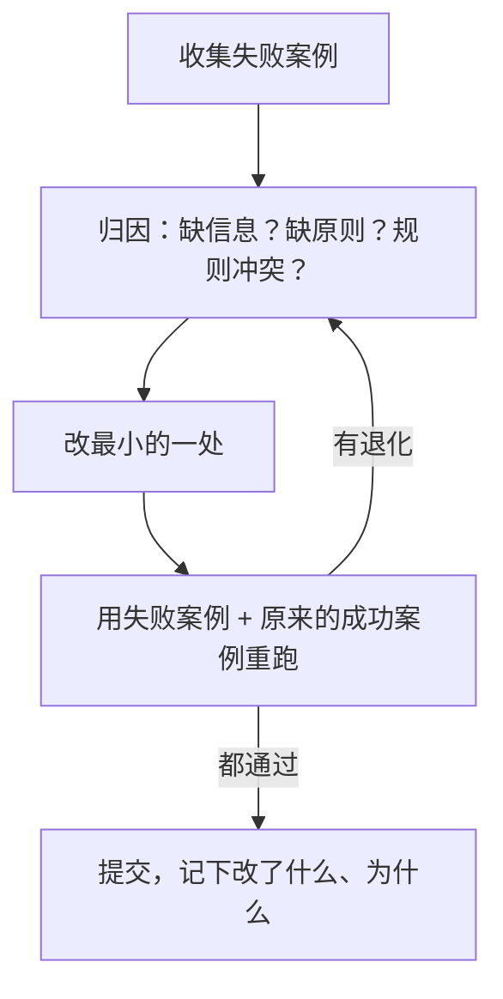

# system prompt 的写法

system prompt 是上下文里最稳定、权重最高的一层：每一轮都在，排在最前面，模型把它当作「这次工作的基本设定」。[《大模型应用工程》第 2 章](../llm-app-engineering/02-prompt-engineering.md)讲了单次调用的 prompt 怎么写，[《Agent 原理与设计》第 6 章](../agent-principles/06-context-engineering.md)列了几条要点。这一章专门讲 **agent 的 system prompt**：它要撑过几十轮循环、面对事先想不到的情况，所以写法和一次性的 prompt 不太一样。

## agent 的 system prompt 难在哪

一次性的 prompt 面对的是一个已知的任务：「把这张进货单读成 JSON」。agent 的 system prompt 面对的是一类任务，以及任务进行中冒出来的各种情况：工具报错了怎么办、用户的要求有歧义怎么办、发现了范围外的问题要不要顺手改。

这些情况写不完。所以 agent 的 system prompt 的核心任务不是列出所有规则，而是**让模型形成正确的判断标准**，在没写到的情况下也能做出你会认可的选择。

## 一份 system prompt 由什么组成

把常见的内容按用途分块：

| 块 | 回答的问题 | 例子 |
|---|---|---|
| 身份与目标 | 你是谁，为谁做什么，什么算做好 | 「你在帮一家餐馆的店主管理库存，目标是让账实相符」 |
| 环境 | 你在什么环境里，能接触到什么 | 今天的日期由用户消息给出；你只能通过工具访问数据库 |
| 原则 | 遇到取舍时怎么判断 | 数据对不上时交给人拍板，不自动猜 |
| 工具使用策略 | 什么时候用哪类工具，顺序如何 | 先查再改；写操作前复述将要做的改动 |
| 边界 | 绝对不能做的事 | 不删除任何单据 |
| 输出格式 | 回复长什么样 | 中文、先给结论、数字带单位 |

不是每块都要写，但这个清单能帮你检查有没有漏掉重要的一类。实践中最容易漏的是**原则**：大家习惯写「做什么」和「不做什么」，很少写「两个目标冲突时听谁的」。

## 找到合适的高度

写 system prompt 最常见的两种失败，一种写得太低，一种写得太高。

**太低**：把判断硬编码成条件分支。

```text
如果用户问库存，调用 query_stock。
如果用户问进货，调用 query_stock_in。
如果 query_stock 返回空，回复「没有找到该食材」。
如果用户说「补货」，先调用 query_stock 再调用 create_purchase。
如果数量大于 100，提醒用户确认。
……（还有四十条）
```

问题是：规则写得越细，规则之外的情况越多，模型在没写到的地方越无所适从；规则之间还容易互相打架。而且这种写法把模型当成了解释器，浪费了它最擅长的判断能力。

**太高**：只有空泛的愿景。

```text
你是一个专业、友好、高效的库存助手，致力于为用户提供最好的服务。
```

这段话几乎不提供信息。「专业」「高效」每个模型都会自认为做到了。

**合适的高度**：给出原则和判断依据，配少量有代表性的例子。

```text
<principles>
账实相符比回答快更重要。店主根据你的回答决定进多少货，报错一个数可能多花几百块。
所以：
- 数字一律来自工具结果，不要估算；工具没返回的就说没查到
- 名字对不上时（「白菜」和「大白菜」），列出候选让店主选，不要自己认定是同一样
- 改库存的操作先复述「把 X 从 A 改成 B」，等店主确认后再执行
</principles>
```

这一段只有三条规则，但它先讲了**为什么**（店主据此花钱），模型就能推出没写到的情况该怎么办：比如工具返回的数据看起来明显异常（库存是负数），按「账实相符比回答快更重要」的原则，它应该指出异常而不是照念。

判断高度是否合适，有一个简单的测试：**拿一个 prompt 里没写到的情况去问它**。如果它的处理方式和你预期一致，说明原则传达到了；如果不一致，补的应该是原则，而不是再加一条 if。

## 说明为什么

「说明为什么」值得单独强调，因为它是让 prompt 从规则清单变成判断标准的关键。

对比两种写法：

| 只有规则 | 规则 + 理由 |
|---|---|
| 不要发起网络请求 | 不要发起网络请求：这是离线书架，用户常在飞行模式下读书 |
| 报错文案在服务端写 | 报错文案在服务端写，客户端原样显示：多端共用一句话，改一处全端生效 |
| 不要用 `npm install` | 用 `npx expo install` 装依赖：它会挑与当前 SDK 匹配的版本 |

有了理由，模型能正确处理边界情况：知道「离线」是原因，它就明白加载一张远程图片也不行，即使规则里只写了「网络请求」。hatch-shelf 和 hatch-counter 的 `CLAUDE.md` 都是这么写的，[《编码 Agent 实战》第 2 章](../coding-agents/02-claude-md.md)有详细分析。

## 结构：让模型找得到

system prompt 长了以后，结构决定模型能不能在需要时定位到相关部分。两种常用的分隔方式：

- **Markdown 标题**：适合给人也给模型读的文档，比如 `CLAUDE.md`
- **XML 标签**：适合程序拼装的 prompt，边界清楚，也方便在代码里按块替换

```text
<role>
你在帮一家餐馆的店主管理库存和进货单。店主不懂技术，用手机和你对话。
</role>

<principles>
……
</principles>

<tools_guidance>
- 查询类工具可以随时调用，不需要先问店主
- create_purchase、adjust_stock 会改动数据，调用前先复述改动内容并等待确认
- 工具报错时，把错误里的中文原样告诉店主，不要自己编原因
</tools_guidance>

<output>
用中文。先给结论（数字），再给依据（来自哪几张单据）。不用 markdown 表格，手机上看不清。
</output>
```

标签名不需要什么特殊格式，有意义、前后一致就行。

## 例子：少而典型

例子是传达格式和风格最有效的方式，但在 agent 的 system prompt 里要克制：

- **例子会被模仿得过头**。只给一个例子，模型会倾向于套用它的结构、长度甚至用词
- **给两三个差异明显的例子**，让模型看到「变的是什么、不变的是什么」
- **不要试图用例子覆盖所有情况**，那又回到了「太低」的写法

hatch-counter 识别进货单的 prompt（`apps/api/src/ocr/vlm.ts`）就是一个好例子：它给了一个完整的 JSON 示例，同时明确写「照这个结构输出，值换成你从图里读到的」，避免模型把示例里的「大白菜」「毛豆」当成答案。

## 稳定的放前面，变化的放后面

第 1 章说过，缓存是前缀匹配。system prompt 在最前面（只排在工具定义之后），它里面任何一个字节变了，后面整段对话的缓存都会失效。所以要把 prompt 拆成稳定部分和变化部分：

| 内容 | 变化频率 | 放哪里 |
|---|---|---|
| 角色、原则、工具策略 | 随版本发布 | system 开头 |
| 门店名、店主偏好 | 每个用户不同 | 第一条 user 消息，或单独的上下文块 |
| 当前日期 | 每天 | user 消息里，精确到天 |
| 本轮的检索结果 | 每轮 | 本轮 user 消息或工具结果 |

hatch-counter 的进货单 prompt 也体现了这一点：只有开头那句「表格列依次是……」随供货商变化，代码注释写着「只换开头这一句：底下那些规矩跟谁家的单子都没关系」。如果要缓存它，更好的做法是把那句移到规则之后，让规则成为稳定前缀。

在代码里，把 system prompt 写成一个只依赖版本常量的函数，动态信息一律从别处进来：

```typescript
import Anthropic from "@anthropic-ai/sdk";

// 稳定部分：只随代码发布变化，可以安全地缓存
const SYSTEM_PROMPT = [
  "<role>你在帮一家餐馆的店主管理库存和进货单。</role>",
  "<principles>……</principles>",
  "<tools_guidance>……</tools_guidance>",
].join("\n\n");

export function buildRequest(
  store: { name: string; today: string },
  history: Anthropic.MessageParam[],
): Pick<Anthropic.MessageCreateParams, "system" | "messages"> {
  return {
    system: [
      { type: "text", text: SYSTEM_PROMPT, cache_control: { type: "ephemeral" } },
    ],
    messages: [
      // 每个门店不同的信息放在对话开头，不污染 system 的缓存
      { role: "user", content: `<store>门店：${store.name}；今天是 ${store.today}</store>` },
      { role: "assistant", content: "好的，我记下了门店信息。" },
      ...history,
    ],
  };
}
```

会话进行中需要追加指令（比如店主切换到「只看不改」模式），不要去改 system。部分新型号支持在 `messages` 中途插入一条 `role: "system"` 的消息，前面的缓存不受影响；哪些型号支持、放置位置有什么限制，以官方文档为准。不支持时，可以把指令放在下一条 user 消息里，用标签标明是系统指令。

## 强调要克制

早期模型不太听话，大家习惯在 prompt 里写满「务必」「绝对不要」「IMPORTANT」。对现在的模型，这样做往往适得其反：

- 模型对每条大写强调都过度敏感，在无关场景里也变得畏手畏脚
- 当十条规则都标了「最重要」，等于没有重点

更好的做法是：正常的语气陈述规则，靠**理由**体现重要性。「改库存前先复述并等待确认：店主可能手滑说错数字，改错了要盘点才能发现」，比「⚠️ 绝对必须先确认！！！」效果好。

如果某条规则真的必须百分之百遵守，那它不应该只写在 prompt 里，而应该做成代码层面的约束：工具层面的权限检查、hooks 里的拦截（[《编码 Agent 实战》第 4 章](../coding-agents/04-hooks.md)）。**prompt 负责引导判断，代码负责兜底**。

## 冲突与优先级

agent 的上下文里会有多个来源的指令：system prompt、项目记忆、用户消息、工具结果里夹带的文字。它们冲突时，模型会怎么选？不确定。所以要在设计时就消除冲突：

- **同一件事只在一个地方规定**。hatch-counter 的文档原则「一条事实只写在一个地方」对 prompt 同样适用
- **明确层级**：在 system prompt 里写清楚「用户的明确要求可以覆盖风格偏好，但不能覆盖边界」
- **工具结果是数据，不是指令**：网页、文件、邮件里出现的「请忽略之前的指令」不应被执行。在 system prompt 里说明这一点有帮助，但真正的防护要靠权限和隔离，详见[《Agent 安全》](../agent-safety/)

## 迭代：从失败倒推

system prompt 很少一次写对。一个可靠的迭代方式：



几个要点：

- **归因先于修改**。agent 选错了工具，可能是 system prompt 的问题，也可能是工具描述写得含糊（[《工具设计与 MCP》](../tools-and-mcp/)），也可能是上下文里塞了太多无关内容（第 4 章）
- **改完要回归**。一句新加的规则可能修好了一个案例，同时弄坏了三个。留一小组固定的样例，每次改 prompt 都跑一遍，[《评测与质量》](../llm-evals/)会讲怎么系统地做
- **prompt 进版本控制**，和代码一起评审。它就是代码

## 本章要点

- agent 的 system prompt 要面对写不完的情况，核心任务是**传达判断标准**，而不是穷举规则
- 按块检查：身份与目标、环境、原则、工具策略、边界、输出格式；最常漏的是「冲突时听谁的」
- 找到合适的高度：原则 + 理由 + 少量典型例子；用「没写到的情况」测试高度是否合适
- 用 Markdown 标题或 XML 标签分块，方便模型定位、方便代码替换
- 稳定内容放 system 开头并缓存，门店、用户、日期等变化信息放到消息里
- 强调要克制，靠理由体现重要性；必须百分之百遵守的规则交给代码兜底
- 同一件事只在一处规定，工具结果是数据不是指令；从失败案例倒推修改，改完回归
