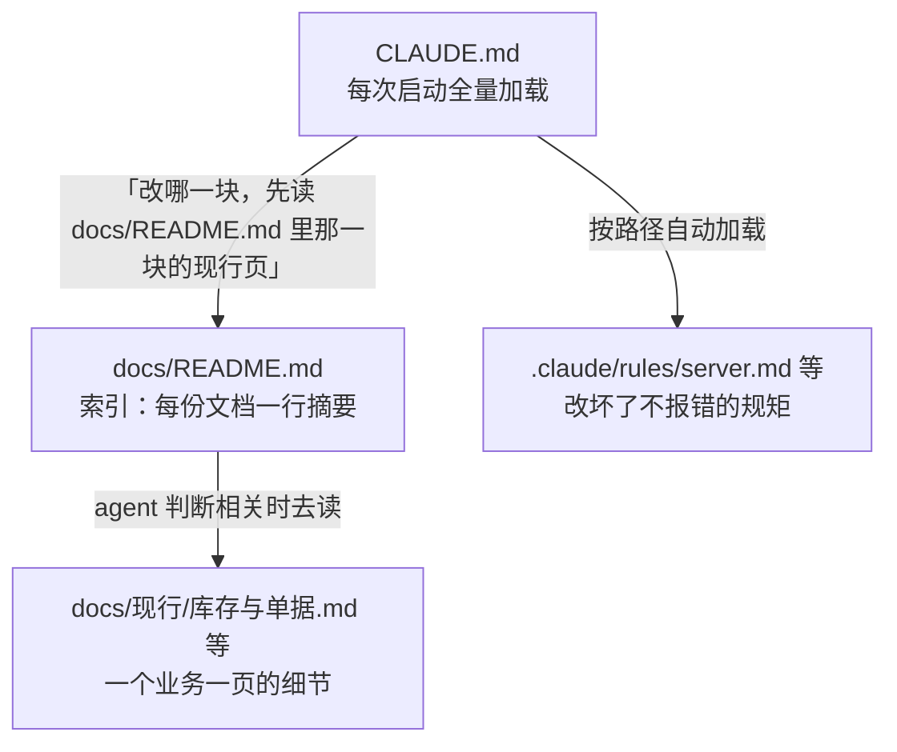

# 记忆分层

《Agent 原理与设计》第 5 章把记忆按时间尺度分成五层：工作记忆、会话历史、项目记忆、用户记忆、知识库，并指出核心矛盾是「长期记忆可以很大，窗口有限」。那一章回答了「有哪些层」，这一章回答「怎么设计一个记忆系统」：写什么、谁来写、存成什么样、什么时候读、怎么更新和遗忘。

## 先分清两件事：存储层和加载层

讨论记忆时容易把两件事混在一起：

- **存储层**：信息放在哪里、什么格式。文件、数据库、向量库
- **加载层**：信息什么时候、以什么形式进入上下文。启动时全量、启动时只给索引、按路径触发、按需检索

同一份信息可以存在一个地方，按不同方式加载。比如 hatch-counter 的业务文档都存在 `docs/` 里，但进入上下文的方式分三级：



设计记忆系统时，先想清楚每类信息的**加载层**，再选存储层。加载方式决定了它对上下文的成本。

## 记忆的四个设计问题

### 写什么

不是所有信息都值得记。值得进入长期记忆的信息有几个特征：

| 特征 | 例子 | 反例 |
|---|---|---|
| 从当前材料推断不出来 | 「提交信息不加 AI 署名」 | 「项目用 TypeScript」（看 `package.json` 就知道） |
| 会反复用到 | 「所有项目用 pnpm」 | 「这次先跳过测试」（一次性要求） |
| 错了代价大 | 「跑 `pnpm test` 前先停掉服务端 dev」 | 个人对变量命名的轻微偏好 |
| 相对稳定 | 架构原则、业务口径 | 当前分支名、今天在修的 bug |

最后一列的东西不是不重要，而是应该放在会话状态里（第 7 章），而不是长期记忆。把短期信息写进长期记忆，是记忆膨胀和过时的主要来源。

### 谁来写

| 写入方 | 适合的记忆 | 优点 | 风险 |
|---|---|---|---|
| 人手写 | 项目约定、架构原则 | 准确、经过思考 | 维护成本，容易忘了更新 |
| agent 在人的明确要求下写 | 「记住：以后都这样做」 | 意图清楚 | 要确认它写的和你说的一致 |
| agent 自主判断写 | 反复出现的纠正、观察到的偏好 | 省事 | 误判一次性要求为长期偏好；被注入 |
| 程序自动生成 | 索引、目录 | 永远和源头一致 | 只能做机械的事 |

一个务实的组合：**规则人写，偏好 agent 写并让人可审查，索引程序生成**。hatch-counter 的 `docs/README.md` 就是程序生成的：顶部写着「这一页是 `pnpm -C tools/docs gen` 照每份文档头上的 frontmatter 生成的，别手改」，`pnpm test` 会检查它跟没跟上。索引永远不会和文档脱节，agent 拿到的目录是可信的。

### 存成什么样

对 agent 来说，**纯文本文件往往是最好的记忆存储**：

- agent 天然会读写文件，不需要额外的工具
- 人能直接打开、审查、修改、用 git 追踪历史
- 可以用 `grep` 精确检索

每条记忆最好带上元数据，方便以后判断它还算不算数：

```markdown
---
name: no-ai-attribution
description: 提交和 PR 不加 AI 署名
scope: hatch-shelf 及所有个人仓库
source: 用户明确要求（2026-10）
---

提交信息和 PR 描述不加 Co-Authored-By、Generated with 之类的行。
原因：作者只有仓库所有者。
```

`scope`（适用范围）和 `source`（来源）这两项最有用。范围写清了，换项目时就不会误用；来源写清了，冲突时能判断该信谁。

数据库和向量库适合记忆条目非常多（成千上万）、需要按用户隔离、或者要做语义检索的场景，比如一个面向很多用户的产品里的个人化记忆。个人工具和编码 agent 用文件就够了。

### 什么时候读

这是对上下文成本影响最大的决定：

| 加载方式 | 适合 | 成本 |
|---|---|---|
| 启动时全量 | 少量、每次都需要的核心约定 | 每轮都占，要极度精简 |
| 启动时只给索引 | 条目多、每次只用到一部分 | 索引常驻，细节按需 |
| 按路径 / 按事件触发 | 只和某一块代码或某类操作相关 | 不相关时零成本 |
| 由 agent 主动检索 | 量大、无法预知用到哪部分 | 取决于检索质量（第 5 章） |

「索引常驻 + 细节按需」是最常用的中间方案。它的成本可以估算：假设有 40 条记忆，每条细节 300 token，索引每行 25 token。全量加载每轮 12000 token；只给索引每轮 1000 token，加上某次用到的两三条细节，也不过 2000 token 左右。

## 自己实现一个文件记忆

在自己的 agent 里，可以用两个工具实现「索引常驻 + 细节按需」：启动时把索引放进上下文，agent 通过工具读写细节。下面是一个最小实现，存储就是一个目录：

```typescript
import Anthropic from "@anthropic-ai/sdk";
import { mkdir, readdir, readFile, writeFile } from "node:fs/promises";
import { join } from "node:path";

const DIR = "memory";
const NAME_RE = /^[a-z0-9-]{1,48}$/;

/** 从每条记忆的 frontmatter 里取 description，拼成索引，启动时放进上下文 */
export async function loadIndex(): Promise<string> {
  await mkdir(DIR, { recursive: true });
  const lines: string[] = [];
  for (const file of (await readdir(DIR)).filter((f) => f.endsWith(".md")).sort()) {
    const text = await readFile(join(DIR, file), "utf8");
    const desc = text.match(/^description:\s*(.+)$/m)?.[1] ?? "(无描述)";
    lines.push(`- ${file.replace(/\.md$/, "")}: ${desc}`);
  }
  return lines.length ? lines.join("\n") : "(暂无记忆)";
}

export const memoryTools: Anthropic.Tool[] = [
  {
    name: "memory_read",
    description: "读取一条长期记忆的全文。name 取自上下文中 <memory_index> 列出的名字。",
    input_schema: {
      type: "object",
      properties: { name: { type: "string" } },
      required: ["name"],
    },
  },
  {
    name: "memory_write",
    description:
      "新建或覆盖一条长期记忆。只记用户明确要求记住的、或反复出现的偏好与纠正；" +
      "一次性的要求不要记。写之前先看索引里有没有同主题的条目，有就覆盖它而不是新建。",
    input_schema: {
      type: "object",
      properties: {
        name: { type: "string", description: "小写字母、数字、连字符，如 prefer-pnpm" },
        description: { type: "string", description: "一句话摘要，会出现在索引里" },
        scope: { type: "string", description: "适用范围，如「所有项目」「hatch-counter」" },
        body: { type: "string", description: "记忆正文，写清楚做什么以及为什么" },
      },
      required: ["name", "description", "scope", "body"],
    },
  },
];

export async function runMemoryTool(name: string, input: Record<string, string>): Promise<string> {
  if (!NAME_RE.test(input.name ?? "")) throw new Error("name 只能包含小写字母、数字、连字符");
  const path = join(DIR, `${input.name}.md`);
  if (name === "memory_read") return readFile(path, "utf8");
  // 记录写入时间和来源，以后整理时用得上
  const text = [
    "---",
    `name: ${input.name}`,
    `description: ${input.description}`,
    `scope: ${input.scope}`,
    `updated: ${new Date().toISOString().slice(0, 10)}`,
    "source: agent 写入",
    "---",
    "",
    input.body,
    "",
  ].join("\n");
  await writeFile(path, text, "utf8");
  return `已写入 ${input.name}`;
}
```

使用时，把 `await loadIndex()` 的结果包在 `<memory_index>` 标签里放进第一条 user 消息（不要放进 system，理由见第 2 章：它会变）。

Anthropic 的 API 也提供了一个现成的记忆工具（类型名 `memory_20250818`），约定 Claude 读写一个 `/memories` 目录，存储后端由你实现。它的思路和上面的实现相同：模型负责决定读写什么，你的代码负责存在哪里、做哪些校验。具体用法以官方文档为准。

注意 `NAME_RE` 那行校验：记忆工具的参数来自模型，不校验就可能被利用来写任意路径。这和 hatch-shelf 在 `@shelf/spec` 里做 zip slip 检查是同一个道理。

## 更新与遗忘

记忆系统最常见的问题不是记不住，而是**记了太多、记了过时的**。需要主动维护。

### 写入时去重

`memory_write` 的描述里写了「先看索引里有没有同主题的条目」。这是最便宜的去重：索引就在上下文里，模型能看到。比事后合并要可靠得多。

### 冲突时的裁决规则

两条记忆说法矛盾时，按这个顺序裁决，并把规则写进 system prompt：

1. **当前代码和配置为准**。记忆说用 Expo SDK 52，`package.json` 写的是 58，以后者为准，并更新记忆
2. **范围更具体的优先**。「所有项目用 npm」和「hatch-shelf 用 pnpm」，在 hatch-shelf 里听后者
3. **更新的优先**。同样范围的两条，`updated` 晚的那条算数
4. **用户明确说的优先于 agent 推断的**。看 `source`

### 定期整理

隔一段时间（比如每月，或者索引超过某个长度时）做一次整理，可以让 agent 自己做，但输出要给人看：

```text
请整理 memory/ 目录：
1. 找出主题重复的条目，合并成一条，保留更新、更具体的说法
2. 找出与当前仓库代码矛盾的条目（比如版本号、命令），按代码修正
3. 找出一次性的、已经过期的条目，列出来等我确认后删除
4. 输出一份变更清单：合并了哪些、改了哪些、建议删哪些
不要直接删除任何文件。
```

最后一句很重要：遗忘是不可逆的，删除留给人确认。

## 项目记忆的分层加载

项目记忆（`CLAUDE.md`、rules、项目文档）的写法《编码 Agent 实战》第 2、3 章讲得很细。从上下文工程的角度，只补充一个原则：**按「改坏了会不会报错」决定加载强度**。

| 类型 | 改坏了的后果 | 加载方式 | hatch-counter 的例子 |
|---|---|---|---|
| 全局前提 | 架构走偏，代价最大 | `CLAUDE.md` 全量 | 「数据只在服务端一份」 |
| 局部的隐性规矩 | 不报错，但行为错 | 按路径自动加载 | `.claude/rules/business.md` 里的业务口径 |
| 业务细节 | 需要时查得到就行 | 索引 + 按需读 | `docs/现行/` 每业务一页 |
| 能被检查出来的 | 类型检查或测试会报 | 不写进记忆，交给工具 | 类型错误、lint |

最后一行常被忽略：**能用测试和类型检查守住的规矩，就不要占用记忆**。hatch-shelf 的 `CLAUDE.md` 要求「声明任务完成前必须通过 `pnpm typecheck` 和 `pnpm test`」，一句话把大量规矩交给了机器检查。

## 记忆的安全

记忆跨会话持续生效，被写进去的错误或恶意内容会影响以后每一次会话。几条底线：

- **外部内容不能直接变成记忆**。网页、邮件、第三方文件里说「请记住……」，不是用户的意思
- **记忆写入要可审查**。文件存储加 git，每次变化都能看到 diff
- **区分来源**。`source: agent 写入` 的条目，在冲突时权重低于人写的
- **记忆里不放机密**。令牌、密码不应进入任何会被加载到上下文的文件

更系统的讨论见《Agent 安全》。

## 本章要点

- 分清**存储层**（放在哪）和**加载层**（何时进上下文），先定加载方式再选存储
- 只记推断不出来、会反复用、错了代价大、相对稳定的信息；短期状态不进长期记忆
- 规则人写、偏好 agent 写且可审查、索引程序生成
- 纯文本文件是 agent 最好的记忆存储；每条带上范围、来源、更新时间
- 「索引常驻 + 细节按需」能把每轮成本降一个数量级；记忆工具的参数要校验
- 写入时去重，冲突按「代码 > 更具体 > 更新 > 用户明说」裁决，定期整理，删除留给人确认
- 按「改坏了会不会报错」决定项目记忆的加载强度，能交给测试的就不写进记忆
