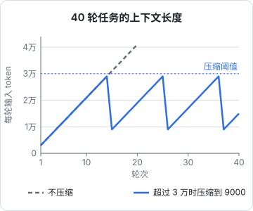

# 压缩与摘要

上下文只会越来越长。第 1 章那条二次方曲线迟早会撞上窗口上限，在那之前，注意力稀释已经开始让 agent 变笨。这一章讲怎么让上下文「变短」：从源头少放、清理用过的、把历史总结成摘要，以及什么时候干脆重开一个窗口。

压缩的难点不在技术，而在取舍：**压缩是有损的**。每一种压缩都在赌「被丢掉的东西以后用不上」。赌输了，agent 会忘掉一个关键决定，然后把你刚否决的方案又试一遍。

## 四个层次

按「越早越便宜」排列，压缩可以发生在四个地方：

| 层次 | 做什么 | 什么时候 | 损失 |
|---|---|---|---|
| 源头控制 | 工具只返回必要的内容 | 每次工具调用 | 很小，模型可以再要 |
| 清理旧结果 | 把用过的工具输出换成占位符 | 历史变长时 | 小，需要时可重新获取 |
| 摘要 | 把一段历史总结成一段话 | 接近阈值时 | 中到大，取决于摘要质量 |
| 重开窗口 | 开新会话，从交接文档开始 | 任务阶段切换时 | 由交接文档决定 |

从上往下，压缩力度越来越大，信息损失也越来越大。好的系统优先用上面的层次，让下面的层次尽量少触发。

## 源头控制：工具别一次给太多

上下文里最占地方的通常不是对话，而是工具输出：一个文件的全文、一次构建的完整日志、一次搜索的几百条结果。在源头控制住，收益最大。

几条设计原则：

- **默认给摘要，需要时再给全文**。构建失败时，返回「失败，3 个错误」加上前几条错误，而不是五千行日志
- **分页与范围**。读文件支持 `offset` / `limit`，搜索结果默认前 20 条并告诉模型还有多少
- **返回句柄而不是内容**。查到一批订单，返回 ID 和一行摘要；模型要看哪张再取哪张
- **截断时说明截断了**。悄悄截断最危险，模型会以为自己看到了全部

一个通用的截断函数：

```typescript
/** 截断长输出：保留开头和结尾（错误通常在结尾），并明确告诉模型中间省略了多少 */
export function truncateOutput(text: string, maxChars = 8000): string {
  if (text.length <= maxChars) return text;
  const head = text.slice(0, maxChars * 0.3);
  const tail = text.slice(-maxChars * 0.7);
  const omittedLines = text.slice(head.length, text.length - tail.length).split("\n").length;
  return `${head}\n\n[……省略中间约 ${omittedLines} 行。需要完整内容时，用 offset/limit 分段读取，或用 grep 搜索关键字……]\n\n${tail}`;
}
```

注意截断提示里给了**下一步怎么办**。模型知道内容被截断，也知道怎么拿到被截掉的部分，就不会基于残缺信息瞎猜。

工具设计的更多细节在[《工具设计与 MCP》](../tools-and-mcp/)里展开。

## 清理旧结果：用过的就收起来

agent 在第 3 轮读了一个文件的全文，第 4 轮据此改了代码，到第 20 轮时，那份全文多半已经没用了，而且它反映的是改动前的旧版本，留着反而可能误导。

清理的做法是：把较早的工具结果替换成一行占位符，保留「做过这件事」的痕迹，丢掉具体内容。

```typescript
import Anthropic from "@anthropic-ai/sdk";

/**
 * 把最近 keepRecent 条之前的工具结果替换成占位符。
 * 只改 tool_result 的内容，不删消息，tool_use 和 tool_result 仍然一一配对。
 */
export function clearOldToolResults(
  messages: Anthropic.MessageParam[],
  keepRecent = 6,
): Anthropic.MessageParam[] {
  const positions: Array<[number, number]> = [];
  messages.forEach((m, i) => {
    if (m.role === "user" && Array.isArray(m.content)) {
      m.content.forEach((b, j) => b.type === "tool_result" && positions.push([i, j]));
    }
  });
  const toClear = new Set(positions.slice(0, -keepRecent).map(([i, j]) => `${i}:${j}`));

  return messages.map((m, i) => {
    if (m.role !== "user" || !Array.isArray(m.content)) return m;
    return {
      ...m,
      content: m.content.map((b, j) =>
        b.type === "tool_result" && toClear.has(`${i}:${j}`)
          ? { ...b, content: "[早先的工具结果已清理。需要时请重新调用工具获取最新内容。]" }
          : b,
      ),
    };
  });
}
```

这里有两个要点。

**不能删 `tool_use` / `tool_result` 消息本身**。API 要求每个 `tool_use` 都有对应的 `tool_result`，删掉一半会直接报错。只改内容最安全。

**清理会让缓存失效**。改动了历史中间的消息，从改动点往后的缓存全部作废。所以不要每轮都清理一点，而是**攒到一定量再一次性清理**，比如上下文超过某个阈值时清一次，清完之后又能稳定地追加、命中缓存一段时间。

Anthropic 的 API 也提供了服务端的上下文编辑（context editing，目前是 beta），可以按配置的阈值自动清理旧的工具结果或思考块，不需要自己改消息数组：

```typescript
const response = await client.beta.messages.create({
  model: MODEL,
  max_tokens: 16000,
  betas: ["context-management-2025-06-27"],
  context_management: { edits: [{ type: "clear_tool_uses_20250919" }] },
  tools,
  messages,
});
```

beta 功能的参数名和触发条件可能变化，使用前以官方文档为准。

## 摘要：把历史写成一份交接

清理之后上下文还是太长，就要做摘要：把较早的一段对话交给模型，让它写成一段总结，替换掉原文。

### 摘要里必须有什么

摘要的质量几乎完全取决于你让模型保留什么。一份好摘要应当回答这些问题：

| 必须保留 | 为什么 |
|---|---|
| 任务目标和验收标准 | 否则后面的工作会偏离 |
| 已做出的决定，以及**为什么** | 丢了理由，agent 会重新考虑已否决的方案 |
| 已排除的方案和失败原因 | 防止重复踩坑 |
| 当前状态：改了哪些文件、测试情况 | 继续工作的起点 |
| 还没完成的事 | 下一步做什么 |
| 用户提出的约束和偏好 | 这些往往只说过一次 |

可以舍弃的：工具输出原文、中间的试探步骤、已经修好的报错细节、寒暄。

把这些写成摘要用的 prompt：

```text
下面是一段 agent 工作记录。请写一份交接摘要，接手的人只能看到这份摘要，看不到原始记录。

必须包含：
1. 任务目标与验收标准（原话照抄用户的要求）
2. 已做出的决定，每条附上原因
3. 试过但放弃的方案，每条附上放弃的原因
4. 当前状态：改动过的文件路径、测试与类型检查的最新结果
5. 待办事项，按顺序
6. 用户提出的所有约束和偏好（哪怕只提过一次）

不需要：工具输出原文、已解决问题的排查过程。
文件路径、函数名、命令、报错信息保持原样，不要意译。
```

最后一句很关键：模型做摘要时喜欢「意译」，把 `parseBookManifest` 写成「解析书籍清单的函数」。接手的 agent 拿着意译去搜代码，就找不到了。

### 自己实现一次摘要

在自己的 agent loop 里，压缩的骨架是：数一数 token，超过阈值时，把较早的消息交给模型摘要，用摘要替换它们，保留最近几轮原文。

```typescript
import Anthropic from "@anthropic-ai/sdk";

const client = new Anthropic();
const MODEL = "claude-opus-5-5";        // 主模型，换成你实际使用的
const SUMMARY_MODEL = "claude-haiku-5-5"; // 摘要可以用更便宜的模型，质量不够再换回主模型
const THRESHOLD = 120_000;              // 按你的模型窗口和预算调整

const SUMMARY_PROMPT = "……（上面那段摘要 prompt）";

function serialize(messages: Anthropic.MessageParam[]): string {
  return messages
    .map((m) => {
      const parts = typeof m.content === "string" ? [m.content] : m.content.map((b) => {
        if (b.type === "text") return b.text;
        if (b.type === "tool_use") return `[调用 ${b.name}] ${JSON.stringify(b.input)}`;
        if (b.type === "tool_result") {
          const text = typeof b.content === "string" ? b.content : JSON.stringify(b.content);
          return `[工具结果] ${text.slice(0, 2000)}`; // 摘要不需要完整输出
        }
        return `[${b.type}]`;
      });
      return `## ${m.role}\n${parts.join("\n")}`;
    })
    .join("\n\n");
}

export async function maybeCompact(
  system: string,
  tools: Anthropic.Tool[],
  messages: Anthropic.MessageParam[],
  keepRecent = 8,
): Promise<Anthropic.MessageParam[]> {
  const { input_tokens } = await client.messages.countTokens({ model: MODEL, system, tools, messages });
  if (input_tokens < THRESHOLD) return messages;

  // 切点必须落在 assistant 消息上：保留部分以 assistant 开头，
  // 它的 tool_use 和后面的 tool_result 都在保留部分里，不会被拆散
  let cut = Math.max(1, messages.length - keepRecent);
  while (cut < messages.length && messages[cut].role !== "assistant") cut++;
  if (cut >= messages.length) return messages;

  const res = await client.messages.create({
    model: SUMMARY_MODEL,
    max_tokens: 4000,
    messages: [{ role: "user", content: `${SUMMARY_PROMPT}\n\n<log>\n${serialize(messages.slice(0, cut))}\n</log>` }],
  });
  const summary = res.content.flatMap((b) => (b.type === "text" ? [b.text] : [])).join("\n");

  return [
    { role: "user", content: `<handoff>\n以下是此前工作的摘要，原始记录已压缩：\n${summary}\n</handoff>` },
    ...messages.slice(cut),
  ];
}
```

几个容易出错的地方：

- **切点**。代码里专门让切点落在 assistant 消息上。如果从一条包含 `tool_result` 的 user 消息切开，它对应的 `tool_use` 被摘要掉了，API 会报错
- **system prompt 不参与摘要**。它每轮都会重新带上，原样保留。项目记忆（`CLAUDE.md`）同理，Claude Code 压缩后会重新加载它们
- **不要摘要摘要**。第二次压缩时，前一次的 `<handoff>` 又被摘要一遍，信息逐次衰减。更好的做法是把旧摘要原样带入新摘要的输入，并要求「在此基础上更新」，或者把关键决定写进文件（第 7 章）

### 服务端压缩

Anthropic 的 API 也提供服务端压缩（compaction，beta）：请求接近阈值时，服务端自动把较早的内容摘要成一个 `compaction` 块。用它时有一个必须遵守的规则：**把响应的完整 `content` 追加回消息历史**，而不是只取文本，否则压缩状态会丢失。

```typescript
const response = await client.beta.messages.create({
  betas: ["compact-2026-01-12"],
  model: MODEL,
  max_tokens: 16000,
  messages,
  context_management: { edits: [{ type: "compact_20260112" }] },
});
// 必须追加完整的 content，里面的 compaction 块下次请求要原样带回去
messages.push({ role: "assistant", content: response.content });
```

自己实现和服务端压缩怎么选：服务端压缩省代码，但摘要写什么由服务端决定；自己实现能用上面那份针对你的任务定制的摘要 prompt。可以先用服务端的，发现摘要丢了关键信息时再换成自己的。

## 压缩的节奏

把源头控制、清理、摘要组合起来，一个长任务的上下文长度会呈锯齿形：



这张图的假设是：初始 3000 token，每轮新增 2000，超过 3 万时压缩成「初始 3000 + 摘要 2000 + 最近两轮 4000」= 9000。40 轮累计输入从不压缩的 168 万降到 69 万。

阈值怎么定，是在三件事之间权衡：

- **定得太高**：压缩前那几轮已经进入注意力稀释区，质量先下降
- **定得太低**：压缩太频繁，每次都丢信息、都要重建缓存
- **压缩本身要花钱**：摘要调用要读一遍被压缩的内容

一般的经验是：阈值远低于窗口上限，给压缩后的工作留出充足空间；同时关注质量信号，如果 agent 在压缩后明显「失忆」，说明摘要 prompt 漏了东西，而不是阈值的问题。

## Claude Code 里的压缩

用 Claude Code 时，压缩是现成的，但你仍然可以影响它：

- **自动压缩**：上下文接近上限时自动触发
- **手动 `/compact`**：可以在后面跟上指令，告诉它重点保留什么，比如 `/compact 保留关于数据库迁移方案的所有决定和原因`
- **`/clear`**：直接清空对话，开始新的上下文。一件事做完、开始下一件不相关的事时，`/clear` 比压缩更干净
- **压缩后重新注入**：用 `SessionStart` hook 配 `compact` matcher，在压缩后自动补回关键信息，[《编码 Agent 实战》第 4 章](../coding-agents/04-hooks.md)有完整示例

一个实用的判断：**还在同一件事里、需要之前的上下文，用 `/compact`；换一件事，用 `/clear`**。很多人习惯一个会话从早用到晚，靠自动压缩续命，结果前一件事的残留不断干扰后一件事。

## 重开窗口：最彻底的压缩

摘要再好也是有损的，而且会逐次衰减。对于真正的长任务，更可靠的方式是**主动结束当前窗口，在新窗口里从一份交接文档开始**。

这和摘要的区别在于：交接文档是**在工作过程中持续维护**的文件，而不是在快满时临时让模型回忆。它更完整、更准确，也不依赖某一次摘要调用的质量。第 7 章专门讲这个。

## 本章要点

- 压缩是有损的，每一种压缩都在赌被丢的东西以后用不上
- 按越早越便宜排序：**源头控制 > 清理旧结果 > 摘要 > 重开窗口**
- 工具默认给摘要、支持分页、返回句柄，截断时说明截断了并告诉模型怎么拿全
- 清理旧结果只改内容不删消息，攒够了再一次性清理，减少缓存重建
- 摘要必须保留目标、决定及原因、放弃的方案、当前状态、待办、用户约束；标识符保持原样
- 自己实现摘要时切点要落在 assistant 消息上，避免拆散 `tool_use` / `tool_result`
- 服务端压缩要把完整 `content` 追加回历史
- 同一件事里用 `/compact`，换一件事用 `/clear`；真正的长任务靠持续维护的交接文件，而不是临时摘要

## 动手练习

1. **截断时说清楚省略了多少**：用本章的 `truncateOutput` 处理一段 10 万行的文本。

   ```javascript
   const text = Array.from({ length: 100000 }, (_, i) => String(i + 1)).join("\n");
   const out = truncateOutput(text);
   console.log(out.length, out.match(/省略中间约 (\d+) 行/)[1], out.split("\n")[0], out.split("\n").at(-1));
   ```

   验证：输出长度约 8000 字符，省略行数约 98440，第一行是 `1`，最后一行是 `100000`。

   参考答案：保留开头和结尾，错误信息通常在结尾；提示里写明省略了多少、怎么拿全，模型就不会把残缺的内容当成全部。

2. **清理旧结果后配对仍然完整**：造一段有 10 轮工具调用的历史（每轮一条带 `tool_use` 的 assistant 消息和一条带 `tool_result` 的 user 消息），用 `clearOldToolResults(messages, 6)` 处理。

   验证：前 4 个 `tool_result` 的内容变成占位符，后 6 个原样保留；消息条数和每个 `tool_use_id` 都没有变化。

   参考答案：只改内容不删消息，`tool_use` 和 `tool_result` 才能一一配对；删掉一半，API 会直接报错。

3. **算出锯齿的账，再调一调阈值**：沿用本章的假设（初始 3000，每轮加 2000，超过阈值压缩回 9000），算 40 轮的累计输入和压缩次数，阈值分别取 2 万、3 万、6 万。

   ```bash
   node -e 'for (const T of [20000, 30000, 60000]) { let c = 3000, s = 0, k = 0; for (let n = 1; n <= 40; n++) { s += c; c += 2000; if (c > T) { c = 9000; k++ } } console.log(T, s, k) }'
   ```

   验证：阈值 3 万时累计 `690000`、压缩 3 次，和本章的图一致；2 万时累计 `528000`、压缩 6 次；6 万时累计 `1108000`、压缩 1 次。

   参考答案：阈值越低越省 token，但压缩次数翻倍，每次都丢信息、都要重建缓存、摘要调用本身也花钱。这笔账只算了输入，没算质量，所以还要看压缩后 agent 有没有「失忆」。
