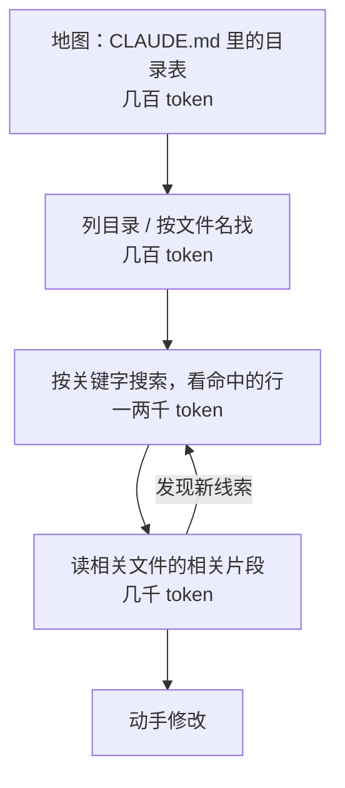

# 按需检索

前两章一个在管「放进去之前」（记忆写什么），一个在管「放进去之后」（怎么压缩）。这一章讲中间那一步：**信息什么时候进入上下文**。

传统做法是预加载：任务开始前，把可能相关的资料一次性准备好放进 prompt，RAG（检索增强生成）的经典形态就是这样。agent 有了工具之后，多了一种选择：先只给它一张地图，让它在工作过程中自己去找需要的东西。这叫**即时检索**（just-in-time retrieval）。这一章讲两种方式各适合什么、怎么为 agent 设计检索工具，以及怎么组合使用。

## 预加载与即时检索

| | 预加载 | 即时检索 |
|---|---|---|
| 谁决定取什么 | 你的代码，在任务开始前 | agent 自己，在工作过程中 |
| 依据 | 用户的初始问题 | 当前这一步的需要 |
| 上下文成本 | 一开始就占满，不管用不用得上 | 用到才占 |
| 速度 | 一次调用就有答案 | 要多轮工具调用 |
| 风险 | 取错了模型也只能将就 | 搜索策略差会绕远路 |
| 适合 | 问答、一次性任务、资料量小 | 多步任务、资料量大、需求在过程中才明确 |

两者不是二选一。最常见的组合是：**预加载一张地图，细节即时检索**。Claude Code 就是这么做的：启动时加载 `CLAUDE.md`（里面写着仓库结构），具体代码靠 `Grep`、`Glob`、`Read` 工具在需要时去找。

## 为什么 agent 适合自己找

[《Agent 原理与设计》第 5 章](../agent-principles/05-memory.md)提到，编码 agent 大多直接用 `grep` 和读文件来「检索」代码，而不是预先建向量索引。值得展开说说原因，因为它适用的范围比代码更广。

**需求是在过程中才明确的**。用户说「导入书的时候文件名有空格会失败，修一下」。任务开始时，你无法预知需要哪些文件。agent 先搜「import」，找到导入管线，读了之后发现文件名校验在 `@shelf/spec` 里，再去读那里，最后发现正则不允许空格。每一步取什么，取决于上一步看到了什么。预加载无法做到这一点。

**能迭代就能纠错**。第一次搜索没找到，换个关键词再搜；找到的太多，加限定条件再搜。预计算的检索结果只有一次机会。

**结构本身就是信息**。文件路径 `packages/spec/src/schema.ts` 本身就告诉 agent：这是共享包里的 schema 定义。文件名、目录层级、修改时间、文件大小，都是 agent 判断「要不要打开看」的依据，而这些信息几乎不占上下文。

**轻量的引用代替内容**。上下文里只需要存「`schema.ts` 第 15 行定义了 `bookManifestSchema`」这样的引用，需要时再读原文。人也是这么工作的：我们不会背下整个代码库，而是记得东西在哪里。

## 渐进式探索

一个检索良好的 agent，通常是这样一步步缩小范围的：



每一层都比上一层更具体、更贵。好的检索工具要让 agent 能在每一层停下来做判断，而不是被迫一步到位地拿到全文。

## 为 agent 设计检索工具

如果你在给自己的 agent 写检索工具（搜索知识库、查业务数据、翻文档），下面几条原则能明显改善它的检索行为。

### 返回位置和片段，而不是全文

搜索结果应该让 agent 能判断「哪个值得细看」，并且知道怎么去细看：

```text
找到 23 处匹配，显示前 10 处（用 offset=10 查看更多）：

books/agent-principles/05-memory.md:42: 这种「索引常驻 + 细节按需」的两级结构……
books/agent-principles/08-mcp-and-skills.md:131: 这和第 5 章「索引常驻 + 细节按需」的记忆结构……
books/coding-agents/01-how-agents-work.md:71: - **自动记忆**（auto memory）是 Claude 自己记的笔记……
……
```

每条结果带路径和行号，agent 可以直接用读文件工具读那附近的内容。

### 一个书架搜索工具的实现

下面是一个在 `books/` 目录里搜索 Markdown 的工具，体现了这几条原则：有上限、有分页、带位置、搜不到时给提示。

```typescript
import Anthropic from "@anthropic-ai/sdk";
import { readdir, readFile } from "node:fs/promises";
import { join, relative } from "node:path";

const ROOT = "books";
const PAGE = 10;

export const searchTool: Anthropic.Tool = {
  name: "search_books",
  description:
    "在书架的所有章节里按关键字搜索，返回「路径:行号: 该行内容」。" +
    "用于定位某个概念在哪本书哪一章讲过。结果按文件排序，每页 10 条。" +
    "拿到位置后用 read_chapter 读那一段，不要凭搜索片段下结论。",
  input_schema: {
    type: "object",
    properties: {
      query: { type: "string", description: "关键字，不区分大小写；多个词用空格分隔表示都要出现" },
      offset: { type: "integer", description: "跳过前几条结果，用于翻页，默认 0" },
    },
    required: ["query"],
  },
};

async function* markdownFiles(dir: string): AsyncGenerator<string> {
  for (const e of await readdir(dir, { withFileTypes: true })) {
    const p = join(dir, e.name);
    if (e.isDirectory()) yield* markdownFiles(p);
    else if (e.name.endsWith(".md")) yield p;
  }
}

export async function runSearch(query: string, offset = 0): Promise<string> {
  const words = query.toLowerCase().split(/\s+/).filter(Boolean);
  if (words.length === 0) return "query 不能为空";

  const hits: string[] = [];
  for await (const file of markdownFiles(ROOT)) {
    const lines = (await readFile(file, "utf8")).split("\n");
    lines.forEach((line, i) => {
      const lower = line.toLowerCase();
      if (words.every((w) => lower.includes(w))) {
        hits.push(`${relative(".", file)}:${i + 1}: ${line.trim().slice(0, 160)}`);
      }
    });
  }

  if (hits.length === 0) {
    return `没有找到同时包含 ${words.join("、")} 的行。可以试试：减少关键字、换同义词（如「压缩」和「摘要」）、或用英文术语。`;
  }
  const page = hits.slice(offset, offset + PAGE);
  const more = hits.length > offset + PAGE ? `（用 offset=${offset + PAGE} 查看更多）` : "";
  return `找到 ${hits.length} 处匹配，显示第 ${offset + 1}–${offset + page.length} 处${more}：\n\n${page.join("\n")}`;
}
```

注意搜不到时的返回：它没有简单地说「无结果」，而是给出了改进搜索的方向。这是一种很便宜的「教」agent 检索的方法，比在 system prompt 里写一大段搜索策略有效，因为它出现在 agent 恰好需要它的时刻。

### 读取要支持范围

配套的读文件工具应该支持按行范围读取，并在返回时告诉 agent 文件一共多长：

```text
books/context-engineering/04-compaction.md（共 272 行），第 120–160 行：
……
```

agent 知道总长度，才能决定是继续读还是停下来。

### 名字和描述要区分得开

当 agent 同时有好几个检索工具时（搜文档、搜代码、查数据库），工具描述必须说清楚**什么时候用哪个**。「搜索文档」和「搜索知识库」这种描述会让模型随机选。更好的写法：「`search_books`：在书的正文里找概念；`search_notes`：在读者笔记里找疑问和高亮」。[《工具设计与 MCP》](../tools-and-mcp/)会系统讲工具描述的写法。

## 语义检索放在哪

关键词搜索的弱点是要知道用什么词。资料是自然语言、措辞多变时（客服记录、会议纪要、用户反馈），语义检索（把文本向量化，按语义相似度查找）能找到关键词搜不到的内容。

在 agent 里，语义检索的推荐位置是**作为一个工具**，而不是在每轮开始前自动把检索结果塞进上下文：

| 方式 | 问题 |
|---|---|
| 每轮自动检索并前置 | 每轮都占上下文，不管需不需要；检索词就是用户原话，不一定准；还会破坏缓存 |
| 作为工具，由 agent 调用 | agent 自己决定何时检索、用什么词检索，不满意可以再搜 |

很多情况下，可以把语义检索和关键词检索都给 agent，让它根据情况选：找具体的函数名用关键词，找「讲过类似概念的地方」用语义。向量库怎么建、怎么切块、怎么评估召回，见[《RAG 与知识系统》](../rag-systems/)。

## 地图：预加载什么

即时检索不等于什么都不预加载。agent 需要一张地图才能知道去哪里找。好的地图有几个特点：

- **说明「有什么」和「在哪里」，不说明「是什么」**。hatch-shelf 的 `CLAUDE.md` 用一张表列出 `app/`、`packages/spec/`、`tools/shelf-pack/` 各放什么，几百个 token 就覆盖了整个仓库的结构
- **标出权威来源**。「判断书籍结构的逻辑只写在 `@shelf/spec`」，agent 就知道该去哪里找、改哪里，而不是在 App 和 CLI 里各找一遍
- **指向下一级索引**。hatch-counter 的 `CLAUDE.md` 指向 `docs/README.md`，后者是每份文档一行摘要的索引，agent 从索引里挑出相关的那一页再读

这种多级索引的结构，本质上就是给 agent 修了一条渐进式探索的路。

## 预加载仍然更好的场景

即时检索也有代价：多轮工具调用的延迟和 token。下面几种情况，预加载更合适：

- **资料小而且几乎每次都要用**。一份 200 行的业务口径文档，与其每次让 agent 去找，不如直接放进上下文
- **单次调用、没有工具循环**。比如 hatch-counter 识别进货单，供货商的表格布局直接拼进 prompt，不需要检索
- **延迟敏感**。用户在等实时回复时，多跑三轮搜索可能就超时了
- **检索的入口很明确**。用户正在看某个页面并提问，把这个页面的内容预加载进去就行

判断标准仍然是第 1 章那句话：每一步都只给必需的信息。资料几乎每步都必需，就预加载；只有某些步骤需要，就让 agent 自己去取。

## 本章要点

- **预加载**在任务开始前取好资料，**即时检索**让 agent 在过程中自己去找；最常用的组合是预加载地图、即时检索细节
- agent 适合自己找：需求在过程中才明确，能迭代纠错，文件结构本身就是线索，上下文里只需存引用
- 检索工具要返回位置和片段、有上限和分页、读取支持范围、搜不到时给改进方向
- 多个检索工具的描述要说清什么时候用哪个
- 语义检索作为工具交给 agent，不要每轮自动前置
- 地图说明有什么、在哪里、谁是权威来源，并指向下一级索引
- 资料小而常用、单次调用、延迟敏感、入口明确时，预加载更合适
