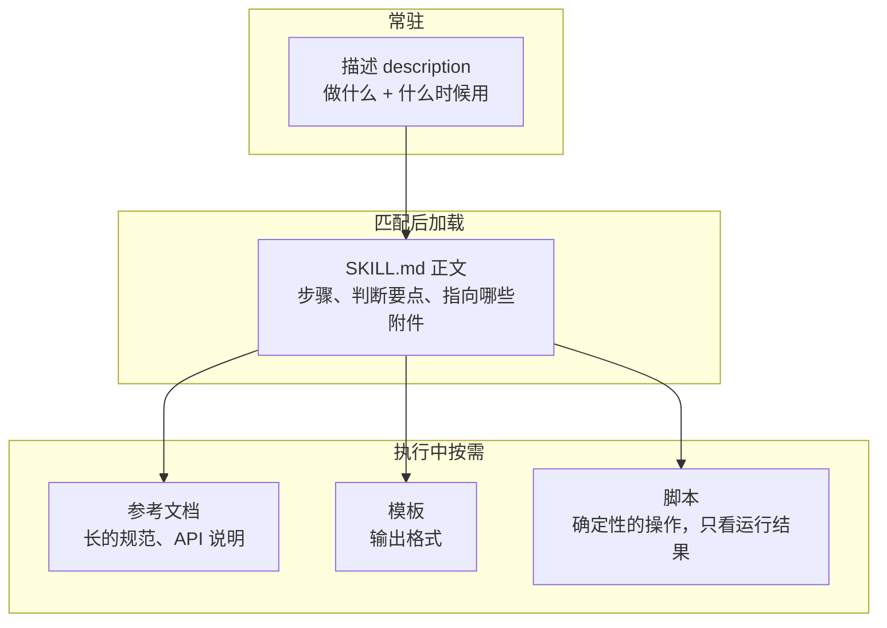

# Skills 的渐进式加载

《Agent 原理与设计》第 8 章介绍了 Skills：一个文件夹，核心是一份 `SKILL.md`，按「描述 → 正文 → 附带文件」三层加载。那一章讲了它是什么、和 MCP 有什么区别。这一章从上下文工程的角度讲：**渐进式披露为什么有效，一个 Skill 该怎么切分和组织，描述怎么写才能在对的时候被触发**，以及同样的模式怎么用在工具、文档和你自己的 agent 上。

## 先算一笔账

渐进式披露的价值，用数字最容易看清。假设你装了 30 个 Skill，每个的描述约 80 token，`SKILL.md` 正文约 2000 token：


全文常驻和按需加载差了十几倍，而且差距随 Skill 数量线性扩大。更重要的是注意力：30 份说明书同时摊在模型面前，彼此的规则还可能冲突；按需加载时，模型在做发版说明时只看到发版说明的那一份。

这和第 3 章「索引常驻 + 细节按需」的记忆结构、第 5 章「地图 + 即时检索」是同一个思想。Skills 只是把它标准化了。

## 三层各放什么



| 层 | 放什么 | 不放什么 | 篇幅 |
|---|---|---|---|
| 描述 | 这个 Skill 做什么、什么时候该用、用户可能怎么说 | 具体步骤 | 一两句 |
| 正文 | 流程步骤、关键判断、去哪找细节 | 长篇参考资料、可以脚本化的操作 | 尽量控制在几百行以内 |
| 附件 | 参考文档、模板、脚本、示例 | 和这个 Skill 无关的东西 | 不限，用到才读 |

一个常见的错误是把所有东西都塞进 `SKILL.md`。正文一旦被加载就整篇进入上下文，所以正文应当是**目录和流程**，把篇幅大的内容放到附件里，在正文里写清「什么情况下去读哪个文件」。

## 描述决定会不会被用上

模型平时只看得到描述。描述写不好，Skill 就永远不会被触发，或者在不该触发的时候被触发。

好描述的三个要素：

1. **做什么**：具体的产出，而不是领域。「生成本仓库的发版说明」好过「发版相关工作」
2. **什么时候用**：触发条件。「当用户要求写 changelog、发版说明、release notes 时使用」
3. **关键词**：用户实际会说的词，包括中英文、口语说法

对比一下：

| 描述 | 问题 |
|---|---|
| 帮助处理书籍 | 太泛：写书、改书、检查书、推送书都算「处理书籍」 |
| 按照 books/AGENTS.md 的规范，使用 Mermaid 和 SVG 配图，遵守 360 宽度…… | 把正文写进了描述，占常驻上下文，而且没说什么时候用 |
| 在 books/ 下新写或修订一本书时使用：书的结构、配图规范、自检命令。用户说「写一本书」「补一章」「改这本书」时触发 | 做什么、何时用、关键词都有 |

还有一种情况需要在描述里写**不该用的时候**：两个 Skill 容易混淆时。比如「生成 Word 文档」和「生成可协作的在线文档」，各自的描述里都要写清和对方的分界。

### 测一测触发

描述写完后，用几句话测一下：

```text
应该触发：
- 帮我写一本讲 Docker 的书
- 给 networking 这本书补一章 DNS
- 这本书的第 3 章配图有问题，修一下

不应该触发：
- 阅读器里 Mermaid 图渲染不出来（这是改代码，不是写书）
- 把书推到手机上（这是 shelf-pack push）
```

在新会话里分别输入，看它有没有加载这个 Skill。不该触发却触发了，说明描述太宽；该触发却没触发，补上用户实际的说法。

## 一个完整的例子：写书 Skill

这套书是由主会话派出多个写书 agent 写成的，每个 agent 启动后都要读一份共用简报。这份简报本质上就是一个 Skill，只是以文件路径的方式传递。把它正式做成 Skill，可以是这样：

```text
.claude/skills/write-book/
├── SKILL.md
├── reference/
│   ├── svg-spec.md        # SVG 规范全文（从 books/AGENTS.md 指过来即可，不必复制）
│   └── chapter-style.md   # 章节结构与语气，指向范文
└── scripts/
    └── preview-svg.sh     # 把 SVG 渲染成 PNG 预览
```

```markdown
---
name: write-book
description: 在 books/ 下新写或修订一本书时使用：目录结构、book.yaml、章节写法、配图、自检。用户说「写一本书」「补一章」「修订这本书」「这章配图有问题」时触发。不用于修改阅读器或 App 代码。
---

# 写书

## 开始之前

1. 读 `books/AGENTS.md` 的硬规则（每章唯一 H1、禁止字符画、禁止远程图片）
2. 在 `books/ROADMAP.md` 里找到这本书的条目：标题、难度、分类、章节大纲
3. 如果 `notes/<book-id>.notes.md` 存在，先读，读者的疑问是修订的优先事项

## 写章节

- 结构和语气见 `reference/chapter-style.md`；需要看范文时再读它指向的章节
- 流程、结构用 Mermaid；数据图用 SVG，画之前读 `reference/svg-spec.md`

## 配图自检

每张 SVG 运行 `scripts/preview-svg.sh <文件>`，用 Read 查看生成的 PNG，确认没有重叠和溢出。

## 完成标准

在仓库根运行 `pnpm -s shelf-pack check books/<id>`，必须通过。
```

这个 `SKILL.md` 有几个刻意的设计：

- **正文很短**，主要是流程和指针。SVG 规范这种篇幅大、只有画图时才用的内容放在 `reference/` 里
- **附件只深一层**。`SKILL.md` 直接指向每个附件，不要出现「A 指向 B，B 再指向 C」的链条，模型顺着链条走时容易只读一半
- **指向而不是复制**。`books/AGENTS.md` 已经有的规则，Skill 里只说「去读它」。复制一份就有两个版本，迟早不一致
- **确定性的操作交给脚本**。渲染 SVG 预览的命令有固定参数，写成脚本后模型只需要知道怎么调用、看结果，脚本源码不进上下文

```bash
#!/usr/bin/env bash
# scripts/preview-svg.sh：把一个 SVG 渲染成 PNG，输出到临时目录并打印路径
set -euo pipefail
svg="$1"
out="${TMPDIR:-/tmp}/svg-preview"
mkdir -p "$out"
qlmanage -t -s 800 -o "$out" "$svg" >/dev/null 2>&1
echo "$out/$(basename "$svg").png"
```

## 长参考文档的组织

有些 Skill 的核心是大量参考资料，比如一个 API 的完整用法、一套设计系统的组件规范。这类 Skill 的附件可能有几万 token，组织方式决定了模型每次读多少。

几条做法：

- **按「读者此刻要做什么」切分文件**，而不是按资料原本的章节。API 参考可以按语言分目录，每种语言再按功能分文件；模型写 TypeScript 的流式调用，只需要读 `typescript/streaming.md`
- **`SKILL.md` 里放一张「任务 → 文件」的阅读指引表**。「做流式输出 → 读 X；做批处理 → 读 Y」，模型可以直接查表
- **长文件开头放目录**。模型可能只读文件的开头一部分，目录能让它知道后面还有什么、该跳到哪里
- **速查信息放在正文里**。最常用的那几条（比如默认参数、最常见的坑）直接写在 `SKILL.md` 正文，避免为了一行信息去读一个大文件

## 同样的模式，用在别处

渐进式披露不是 Skills 专有的。只要「可选项很多，每次只用少数几个」，就可以用它。

### 工具的按需加载

接了十几个 MCP server 之后，工具定义本身就可能占掉大量上下文，模型选错工具的概率也会上升（《Agent 原理与设计》第 8 章提到的工具膨胀）。解决思路相同：平时只放一个「搜索工具」的工具，模型需要时先搜，再加载匹配的工具定义。

Anthropic 的 API 提供了工具搜索工具：把大部分工具标记为 `defer_loading: true`，它们的定义不会一开始就进入上下文，模型通过搜索找到需要的工具后才加载。新加载的工具定义是追加进来的，不会破坏已有的缓存。部分客户端在工具很多时也会自动采用类似的按需加载，具体行为以各自文档为准。

### 文档的按需加载

hatch-counter 的 `docs/` 就是渐进式披露：`CLAUDE.md` 指向 `docs/README.md`（每份文档一行摘要，由脚本从 frontmatter 生成），agent 从摘要里判断该读哪一页。每份文档头上的 frontmatter 就相当于 Skill 的描述。

### 你自己的 agent

在自己的 agent 里实现一个最小的 Skill 机制，只需要两样东西：

```typescript
import Anthropic from "@anthropic-ai/sdk";
import { readdir, readFile } from "node:fs/promises";
import { join } from "node:path";

const SKILLS_DIR = "skills";

/** 启动时：只读每个 SKILL.md 的 frontmatter，拼成技能目录 */
export async function skillCatalog(): Promise<string> {
  const lines: string[] = [];
  for (const name of (await readdir(SKILLS_DIR)).sort()) {
    const text = await readFile(join(SKILLS_DIR, name, "SKILL.md"), "utf8").catch(() => "");
    const desc = text.match(/^description:\s*(.+)$/m)?.[1];
    if (desc) lines.push(`- ${name}: ${desc}`);
  }
  return `<skills>\n${lines.join("\n")}\n</skills>\n任务和某个技能匹配时，先用 load_skill 读取它的说明再动手。`;
}

/** 运行时：模型判断匹配后，读取正文 */
export const loadSkillTool: Anthropic.Tool = {
  name: "load_skill",
  description: "读取某个技能的完整说明（SKILL.md 正文）。name 取自 <skills> 目录。",
  input_schema: {
    type: "object",
    properties: { name: { type: "string" } },
    required: ["name"],
  },
};

export async function runLoadSkill(name: string): Promise<string> {
  if (!/^[a-z0-9-]+$/.test(name)) return "技能名不合法";
  return readFile(join(SKILLS_DIR, name, "SKILL.md"), "utf8").catch(() => `没有名为 ${name} 的技能`);
}
```

第三层（附件）不需要额外的工具：只要 agent 有读文件的能力，正文里写的路径它自己会去读。

技能目录要放在稳定的位置（system prompt 末尾或第一条消息），并且**排序固定**，否则每次启动顺序不同会让缓存失效。

## 什么该做成 Skill

《Agent 原理与设计》第 8 章给过一个判断：每次都要知道的放记忆，有时要会做的放 Skill。从上下文成本的角度再补几条：

- **步骤多、偶尔用**：发版、写书、做数据迁移。最适合 Skill
- **几乎每次都要用**：放进 `CLAUDE.md`。做成 Skill 反而多一次加载
- **只有一两句话**：放进 `CLAUDE.md` 或 rules。为一句话单独建 Skill，描述本身的开销就和内容差不多
- **按文件路径相关**：用带 `paths` 的 rules（《编码 Agent 实战》第 3 章）。但要注意，rules 只在读写匹配的文件时加载；像发版这种「跑一个命令、不碰文件」的流程，rules 触发不了，做成 Skill 更合适

## 本章要点

- 渐进式披露让常驻成本只与描述长度相关，30 个 Skill 常驻几千 token 而不是几万
- 三层分工：**描述**说做什么和何时用，**正文**放流程和指针，**附件**放大篇幅资料、模板和脚本
- 描述决定触发：写清产出、触发条件、用户会说的关键词，必要时写不该用的情况；用正反例测试
- 正文要短、附件只深一层、指向而不复制、确定性操作写成脚本
- 长参考资料按「此刻要做什么」切分，正文里放任务到文件的阅读指引
- 同样的模式适用于工具按需加载（`defer_loading`）、文档索引和你自己的 agent
- 步骤多且偶尔用的做成 Skill；每次都用的放 `CLAUDE.md`；不碰文件的流程用 Skill 而不是 rules
