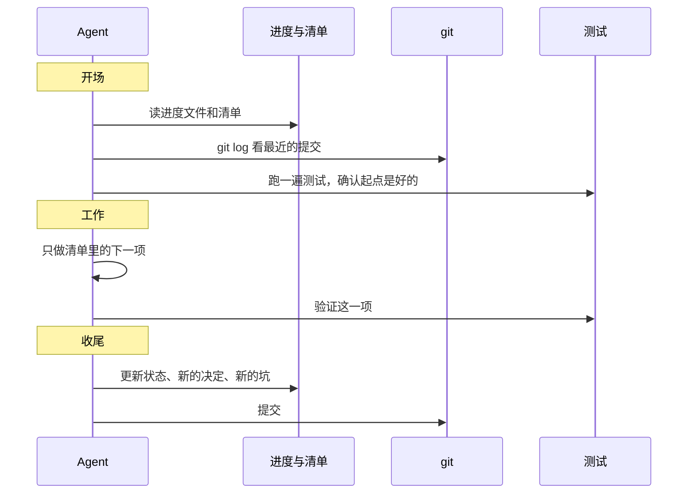

# 长任务的状态管理

前面几章的手法都在一个上下文窗口里打转：写好 system prompt、按需加载、压缩历史。但有些任务注定装不进一个窗口：一次几十个文件的重构、一个从零做起的功能、一本九章的书。它们会跨越多次压缩、多个会话，甚至多个 agent。

这一章讲怎么让这样的任务**不依赖任何一个窗口的记忆**也能持续推进。核心只有一句话，[《Agent 原理与设计》第 6 章](../agent-principles/06-context-engineering.md)已经说过：**把状态放在文件里，而不是只放在上下文里**。这里讲具体怎么做。

## 长任务失败的几种样子

先看问题。让 agent 一口气做一个大任务，常见的失败方式：

| 表现 | 原因 |
|---|---|
| 一次想做完所有事，做到一半窗口满了，留下一堆半成品 | 没有把任务切成可以独立完成的小块 |
| 压缩或换会话之后，重做已经做完的部分 | 「做完了什么」只存在于上下文里 |
| 换会话后推翻之前的决定 | 决定的理由丢了 |
| 做了几项之后宣布「全部完成」，其实还差很多 | 没有一份明确的清单可以对照 |
| 新会话花大量 token 重新摸索项目怎么跑起来 | 环境和启动方式没有记录 |

这些问题的共同点是：**关键信息只存在于易失的上下文里**。解决办法就是把它们写到持久的地方。

## 状态的三种载体

| 载体 | 存什么 | 特点 |
|---|---|---|
| 进度文件（Markdown） | 目标、决定及原因、当前状态、下一步、坑 | 人和模型都好读，适合自由文本 |
| 清单文件（JSON） | 待办项及其完成状态 | 结构化，模型不容易误改格式，程序可以校验 |
| git 历史 | 每一步改了什么 | 天然的日志，可回滚，`git log` 就是进度回顾 |

三者配合使用。进度文件记「为什么」，清单记「做到哪」，git 记「改了什么」。

### 进度文件

一份进度文件的模板：

```markdown
# 进度：书架阅读器支持脚注

## 目标与验收
- 阅读器能渲染 Markdown 脚注 `[^1]`，点击跳到底部，再点回原位
- `pnpm typecheck`、`pnpm test` 通过；示例书里加一个脚注用例

## 决定
- 用 markdown-it 的现成脚注插件，不自己写：维护成本低，与现有渲染配置兼容
- 跳转用页内锚点，不经过 RN 桥：避免为脚注新增消息类型（bridge.ts 是唯一定义处）

## 放弃的方案
- 弹出层显示脚注：WebView 里的弹层在小屏上遮挡正文，试过后放弃

## 当前状态
- 插件已接入 app/reader-web，脚注能渲染
- 跳回原位在暗色主题下高亮颜色不对（未修）

## 下一步
1. 修暗色主题的高亮
2. 示例书加用例，重新 build:assets
3. 跑全仓检查

## 坑
- 改了 reader-web 必须重新 `pnpm app build:assets`，否则 App 里还是旧的
```

「决定」和「放弃的方案」两节最重要，也最容易被省略。没有它们，下一个会话看到暗色主题的问题，可能会觉得「干脆改成弹出层吧」，把已经否决的方案又做一遍。

### 清单文件

需要逐项推进的任务，用 JSON 存清单比用 Markdown 的复选框更可靠：

```json
{
  "task": "为 shelf-pack 补齐测试",
  "items": [
    { "id": "check-missing-yaml", "desc": "缺少 book.yaml 时报错并给出路径", "status": "done" },
    { "id": "check-bad-chapter-name", "desc": "章节文件名含大写字母时报错", "status": "done" },
    { "id": "check-remote-image", "desc": "检测到 http(s) 图片时报错", "status": "in_progress" },
    { "id": "pack-zip-slip", "desc": "打包时拒绝 ../ 路径", "status": "todo" }
  ]
}
```

为什么用 JSON：模型改 Markdown 时容易顺手「整理」格式、合并条目、甚至删掉它认为不重要的项；改 JSON 时它倾向于只改那个字段。而且你可以写一个脚本校验它：项数不能减少，`done` 不能变回 `todo`。

在 system prompt 或进度文件里写明规则：**只能修改 `status` 字段，不能删除或改写条目**。条目的增删由人决定。

### git 作为日志

每完成一个可验证的步骤就提交一次。好处有三个：

- 新会话用 `git log --oneline -20` 几百个 token 就能看清最近做了什么
- 某一步做坏了可以单独回滚，不用从头再来
- 提交信息本身是对「做了什么」的摘要，比模型临时回忆更准确

提交信息写清楚「改完之后是什么样」，而不是「改了哪个文件」，对后续会话的帮助最大。

## 会话的开场与收尾

有了这些文件，每个会话都按固定的流程开始和结束：



**开场先跑测试**这一步容易被省略，但很关键。上一个会话可能留下了没发现的问题，如果不先确认起点是好的，新会话会在一个坏的基础上继续，然后把问题归咎于自己刚写的代码。

**一次只做一项**。这是对抗「一口气做完」冲动的最直接办法。每一项都应该小到能在一个会话里完成并验证。

**收尾时留下干净的状态**：代码能编译、测试能跑、进度文件是最新的、改动已提交。下一个会话（或者第二天的你）拿到的是一个可以直接接着干的现场。

把这些写进给 agent 的指令里：

```text
这是一个跨多个会话的任务。状态记录在 PROGRESS.md 和 tasks.json。

每次开始：
1. 读 PROGRESS.md 和 tasks.json，运行 git log --oneline -10
2. 运行 pnpm test，如果有失败，先修好再做新的
3. 从 tasks.json 里挑第一个 status 不是 done 的项

每次只做一项。做完后：
1. 运行 pnpm typecheck 和 pnpm test 确认通过
2. 把这一项的 status 改成 done（tasks.json 只改 status，不删改条目）
3. 在 PROGRESS.md 更新「当前状态」「下一步」，有新的决定或坑就补上
4. 提交，提交信息写这一项完成后是什么样
```

## 第一个会话不一样

长任务的第一个会话值得单独设计，它的任务不是写功能，而是**搭好后续会话工作的环境**：

- 理解需求，把任务拆成清单，写进 `tasks.json`
- 写好 `PROGRESS.md` 的目标与验收部分
- 确认项目能跑起来，把启动和测试命令记下来；如果启动步骤复杂，写一个 `init.sh`
- 做一次初始提交

之后的每个会话都只做「读状态 → 做一项 → 写状态」。第一个会话花在规划上的 token，会在后续每个会话里省回来：新会话不需要重新理解整个任务，读两个文件就能开工。

清单拆得好不好，决定了后面能不能顺利推进。几个标准：每一项都能独立验证；每一项的描述写的是「做完是什么样」，而不是「做什么」；项与项之间的依赖按顺序排好。

## 案例：这套书的写作

你正在读的这套书是一个典型的长任务：五十多本书，每本六到十章，跨越大量会话和 agent。它的状态管理是这样的：

| 状态 | 载体 | 谁来改 |
|---|---|---|
| 全部书目、每本的大纲和状态 | `books/ROADMAP.md`，状态只有「未写 / 在写 / 已完成」三种 | 只有主会话 |
| 写作规范 | `books/AGENTS.md` | 人 |
| 一次派活的共用说明 | 一份简报文件 | 主会话写，写书 agent 只读 |
| 读者看到的进度 | 导读书里的进度页 | 只有主会话 |
| 每本书的内容 | `books/<id>/` | 只有负责这本书的 agent |
| 做了什么 | git 提交，一本书一个 `content:` 提交 | 只有主会话 |

几个值得借鉴的设计：

- **状态只有三种**。「未写 / 在写 / 已完成」，不允许出现「基本完成」「差不多了」这种模糊状态。模糊的状态正是长任务里「宣布完成但其实没完成」的温床
- **共享状态只有一个写入者**。ROADMAP 和进度页只由主会话改，写书 agent 一律不碰。几个 agent 同时改同一个状态文件，必然冲突
- **写入范围互不重叠**。每个写书 agent 只能写自己那本书的目录，所以可以并行而不需要协调
- **每个 agent 自带验收**。必须跑通 `shelf-pack check` 才算完成，交回给主会话的是已经过机器检查的结果
- **大纲是起点，调整要回写**。ROADMAP 的约定里写着「写的时候可以调整，调整后回写本文件」，状态文件始终反映真实情况

[《编码 Agent 实战》第 5 章](../coding-agents/05-subagents-parallel.md)从并行的角度讲过这个案例，这里关注的是状态：**什么状态存在哪里、谁能改**。这两个问题想清楚了，长任务就能在任意一个会话中断后接着做下去。

## 交接给另一个 agent

长任务里经常需要把一部分工作交给子 agent，或者在会话之间交接。交接文档和进度文件类似，但更强调「接手的人什么都不知道」：

- **写明目标和完成标准**，而不是只写「继续做」
- **列出已经知道的事实和已经排除的可能**，避免重复调研
- **给出文件路径而不是描述**。「问题在导入管线里」不如「`app/src/import/pipeline.ts` 的 `importFile`」
- **说明交回什么**。「交回一份不超过十行的报告，列出改了哪些文件和拿不准的地方」

这些要求和第 4 章的摘要 prompt 很像，因为本质上是同一件事：把一个上下文里的关键信息，压缩成另一个上下文能用的形式。区别在于交接文档由你（或主 agent）有意识地写，而不是在窗口快满时被动地生成。

多 agent 之间怎么分工、怎么汇总，见[《多 Agent 编排》](../multi-agent/)。

## 压缩还是重开

在一个长任务中，上下文快满时有两个选择：压缩后继续，或者结束会话、从进度文件重开。

| | 压缩后继续 | 从进度文件重开 |
|---|---|---|
| 保留的信息 | 摘要里有的 | 进度文件里有的 |
| 质量 | 取决于那一次摘要 | 取决于平时的记录习惯 |
| 残留 | 摘要可能带着之前的错误思路 | 干净的上下文 |
| 适合 | 一项工作做到一半 | 一项工作刚完成、要开始下一项 |

有了维护良好的进度文件，**在一项工作完成的边界上重开**通常比压缩更好：新会话的上下文里只有 system prompt、项目记忆、进度文件和清单，干净而且完整。压缩留给「一项工作做到一半、窗口不够了」的情况。

## 本章要点

- 长任务的关键信息不能只存在于上下文里，要写进**进度文件、清单文件、git 历史**
- 进度文件记目标、决定及原因、放弃的方案、当前状态、下一步、坑；「为什么」最重要
- 逐项推进的清单用 JSON，规定只能改状态字段，条目增删由人决定
- 每个会话：开场读状态、看 git log、先跑测试；一次只做一项；收尾更新状态并提交，留下干净现场
- 第一个会话专门用来拆清单、写验收、记录启动方式
- 状态要明确（只有几种取值），共享状态只有一个写入者，写入范围互不重叠
- 交接文档写给「什么都不知道的人」：目标、已知事实、文件路径、交回什么
- 在一项工作完成的边界上，从进度文件重开通常比压缩更干净
