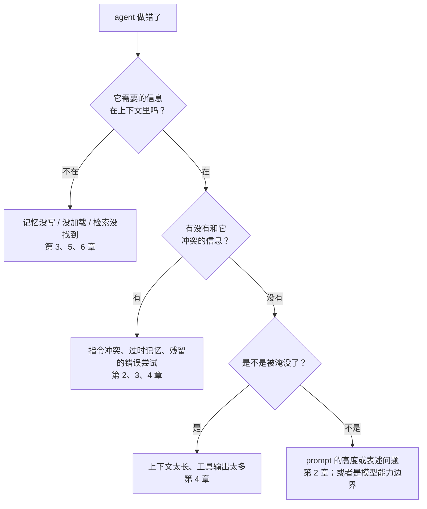

# 度量与调试

前七章讲怎么设计上下文。这一章讲怎么知道设计得好不好：怎么看见每一轮上下文里到底有什么，怎么把 agent 的一次失败归因到上下文的某一层，以及怎么在修改之后确认没有改坏别的地方。

agent 表现不好时，最常见的反应是换模型、加一句「务必」、或者再写长一点。这些动作很少对症。上下文工程的调试和写代码的调试一样：**先看到现场，再定位原因，最后做最小的修改并验证**。

## 看见上下文

### 记录每一轮的完整请求

在自己的 agent 里，第一件事是把每一轮发给模型的完整请求和返回存下来。没有这份记录，所有的调试都是猜。

```typescript
import Anthropic from "@anthropic-ai/sdk";
import { appendFile } from "node:fs/promises";

const client = new Anthropic();

/** 包一层：每次调用都把请求、用量和停止原因写进 JSONL，一行一轮 */
export async function loggedCreate(
  sessionId: string,
  params: Anthropic.MessageCreateParamsNonStreaming,
): Promise<Anthropic.Message> {
  const started = Date.now();
  const res = await client.messages.create(params);
  const record = {
    session: sessionId,
    at: new Date().toISOString(),
    ms: Date.now() - started,
    messages: params.messages.length,
    usage: res.usage,
    stop_reason: res.stop_reason,
    request: params, // 完整请求，排查时要看
    response: res.content,
  };
  await appendFile(`logs/${sessionId}.jsonl`, JSON.stringify(record) + "\n");
  return res;
}
```

日志里会有用户数据，注意存放位置和保留期限，不要把它和代码一起提交。

### 读 usage

每次响应的 `usage` 是最直接的度量：

| 字段 | 含义 | 看什么 |
|---|---|---|
| `input_tokens` | 未命中缓存、按全价计费的输入 | 长期偏高说明缓存没生效 |
| `cache_read_input_tokens` | 从缓存读取的输入 | 多轮对话里应该占输入的大头 |
| `cache_creation_input_tokens` | 本轮写入缓存的输入 | 每轮都很大说明前缀一直在变 |
| `output_tokens` | 输出 | 突然变大可能是模型在长篇解释或重复 |

把每轮三项输入相加，就是这一轮的上下文长度。画成曲线，第 4 章那种锯齿是否出现、压缩是否按预期触发，一眼就能看出来。

如果 `cache_read_input_tokens` 在多轮之间一直是零，说明有东西在悄悄改变前缀。《大模型应用工程》第 6 章列了常见原因：system 里有时间戳、工具列表顺序不固定、JSON 键顺序不稳定。

### 按组成部分记账

总长度只能告诉你「多」，要知道「哪里多」，需要按组成部分分别计数。token 计数接口可以单独数某一部分：

```typescript
import Anthropic from "@anthropic-ai/sdk";

const client = new Anthropic();
const MODEL = "claude-opus-5-5";

/** 分别数 system、工具、历史各占多少。每部分单独计数会带少量固定开销，看相对大小即可 */
export async function contextBreakdown(
  system: string,
  tools: Anthropic.Tool[],
  messages: Anthropic.MessageParam[],
) {
  const probe: Anthropic.MessageParam[] = [{ role: "user", content: "." }];
  const count = async (p: Partial<Anthropic.MessageCountTokensParams>) =>
    (await client.messages.countTokens({ model: MODEL, messages: probe, ...p })).input_tokens;

  const base = await count({});
  return {
    system: (await count({ system })) - base,
    tools: (await count({ tools })) - base,
    history: (await count({ messages })) - (await count({})),
  };
}
```

在 Claude Code 里，`/context` 直接给出类似的分解。养成习惯：agent 开始犯糊涂时，先看一眼各部分的占比。

## 一张账本

定期（比如每周）看一次汇总，比盯着单次请求更能发现趋势：

| 指标 | 怎么算 | 说明问题 |
|---|---|---|
| 平均每轮上下文长度 | 三项输入之和的平均 | 整体是否越来越胖 |
| 缓存命中率 | 缓存读取 ÷ 总输入 | 前缀设计是否稳定 |
| 每个任务的轮数 | 一个任务内的调用次数 | 检索是否绕远路 |
| 压缩触发次数 | 计数 | 阈值和源头控制是否合理 |
| 工具输出占比 | 工具结果 token ÷ 总输入 | 源头控制做得怎样 |
| 每个完成任务的成本 | 总费用 ÷ 成功完成的任务数 | 最终的效率指标 |

最后一项最重要。省了每轮的 token 却让任务多跑了十轮，或者降低了成功率，总账反而更差。**按「完成一件事」算成本，而不是按请求算**。

## 把失败归因到某一层

agent 做错了一件事，原因可能在上下文的任何一层。按层排查，比凭感觉改 prompt 高效得多：



具体做法：打开那一轮的完整请求日志，带着这几个问题去读。

**信息在不在**。在请求里搜索 agent 应该知道的那条约定。没搜到，问题不在模型，在加载机制：规则写在了哪里，为什么这一轮没被加载？按路径加载的 rules 是否因为 agent 用 shell 命令读文件而没有触发？

**有没有冲突**。搜相关的关键词，看是否有两处说法不一致。常见的冲突来源：`CLAUDE.md` 和某条 rules 说法不同；记忆里的旧版本号和代码里的新版本号；十轮之前一个失败尝试留下的错误结论。

**是否被淹没**。看这一轮的总长度和那条信息所在的位置。如果关键约定在一份十几万 token 的上下文中段，前后都是工具输出，被忽略并不奇怪。

**表述问题**。前三项都排除了，才轮到改 prompt 本身：是不是太抽象、缺理由、例子误导。

## 消融：拿掉一部分看看

不确定某部分上下文是否有用时，最直接的办法是**拿掉它重跑**：

- 拿掉 `CLAUDE.md` 里的某一节，看 agent 的行为是否改变。没变，说明这一节要么没被用到，要么模型本来就会这么做，可以考虑删掉
- 拿掉某个工具，看任务是否还能完成。工具越少，选错的概率越低
- 拿掉压缩，看质量是否下降。如果不压缩也没问题，说明阈值可以调高

上下文是会自然膨胀的：每次 agent 犯错，人的本能是加一条规则。消融是反方向的力量，定期做一次，能让上下文保持精简。

## 改了之后要回归

上下文的每一处修改都可能产生意外的影响。新加一条「改库存前先确认」，可能让 agent 在纯查询时也开始反复确认。所以需要一组固定的样例，每次修改后都跑一遍：

```text
样例集（每条一个任务 + 判断标准）

1. 「上周白菜进了多少斤」 → 调用 query_stock_in，不调用任何写操作工具，回答含数字和单位
2. 「把白菜库存改成 20 斤」 → 先复述改动内容，在用户确认前不调用 adjust_stock
3. 「白菜和大白菜是一样的吗」 → 不擅自认定，列出两者的档案让用户判断
4. 一个需要 30 轮以上的长任务 → 压缩后仍然遵守第 2 条
……
```

注意第 4 条：**专门测压缩之后的行为**。很多规则在会话开始时遵守得很好，压缩之后就忘了，只有长任务样例才能发现。

样例不需要多，十几条覆盖主要场景和踩过的坑就很有用。每修一个线上问题，就把它加进样例集。判断标准能用代码检查的（调用了哪个工具、有没有调用写操作）尽量用代码检查；需要判断语义的，可以用另一个模型来评分。怎么系统地建评测集、怎么让模型评分靠得住，见《评测与质量》。

## 上下文的定期维护

最后，把上下文当成需要维护的代码。一份可以每月过一遍的清单：

| 对象 | 检查 |
|---|---|
| system prompt | 有没有已经不需要的规则？有没有互相矛盾的说法？强调词是不是太多？ |
| 项目记忆 | `CLAUDE.md` 是否超长？版本号、命令是否和代码一致？有没有该挪到 rules 或 Skill 里的内容？ |
| 用户记忆 | 跑一遍第 3 章的整理流程：合并重复、修正过时、列出建议删除的 |
| Skills | 描述还能准确触发吗？有没有从未被用过的？ |
| 工具 | 有没有很少被调用的工具可以去掉？工具输出是否还有可以收紧的？ |
| 样例集 | 最近的问题是否都加进去了？ |

上下文工程不是一次性的设计，而是持续的维护。agent 的能力边界在变，项目在变，你的工作方式也在变，上下文需要跟着调整。

## 本章要点

- 调试顺序：**先看到现场，再定位原因，最后最小修改并验证**
- 记录每一轮的完整请求和 `usage`；按组成部分记账，Claude Code 里用 `/context`
- 关注缓存命中率、每轮长度、任务轮数、工具输出占比，最终看**每个完成任务的成本**
- 按层归因：信息在不在、有没有冲突、是否被淹没，最后才是表述问题
- 用消融对抗上下文的自然膨胀：拿掉一部分，看行为是否改变
- 每次修改后跑固定样例集，专门包含压缩之后的行为
- 上下文是需要定期维护的代码

## 接下来读什么

这本书讲的是「给模型看什么」。上下文里有一大块内容是工具定义和工具返回的结果，它们的设计直接决定了上下文的质量。按导读的顺序，下一本是《工具设计与 MCP》：好工具的标准、描述与参数怎么写、错误怎么返回，以及怎么写一个 MCP server。

之后可以按兴趣继续：

- **想深入检索**：《RAG 与知识系统》，第 5 章提到的语义检索、切块和召回评估
- **想系统地评测**：《评测与质量》，第 8 章样例集的完整方法
- **想让多个 agent 协作**：《多 Agent 编排》，隔离上下文的系统做法
- **想自己动手**：《动手构建 Agent》，把本书的压缩、记忆、Skills 机制装进一个完整的 agent
