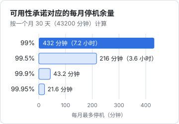
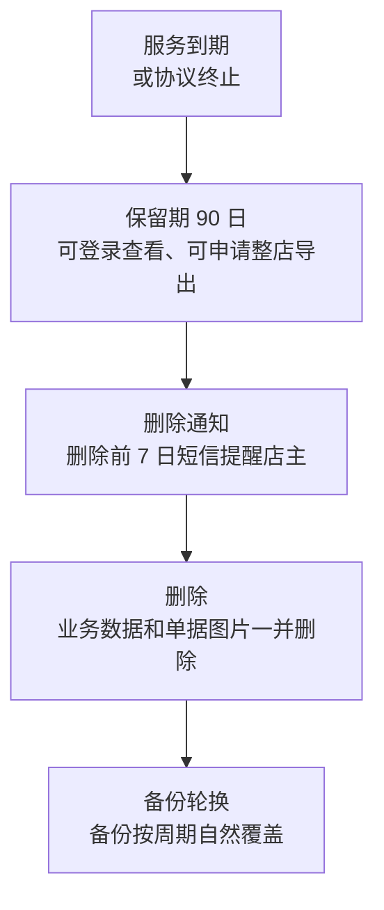

# SaaS 服务合同

卖软件服务给企业客户，绕不开一份服务合同。对一人公司来说，这份合同有两个特点：一是**你是提供格式条款的一方**，几乎所有客户都签同一份；二是**你是持续履行的一方**，服务一天不停，责任就一天都在。所以写这份合同的思路，不是「怎么把客户套住」，而是「怎么把我能承诺的说清楚，把我扛不住的风险封顶」。

这一章以 hatch-counter 跟门店签的服务合同为例，按条款讲：服务范围、服务等级（SLA）与赔偿上限、数据归属与导出、服务终止后的数据处理、价格调整、自动续费、责任限制，以及格式条款的提示怎么落地。

## 先定文件结构：哪些签、哪些点

hatch-counter 的客户关系有两层：

- **门店（付钱的一方）**
  - 对象：店主或门店所属的公司、个体户
  - 文件：《掌柜眼服务协议》+ 附件（服务说明及服务等级、数据处理约定）+ 订单
  - 怎么签：开户时线下或电子签署；续费时以订单确认
- **每个登录的人**
  - 对象：店主本人、店员
  - 文件：《用户协议》《隐私政策》
  - 怎么签：首次登录时在线勾选同意（第 3 章）

为什么分两层？因为两层的**法律关系不同**：服务协议是你和门店之间的买卖服务关系，门店付钱、你提供服务；用户协议管的是每个账号怎么用、你作为账号信息的处理者怎么处理个人信息。店员没给你付钱，也不是服务协议的当事人，你不能指望店员受服务协议约束。

**订单**是这套结构里最容易被忽视、却最实用的部分。服务协议正文长期不变，每次开户、续费、加店、升级都出一张订单，写清楚门店、套餐、金额、服务期限。hatch-counter 的后台本来就有订单台账（开户、续期、加店、升级、试用几种），把订单编号写进合同体系，财务和法律就能对上账：

> **第 2 条　订单**
>
> 2.1 双方就具体服务内容、门店数量、服务期限和服务费以订单方式确认。订单经乙方在管理系统中生成并经甲方以签字、盖章、电子签名或者付款任一方式确认后生效，构成本协议不可分割的一部分。
>
> 2.2 甲方付款即视为确认对应订单内容。订单与本协议正文不一致的，以订单中关于价格、服务期限和门店数量的约定为准。

## 服务范围：写能做的，不写想做的

### 范围条款

服务范围是整份合同的地基。常见的坑是官网怎么宣传，合同就怎么写，结果把「规划中」的功能也写成了承诺。

> **第 3 条　服务内容**
>
> 3.1 乙方通过互联网向甲方提供「掌柜眼」门店经营管理软件服务（以下简称「本服务」），具体功能以附件一《服务说明》所列为准。
>
> 3.2 本服务以乙方提供的网页端、桌面端和移动端访问，移动端仅提供查看功能。甲方应自备可连接互联网的设备和网络，本服务在无网络时不可用。
>
> 3.3 附件一以外的功能、乙方官网或宣传材料中标注为「即将上线」「规划中」的功能，不构成乙方的合同义务。
>
> 3.4 乙方有权对本服务进行升级、调整界面和操作方式，但不得实质性减少附件一所列的核心功能；确需下线核心功能的，应提前三十日通知甲方，甲方有权解除本协议并按第 9 条退还未使用期间的服务费。

3.4 是一个平衡：SaaS 必然持续迭代，你需要改功能的自由；但客户买的是「现在这些功能」，你单方面砍掉核心功能，客户有权走人并拿回钱。不写这个平衡，要么你被冻结不能改，要么条款因「不合理地限制对方主要权利」而面临无效风险。

### 不做的事也要写

> 3.5 下列事项不属于本服务范围，甲方需要的，双方另行签订协议：
>
> （1）为甲方定制开发功能；
>
> （2）上门安装、培训，或者代甲方录入数据；
>
> （3）对接甲方使用的其他收银、财务系统；
>
> （4）就甲方的经营、税务、财务问题提供咨询意见。

第（4）项对 hatch-counter 尤其重要。它会算毛利、算盈亏，店主可能会把这些数字当成报税依据或者经营决策依据。写明「不提供经营、税务、财务意见」，再在界面上对估算口径做说明，可以避免「你算的账不对害我亏钱」这类纠纷。

## 服务等级（SLA）与赔偿上限

### 可用性数字到底意味着什么

很多合同随手写「系统可用性不低于 99.9%」。先算一下这个数字意味着什么：

一人公司的服务部署在一台云服务器上，一次正常的发版（迁移数据库、重启容器）就可能停几分钟；云服务商一次区域性故障就是几十分钟到几小时；你周末带孩子出门没看到告警，就是半天。99.9% 意味着整个月只有 43 分钟的余量，一人公司在单机部署下承诺这个数字，等于主动违约。

更现实的做法：

1. **按真实能力写**。单机部署、一个人值守，写 99% 或 99.5%，并明确计算口径
2. **排除计划内维护**。提前通知的维护窗口不计入不可用时间
3. **违约后果写成服务抵扣**，而不是现金赔偿

> **附件一　第 5 条　服务可用性**
>
> 5.1 乙方承诺每个自然月的服务可用性不低于 99%。
>
> 服务可用性 =（当月总分钟数 − 不可用分钟数）÷ 当月总分钟数。
>
> 5.2 「不可用」指甲方在网络正常的情况下，连续五分钟以上无法登录或者无法使用附件一第 2 条所列核心功能，且经乙方监控记录或者甲方报告后经乙方核实。
>
> 5.3 下列时间不计入不可用时间：
>
> （1）乙方提前二十四小时通知的计划维护，每月合计不超过四小时；
>
> （2）因甲方设备、网络或者甲方违反本协议使用导致的不可用；
>
> （3）不可抗力；
>
> （4）为应对正在发生的网络攻击、安全漏洞而采取的紧急措施，乙方应在事后二十四小时内告知原因。
>
> 5.4 当月可用性低于 99% 的，乙方按下表向甲方延长服务期限，作为甲方就服务不可用所能获得的全部补偿：
>
> 可用性 95% 至 99%（不含）：延长 3 日；
>
> 可用性 90% 至 95%（不含）：延长 7 日；
>
> 可用性低于 90%：延长 15 日，且甲方有权解除本协议。
>
> 5.5 甲方应在当月结束后三十日内提出补偿申请，逾期视为放弃。

几点说明：

- 「延长服务期限」对 hatch-counter 是现成的动作：后台有「赠送天数」，加上去就行，比退钱简单，也不影响财务入账
- 5.3（4）给安全事件留了余地，但要求事后告知，避免被滥用
- 5.4 写「作为全部补偿」是为了把 SLA 和一般赔偿责任分开。但要注意它仍然是格式条款，**要做提示**，而且如果不可用是你故意或重大过失造成的，这个限制可能无效（《民法典》第五百零六条）
- 补偿档位不要设得太狠。按第 1 章说的可预见规则和违约金调整规则，补偿明显超过客户实际损失没有意义，明显低于又可能被认定为不合理地减轻自己责任

### 响应时间：一个人能兑现的才写

> **附件一　第 6 条　技术支持**
>
> 6.1 乙方通过客服微信和电子邮件提供技术支持，服务时间为每日 9:00 至 21:00（法定节假日除外）。
>
> 6.2 故障分级及响应：
>
> 一级（全部门店无法登录或者核心功能不可用）：服务时间内 1 小时内响应，服务时间外乙方监控发现后尽快处理；
>
> 二级（部分功能异常，不影响记账）：1 个工作日内响应；
>
> 三级（使用咨询、功能建议）：3 个工作日内响应。
>
> 6.3 「响应」指乙方确认收到并开始处理，不代表问题已经解决。

6.3 很关键。客户常把「1 小时响应」理解为「1 小时修好」，一人公司根本做不到。

## 赔偿责任的上限

SLA 只管「服务不可用」，但风险不止这一种：数据错乱、计算错误、数据泄露、你的员工（如果有）操作失误。这些都要放进一个总的责任限制条款：

> **第 11 条　责任限制【请重点阅读】**
>
> 11.1 除本条 11.3 规定的情形外，乙方因本协议承担的违约及赔偿责任总额，以损失发生前十二个月内甲方实际支付的服务费为限。
>
> 11.2 除本条 11.3 规定的情形外，乙方不对甲方的营业利润损失、商誉损失、因经营决策产生的损失承担责任。
>
> 11.3 下列情形不适用 11.1、11.2 的限制：
>
> （1）因乙方故意或者重大过失造成的损失；
>
> （2）因乙方违反本协议第 8 条（数据保护）或者附件二《数据处理约定》导致客户数据泄露造成的损失；
>
> （3）法律规定不得限制或者排除的责任。

为什么 11.3（2）要把数据泄露排除在上限之外？这看起来对你不利，但有两个理由：

1. 客户（尤其是连锁门店、有法务的客户）几乎一定会要求，主动放进去可以省掉一轮谈判
2. 数据泄露往往伴随重大过失的认定，就算你写了上限也未必有效。与其写一个可能失效的条款，不如用其他方式控制风险：做好安全措施、买网络安全保险（如果有合适的产品）、在附件二里写清楚双方各自的安全责任

如果你确实要给数据泄露设上限，常见的做法是另设一个更高的上限，比如「十二个月服务费的三倍」，而不是完全不设。这是一个需要律师参与的谈判点。

## 数据归属与导出

### 数据是客户的

门店在 hatch-counter 里录入的销量、进货、开支、员工档案，是门店的经营数据。合同要明确这一点，也要明确你能怎么用：

> **第 8 条　客户数据**
>
> 8.1 甲方及其授权用户在使用本服务过程中录入、上传、导入的数据，以及本服务基于上述数据生成的报表和分析结果（以下统称「客户数据」），其权益归甲方所有。
>
> 8.2 乙方仅为向甲方提供本服务、保障服务安全、处理甲方请求之目的处理客户数据，不将客户数据用于向第三方提供、商业推广或者本协议约定以外的其他目的。
>
> 8.3 乙方可以对本服务的运行数据（如访问次数、功能使用频率、接口耗时、错误日志）进行统计分析，用于改进本服务。前述统计结果不得识别到甲方或者任何个人。
>
> 8.4 未经甲方书面同意，乙方不得将客户数据用于训练人工智能模型。

8.4 这几年越来越常被问到。hatch-counter 把进货单照片交给第三方视觉模型识别，客户会担心照片被拿去训练。你自己不训练，也要确认你用的模型服务商的条款里有没有「可能用于改进模型」的约定，有的话要么关掉（很多服务商的企业接口默认不用于训练，以服务商条款为准），要么在附件二里如实告知。

### 导出要写到能执行

「客户可以随时导出数据」是一句漂亮话，关键是导出什么、什么格式、多快。合同要跟代码对上：

> 8.5 甲方可以通过以下方式获取客户数据：
>
> （1）在本服务各分析页面自行导出当前页面数据（Excel 格式）；
>
> （2）向乙方客服申请整店导出。乙方应在收到申请后五个工作日内生成包含甲方门店全部业务数据的 Excel 文件压缩包（甲方可选择是否包含单据图片），通过本服务向门店店主提供下载，下载链接有效期七日。
>
> 8.6 本协议终止、服务到期或者门店被暂停服务的，不影响甲方依照 8.5（2）申请整店导出。

这两条是照着 hatch-counter 的实现写的：分析页面有「导出这一页」，后台有「整店导出」（店主申请、后台发起、复核后生成 Excel 压缩包、可选带图片、7 天有效、停用和到期的店也能下载）。**合同写的每一项导出能力，代码里都要真有**；反过来，代码有而合同没写的能力，客户不知道，也就没法用来说服他签约。

## 服务终止后的数据处理

这是 SaaS 合同里最容易「合同和代码对不上」的地方。先看 hatch-counter 现在的实际行为：

| 场景 | 代码里实际发生的事 |
|---|---|
| 服务到期 | 店主照样能登录，账都在，记账页不能用；续费后恢复 |
| 后台停用门店 | 业务接口当场被拦，店主能登录看到「已停用」，数据不动 |
| 后台删店 | 软删除，数据一行不动，进回收站，超管可以恢复 |
| 回收站里彻底删除 | 业务表随外键级联删除；**对象存储里的单据原图、开支凭证不跟着删** |

合同里如果写「终止后三十日内删除全部客户数据」，那么现在的代码就做不到：软删除会一直留着，彻底删除又漏了对象存储里的图。合同和代码必须二选一地对齐：要么改代码（加一个到期后的自动清理任务、彻底删除时连图一起删），要么改合同（如实写保留期限）。

更好的做法是把终止后的数据处理写成一个明确的时间线：

对应的条款：

> **第 10 条　终止后的数据处理【请重点阅读】**
>
> 10.1 服务到期未续费或者本协议终止后，乙方为甲方保留客户数据九十日（以下简称「保留期」）。保留期内甲方可以登录查看，并可以依照第 8.5 条申请导出，但不能新增或者修改数据。
>
> 10.2 保留期届满前七日，乙方以短信方式通知门店店主。保留期届满后，乙方将删除甲方的客户数据，包括数据库中的业务数据和对象存储中的单据图片、凭证图片。删除后无法恢复。
>
> 10.3 乙方的数据备份按备份周期滚动覆盖，已删除的客户数据将在备份周期届满后从备份中消失。在此之前，乙方不会为任何目的使用或者恢复备份中的该部分数据，但法律另有规定的除外。
>
> 10.4 法律、行政法规要求保留的数据（如交易记录、操作日志），乙方在法定期限内继续保存，并停止除存储和必要安全保护之外的处理。
>
> 10.5 甲方在保留期内书面要求提前删除的，乙方应在十个工作日内删除，并书面确认。

10.3 是对技术现实的诚实交代：你不可能为了一个客户去改写所有历史备份，但可以承诺不用、不恢复。10.4 呼应了个人信息保护法里关于删除和法定留存的规则（见[《国内合规实务》第 6 章](../opc-compliance-cn/06-pipl.md)）。10.5 让客户有主动权，也是附件二里受托人「委托结束后返还或删除」义务的落地。

写完这几条，回到代码里补三件事：到期满 90 日的提醒和清理任务、彻底删除时连对象存储一起删、删除完成的记录。否则这份合同就是一张空头支票。

## 价格调整

一人公司早期定价往往偏低（见[《定价与商业模式》第 4 章](../pricing-monetization/04-price-experiments.md)），以后大概率要涨价。合同要给自己留涨价的口子，同时不让客户觉得被突袭：

> **第 6 条　服务费及调整**
>
> 6.1 服务费以订单载明的金额为准。已生效订单的服务期限内，乙方不调整该订单的价格。
>
> 6.2 乙方调整服务价格的，应提前三十日在本服务内和官网公告，并以短信或者客服微信通知甲方。调整后的价格自甲方下一次续费时适用。
>
> 6.3 甲方不接受调整后价格的，可以在当前服务期限届满后不再续费，乙方依照第 10 条处理客户数据。

这个结构和 hatch-counter 后台的设计是一致的：改价只影响以后生成的订单，已有订单的金额不变，停售的老套餐老门店照样能续（见[《定价与商业模式》第 8 章](../pricing-monetization/08-case-hatch-counter.md)）。如果你想对老客户「锁价」作为卖点，可以在 6.2 后面加一句「甲方连续续费的，按其首次订购时的价格续费」，但要想清楚以后是否兑现得了。

## 自动续费

### B 端客户也要按显著提示来做

> [!WARNING]
> 本节引用的《网络交易监督管理办法》《消费者权益保护法实施条例》按 2025 年前后的规定整理，自动续费的监管要求近年持续收紧，以市场监管总局最新发布的规章和公告为准。

自动续费在 To C 领域有明确的监管要求：

- 《网络交易监督管理办法》第十八条：网络交易经营者采取自动展期、自动续费等方式提供服务的，应当在消费者接受服务前和自动展期、自动续费等日期**前五日**，以显著方式提请消费者注意，由消费者自主选择；服务期间内应当提供显著、简便的随时取消或者变更的选项
- 《消费者权益保护法实施条例》（2024 年 7 月 1 日起施行）第十条第二款：经营者采取自动展期、自动续费等方式提供服务的，应当在消费者接受服务前和自动展期、自动续费等日期前，以显著方式提请消费者注意

门店购买经营软件，严格说不是「为生活消费需要」购买服务，一般不按消费者对待。但个体户店主和普通消费者的边界在实践中并不总是清楚，而且格式条款的提示义务对 B 端照样适用。稳妥的做法是**按 To C 的标准来做**：

> **第 7 条　续费【请重点阅读】**
>
> 7.1 本协议项下的服务不自动续费。服务期限届满前，甲方可以通过客服续费，续费以新订单确认。
>
> （或者，如果你确实做了自动扣款：）
>
> 7.1 甲方在订单中勾选「到期自动续费」的，乙方将在服务期限届满时，按届时适用的价格从甲方授权的支付账户中扣取下一期服务费。
>
> 7.2 乙方应在每次扣费日前至少五日，以短信和本服务内提醒的方式告知甲方扣费日期、扣费金额和取消方式。
>
> 7.3 甲方可以随时在本服务内或者通过客服取消自动续费，取消后不影响当前服务期限。

hatch-counter 目前是人工开户、人工续费（财务确认收款后顺延到期日），没有自动扣款，那就老老实实写第一种「不自动续费」。不要为了「看起来像个正经 SaaS」而写上自动续费条款，又不做提醒，这是给自己挖坑。退款怎么设计、自动续费引起的客诉怎么处理，见[《定价与商业模式》第 7 章](../pricing-monetization/07-refunds-disputes.md)「退款与客诉」。

## 暂停服务与客户的义务

合同也要写清楚**客户**要做什么，否则出了问题全是你的：

> **第 5 条　甲方的义务**
>
> 5.1 甲方应妥善保管店主及成员的登录手机号，因甲方成员手机号变更未及时在本服务中更新、成员离职未及时移除，导致他人使用该账号的，由甲方承担相应后果。
>
> 5.2 甲方保证其录入本服务的员工信息、供应商信息等个人信息已依法取得相关个人的同意或者具有其他合法性基础（详见附件二）。
>
> 5.3 甲方不得利用本服务从事违法活动，不得对本服务进行反向工程、批量抓取或者影响服务稳定的压力测试。
>
> 5.4 甲方违反本条约定，经乙方通知后七日内未改正的，乙方有权暂停对甲方提供服务；情节严重的，乙方有权解除本协议。

## 格式条款的提示怎么落地

> [!WARNING]
> 提示义务的举证标准依据法释〔2023〕13 号第十条，按 2025 年前后的司法口径整理，可能调整，以最高人民法院最新司法解释和当地法院的裁判为准。

上面好几条都加了【请重点阅读】。根据第 1 章讲的规则，提示是你的举证责任，所以要做到**能拿出证据**：

1. **正文里标出来**：责任限制、终止后数据删除、续费、争议解决这几条，标题加【请重点阅读】，正文加粗
2. **签署页上列出来**：在签字栏上方写一段「甲方确认：乙方已提示甲方重点阅读第 7、10、11、14 条，甲方已充分理解其含义」
3. **线下签约当面讲一句**，事后在微信上发一条「X 老板，合同里第 10 条是说到期 90 天后数据会删掉，您留意一下」，截图留存
4. **电子签署时**，用支持「指定条款单独确认」的电子签平台，或者在签署前的页面里把重点条款单列一屏（第 7 章）

第 3 条那种做法看起来土，但很管用：它同时证明了提示和说明，而且是在正常业务往来中形成的电子数据（第 7 章讲这类证据为什么容易被认可）。

## 审 SaaS 服务合同的清单

不管是你写给客户，还是你作为客户去签别人的 SaaS 合同，都可以用这张清单：

| 检查项 | 要看什么 |
|---|---|
| 服务范围 | 功能以附件为准？宣传材料是否排除？单方下线核心功能的后果？ |
| 可用性 | 数字、计算口径、排除项、补偿方式、申请期限 |
| 支持 | 服务时间、分级、「响应」的定义 |
| 价格 | 服务期内能不能调价？调价怎么通知？ |
| 续费 | 自动还是手动？扣费前提醒？怎么取消？ |
| 数据归属 | 客户数据归谁？供应商能怎么用？能不能用于训练模型？ |
| 导出 | 什么格式、多久、终止后还能不能导 |
| 终止后 | 保留多久、什么时候删、备份怎么处理、删前通知 |
| 责任上限 | 金额、例外情形、间接损失 |
| 暂停 | 欠费、违约时能否暂停、暂停是否顺延 |
| 第三方 | 用了哪些第三方服务（云、短信、模型），出问题谁负责 |
| 提示 | 重点条款是否加粗标出、签署页是否确认 |

## 常见的坑

- **照抄大厂合同**。大厂写 99.95%、7×24 小时、多可用区容灾，你照抄就要照做。合同要按一人公司的真实能力写
- **把 SLA 补偿写成现金**。现金赔偿要走退款、红冲发票，延长服务期限简单得多
- **数据删除条款和代码不一致**。合同说 30 天删，代码里软删永久保留，出事时这就是你违约的直接证据
- **只写「乙方不承担任何责任」**。大概率无效，还会让对方的律师对整份合同提高警惕
- **订单和合同脱节**。合同里写一年，订单里写两年，价格对不上，没写以谁为准
- **试用期没有合同**。试用期间客户也在录入真实数据，至少要让他在线同意用户协议和隐私政策，并在服务协议里写明试用期的数据怎么处理（试用结束不转正的，按第 10 条处理）

## 本章要点

- 服务协议（门店签）和用户协议、隐私政策（每个登录的人同意）是两层法律关系，分开写
- 用「协议正文 + 附件 + 订单」的结构，订单承载价格、期限、门店数量
- 服务范围以附件为准，排除宣传材料和规划功能；单方下线核心功能要给客户解约和退款的权利
- 可用性按真实能力写，排除计划维护，补偿写成延长服务期限；「响应」不等于「解决」
- 责任上限写成「十二个月服务费」，排除故意、重大过失和数据泄露，比写「不承担责任」更站得住
- 客户数据归客户；导出和终止后删除的条款要跟代码逐项对齐，hatch-counter 还需要补到期清理和对象存储删除
- 涨价只影响续费；自动续费按扣费前五日显著提醒的标准做，没做自动扣款就写「不自动续费」
- 重点条款加粗标出、签署页确认、微信再提醒一次，留下能举证的提示记录
