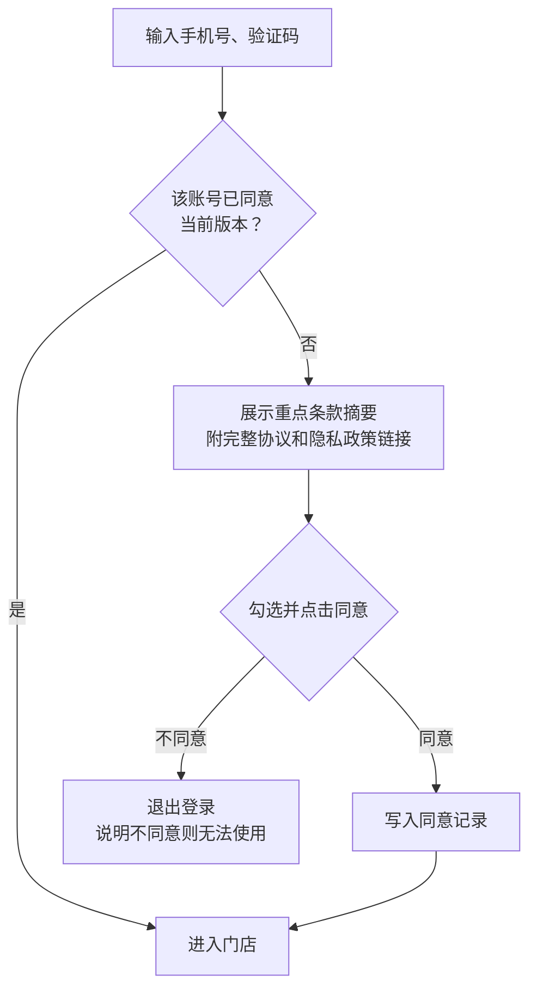

# 用户协议与隐私政策

上一章的服务协议是跟付钱的门店签的，一份合同对一个客户。这一章的两份文件面对的是**每一个注册、登录的人**：店主、店员，以后可能还有门店的顾客。它们通常不是一对一谈出来的，而是挂在登录页上、让人点一下「同意」。

这两份文件经常被当成「上架要用的法务两页」，从网上找个模板改改名字就挂上去。这样做的问题在第 1 章已经说过：它们是典型的格式条款，写得越随意，关键时刻越靠不住；而隐私政策写的和代码做的不一致，本身就是违规证据。

这一章从**合同文本**的角度讲：用户协议的骨架和关键条款、在线同意怎么设计才能举得出证、协议怎么更新，以及隐私政策作为一份「告知文件」在结构上要注意什么。个人信息保护法的具体要求（告知哪些事项、个人有哪些权利、敏感个人信息怎么处理），见[《国内合规实务》第 6 章](../opc-compliance-cn/06-pipl.md)「个人信息保护法」，这里不重复。

## 两份文件分别管什么

| | 用户协议 | 隐私政策 |
|---|---|---|
| 性质 | 合同（格式条款） | 主要是告知文件；其中的同意部分构成处理个人信息的合法性基础之一 |
| 管什么 | 账号怎么用、什么不能做、服务能不能变、出了问题谁负责、在哪打官司 | 收集什么个人信息、为什么、给了谁、存多久、个人怎么行使权利 |
| 写错的后果 | 条款不成为合同内容或者无效 | 监管通报、整改、处罚；和代码不一致是直接的违规证据 |
| 谁来对照检查 | 发生纠纷时的法院、仲裁庭 | 监管部门的 App 检测、应用商店审核、用户投诉 |

**不要把两份合成一份**。合并后隐私政策的内容会被埋在协议里，「以显著方式告知」很难证明；监管检测也通常要求隐私政策单独成文、可以单独访问。

## 用户协议的骨架

以 hatch-counter 的《掌柜眼用户协议》为例，结构可以是这样：

| 章节 | 要点 |
|---|---|
| 1 协议主体与适用范围 | 运营方全称；本协议适用于所有账号；门店另签服务协议的，本协议与服务协议的关系 |
| 2 账号 | 开户方式、登录方式、账号归属、账号安全 |
| 3 使用规范 | 禁止行为清单 |
| 4 服务的变更、中断和终止 | 维护、升级、门店停用或到期对个人账号的影响 |
| 5 知识产权 | 软件归运营方；用户数据归门店 |
| 6 免责与责任限制【重点】 | 合理范围内的限制 |
| 7 个人信息保护 | 指向《隐私政策》 |
| 8 协议的变更【重点】 | 怎么通知、什么时候生效、不同意怎么办 |
| 9 通知 | 通过什么渠道通知用户 |
| 10 法律适用与争议解决【重点】 | 管辖法院 |

下面挑几个容易写错的地方展开。

### 和服务协议的关系

hatch-counter 的特殊之处在于，店员的账号是店主在「成员权限」里加的，店员本人跟你没有付费关系。用户协议要把这层关系说清楚：

> 1.2 您使用的账号可能由您本人所在的门店为您开通。门店与我们另行签订《掌柜眼服务协议》，就服务内容、费用、门店数据的权益和处理等作出约定。您在门店中能够查看和操作哪些数据，由门店的店主在「成员权限」中设置。
>
> 1.3 您以门店成员身份录入的经营数据属于该门店，您离开该门店或者被店主移除后，将无法再访问该门店的数据。

1.3 预先回答了一个常见纠纷：店员离职后要求「把我录的数据给我」或「删掉我录的东西」。经营数据是门店的，店员个人信息的权利另按隐私政策处理。

### 账号条款：开户和归属

> 2.1 掌柜眼不提供自助注册。门店账号由我们根据门店与我们签订的服务协议在管理后台开通；门店成员账号由店主在「成员权限」中添加。
>
> 2.2 您以手机号和短信验证码登录。该手机号是识别您身份的唯一凭证，请您妥善保管手机及 SIM 卡。因您的手机号被他人使用（包括手机号注销后被运营商重新分配给他人）导致的损失，在我们无过错的范围内由您承担。
>
> 2.3 您更换手机号的，请联系店主或者我们的客服更新。

2.2 里「手机号注销后被重新分配」不是凭空想的：只靠手机号验证码登录的系统，二次放号是真实存在的风险。写进协议的同时，产品上也可以做一些缓解，比如长期未登录的账号再次登录时提示确认门店。

### 使用规范：写具体，不写口号

> 反例：「用户不得利用本服务从事任何违法违规活动。」
>
> —— 太空泛，真出了事无法据此处理。
>
> 改法：
>
> 3.1 您不得：
>
> （1）将账号出借、出租给门店以外的人使用；
>
> （2）通过脚本、爬虫等自动化方式批量调用本服务的接口或者抓取数据；
>
> （3）对本服务进行反向工程、反编译，或者试图绕过权限访问其他门店的数据；
>
> （4）上传含有病毒、恶意代码的文件，或者与门店经营无关的违法内容；
>
> （5）冒用他人身份或者伪造进货单据。
>
> 3.2 您违反上述约定的，我们可以视情节采取警告、限制功能、暂停账号等措施，并通知您所在门店的店主。

3.2 的「通知店主」是 B 端产品的特点：个人账号的违规行为影响的是门店，处理时让门店知情是合理的。

### 免责条款：别写成「全部不负责」

用户协议里最常见的问题，就是从模板抄来一大段「因不可抗力、黑客攻击、电信部门技术调整、第三方原因……造成的一切损失，本公司不承担任何责任」。按第 1 章讲的规则，这类条款有两个风险：免除了自己的故意或重大过失责任（无效）；没有提示（不成为合同内容）。

> 6.1【请重点阅读】我们会采取合理的技术和管理措施保障服务稳定和数据安全，但本服务可能因以下原因中断或者出现异常：计划内的系统维护（我们会提前通知）；电信网络、云服务等基础设施故障；不可抗力。对于上述原因造成的服务中断，我们会尽快恢复，但不承担由此导致的间接损失。
>
> 6.2 本服务提供的毛利、盈亏等分析结果基于门店录入的数据和本服务说明的计算口径得出，仅供经营参考，不构成财务、税务意见。
>
> 6.3 本条不限制或者排除因我们的故意或者重大过失给您造成损失时应承担的责任，也不限制或者排除法律规定不得限制或者排除的责任。

6.3 这种「兜底声明」看起来像在给自己找麻烦，其实是在保护前面的条款：它让 6.1 和 6.2 不至于因为「免除故意或重大过失责任」而整体被认定无效。

### 争议解决：管辖要合理

> [!WARNING]
> 协议管辖规则按 2023 年修正的《民事诉讼法》第三十五条整理，条号和适用口径可能随修法、司法解释调整，以国家法律法规数据库和最高人民法院发布的最新文本为准。

在线协议的管辖条款，常见写法是「提交本公司所在地人民法院管辖」。《民事诉讼法》第三十五条允许合同纠纷的当事人书面协议选择被告住所地、合同履行地、合同签订地、原告住所地、标的物所在地等与争议有实际联系的地点的人民法院管辖。

但在线格式条款里约定由你所在地法院管辖，对异地用户来说是加重了维权成本，属于与对方有重大利害关系的条款，**要提示**；没有提示的，存在不成为合同内容的风险。所以这一条一定要加粗标出。另外，个人用户和你之间的纠纷金额通常很小，管辖条款写得再有利，对方大多也不会真去起诉；它真正起作用的场景是门店（服务协议）层面的纠纷，第 8 章再讲诉讼和仲裁怎么选。

## 在线同意：设计成能举证的样子

### 勾选框不够

> [!WARNING]
> 本节依据法释〔2023〕13 号第十条，按 2025 年前后的司法口径整理，以最高人民法院发布的最新司法解释为准。

合同编通则解释第十条明确：通过互联网订立的电子合同，提供格式条款的一方**仅以采取了设置勾选、弹窗等方式**为由主张已经履行提示义务或者说明义务的，法院不予支持，除非举证符合「以明显标识提示异常条款」「按要求解释说明」的标准。

所以在线同意要做三件事：

1. **界面上**：重点条款在协议正文里加粗、标【请重点阅读】；首次同意时用一屏摘要列出重点条款，而不是只放一个链接
2. **流程上**：未勾选同意不能继续，不能默认勾选；协议链接可以点开，内容可以完整阅读
3. **记录上**：服务端记下谁、在什么时间、同意了哪个版本的哪份文件、当时展示的是什么内容

### 同意记录的数据结构

第 3 点是开发者最能发挥的地方。一个最小的同意记录表：

```sql
-- 协议版本：每次发布新版本插入一行，正文存一份快照
CREATE TABLE legal_documents (
  id           bigserial PRIMARY KEY,
  kind         text        NOT NULL,          -- 'terms' | 'privacy' | 'service'
  version      text        NOT NULL,          -- 如 '2026-11-03'
  content_hash text        NOT NULL,          -- 正文 SHA-256
  content      text        NOT NULL,          -- 当时展示的完整正文
  summary      text        NOT NULL,          -- 同意弹窗里那一屏重点摘要
  published_at timestamptz NOT NULL,
  UNIQUE (kind, version)
);

-- 同意记录：只追加，不更新、不删除
CREATE TABLE legal_consents (
  id          bigserial PRIMARY KEY,
  user_id     bigint      NOT NULL,
  document_id bigint      NOT NULL REFERENCES legal_documents(id),
  action      text        NOT NULL,           -- 'accept' | 'withdraw'
  client      text        NOT NULL,           -- 'web' | 'desktop' | 'mobile'
  app_version text,
  ip          inet,
  created_at  timestamptz NOT NULL DEFAULT now()
);
```

几个设计要点：

- **正文存快照、存哈希**。协议文件会改，官网上的链接永远指向最新版。发生纠纷时你要证明的是「对方当时同意的那个版本写了什么」，没有快照就证明不了
- **摘要也存**。提示义务的证据很大一部分在那一屏摘要上
- **只追加**。撤回同意也是插一行，不是删掉原来那行。可以在数据库层面收回业务角色对这张表的 `UPDATE` 和 `DELETE` 权限
- **IP 是个人信息**。记它是为了安全和举证，要在隐私政策里写明，并定保存期限

hatch-counter 的服务端已经有把后台敏感表放进单独 schema、业务角色够不着的做法，同意记录表可以沿用类似的权限思路：业务接口只能插入，不能改。

### 首次登录的流程



App 端还有一个顺序要求：**在用户同意隐私政策之前，不初始化会收集个人信息的 SDK、不申请权限**（见《国内合规实务》第 6 章）。所以同意弹窗要在 App 启动后、任何 SDK 初始化之前出现。hatch-counter 是验证码登录，发验证码本身就要处理手机号，所以在发验证码之前就要让用户看到并同意（或至少以显著方式告知）隐私政策，不能等登录成功之后才弹。

## 协议的更新

### 不能「更新即生效」

> [!WARNING]
> 协议单方变更的效力主要靠格式条款规则和司法实践判断，本节按 2025 年前后的口径整理，可能调整，以最高人民法院相关司法解释和市场监管总局的最新规定为准。

模板里常见：「本公司有权随时修改本协议，修改后的协议一经公布即生效，用户继续使用视为同意。」

这句话的问题是：对已经在用的用户来说，单方变更合同内容、且不给合理通知期，很可能被认定为不合理地加重对方责任或者限制对方权利。更稳妥的做法：

> 8.1 我们可能根据业务调整或者法律法规的变化修订本协议。修订内容涉及您的重大权益的（例如责任限制、争议解决、数据处理方式），我们会在生效日前至少七日，通过登录弹窗、短信或者站内通知告知您，并说明修订的主要内容。
>
> 8.2 修订后的协议在您再次登录时请您确认。您不同意修订内容的，可以停止使用本服务；您是门店店主的，可以依照《掌柜眼服务协议》的约定处理门店数据。
>
> 8.3 仅涉及文字表述、联系方式等不影响您权益的修订，我们会在协议页面更新，并标注修订日期。

### 版本管理的工程做法

协议文件放进代码仓库，用 Markdown 写，跟代码一起版本化，有几个好处：每次修订都有 diff 可查；发布流程可以跟代码发布绑在一起，保证「协议说的」和「代码做的」同时上线；版本号可以直接用日期。

hatch-counter 的计划是把这两页放在官网（`apps/site`）里，用 Vite 的多入口出两份独立的 HTML。在此基础上可以再加一步：构建时把协议正文和它的 SHA-256 写进 `legal_documents` 表的迁移或者种子数据，客户端只需要知道当前版本号，服务端比对用户是否已同意该版本。

每次修订，在协议末尾保留一个修订记录：

> **修订记录**
>
> 2026-11-03　首次发布。
>
> 2027-03-01　第 6 条：补充识别服务中断时的说明；第 8 条：重大修订通知期由三日改为七日。

## 隐私政策：从文件结构的角度

> [!WARNING]
> 隐私政策的告知事项和 App 收集个人信息的要求按 2025 年前后的《个人信息保护法》及配套规定整理，监管细则更新频繁，以国家网信办、工业和信息化部发布的最新规定为准。

隐私政策要告知哪些事项，《国内合规实务》第 6 章已经列了清单。这里补充几个**写文件**层面的要点。

### 先说清楚你是谁、扮演什么角色

hatch-counter 同时扮演两个角色：对店主、店员的账号信息，它是处理者；对门店录入的员工档案、工资、进货单内容，它更接近受托人（第 5 章细讲）。隐私政策开头就要讲清楚这一点，否则读者会以为员工档案也是你在决定怎么用：

> **一、适用范围**
>
> 1. 本政策说明我们作为个人信息处理者，如何处理您作为掌柜眼账号使用者的个人信息，包括手机号、登录记录、设备信息和操作日志。
>
> 2. 门店在掌柜眼中录入的员工档案、工资、供应商联系人等信息，由门店决定处理目的和方式，我们按照与门店签订的服务协议和数据处理约定，受门店委托处理。如果您是门店的员工，想查阅、更正或者删除门店录入的您的信息，请先联系门店；门店需要我们协助的，我们会配合。

### 按功能写，不按数据类型写

> 反例：「我们会收集您的个人信息，包括但不限于姓名、手机号、设备信息、位置信息等。」
>
> —— 「包括但不限于」等于什么都没说；还列了根本不收集的位置信息。
>
> 改法：按功能列表写。
>
> 功能：登录
>
> - 收集的信息：手机号、短信验证码
> - 目的：验证您的身份
> - 是否必要：必要，不提供无法登录
>
> 功能：拍进货单识别
>
> - 收集的信息：您拍摄的进货单照片（可能含供应商联系人姓名、电话）
> - 目的：识别为进货记录
> - 委托处理方：视觉模型识别服务商（名称见第五条）
> - 是否必要：可选，不使用该功能不影响记账

### 第三方清单和代码一起维护

服务商名单（云、对象存储、短信、模型识别）是隐私政策里最容易过期的部分。hatch-counter 的识别服务有一条降级链，短信也有可切换的通道，都在后台配置。这意味着**后台改一次配置，隐私政策里的服务商名单就可能不准了**。

两个办法：一是隐私政策里写清所有**可能启用**的服务商，而不只是当前启用的；二是在后台的配置页上加一句提示「新增服务商前，先更新隐私政策和数据处理约定的服务商清单」，把法律文件的更新嵌进操作流程。

## 审用户协议和隐私政策的清单

| 检查项 | 要看什么 |
|---|---|
| 主体 | 运营方全称、联系方式是否真实，与 ICP 备案主体一致 |
| 适用范围 | 与服务协议的关系说清楚了吗 |
| 重点条款 | 责任限制、协议变更、争议解决、数据删除是否加粗、标注 |
| 免责条款 | 有没有免除故意、重大过失责任；有没有兜底声明 |
| 变更 | 是否给了通知期、是否需要重新确认 |
| 同意流程 | 不能默认勾选；摘要一屏；同意前不初始化 SDK、不申请权限 |
| 同意记录 | 版本、正文快照、哈希、时间、渠道是否落库 |
| 隐私政策角色 | 处理者和受托人的部分分开说了吗 |
| 功能清单 | 按功能写，必要和可选分开，没有「包括但不限于」 |
| 第三方 | 服务商清单是否完整，是否覆盖可切换的备选 |
| 一致性 | 文件写的和代码、后台配置做的一致吗 |

## 常见的坑

- **抄别人的协议连名字都没改干净**。真实见过协议里残留着别家公司名和别家产品的功能。抄来的协议既不贴合你的产品，也可能涉及他人作品的著作权问题
- **隐私政策里写了不收集的东西**。写多了也是问题：监管检测会对照「声明收集的」和「实际必要的」，声明收集位置信息却没有用到位置的功能，同样会被质疑
- **只在官网放链接**。App 内、登录页都要能访问到，应用商店审核也会检查
- **改协议不留旧版本**。发生纠纷时拿不出对方当时同意的版本
- **同意记录存在客户端**。本地存一个 `agreed=true`，换设备就没了，也证明不了任何事

## 本章要点

- 用户协议是格式条款合同，隐私政策主要是告知文件，两份分开写、分开展示
- B 端产品的用户协议要说清楚和门店服务协议的关系：店员账号由门店开通，经营数据归门店
- 免责条款写成合理范围内的限制，加一句不排除故意和重大过失责任的兜底声明
- 管辖条款对异地用户是重大利害条款，要提示
- 勾选框本身不足以证明尽到提示义务：重点条款加粗、首次同意展示摘要、服务端只追加地记录版本快照和哈希
- 协议更新给通知期、重大修订要重新确认，协议文件跟代码一起版本化
- 隐私政策开头讲清处理者和受托人两种角色，按功能写，第三方服务商清单覆盖所有可能启用的备选
