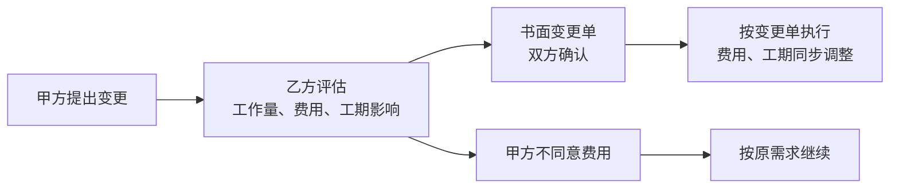
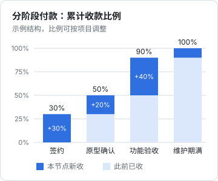

# 外包与定制开发合同

一人公司碰外包合同有两个方向：**你接活**，过渡期接外包补贴收入，或者给大客户做定制功能；**你发活**，找人画设计稿、做插画、写一段你不熟的原生模块。两个方向用的是同一套条款，只是你站的位置不同，要盯的重点相反。

外包是纠纷最多的合同类型之一。原因不复杂：交付物在签约时是不存在的，双方对「做成什么样」的想象不一致，而这种不一致要到验收时才暴露，那时候钱已经付了一半。这一章讲怎么用合同把这种不一致提前暴露、分段消化：需求确认与变更、分阶段验收、尾款、知识产权归属、源代码交付和维护期。

外包接单本身怎么找、怎么报价、要不要接，见[《过渡期收入与个人保障》](../opc-transition/)；这一章只讲合同。

## 先搞清楚这是什么合同

软件外包在法律上可能被认定为两种合同：

| | 承揽合同 | 技术开发合同（委托开发） |
|---|---|---|
| 定义 | 承揽人按照定作人的要求完成工作、交付工作成果，定作人支付报酬（《民法典》第七百七十条） | 当事人之间就新技术、新产品、新工艺、新品种或者新材料及其系统的研究开发所订立的合同（第八百五十一条） |
| 形式 | 没有强制要求 | 应当采用书面形式（第八百五十一条） |
| 典型 | 按现成技术做一个网站、一个小程序 | 有研究开发性质的新系统 |
| 一个关键差别 | 定作人在完成前**可以随时解除**，造成损失要赔偿（第七百八十七条） | 没有对应的任意解除规则；作为开发标的的技术已被他人公开、履行没有意义的，可以解除（第八百五十七条） |

实务中，普通的网站、App、小程序外包，法院多按承揽或者参照承揽处理；有一定研发性质的，可能按技术开发合同处理。具体怎么认定，看合同内容和法院的判断，这是第 9 章说的「值得问律师」的问题之一。

对你有直接影响的是第七百八十七条：**按承揽处理时，客户在你完成前可以随时叫停**，只需赔偿你的损失。所以合同里一定要约定客户中途解除时怎么结算：

```text
第 X 条　甲方提前终止
X.1 甲方可以在项目完成前书面通知乙方终止本合同。
X.2 甲方提前终止的，应当向乙方支付：（1）已完成并经验收的阶段的全部
    费用；（2）正在进行中的阶段，按乙方已投入工作量占该阶段工作量的
    比例计算的费用，比例由双方根据工作记录确认，确认不成的按百分之
    五十计算；（3）乙方为本项目已支出且无法退回的第三方费用。
X.3 甲方已支付的款项超过上述金额的，乙方应退还差额；不足的，甲方
    应在终止通知发出后十日内补足。
```

（2）里「确认不成的按百分之五十计算」是一个兜底，避免双方在「做了多少」上无休止地扯皮。比例本身是可以谈的。

## 需求确认：把「想象」变成文件

### 需求说明书是合同附件

外包合同的正文可以从模板来，但需求说明书一定是这个项目独有的，而且是整份合同里最重要的附件。它要回答的问题是：**验收时拿什么来对照**。

需求说明书的写法可以参考[《产品思维》第 6 章](../product-thinking/06-writing-specs.md)「把需求写下来」。从合同角度，要额外保证几点：

1. **功能清单逐条编号**，每一条都能判断「做了没有」
2. **写明不做什么**：不做的平台、不做的浏览器、不对接的系统、不负责的数据迁移
3. **写明依赖**：客户要提供什么（素材、接口文档、测试账号、服务器），什么时候提供
4. **写明验收环境**：在哪台机器、什么浏览器、什么数据量下验收

```text
附件一　需求说明书（节选）
F-01 门店登录：手机号 + 短信验证码登录。短信通道由甲方提供并承担费用。
F-02 收银数据导入：支持甲方现用的 X 收银系统导出的 Excel 日报表
     （格式以甲方于 2026-11-10 前提供的三份样例为准）。
N-01 不在范围：其他收银系统的报表格式；历史数据迁移；微信小程序端。
D-01 甲方依赖：甲方应于合同签订后五个工作日内提供 F-02 所需样例文件
     和一个可用于测试的门店账号。
```

### 甲方的协助义务

《民法典》第七百七十八条：承揽工作需要定作人协助的，定作人有协助义务；定作人不履行协助义务致使承揽工作不能完成的，承揽人可以催告定作人在合理期限内履行，并可以**顺延履行期限**；定作人逾期不履行的，承揽人可以解除合同。

外包项目延期，十有八九是因为客户的东西没给到：素材、接口、账号、审批。合同里把依赖列清楚，再加一条顺延规则，你就不会背延期的锅：

```text
第 X 条　工期顺延
甲方未按附件一约定的时间提供依赖事项的，乙方的交付期限相应顺延；
甲方延误超过十五日的，乙方有权书面催告，催告后十日内仍未提供的，
乙方有权解除本合同，并按本合同第 X 条（甲方提前终止）结算。
```

## 需求变更：不是不能变，是要有流程

《民法典》第七百七十七条：定作人中途变更承揽工作的要求，造成承揽人损失的，应当赔偿损失。法律站在你这边，但前提是你能证明「这是变更」以及「造成了多少损失」。所以变更要走书面流程：



```text
第 X 条　需求变更
X.1 甲方要求增加、修改附件一所列需求的，应以书面（含电子邮件、微信）
    方式提出。乙方应在三个工作日内回复变更对费用和工期的影响。
X.2 双方书面确认变更单后，乙方按变更单执行。未经确认的，乙方有权按
    原需求继续履行，不视为违约。
X.3 单项变更工作量不超过半个人日的，乙方可以不收费，但同一阶段内
    累计超过两个人日的部分，按每人日 X 元计费。
```

X.3 是一个实用的弹性设计：小改动不计较，显得你好合作；但设一个累计阈值，避免「每次只改一点点」累积成一个新项目。

一张变更单的样子：

```text
变更单　CR-003
项目：门店系统定制开发　　日期：2026-12-02
提出方：甲方（王经理，微信）
变更内容：F-02 增加支持 Y 收银系统的报表格式
影响评估：工作量 2 人日；第二阶段交付日由 12-15 顺延至 12-18
费用：2 人日 × X 元 = 2X 元，随第二阶段款支付
甲方确认：＿＿＿＿（签字 / 微信回复「确认 CR-003」）
乙方确认：＿＿＿＿
```

微信回复「确认 CR-003」也能作为确认的证据，前提是合同里约定了微信是有效的书面形式（第 1 章的通知条款），并且聊天记录保存完好（第 7 章）。

## 分阶段验收和付款

### 为什么要分阶段

一次性交付、一次性验收，风险全部堆在最后：你做了三个月，客户说「不是我要的」，你一分钱都没拿到。分阶段的本质是**把一个大的信任问题拆成几个小的**：每个阶段交付一点、确认一点、付一点。



上图是一种常见结构，比例可以调。原则是：**每个时点上，你已经收到的钱，大致不少于你已经投入的工作**。签约时付的那一笔覆盖了需求分析和原型；尾款控制在 10% 左右，太高的尾款等于你在给客户提供无息贷款，而且最容易收不回来。

### 验收条款

验收条款要回答四个问题：拿什么对照、多久验完、有问题怎么办、不验怎么办。

```text
第 X 条　验收
X.1 乙方每一阶段交付后，以书面方式通知甲方验收。甲方应在收到通知后
    七个工作日内，对照附件一中该阶段的功能清单进行验收。
X.2 甲方发现交付物不符合附件一的，应在验收期内书面列明具体问题。乙方
    应在五个工作日内修正并重新提交，重新验收的期限为五个工作日，仅针对
    所列问题和修正内容。
X.3 下列问题不影响验收通过，由乙方在维护期内修正：不影响功能使用的
    界面细节；附件一未约定的性能、兼容性要求。
X.4 甲方在验收期内未提出书面意见，或者已将交付物用于实际经营的，视为
    该阶段验收通过。
```

X.4 的「视为验收通过」是外包合同里最重要的条款之一。没有它，客户可以一直不验收，你的阶段款就一直拿不到。另一个触发条件「已将交付物用于实际经营」也很实用：客户的门店已经在用你做的系统收银了，却说还没验收，这种主张通常站不住。

X.2 的「仅针对所列问题」防止的是验收无限延长：第一轮提了五个问题，你改完了，第二轮又提了十个新问题。

### 尾款

尾款是外包里最难收的钱，因为它付不付对客户已经没有约束力了：东西已经在用了。几个办法：

1. **尾款比例压低**，10% 左右
2. **尾款跟一个对客户有价值的东西绑定**，比如源代码的最终交付、软件著作权的转让登记配合、维护期的服务
3. **约定逾期付款违约金**（第 1 章）
4. **约定逾期时可以暂停维护**

```text
第 X 条　尾款
X.1 尾款为合同总价的百分之十，于维护期届满之日起十日内支付。
X.2 甲方逾期支付尾款的，每逾期一日按未付金额的万分之五支付违约金；
    逾期超过十五日的，乙方有权暂停维护服务，直至甲方付清。
```

## 知识产权归属：默认不是你以为的那样

《计算机软件保护条例》第十一条：接受他人委托开发的软件，其著作权的归属由委托人与受托人签订书面合同约定；**无书面合同或者合同未作明确约定的，其著作权由受托人享有**。《著作权法》第十九条对委托作品也是同样的思路：合同未作明确约定或者没有订立合同的，著作权属于受托人。

这条默认规则对两个方向的影响相反：

- **你接活**：没写就是你的。很多客户不知道，以为付了钱代码就归他了。签合同时客户一般会要求归他，这本身是合理的，但要谈清楚你保留什么（通用组件、你原有的代码库）
- **你发活**：没写就是对方的。你找人画的品牌插画、写的原生模块，如果合同里没约定著作权归你，法律上归画师、归写代码的人，你上架、登记软著、商标申请都可能出问题

知识产权条款怎么写（全部转让、部分保留、许可使用、开源组件、AI 生成内容），第 6 章专门讲。这里只给外包合同里最常用的一种：

```text
第 X 条　知识产权
X.1 乙方为本项目专门开发的源代码、文档、设计稿（以下简称「定制成果」）
    的著作权，自甲方付清全部合同价款之日起归甲方所有。付清之前，甲方
    在本合同目的范围内享有使用权。
X.2 乙方在本合同签订前已经拥有的、或者独立于本项目开发的通用代码、
    工具和组件（以下简称「乙方既有成果」，清单见附件三），著作权仍归
    乙方。乙方授予甲方在定制成果中永久、免费、不可撤销地使用乙方既有
    成果的权利，但甲方不得将乙方既有成果单独转让或者许可他人使用。
X.3 定制成果中使用的开源软件，依照其开源许可证使用，清单见附件三。
```

X.1 的「付清之日起」是承接方的一个重要保护：著作权跟着尾款走，客户不付清就拿不到完整的权利。你作为发包方时，对方也可能提出同样的条款，这是合理的，接受就好。

## 源代码交付：交什么、怎么交

「交付源代码」四个字背后有很多细节。客户拿到一个压缩包，打开发现跑不起来，然后说你没交付，这种纠纷很常见。合同要写清楚交付清单：

```text
附件四　交付清单
1. 源代码：完整的 Git 仓库（含提交历史），推送至甲方指定的代码托管
   仓库，或者以压缩包方式交付。
2. 构建说明：依赖版本、环境变量清单（不含密钥值）、构建和部署命令，
   在一台全新环境中按说明可以构建成功。
3. 数据库：迁移脚本和初始化数据。
4. 第三方账号清单：项目使用的云服务、短信、域名、应用商店开发者账号，
   注明归属主体。以甲方名义注册的账号由甲方掌握；以乙方名义代为注册
   的，乙方应在交付时配合转移至甲方名下。
5. 密钥和证书：通过双方约定的安全方式单独交付，不写入代码仓库。
6. 已知问题清单。
```

第 4 条是外包项目里最容易埋雷的地方：开发者为了方便，用自己的身份证注册了云服务器、域名、苹果开发者账号，项目结束后这些东西在法律上还是开发者的。作为发包方，**一开始就坚持用自己的主体注册所有账号**，然后给开发者分配权限；作为承接方，**不要用自己的名义注册客户的账号**，必要时也要在合同里写明是代注册、交付时转移。

### 交付前不付款、付款前不交付

尾款和源代码交付经常形成僵局：客户说先给代码再付钱，你说先付钱再给代码。几个化解思路：

- **分批交付**：每个阶段验收时就把那个阶段的代码推到客户的仓库，最后剩下的只是维护期修正和最终打标签，僵局的筹码自然变小
- **著作权跟着钱走**：代码可以先交，但权利在付清后才转移（上面的 X.1）
- **对于大项目**，可以考虑第三方托管，但一人公司接的项目规模一般用不上

## 维护期：免费修什么、不修什么

外包合同里的「维护期」「质保期」经常被客户理解为「这段时间你随叫随到，什么都管」。要分清楚：

| | 免费维护期内要做 | 不包括（另行计费） |
|---|---|---|
| 缺陷 | 与需求说明书不符的缺陷 | 需求说明书没写的新需求 |
| 环境 | 交付时约定的运行环境下的问题 | 客户自行升级系统、更换服务器后的适配 |
| 第三方 | — | 第三方接口变更（如收银系统改了报表格式）导致的适配 |
| 数据 | — | 客户误操作后的数据修复 |
| 运维 | — | 服务器运维、备份、监控（除非另签运维合同） |

```text
第 X 条　维护
X.1 维护期为全部功能验收通过之日起三个月。维护期内，乙方免费修正交付物
    中与附件一不符的缺陷，响应时间为工作日一个工作日内。
X.2 维护期不包括下列事项：新增或者修改需求；因甲方变更运行环境、第三方
    系统接口变更导致的适配；甲方误操作导致的数据修复；服务器运维。上述
    事项甲方需要的，按每人日 X 元另行计费，或者另签运维合同。
X.3 维护期届满后，甲方需要乙方继续提供维护的，双方另行签订维护协议。
```

《民法典》第七百八十一条规定，承揽人交付的工作成果不符合质量要求的，定作人可以合理选择请求承揽人承担修理、重作、减少报酬、赔偿损失等违约责任。维护期条款并不能排除这条法定责任，它的作用是把「修理」这件事流程化、限定范围。

## 你不能转包，除非写明

《民法典》第七百七十二条：承揽人应当以自己的设备、技术和劳力完成**主要工作**，当事人另有约定的除外；未经定作人同意把主要工作交给第三人完成的，定作人可以解除合同。第七百七十三条允许把**辅助工作**交给第三人，但要对其成果负责。

一人公司接活，经常需要找人帮忙画图、做测试。合同里提前写一句，避免以后被抓住把柄：

```text
乙方可以将设计稿绘制、测试等辅助工作交由第三方完成，并对其工作成果
向甲方负责。乙方应确保第三方遵守本合同的保密和知识产权约定。
```

使用 AI 编码工具写代码，一般不属于「交给第三人完成」，但涉及两个合同问题：一是把客户的代码和资料发给 AI 服务是否违反保密约定（第 5 章）；二是 AI 生成内容的权利归属（第 6 章）。如果客户对此敏感，在合同里明确说明你会使用哪类工具、如何处理客户资料，比事后解释好得多。

## 对方付不起了怎么办

《民法典》第五百二十七条规定了不安抗辩权：应当先履行债务的一方，有确切证据证明对方经营状况严重恶化、转移财产逃避债务、丧失商业信誉或者有其他丧失履行能力情形的，可以中止履行。

外包场景下，如果你听说客户的公司已经在裁员、拖欠其他供应商、门店接连关张，而合同约定你要先交付下一阶段，可以依据这条暂停。但要注意「确切证据」：传闻不够，要有法院的执行信息、公开的欠款纠纷、对方自己的表态等。没有确切证据中止履行的，要承担违约责任。中止后要及时通知对方（第五百二十八条），对方提供适当担保的，应当恢复履行。

## 两个方向各自的审查重点

| 条款 | 你接活时盯 | 你发活时盯 |
|---|---|---|
| 需求 | 范围有边界；依赖写清楚；不做什么写清楚 | 功能清单完整；验收标准可判断 |
| 变更 | 变更要加钱、要顺延 | 变更费用有单价，不被漫天要价 |
| 验收 | 有期限、有「视为通过」 | 有足够时间验收；问题能要求修正 |
| 付款 | 首付覆盖前期投入；尾款比例低 | 每期付款对应可验证的交付 |
| 提前终止 | 按已完成工作量结算 | 能终止，结算方式清楚 |
| 知识产权 | 保留既有成果；著作权随付清转移 | 定制成果明确归你；开源清单 |
| 交付 | 交付清单有边界 | 能独立构建；账号在你名下 |
| 维护 | 范围和期限有限 | 有维护期；响应时间明确 |
| 转包 | 允许辅助工作外包 | 主要工作不得转包 |

## 常见的坑

- **没签合同就开工**。合同成立了，但条款全靠聊天记录还原，验收标准、付款节点都是空白
- **需求说明书一句话**。「做一个类似美团商家版的系统」，验收时没有任何可以对照的东西
- **变更都是口头的**。客户改了十次，你没法证明哪些是变更，最后按原价结算
- **没有「视为验收」**。客户一直不验收，阶段款一直拿不到
- **尾款 30% 甚至更高**。系统上线后，客户付尾款的动力大幅下降
- **知识产权没写**。你发活时找人画的图，法律上不是你的
- **用自己的名义给客户注册账号**。项目结束后账号转移扯不清，客户还可能怀疑你留后门
- **维护期什么都包**。三个月维护期变成三个月免费驻场

## 本章要点

- 软件外包可能按承揽或技术开发合同处理；按承揽时客户可以随时解除，合同要约定按已完成工作量结算
- 需求说明书是最重要的附件：功能逐条编号、写明不做什么、写明客户依赖；客户不提供协助的，工期顺延
- 变更走书面变更单，小改动可以设免费阈值，超出按人日计费
- 分阶段验收和付款，每个时点已收款不少于已投入；尾款控制在 10% 左右
- 验收条款要有期限、有「仅针对所列问题」的复验、有「逾期未提意见或已实际使用视为通过」
- 委托开发的软件，没有书面约定时著作权归受托人：接活时你占优，发活时一定要写明归你
- 源代码交付写交付清单：能独立构建、账号归属清楚、密钥单独交付
- 维护期限定为修正与需求不符的缺陷，新需求、环境变更、运维另行计费
