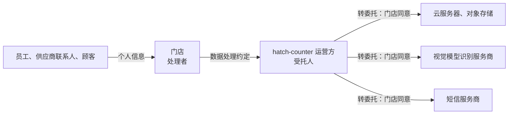

# 保密与数据处理协议

这一章讲两种「管信息」的协议。**保密协议**（NDA）管的是商业信息：报价、方案、源代码、经营数据，谈合作之前、外包开工之前经常要签。**数据处理协议**管的是个人信息：门店把员工档案、工资、供应商联系人放进你的 SaaS，你替门店处理这些信息，双方要约定处理的范围和规矩。

两者看起来相似，都是「别乱用、别外传」，但法律基础完全不同。保密协议主要是双方的商业约定；数据处理协议是《个人信息保护法》**要求必须有**的约定，写什么、少写什么都有后果。

个人信息保护法本身的概念（处理者、受托人、第三方、合法性基础），见《国内合规实务》第 6 章「个人信息保护法」，本章只讲合同怎么写。

## 保密协议

### 没签 NDA 也有保密义务，但不够用

即使没签任何保密协议，法律也给了一些保护：

- 《民法典》第五百零一条：当事人在订立合同过程中知悉的商业秘密或者其他应当保密的信息，**无论合同是否成立**，不得泄露或者不正当地使用；造成对方损失的，应当承担赔偿责任
- 《民法典》第五百零九条第二款：当事人应当遵循诚信原则，根据合同的性质、目的和交易习惯履行通知、协助、**保密**等义务
- 《反不正当竞争法》对商业秘密的保护。按该法的定义，商业秘密要满足「不为公众所知悉、具有商业价值、经权利人采取相应保密措施」等条件

问题在于：法定义务的范围模糊、举证难、赔偿要证明实际损失。保密协议的价值在于把「什么算保密信息」「能用来干什么」「违约了怎么算」写清楚。另外，签保密协议本身就是一种「保密措施」，对将来主张商业秘密保护有帮助。

### 什么时候需要

| 场景 | 谁保护谁 | 要不要签 |
|---|---|---|
| 给连锁客户演示，对方要给你看现有系统和经营数据 | 你保护客户 | 客户通常会要求，签就是了 |
| 接外包，客户给你需求文档、接口文档、测试数据 | 你保护客户 | 外包合同里有保密条款即可，不一定单签 |
| 找设计师画官网插画，你给他看还没发布的产品 | 对方保护你 | 产品没发布前值得签，可以简单 |
| 找人写原生模块，你给他代码仓库权限 | 对方保护你 | 签，并且只给必要的仓库权限 |
| 跟潜在合作方谈渠道、谈合作 | 双向 | 双向 NDA |

一人公司常犯的错是两头极端：要么什么都不签，要么拿一份几十条的大公司 NDA 给设计师，把人吓跑。按场景选简单或完整的版本就好。

### 一份 NDA 的核心条款

```text
第 1 条　保密信息
1.1 本协议所称保密信息，是指一方（以下简称「披露方」）在本协议有效期
    内向另一方（以下简称「接收方」）披露的、与「门店系统对接项目」有关
    的下列信息：业务数据、经营数据、技术方案、源代码、接口文档、产品
    规划、报价，以及披露时标明「保密」或者根据其性质应当被合理认为
    属于保密的其他信息。
1.2 下列信息不属于保密信息：
    （1）接收方从披露方获得之前已经合法知悉的；
    （2）非因接收方违约而已经公开的；
    （3）接收方从有权披露的第三方合法获得的；
    （4）接收方独立开发、未使用保密信息的。
    主张上述例外的一方应当提供证据。
```

几个要点：

- **范围要有边界**。「双方的一切信息」等于没有定义，发生纠纷时很难主张；写清楚「与某项目有关」
- **例外条款对你很重要**，尤其是第（4）项「独立开发」。你是开发者，可能同时在做类似的产品。hatch-counter 本身就是门店管理软件，跟连锁客户谈对接时，对方的系统思路很可能和你已有的设计相似。没有独立开发的例外，对方可能主张你的产品抄了他们的方案
- 举证责任写清楚，避免一方空口主张例外

```text
第 2 条　使用和披露限制
2.1 接收方仅为评估、履行双方之间的合作之目的使用保密信息，不得用于
    其他目的。
2.2 接收方仅可以向为上述目的确有必要知悉的员工、外包人员、专业顾问
    披露保密信息，并应确保其承担不低于本协议的保密义务。
2.3 接收方不得将保密信息输入公开的、会将输入内容用于模型训练的人工智能
    服务。使用其他人工智能工具处理保密信息的，应确保该工具的服务条款
    承诺不将输入内容用于训练且不向第三方提供。
```

2.3 是这两年新出现的条款。你用编码 agent 读客户的代码、把需求文档喂给大模型总结，这些都是在「向第三方提供」保密信息。客户越来越会关注这一点。主动写清楚你会怎么用 AI 工具，比被对方写一条「禁止使用任何 AI 工具」好得多，后者你几乎一定做不到。

```text
第 3 条　期限和返还
3.1 本协议自签署之日起生效，保密义务持续至本协议终止后三年。属于商业
    秘密的保密信息，保密义务持续至该信息依法不再构成商业秘密时止。
3.2 合作结束或者披露方书面要求时，接收方应在十日内返还或者销毁保密
    信息，并书面确认。法律要求保留的、或者存在于自动备份系统中且无法
    单独删除的副本，接收方可以保留，但应继续履行保密义务。
```

3.1 的「三年」是常见取值，不是法定的。无限期的保密义务对一人公司负担很大（你要永远记得哪些东西不能用），但对源代码、算法这类真正的商业秘密，可以约定持续到不再构成商业秘密为止。

3.2 的备份例外跟第 2 章服务合同里的备份条款是同一个道理：技术上做不到逐条删除备份，就如实写，承诺继续保密。

```text
第 4 条　违约责任
4.1 接收方违反本协议的，应赔偿披露方因此遭受的损失，包括披露方为制止
    违约行为支付的合理费用（含律师费、公证费）。
4.2 披露方有权要求接收方立即停止违约行为。
```

违约金要不要写？很多 NDA 写一个固定的违约金（比如 10 万元），因为保密信息泄露造成的损失很难证明。但按第 1 章讲的，违约金明显高于实际损失可能被调低；一人公司签对方给的 NDA 时，看到高额违约金条款要掂量一下自己能不能承受。作为提供方，写「赔偿实际损失加维权合理费用」通常就够了，**把律师费、公证费写进去**是关键：没有这一句，这些费用通常要你自己承担。

### 审 NDA 的清单

| 检查项 | 你作为接收方 | 你作为披露方 |
|---|---|---|
| 单向还是双向 | 只约束你的单向 NDA，问一句能否改双向 | 单向即可 |
| 保密信息范围 | 有边界；有「独立开发」例外 | 覆盖你真正要保护的东西 |
| 使用目的 | 限于评估和履行合作，没有其他隐含义务 | 限定清楚 |
| AI 工具 | 不是一刀切禁止 | 明确不得输入会训练的服务 |
| 期限 | 有限期 | 商业秘密可延长 |
| 违约金 | 金额你承受得起 | 律师费、公证费可以追偿 |
| 隐藏条款 | 没有竞业、不招揽、知识产权转让 | — |

最后一条值得单独提：有些 NDA 里会夹带「合作期间及结束后两年内，不得开发与对方业务类似的产品」这类**竞业条款**，或者「接收方基于保密信息作出的任何改进归披露方所有」这类**知识产权条款**。对一个做门店 SaaS 的人来说，签了这种条款等于把自己的产品方向锁死。看到就删，删不掉就不签。

## 数据处理协议：门店把数据交给你

### 为什么是「必须有」

《个人信息保护法》第二十一条规定：个人信息处理者委托处理个人信息的，**应当**与受托人约定委托处理的目的、期限、处理方式、个人信息的种类、保护措施以及双方的权利和义务等，并对受托人的个人信息处理活动进行监督。受托人应当按照约定处理，不得超出约定的处理目的、处理方式；委托合同不生效、无效、被撤销或者终止的，受托人应当将个人信息返还或者删除，不得保留；未经处理者同意，受托人不得转委托。

第五十九条还规定，受托人应当采取必要措施保障所处理的个人信息的安全，并协助个人信息处理者履行法定义务。

这两条放在一起，意思是：你作为 SaaS 提供方处理门店员工的个人信息，**门店有义务跟你签约定，你有义务按约定办**。这份约定通常作为服务协议的附件，叫「数据处理约定」或「个人信息委托处理协议」。

### hatch-counter 的角色拆分

先把数据按角色分清楚：

| 数据 | 谁的个人信息 | 谁决定处理目的和方式 | hatch-counter 的角色 |
|---|---|---|---|
| 店主、店员的登录手机号、登录记录 | 店主、店员 | hatch-counter | 处理者，适用用户协议和隐私政策（第 3 章） |
| 员工档案、排班考勤、工资 | 门店员工 | 门店 | 受托人，适用数据处理约定 |
| 进货单照片里的供应商联系人 | 供应商联系人 | 门店 | 受托人 |
| 开支凭证照片里可能出现的个人信息 | 收款人等 | 门店 | 受托人 |
| 以后如果做会员功能：顾客手机号、消费记录 | 顾客 | 门店 | 受托人 |



短信服务商那一条要说明一下：给店主、店员发验证码，处理的是账号信息，hatch-counter 是处理者，这时短信服务商是 hatch-counter 自己的受托人，不是门店的转委托。只有在你替门店给员工、顾客发短信时（比如以后做会员营销短信），才是门店委托链条上的转委托。数据处理约定里列服务商清单时，要按实际用途区分。

### 数据处理约定的条款

下面按《个人信息保护法》第二十一条要求的要素，逐条给出示范：

```text
附件二　数据处理约定

第 1 条　委托事项
1.1 甲方（门店）委托乙方在提供「掌柜眼」服务的过程中处理本附件第 2 条
    所列个人信息。甲方为个人信息处理者，乙方为受托人。
1.2 处理目的：仅为向甲方提供服务协议约定的员工管理、排班考勤、工资计算、
    进货记录、开支记录功能。
1.3 处理方式：存储、按甲方的操作进行计算和展示、按甲方的指令导出和删除；
    对进货单、凭证图片进行文字识别。
1.4 处理期限：服务协议有效期内，以及服务协议第 10 条约定的保留期。

第 2 条　个人信息的种类
2.1 员工信息：姓名、手机号、岗位、入职和离职日期、排班和考勤记录、
    工资及其构成。
2.2 供应商联系人信息：进货单、供应商资料中出现的姓名、电话。
2.3 其他：甲方在开支凭证、备注中自行录入的个人信息。
2.4 甲方不应在本服务中录入身份证号、银行卡号、健康信息等本服务功能
    不需要的个人信息；确需录入的，应事先告知乙方。
```

2.4 有两层作用：一是贯彻最小必要，二是划清责任。hatch-counter 没有要求录入身份证号的字段，但门店可能在备注里写；约定里明确「不应录入」，出了问题责任就更容易分清。

```text
第 3 条　甲方的义务
3.1 甲方保证其向乙方提供、在本服务中录入的个人信息，已经依法告知相关
    个人并取得同意，或者具有其他合法性基础（例如为实施人力资源管理所
    必需）。
3.2 甲方应当通过成员权限控制其员工对个人信息的访问范围，工资等信息
    应仅授权给确有需要的人员。
3.3 相关个人向甲方提出查阅、复制、更正、删除其个人信息等请求的，由
    甲方负责响应，乙方提供必要的技术协助。
```

3.1 是门店作为处理者的义务，不是你的。《个人信息保护法》第十三条列举的合法性基础里，包括「按照依法制定的劳动规章制度和依法签订的集体合同实施人力资源管理所必需」（见《国内合规实务》第 6 章），员工档案和工资大多可以落在这一项上。但这是门店的判断，你在合同里让门店作出保证即可。

3.2 呼应了 hatch-counter 的「十把钥匙」权限设计：看工资要单独的权限。合同里写清楚权限是门店在控制，出现「店长看了所有人的工资」这类内部纠纷时，就不是你的问题。

```text
第 4 条　乙方的义务
4.1 乙方仅按照本约定和甲方在本服务中的操作指令处理个人信息，不得用于
    其他目的，不得向第三方提供，但本约定第 5 条另有约定或者法律另有规定
    的除外。
4.2 乙方采取本附件第 7 条所列的安全措施，并对其员工、外包人员访问个人
    信息进行授权管理和记录。
4.3 乙方不得将个人信息用于训练人工智能模型，不得将其与其他门店的数据
    关联分析。
4.4 乙方协助甲方响应个人的权利请求，以及履行个人信息保护影响评估、
    安全事件通知等法定义务。
```

4.3 后半句「不得与其他门店的数据关联分析」值得想一想：一个门店 SaaS 积累了很多店的数据，「行业平均毛利」「同城进价」这类功能很诱人。如果你以后想做，要么只用不含个人信息的经营数据、并且做到匿名化，要么先修改约定并取得门店同意。合同现在写死，以后改是有成本的，所以措辞要准确：限制的是个人信息，不是全部经营数据。

```text
第 5 条　转委托
5.1 甲方同意乙方将本约定项下的部分处理活动转委托给附表所列的服务商。
    乙方应与服务商签订不低于本约定保护水平的协议，并对服务商的处理活动
    承担责任。
5.2 乙方新增或者更换服务商的，应提前十五日在本服务内或者以短信通知甲方。
    甲方有合理理由反对的，可以在通知期内提出；双方协商不成的，甲方可以
    解除服务协议，乙方退还未使用期间的服务费。
5.3 乙方不将个人信息提供至境外，所列服务商均在中华人民共和国境内处理
    个人信息。

附表　转委托服务商
| 服务商类别 | 用途 | 涉及的个人信息 | 处理地点 |
| 云服务器、数据库 | 存储和运行 | 全部 | 境内 |
| 对象存储 | 存储单据、凭证图片 | 图片中的个人信息 | 境内 |
| 视觉模型识别服务（主用） | 识别进货单、凭证 | 图片中的个人信息 | 境内 |
| 文字识别服务（备用） | 同上 | 同上 | 境内 |
```

转委托是《个人信息保护法》第二十一条明确要求「经处理者同意」的事项。5.1 用的是「事先概括同意 + 列清单」，5.2 用的是「变更通知 + 反对权」，这是业界常见的平衡：既满足了同意的要求，又不至于每换一家服务商都要逐个门店签字。

附表要跟真实情况一致。hatch-counter 的识别服务有一条降级链（大模型为主，腾讯云的文字识别为备），在附表里**把备用的也列上**，否则降级的那一刻就构成了未经同意的转委托。附表里的服务商具体名称，可以写在附表里，也可以写「以本服务内公示的清单为准」并真的在产品里公示。

```text
第 6 条　安全事件
6.1 乙方发现或者合理怀疑发生个人信息泄露、篡改、丢失的，应立即采取
    补救措施，并在知悉后二十四小时内通知甲方，说明事件涉及的信息种类、
    原因、可能的影响、已采取的措施和联系人。
6.2 乙方应配合甲方依法通知履行个人信息保护职责的部门和相关个人。
```

《个人信息保护法》第五十七条规定处理者发生泄露等事件时要立即补救并通知主管部门和个人。门店是处理者，但真正最先发现问题的往往是你。所以合同要约定你多快通知门店。「二十四小时」是合同约定的期限，不是法定期限，你可以根据自己能做到的写，但不能拖到让门店来不及履行它的法定义务。

```text
第 7 条　安全措施
7.1 多租户隔离：各门店数据通过数据库行级安全策略隔离，业务数据库账号
    不具有绕过隔离策略的权限。
7.2 访问控制：门店内部按成员权限控制访问；乙方工作人员仅能通过管理
    后台办理开户、续期等事务，管理后台的操作记入操作日志。
7.3 传输和存储：通过 HTTPS 传输；单据、凭证图片存储于私有存储空间，
    下载使用有时效的临时链接。
7.4 日志和备份：数据库变更日志保留九十日后汇总为按月计数；备份按
    周期滚动。
7.5 乙方每年至少对上述措施自查一次，甲方可以书面要求乙方提供自查结果。
```

第 7 条的每一项都是从 hatch-counter 的现有实现里挑出来的：业务表的隔离只靠 Postgres 行级安全、业务连接角色不是表的 owner；管理后台操作有日志；整店导出的下载要换一把 10 分钟的临时钥匙；变更流水 90 天后压成按月计数。**合同里写的安全措施，一定是你已经做到的**，不要写「采用国际领先的加密技术」这种空话，也不要写你还没实现的东西。

7.5 是对「监督」义务的落地。第二十一条要求处理者对受托人进行监督，但门店不可能真的来审计你的服务器。提供一份年度自查结果（可以是一页纸的清单），是一人公司能负担的监督方式。如果遇到要求现场审计的大客户，可以约定「提前三十日通知、每年不超过一次、费用由甲方承担」。

```text
第 8 条　委托终止
委托终止后，乙方依照服务协议第 10 条的约定返还（通过整店导出）或者删除
个人信息，不得保留，但法律、行政法规另有规定的除外。
```

这一条直接对应第二十一条「返还或删除、不得保留」，并且指向第 2 章服务协议里的终止后数据处理条款，两处保持一致。

## 数据处理约定和代码的对照表

写完约定，按下表检查代码是否做到：

| 约定条款 | 代码或运维上要有 |
|---|---|
| 仅按门店指令处理 | 没有后台人员可以直接改门店数据的入口；确需操作的走审计 |
| 访问控制 | 工资等页面有单独权限 |
| 不训练模型 | 识别服务商的条款确认不用于训练，或已关闭相关选项 |
| 转委托清单 | 后台可配置的每一个服务商都在清单里 |
| 境内处理 | 所有服务商的数据处理地点在境内 |
| 安全事件 24 小时通知 | 有告警；有一份写好的通知模板和门店联系方式 |
| 终止后删除 | 有到期清理任务；彻底删除连对象存储一起删 |
| 年度自查 | 日历上有提醒；有自查清单 |

## 常见的坑

- **把数据处理约定写进用户协议**。用户协议是你和店员之间的，数据处理约定是你和门店之间的，主体不同，放错地方等于没签
- **服务商清单只列主用的**。降级链、备用通道、新换的服务商都要在清单里
- **约定里写了做不到的安全措施**。写了「数据库全量加密」「每季度第三方渗透测试」，没做，就是违约
- **NDA 里夹带竞业条款**。签之前通读，尤其是「其他」「附则」部分
- **NDA 一刀切禁止 AI 工具**。你签了就做不到，不如主动提出一个可执行的版本
- **以为签了 NDA 就万事大吉**。真正的保护还要靠保密措施：权限最小化、仓库只给必要的人、离开项目就收回

## 本章要点

- 没签 NDA 也有法定保密义务，但范围模糊；NDA 的价值在于写清范围、目的、期限、例外和追偿
- NDA 要有「独立开发」例外，对做同类产品的开发者尤其重要；警惕夹带的竞业和知识产权条款
- 主动写清楚 AI 工具怎么用，比被一刀切禁止好
- 门店委托你处理员工、供应商、顾客的个人信息，《个人信息保护法》第二十一条要求必须约定目的、期限、方式、种类、保护措施和权利义务
- 数据处理约定作为服务协议的附件签，和用户协议分开
- 转委托用「概括同意 + 清单 + 变更通知 + 反对权」，清单要包括备用服务商
- 合同里的安全措施只写已经做到的，并逐条对照代码检查
