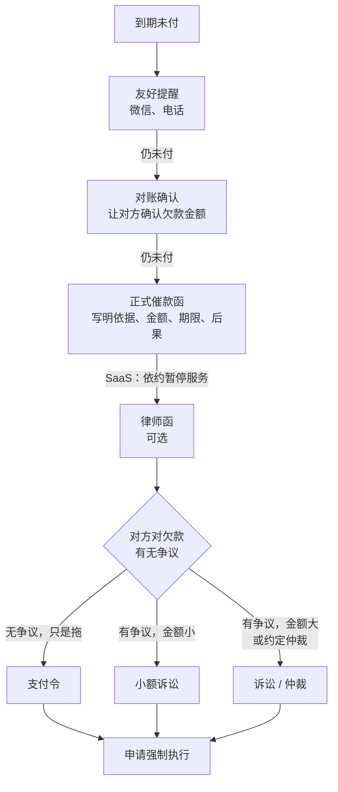

# 催款、违约与纠纷

前面几章都在讲怎么把合同写好。这一章讲合同写好了、对方还是不付钱或者不履约时怎么办，以及反过来，你自己出了问题时怎么处理。

一人公司在纠纷面前有两个天然劣势：没有专人跟进，时间就是你写代码的时间；金额通常不大，几千到几万，请律师打官司「不划算」。所以对方有时会赌你不会认真追。这一章的目标是让你知道每一步的成本和效果，在「算了」和「打官司」之间，还有很多便宜有效的中间选项。

## 先算时间：诉讼时效

在做任何事之前，先确认还在不在时效内。

- 《民法典》第一百八十八条：向人民法院请求保护民事权利的诉讼时效期间为**三年**，自权利人知道或者应当知道权利受到损害以及义务人之日起计算（法律另有规定的除外）
- 《民法典》第一百九十二条：诉讼时效期间届满的，义务人可以提出不履行义务的抗辩；但届满后义务人同意履行的，不得再以时效届满为由抗辩
- 《民法典》第一百九十五条：有下列情形之一的，诉讼时效**中断**，从中断时起重新计算：权利人向义务人提出履行请求；义务人同意履行义务；权利人提起诉讼或者申请仲裁；与提起诉讼或者申请仲裁具有同等效力的其他情形

第一百九十五条的实务含义：**每一次有证据的催款，都会让三年重新开始计算；每一次对方承认欠款，也一样**。所以催款不是「做了也没用」，它本身就是在保全你的权利。前提是有证据，这正是下面要讲的催款函、对账单要留痕的原因。

## 催款的升级路径



每一步都比上一步更正式、成本更高，也给了对方更多的「台阶」。多数欠款在前三步就解决了。

### 第一步：友好提醒

到期当天或者第二天，发一条简短的提醒。语气就是提醒，不是指责：

```text
王经理您好，第三阶段款 18,000 元按合同约定是 12 月 20 日付，今天到期了，
麻烦您安排一下。对公账户信息我再发您一遍：……如果需要发票，告诉我抬头
我今天就开。
```

最后一句是在消除对方拖延的借口。很多拖款不是恶意，是对方财务流程卡在某个环节（没有发票、没有内部审批单），你主动把这些环节补齐，钱就来了。

### 第二步：对账确认

提醒一两次无果，下一步不要急着发催款函，先**让对方确认欠款金额**。这一步的法律价值很大：对方确认就是「义务人同意履行义务」，诉讼时效中断；而且以后对方再说「东西不合格、不该付这么多」，他自己确认过的对账单就是最有力的证据。

```text
对账确认函

致：XX 餐饮管理有限公司
根据双方于 2026 年 9 月 1 日签订的《门店系统定制开发合同》，截至 2026 年
12 月 31 日，贵司应付款项如下：
| 款项 | 金额 | 约定付款日 | 已付 | 未付 |
| 第一阶段款 | 18,000 | 2026-09-05 | 18,000 | 0 |
| 第二阶段款 | 12,000 | 2026-10-20 | 12,000 | 0 |
| 第三阶段款 | 24,000 | 2026-12-20 | 6,000 | 18,000 |
合计未付：人民币 18,000 元。
请贵司核对后在下方签章确认，或回复邮件确认。如有异议，请于 7 日内书面
提出具体理由。

确认单位（签章）：＿＿＿＿　　日期：＿＿＿＿
```

对方签章或回邮件确认最好；回复「数对的，过两天付」也有效。对方提出异议，你也能提前知道他拖款的真实理由。

### 第三步：正式催款函

催款函是从「商量」到「主张权利」的转折点。它要做到四件事：说清依据和金额、给一个明确期限、写清不付的后果、证明你发出去了。

```text
催款函

致：XX 餐饮管理有限公司（统一社会信用代码：＿＿＿＿）
地址：合同首页载明的联系地址

一、依据：双方于 2026 年 9 月 1 日签订《门店系统定制开发合同》（以下简称
    「合同」）。我方已于 2026 年 12 月 10 日完成第三阶段交付，贵司于
    2026 年 12 月 18 日以微信方式确认验收通过（或：贵司在验收期内未提出
    书面意见，依合同第 X 条视为验收通过）。
二、欠款：依合同第 X 条，贵司应于 2026 年 12 月 20 日前支付第三阶段款
    24,000 元，现已支付 6,000 元，尚欠 18,000 元。
三、违约金：依合同第 X 条，逾期付款按每日万分之五计算违约金，自 2026 年
    12 月 21 日起算，至实际付清之日止。
四、请贵司于本函送达之日起 7 日内付清上述欠款及违约金。
五、逾期未付的，我方将依合同第 X 条暂停维护服务，并通过法律途径主张
    权利，由此产生的诉讼费、保全费等费用依合同约定由贵司承担。

发函人：＿＿＿＿　　日期：＿＿＿＿　　联系方式：＿＿＿＿
```

发送方式要能证明送达：

- **邮政 EMS 或快递**，寄到合同约定的送达地址，快递单上「内件品名」写「催款函」，保留快递单和签收记录。被拒收或者退回也有意义：如果合同约定了送达地址和「拒收视为送达」（第 1 章的通知条款），拒收不影响送达效力
- **同时发邮件和微信**，附上催款函 PDF
- 自己留一份**原件副本**，和快递单放在一起归档（第 7 章的档案目录）

写催款函的语气要克制，事实准确，金额精确到元。不要夸大，不要威胁（「不付款就让你身败名裂」这类话会让你从有理变成没理），也不要在函里说你不确定的事（比如「我方已向法院起诉」而实际还没有）。

### SaaS 的特殊工具：暂停服务

SaaS 欠费处理比外包简单得多：到期不续费，服务自然停止。hatch-counter 的做法是到期、停用后店主照样能登录、账都在，只是记账的几页用不了。这既是一个有效的催款杠杆，又没有越过「扣押客户数据」的红线。

这条红线很重要。用「不付钱就删数据」「不付钱就不让导出」来逼对方付款，在合同上很可能违反你自己写的数据归属和导出条款（第 2 章），在法律上还可能涉及受托人返还个人信息的义务（第 5 章）。**能暂停的是服务，不是客户对自己数据的权利**。合同里写清楚暂停的条件和范围，催款时依约执行即可。

### 律师函

律师函是律师以律师事务所名义发出的函件，内容和催款函差不多，区别在于它向对方传达了「我已经请了律师」的信号。费用因地区和律所而异，一般远低于代理诉讼的费用。对金额不大、对方有一定规模、在乎名声的客户，律师函的效果往往比你自己发的催款函好。第 9 章讲怎么找律师。

## 支付令：对方没争议、只是拖

### 条件和流程

支付令是《民事诉讼法》督促程序里的工具，专门对付「欠钱不还但也说不出理由」的情况：

- 《民事诉讼法》第二百二十五条：债权人请求债务人给付金钱、有价证券，符合下列条件的，可以向有管辖权的基层人民法院申请支付令：债权人与债务人**没有其他债务纠纷**；支付令**能够送达**债务人
- 第二百二十六条：法院应当在五日内通知债权人是否受理
- 第二百二十七条：法院受理后，对债权债务关系明确、合法的，应当在受理之日起十五日内向债务人发出支付令。债务人应当自收到支付令之日起**十五日内**清偿债务，或者向法院提出书面异议。债务人在此期间不提出异议又不履行的，债权人可以**申请执行**
- 第二百二十八条：法院收到债务人的书面异议，经审查异议成立的，裁定终结督促程序，支付令自行失效；支付令失效的，转入诉讼程序，但申请支付令的一方不同意提起诉讼的除外

### 优缺点

| 优点 | 缺点 |
|---|---|
| 不开庭，书面审查，快 | 对方提出书面异议，经审查成立的，支付令失效，转入诉讼 |
| 申请费低：比照财产案件受理费标准的三分之一（《诉讼费用交纳办法》第十四条） | 要求能够送达，对方失联不适用 |
| 对方不异议又不履行，可以直接申请强制执行 | 对方只要想拖，提个异议就能拖进诉讼程序 |

适用场景很明确：**对账单签过、催款函收到了、对方也没说不付**的欠款。有对账确认函在手，对方的异议很难成立。

## 小额诉讼：金额小、事实清楚

### 适用范围

《民事诉讼法》第一百六十五条：基层人民法院和它派出的法庭审理事实清楚、权利义务关系明确、争议不大的简单金钱给付民事案件，标的额为各省、自治区、直辖市**上年度就业人员年平均工资百分之五十以下**的，适用小额诉讼的程序审理，实行**一审终审**。标的额超过百分之五十但在**二倍以下**的，当事人双方也可以约定适用小额诉讼的程序。

具体金额每年随各省的平均工资数据变化，以当地法院公布的标准为准。一人公司的大部分欠款，几千到几万元，通常在这个范围内。

第一百六十六条列出了不适用的情形：人身关系、财产确权案件；涉外案件；需要评估、鉴定或者对诉前评估、鉴定结果有异议的案件；一方当事人下落不明的案件；当事人提出反诉的案件；其他不宜适用的案件。

注意「需要鉴定」那一项：如果对方主张你的软件有质量问题、要求做软件功能鉴定，案件就不适用小额诉讼了。这又回到了第 4 章：验收条款和「视为验收通过」写得好，对方就很难把案子拖进鉴定。

第一百六十八条：适用小额诉讼程序审理的案件，应当在立案之日起**两个月内**审结，有特殊情况经院长批准可以延长一个月。

### 费用怎么算

按《诉讼费用交纳办法》第十三条，财产案件受理费分段累计：不超过 1 万元的每件交纳 50 元，超过 1 万元至 10 万元的部分按 2.5% 交纳（更高的分段见原文）。第十六条规定，适用简易程序审理的案件减半交纳案件受理费。

以 18,000 元欠款为例：

| 程序 | 计算 | 金额 |
|---|---|---|
| 普通程序受理费 | 50 + (18,000 − 10,000) × 2.5% | 250 元 |
| 简易程序（含小额诉讼）减半 | 250 ÷ 2 | 125 元 |
| 支付令申请费 | 250 ÷ 3 | 约 83 元 |

这些费用在你胜诉后一般由对方负担。真正的成本是你的时间，以及如果请律师的律师费；律师费能否由对方承担，要看合同有没有约定（第 5 章 NDA 和第 1 章违约条款里都建议写上「维权合理费用」）。

## 诉讼还是仲裁

### 在签合同时就要选

争议解决方式要在合同里约定，等到纠纷发生再选，双方很难达成一致。两种方式的主要区别：

| | 诉讼 | 仲裁 |
|---|---|---|
| 依据 | 《民事诉讼法》 | 《仲裁法》（2025 年修订，2026 年 3 月 1 日起施行） |
| 管辖 | 合同纠纷由被告住所地或者合同履行地法院管辖（第二十四条）；可以书面约定原告住所地等与争议有实际联系的地点（第三十五条） | 双方协议选定的仲裁机构，不实行级别管辖和地域管辖 |
| 审级 | 一般两审终审；小额诉讼一审终审 | **一裁终局**（《仲裁法》第十条），裁决作出后不能再就同一纠纷起诉或仲裁 |
| 公开 | 一般公开审理 | **不公开进行**，当事人协议公开的除外（第五十二条） |
| 线上 | 很多法院支持网上立案、在线开庭 | 仲裁活动可以通过信息网络在线进行，当事人明确表示不同意的除外（第十一条） |
| 费用 | 按《诉讼费用交纳办法》，小额案件很低 | 各仲裁委自定收费标准，小额案件往往比诉讼贵，以仲裁委公布的标准为准 |
| 撤销 | — | 当事人可以在收到裁决书之日起三个月内申请撤销（第七十二条），理由有限 |

### 一人公司怎么选

对一人公司常见的小额合同，**诉讼通常更合适**：

- 费用低，小额诉讼程序快
- 可以约定在你所在地的法院管辖（原告住所地），免去异地奔波
- 一审终审的小额诉讼和一裁终局的仲裁在「快」上差不多，但诉讼的费用更低

仲裁的优势在于不公开、一裁终局、可以选择仲裁员，更适合金额较大、涉及商业秘密、双方都希望保密的纠纷。

### 管辖条款的写法

```text
第 X 条　争议解决【请重点阅读】
因本合同引起的或者与本合同有关的争议，双方应友好协商解决；协商不成的，
任何一方均可向乙方住所地有管辖权的人民法院提起诉讼。
```

如果选仲裁：

```text
第 X 条　争议解决
因本合同引起的或者与本合同有关的争议，提交 XX 仲裁委员会，按照申请仲裁
时该会现行有效的仲裁规则进行仲裁。仲裁裁决是终局的，对双方均有约束力。
```

仲裁条款最容易写坏。《仲裁法》第二十七条要求仲裁协议具有请求仲裁的意思表示、仲裁事项和**选定的仲裁机构**；第二十九条规定，仲裁协议对仲裁事项或者仲裁机构没有约定或者约定不明确的，当事人可以补充协议，达不成补充协议的，**仲裁协议无效**。常见的错误：

- **仲裁机构名称写错或者写得模糊**：「提交当地仲裁机构」「提交北京的仲裁委员会」，可能因为约定不明而无效。写全称，去仲裁委官网复制
- **「或裁或诉」**：「可以向仲裁委员会申请仲裁，也可以向人民法院起诉」。司法实践中，这类同时约定仲裁和诉讼的条款，仲裁约定一般被认定无效，最后还是走诉讼，绕了一圈
- **用户协议里约定仲裁**：面向大量个人用户的格式条款约定仲裁，对个人用户维权成本影响大，要格外注意提示义务

## 判了不给：强制执行

拿到胜诉判决、生效的支付令或者仲裁裁决，对方还是不付，就申请强制执行。

- 《民事诉讼法》第二百五十条：申请执行的期间为**二年**，从法律文书规定履行期间的最后一日起计算；申请执行时效的中止、中断，适用诉讼时效中止、中断的规定
- 申请执行费按《诉讼费用交纳办法》第十四条的标准计算，执行到位后一般由被执行人负担

执行能不能拿到钱，取决于对方有没有可供执行的财产。一个只剩空壳的小公司，判了也可能执行不到。这就是为什么**前期**的工作更重要：签约前了解对方的经营状况（企业信息公示系统、裁判文书和执行信息的公开渠道），合同里控制首付款和尾款比例（第 4 章），发现对方经营恶化时及时依法中止履行（第 4 章讲的不安抗辩）。

起诉时如果担心对方转移财产，可以向法院申请财产保全，这需要提供担保，一般值得请律师处理。

## 证据准备清单

不管走哪条路，下面这些证据都要准备好（对应第 7 章的档案结构）：

| 证明什么 | 证据 |
|---|---|
| 合同关系 | 签署的合同、电子签证据报告；没签合同的，聊天记录、报价单、付款记录 |
| 你履行了 | 交付邮件（含哈希）、代码仓库推送记录、上线记录、服务开通记录 |
| 对方验收了或者应视为验收 | 验收确认；验收通知和验收期届满的证据；对方实际使用的证据（如系统登录日志） |
| 欠款金额 | 对账确认函、已付款的银行流水、发票 |
| 你催过 | 催款函、快递单和签收记录、催款的聊天记录 |
| 对方身份 | 营业执照、企业信用信息；微信号与对方身份的关联 |

如果担心关键证据被对方删除或者灭失，《民事诉讼法》第八十四条规定可以在诉讼中申请证据保全，情况紧急的也可以在起诉前申请。

## 反过来：你违约了怎么办

一人公司也会违约：服务宕机超过 SLA、数据计算出错、外包延期。处理原则跟处理别人的违约是对称的：

1. **先止损**。恢复服务、修复数据，这对应《民法典》第五百九十一条：对方有防止损失扩大的义务，你自己更应该第一时间采取措施
2. **如实告知**。说清楚发生了什么、影响范围、已经做了什么。隐瞒被发现，小事会变成大事
3. **按合同补偿**。按 SLA 条款延长服务期、按约定退款。主动按合同办，往往比等对方提出来更能平息情绪
4. **不在情绪中乱承诺**。聊天里一句「您的损失我们全赔」，可能突破你在合同里精心设计的责任上限。承诺之前回去看一眼合同
5. **记录下来**。事故经过、处理过程、沟通记录、补偿结果，归档

```text
王经理，昨天 14:20 到 16:05 系统无法登录，原因是数据库所在的云服务器
故障，现已恢复，您店里的账没有丢失，我核对过了。按服务协议附件一第 5 条，
本月可用性低于 99%，已为您的门店延长 3 天服务期，到期日从 2027-03-01 变为
2027-03-04，您可以在左下角名字卡里看到。给您添麻烦了，我们这周会补上
故障时自动切换的预案。
```

这条消息做了上面五件事中的前四件：说了发生了什么、确认了数据、按合同主动补偿、说了改进措施，没有作超出合同的承诺。

## 本章要点

- 诉讼时效一般三年；每一次有证据的催款、对方每一次承认欠款，都会让时效重新计算
- 催款按提醒、对账确认、催款函、暂停服务、律师函逐步升级，多数欠款在前几步解决
- 对账确认函是最有价值的一步：锁定金额、中断时效、堵住事后的质量抗辩
- 催款函写清依据、金额、期限、后果，用快递寄到约定地址并同时发邮件和微信
- SaaS 可以依约暂停服务，但不能以客户数据要挟
- 对方无争议只是拖：支付令，申请费为受理费的三分之一，对方异议成立就转诉讼
- 金额小、事实清楚：小额诉讼一审终审、两个月审结，但需要鉴定或对方反诉的不适用
- 一人公司的小额合同通常选诉讼并约定原告住所地法院；选仲裁要写准仲裁机构全称，不写「或裁或诉」
- 判决生效后两年内申请执行；能否拿到钱取决于对方的财产，前期控制风险更重要
- 自己违约时先止损、如实告知、按合同补偿，不作超出合同的承诺
