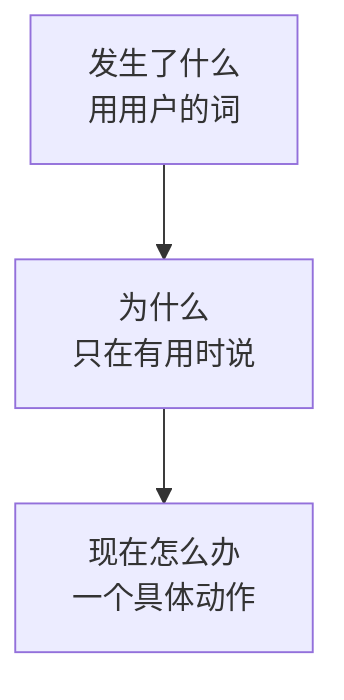
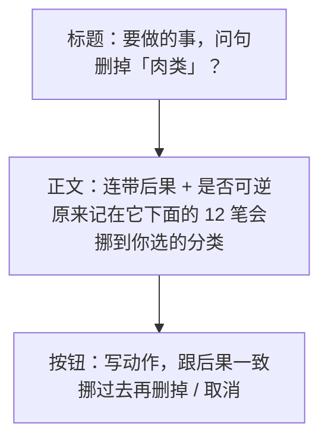
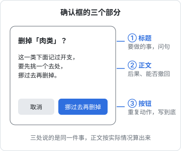

# 报错、空态与确认框

用户顺利的时候很少读文字，出事的时候才会一个字一个字地读。报错、空态、确认框这三种文案，恰好都出现在「事情没按预期走」或者「马上要发生不可逆的事」的时刻。这一章拿掌柜眼和本书架 App 的真实文案做前后对比，讲清这三种文案各自要回答什么问题，以及在代码里怎么组织它们，才不会写一次乱一次。

## 三种文案，三个问题

| 文案 | 出现的时刻 | 用户心里的问题 | 文案必须回答 |
|---|---|---|---|
| 报错 | 刚做的事没成 | 怎么了？是我的错吗？现在怎么办？ | 发生了什么 + 下一步 |
| 空态 | 页面上什么都没有 | 是坏了还是本来就空？这里该有什么？ | 为什么空 + 怎么让它不空 |
| 确认框 | 点了一个有后果的按钮 | 点下去会怎样？能撤回吗？ | 后果 + 是否可逆 |

三者的共同点就是掌柜眼规范里那四个字：**说清后果**。

## 报错

### 一句好报错的结构



不是每句报错都要三段齐全。「验证码不对」就够了，用户知道怎么办。但只要用户可能卡住，第三段就不能省。

### 前后对比

下表右列是掌柜眼服务端真实的报错文案，左列是同一场景下常见的写法：

| 场景 | 常见写法 | 掌柜眼的写法 |
|---|---|---|
| 登录用的手机号没开户 | 用户不存在 | 这个手机号还没有开通。请联系客服开户，或确认用的是开户时登记的号码 |
| 门店服务到期 | 403 Forbidden | 这家门店的服务已到期，请联系客服续期 |
| 验证码发得太频繁 | 请求过于频繁 | 验证码刚发过，{秒数} 秒后再试 |
| 试错次数太多 | 验证失败次数超限 | 试的次数太多了，重新获取一个验证码 |
| 刷新令牌被重复使用 | Invalid refresh token | 登录状态异常，为安全起见请重新登录 |
| 很久没打开 | 会话已过期 | 很久没用了，重新登录一下 |
| 扫码登录时码被别人扫了 | 二维码状态错误 | 这个码已经被另一台手机扫了，在电脑上换个新的再扫 |
| 想在设备列表里踢掉自己这台 | 操作不允许 | 这就是你正在用的这台。要退出请用「退出登录」 |
| 权限不够 | 无权限 | 这个功能只有店主能用 |

几个值得学的地方：

- **主语是用户熟悉的东西**：「这个手机号」「这家门店」「这个码」，不是「用户」「资源」「令牌」
- **给了一个具体动作**：联系客服续期、换个新的再扫、用「退出登录」。动作里引用的按钮名照界面原样写
- **把等待时间算出来**：「{秒数} 秒后再试」比「请稍后再试」好得多，用户知道要等多久
- **区分了相似的情况**：同样是要重新登录，「登录已过期」「很久没用了」「登录状态异常」各是一句，因为背后原因不同，用户该有的警惕程度也不同
- **语气是口语**：「重新登录一下」「过一会儿再试」，像店里的人在说话

### 门店到期为什么不做成登录失败

掌柜眼规范里有一条和文案直接相关的设计决定：门店停用、到期**照样能登录，拦在业务接口上**，报「这家门店已停用，请联系客服」。理由写得很直白：做成登录失败，店主会以为系统坏了。

这说明一件事：**报错文案写得再好，出现的位置不对也没用**。用户在登录页看到「登录失败」，第一反应是密码错了或者服务挂了；登进去以后在业务页上看到「服务已到期，请联系客服续期」，才会意识到是续费的事。写报错前先问：用户在哪一步撞上它，最容易理解？

### 未知错误怎么写

总会有你没预料到的异常。掌柜眼的做法是：没认领的异常一律回 500「服务端出了点问题，稍后再试」，**真实原因只进日志**。原因有两个：

1. 堆栈里常带着表名、SQL 片段甚至连接串，回给客户端就是泄露
2. 「duplicate key value violates unique constraint」对店主没有任何意义

但「稍后再试」这句话也有边界：只有在**重试真的可能成功**时才该这么写。如果一个错误是确定性的（输入格式不对、文件损坏），就不要让用户徒劳地重试，而要在入口处把它认出来，换成准确的话。掌柜眼把格式没拦住、带进 SQL 才炸的那类错误也认成 400，并且记一笔警告日志，「好回头在入口补一句更准的话」。这是一个持续改进文案的闭环：**日志里每多一种未知错误，就是一句该写的报错**。

### 在代码里组织报错

报错文案写在哪里，决定了它会不会乱。掌柜眼的做法是**服务端写人话，客户端原样展示**，回包里同时带人话和机器码：

```ts
// common/errors.ts（示意，不是掌柜眼原文件）
export class AppError extends Error {
  constructor(
    /** 原样给用户看的一句中文 */
    message: string,
    /** 给客户端程序认的机器码，客户端分处置时只认它 */
    readonly code = 'bad_request',
    readonly status = 400,
  ) {
    super(message);
  }
}

export class ForbiddenError extends AppError {
  constructor(message: string, code = 'forbidden') {
    super(message, code, 403);
  }
}

// 业务里
throw new ForbiddenError('这家门店的服务已到期，请联系客服续期', 'store_expired');
```

```ts
// NestJS 异常过滤器（示意）
import { ArgumentsHost, Catch, ExceptionFilter, Logger } from '@nestjs/common';
import type { Response } from 'express';
import { AppError } from './errors';

@Catch()
export class AppExceptionFilter implements ExceptionFilter {
  private readonly logger = new Logger('AppExceptionFilter');

  catch(err: unknown, host: ArgumentsHost) {
    const res = host.switchToHttp().getResponse<Response>();
    if (err instanceof AppError) {
      res.status(err.status).json({ error: err.message, code: err.code });
      return;
    }
    // 没认领的：真实原因只进日志
    this.logger.error(err);
    res.status(500).json({ error: '服务端出了点问题，稍后再试', code: 'internal' });
  }
}
```

为什么不让客户端各自写一份：同一件事两处文案，改了一处就对不上；Web、移动端、管理后台各写一份就是三处。客户端如果需要不同处置（比如 `store_expired` 时把名字卡变黄），认 `code` 就行，不要去匹配文案字符串。

这套做法要求后端开发者（也就是你自己）在写 `throw` 的那一刻就想清楚用户会看到什么。这比事后统一「优化文案」容易得多，因为写 `throw` 时你最清楚这个错误是怎么来的。

### 本书架 App 的导入报错

hatch-shelf 的导入检查逻辑写在共享包 `@shelf/spec` 里，App 和命令行工具共用。它的提示文案有一个好习惯：**把后果写进去**。

```text
未列入 chapters，不会被导入：extra.md
不支持的文件类型，导入时会被丢弃：notes.txt
压缩包里没有可导入的文件
```

「不会被导入」「会被丢弃」是后果，冒号后面是具体哪个文件。对比只写「无效文件：notes.txt」，用户得自己猜这个文件会怎样。

## 空态

### 空态有好几种

同样是「什么都没有」，原因不同，该说的话也不同：

| 类型 | 例子 | 该说什么 |
|---|---|---|
| 首次使用 | 书架上一本书都没有 | 这里会有什么、怎么放进来 |
| 筛选为空 | 搜索没有结果 | 哪个条件让它空了、改哪个 |
| 用户清空 | 读完了所有待读 | 确认这是好事，不用做什么 |
| 没有权限 | 这一页对你不开放 | 为什么、找谁 |
| 出错导致空 | 加载失败 | 这是错误，不是空，按报错写 |

最后一种最容易写错：加载失败时显示「暂无数据」，用户会以为真的没有数据。**错误和空必须分开**。

### 掌柜眼的空态规矩

掌柜眼对空态有一条反直觉的规定：**空态里不放行为按钮**。理由是那些按钮都是页头按钮的复制品，同一件事摆两处，人得先愣一下该点哪个。空态只留一段话，把按钮名和它在哪儿照原样写出来，比如「右上角「记一笔账」」。

筛选为空时也不放「清除筛选」按钮：筛选条就在正上方，每个条件原地就能撤。那段话只点名开着的、该动的那个条件，例如「换个关键词，或者把分类拨回「全部分类」再看看」；分类本来就是「全部分类」时就别叫人拨回去。

这条规矩也有例外，写得同样清楚：那件事在这一页上**只有空态这一处做得了**时（例如建工资单之前的「生成 X 月的工资单」），按钮就该放在空态里。

你不一定要照搬「不放按钮」，但这条规矩背后的思路值得学：**空态是页面的一部分，不是一个独立的插图位**。它要和页面上已有的按钮、筛选条配合，而不是另起炉灶。

### 前后对比

| 场景 | 常见写法 | 更好的写法 |
|---|---|---|
| 这个月还没有工资单 | 暂无数据 | 这个月还没有工资单。先在下面生成一张 |
| 工资单里没有人 | 列表为空 | 这张工资单一个人都没有。先到「员工档案」把人建上，或者删掉这张草稿 |
| 某个大类下没有小类 | 暂无 | 人工底下还没有小类（并说明确认工资单时会自动建一个「工资」） |
| 算不出毛利 | 无数据 | 一道菜都算不出毛利：配方还没填用量，或者用到的料还没有进价 |
| 权限页一页都没开 | 无权限访问 | 还没有哪一页对你开放（并指到「员工管理 → 成员权限」） |

右列都是掌柜眼的真实文案。注意「算不出毛利」那一条：它把**为什么空**说成了两个具体原因，用户顺着原因就知道该去补配方还是补进价。

## 确认框

### 确认框的三个要素





### 后果要说全

掌柜眼规范里说：删除确认里「连带删掉 X」这类后果要说全，**那是告知不是入口**。意思是确认框的职责是让用户知情，不是借机推销别的功能、也不是给用户出选择题。

本书架 App 删除一本书时的确认框：

```text
标题：删除《Go 并发编程实战》？
正文：书籍文件、阅读进度、高亮和笔记都会被删除。需要保留笔记请先在笔记页导出。
按钮：取消 / 删除
```

正文做了两件事：列全了会连带消失的东西（进度、高亮、笔记都是用户自己的数据，最心疼的就是它们），并给了一条在删之前能保住数据的路。

掌柜眼撤销一笔已付工资时的提示更进一步，直接告诉用户正确的顺序：

```text
这笔工资已经标了已付，撤销确认会连它一起删掉。真要改，先到「开支流水」把它改回未付款，再回来撤销
```

### 没有后果就说没有后果

删除一个没用过的分类时，掌柜眼的正文是「这一类还没有开支，删了不影响任何一笔账」。这句话看起来是废话，其实是在消除恐惧：用户看到「删除」两个字本能地紧张，明确告诉他「没事」，他才能放心点下去。

规矩是：**确认框的正文是根据实际情况算出来的，不是写死的**。用过和没用过，后果不同，弹窗就不同，按钮文字也不同（「挪过去再删掉」和「删掉」）。为此掌柜眼在用户点「删掉」时才去问服务端这一类用没用过，页面上平时不摆笔数。

### 什么时候不该弹确认框

确认框用多了，用户会养成不看就点「确定」的习惯，真正危险的那一次也挡不住。下面这些情况通常不需要确认框：

- **可以撤销的操作**：删完给一条「已删除」提示带「撤销」，比事先确认更顺手
- **再来一次结果一样的操作**：改名、排序
- **用户刚刚明确表达过意图的操作**：在一个专门的「删除账号」页面里填完确认文字，就不要再弹一次

## 说现在是什么样

掌柜眼规范里还有一句很容易被忽视的话：**说现在是什么样，别反驳一个读者没有过的念头**。它举的例子是「不用你自己填密钥」，只有见过旧版的人才看得懂，新用户读了反而困惑：什么密钥？

开发者特别容易犯这个错，因为你脑子里装着产品的所有历史版本。写文案时要假设读者是第一次见到这个界面：

| 带着历史的写法 | 说现在的写法 |
|---|---|
| 现在不用手动同步了 | 改动会自动保存 |
| 新版不再需要填密钥 | 识别服务已经接好，直接拍照就行 |
| 我们去掉了登录密码 | 用手机号收验证码登录 |

历史留给更新日志，界面只说现在。

## 一张检查清单

写完一条报错、空态或确认框，过一遍：

1. 用户第一次看到它时，能看懂每一个词吗？有没有表名、字段名、英文错误码？
2. 它说了下一步吗？下一步里引用的按钮名和界面上一字不差吗？
3. 如果要等，说了等多久吗？
4. 有用户看不见的连带后果吗？写全了吗？可逆吗？
5. 错误和空分开了吗？
6. 它在用户最容易理解的那一步出现吗？
7. 有没有反驳一个新用户没有过的念头？

## 本章要点

- 报错回答「发生了什么、现在怎么办」，空态回答「为什么空、怎么不空」，确认框回答「后果是什么、能不能撤回」
- 报错的主语用用户熟悉的东西，给一个具体动作，等待时间算出来
- **报错文案在服务端写**，回包带人话和机器码，客户端分处置认码不认文案；未知异常只回一句通用话，原因进日志
- 日志里每多一种未知错误，就是一句该补的报错
- 空态要分清首次使用、筛选为空、无权限和出错；**错误和空必须分开**
- 确认框的后果要说全，按情况算出来；没有后果也要说「没有影响」
- 能撤销的操作用「撤销」代替确认框
- 界面只说现在是什么样，历史留给更新日志
