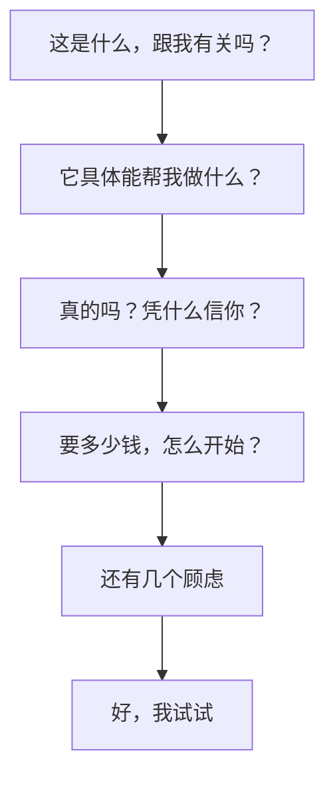
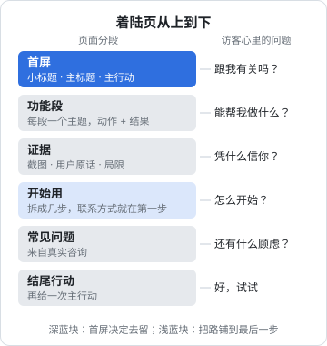

# 着陆页

着陆页是陌生人和你的产品第一次见面的地方。他可能从一条帖子、一次搜索、一个朋友的转发过来，给你的时间以秒计。这一章讲着陆页的文案怎么写：首屏那一句话怎么定，整页按什么顺序讲，功能怎么翻译成好处，以及上线前怎么用最便宜的办法测试它。页面怎么被搜到、流量从哪儿来，见《获客与增长》。

## 着陆页只做一件事

一个着陆页只有一个目标动作：下载、注册、加微信、留邮箱、付款，挑一个。整页的每一段都在为这个动作铺路。

目标动作没想清楚，文案一定写散。先写下这一行再动笔：

```text
看完这页的人，我希望他：________
如果他还没准备好，退而求其次：________
```

掌柜眼官网的答案很清楚：店主没有自助注册，开户全靠找客服，所以主行动是「联系开户」，手机上只有一颗「加客服微信开户」。它的代码注释里解释了为什么手机上只放这一个：店里用的是电脑上的网页版，店主拿着手机看完，能当场办的就是加微信。

这就是着陆页文案的起点：**不是「我有什么」，而是「他看完能做什么」**。

## 首屏：三句话定生死

首屏是不滚动就能看到的那一块。大多数访客只看这一块就决定走还是留。首屏的文案通常由三部分组成：

| 部分 | 作用 | 掌柜眼官网 |
|---|---|---|
| 小标题（kicker） | 说清这是个什么东西、给谁用 | 给中小餐饮门店的经营管理工具 |
| 主标题 | 用户最想要的结果 | 哪道菜在赚钱，一眼看清。 |
| 副标题 / 导语 | 补充范围或打消第一个疑虑 | 给一家到几家店的小馆子、快餐、小酒馆。 |
| 主行动 | 唯一的目标动作 | 打开网页版 / 联系开户 |

主标题没有写「经营管理」「数据分析」「智能」，写的是店主心里最常问的一个问题的答案。小标题负责分类，主标题负责打动，分工明确。

### 主标题的三种写法

| 写法 | 模板 | 示例 |
|---|---|---|
| 结果 | 让 [谁] [得到什么] | 哪道菜在赚钱，一眼看清 |
| 痛点 | 不用再 [痛苦的事] | 不用再月底对着一沓小票算账 |
| 对比 | [旧方式] 变成 [新方式] | 进货单拍一张，库存自己记上 |

结果型最稳。痛点型更抓人，但要确定用户真的痛。对比型适合「大家都知道旧方式很麻烦」的场景。

写主标题时最常见的错误：

- **写你在做什么，而不是用户得到什么**：「基于大模型的智能进货单识别」→ 用户只想知道库存是不是能少记一点
- **写品类而不是差异**：「好用的 Markdown 阅读器」→ 所有阅读器都这么说
- **想讨好所有人**：「适合所有人的效率工具」→ 等于谁都不适合

### 一个检验：把产品名换掉

把主标题里的产品名换成竞品的名字，这句话还成立吗？成立，说明你写的是品类，不是你自己。

## 整页的顺序

首屏之后，访客往下滚，心里的问题大致按这个顺序出现：



页面结构就照这个顺序排：



掌柜眼官网的结构是：首屏 → 01 盈亏 → 02 单据 → 03 卖得怎样 → 04 菜品好坏与料 → 05 账在云上 → 开始用 → 常见问题。五个功能段每段一个主题，标题都是店主的话；「开始用」讲怎么从「看完了」走到「登进去」；常见问题收尾。

## 功能段：从功能翻译成好处

开发者写功能段最自然的写法是列功能清单。问题是功能清单回答的是「它有什么」，用户关心的是「对我有什么用」。

一个翻译的办法是对每个功能连问三次「所以呢」：

| 功能 | 所以呢 | 所以呢 | 写进页面的 |
|---|---|---|---|
| 支持视觉模型识别进货单 | 拍照就能录入 | 不用手抄一行行品名和价格 | 拍进货单，管库存 |
| 开支按天摊销 | 房租不会在交的那天显示亏一大笔 | 看一周的账也是准的 | 记开支，算盈亏 |
| 数据存服务端，多端同步 | 换电脑账还在 | 电脑坏了、丢了也不怕 | 账在云上 |
| 离线 Markdown 渲染 | 没网也能读 | 地铁上、飞机上照样看 | 离线也能读的书架 |

掌柜眼首屏那三个小入口「记开支，算盈亏」「拍进货单，管库存」「导入收银报表，算销量」，每一条都是「用户做的动作 + 得到的结果」，五六个字。

### 用具体代替形容词

「快速」「强大」「简单」「智能」这些词在着陆页上几乎不传递信息，因为所有人都这么写。换成具体的东西：

| 形容词 | 具体 |
|---|---|
| 简单易用 | 说一声店名和手机号，我们在后台开好店和账号 |
| 强大的权限管理 | 先挑个身份——店长、员工、会计，再一页一页改成不可见、只能看或能修改 |
| 安全可靠 | 电脑坏了、丢了，账也还在 |
| 智能识别 | 拍上去的照片会发给识别服务商认字，原图收在你自己的「单据存档」里 |

右列都摘自掌柜眼官网。注意最后一条：它不只说了「能识别」，还主动说了照片会发给谁、原图存在哪儿。对用户在意的事情坦白，本身就是一种具体。

### 演示数据要对得上

着陆页上的截图和演示数字，用户会认真看。掌柜眼官网把演示数据集中在一个文件里，各段互相对得上（首屏浮着的保本线，往下翻到盈亏那段数字一致），利润、保本线、毛利都是现算的，不写死，页脚写明了全是样例。

这件事看起来是工程细节，对文案的意义是：**前后矛盾的数字会让人怀疑整页都是编的**。

## 证据：凭什么信你

一人公司最缺的就是信任背书：没有大客户 logo，没有媒体报道，没有融资新闻。可以用的证据有：

| 证据 | 一人公司怎么做 |
|---|---|
| 真实截图、录屏 | 用真实场景的样例数据，不要用「Lorem ipsum」和「测试 1」 |
| 用户原话 | 征得同意后引用，带上对方身份（「一家快餐店的店主」），不要编造 |
| 你自己 | 你是谁、为什么做这个、用了多久，第 6 章会讲 |
| 透明 | 说清数据存在哪、会发给谁、怎么退款、怎么导出 |
| 坦白局限 | 「代价是没网就用不了」 |

最后一条是掌柜眼常见问题里的原话：讲完账存在服务器上、换电脑也在、几个人能同时用，紧接着一句「代价是没网就用不了」。主动说出局限，反而让前面的好处更可信。用户迟早会发现这个局限，你先说比他自己发现好得多。

**不要编造用户评价、使用人数和媒体背书**。这不只是诚信问题，在国内广告法和平台规则下也有风险，具体以现行规定为准。没有证据就少放，不要凑。

## 「开始用」：把路铺到最后一步

很多着陆页在功能段写得很好，到了行动这一步只有一个按钮。用户点之前心里还有问题：点了之后要干什么？要多久？要准备什么？

掌柜眼的「开始用」段把从「看完了」到「登进去」拆成三步，标题是「开户由我们来办，打开就能登。」：

1. **找客服开户**：说一声店名和手机号，我们在后台开好店和账号、定好有效期。联系方式就摆在这一步底下，代码注释里说得明白：读到「找客服」的那一刻，号就在眼前
2. **在电脑上打开**：店里那台电脑的浏览器
3. **手机号登录**：收条验证码就能进来

第一步画成实心的圆，后两步浅一档，因为那是店主看完这页**唯一要先做的一件事**。文案和视觉一起在说「先做这个」。

## 常见问题：收集真实的顾虑

常见问题不是给你凑字数的地方。好的 FAQ 来自真实的咨询记录，按用户会问的顺序排。掌柜眼官网的 FAQ 有两条编写原则写在代码注释里：

- **每一句都对过使用手册，口径以手册为准；手册没写的功能这儿也别写**
- **先后是「用起来会问的」在前、「打开的时候撞上了才来翻的」在后**

后一条的例子是浏览器兼容那条：国产浏览器默认可能开着兼容模式，整页打不开，店主多半以为是掌柜眼坏了。这个问题很重要，但它是「撞上了才来翻」的，所以放最后。

写 FAQ 答案的规矩：

- **第一句直接回答**：「能。」「不用。」「不另收钱，算在服务里。」然后再解释
- **用户可能接着问的，一起答了**：「员工的工资也能算吗？」答完能算，接着说后厨阿姨不登录也照样建档案
- **路径写到按钮**：「在「销量日历」上点那一批，右栏这一批底下点「整批撤销」」

## 上线前测试：五秒测试

着陆页文案不需要等上线后靠数据验证，有一个几乎零成本的办法：**五秒测试**。

1. 找一个符合目标用户画像、没见过你产品的人
2. 给他看首屏五秒，然后关掉
3. 问三个问题：这是什么？给谁用的？你接下来能做什么？

三个问题答不上来，就改首屏。不需要很多人，三五个人就能暴露最明显的问题。找不到真人时，也可以让 agent 扮演目标用户做一次，但它太聪明、太配合，只能当作补充。

上线后的转化率怎么看、怎么做 A/B 测试，见《数据分析与埋点》。

## 一个着陆页文案模板

动手写之前，先把下面这张表填满。填不满的格子，就是你还没想清楚的地方。

```markdown
## 着陆页文案草稿

- 目标用户：（一句话，越具体越好）
- 目标动作：（只写一个）
- 用户来之前的状态：（他正在用什么旧办法，哪里难受）

### 首屏
- 小标题：（这是什么 + 给谁）
- 主标题：（用户得到的结果）
- 导语：（范围，或打消第一个疑虑）
- 主行动按钮：（动词 + 对象）

### 功能段（3–5 段，每段一个主题）
1. 标题：（动作 + 结果）｜一句解释｜配一张真实截图
2. ...

### 证据
- 截图 / 录屏：
- 用户原话（征得同意）：
- 透明与局限：

### 开始用（拆成 2–4 步）
1. ...

### 常见问题（来自真实咨询）
1. 问：... 答：（第一句直接回答）
```

把这张草稿交给 agent 生成页面代码，比让它从零写一个着陆页好得多：结构和每一句话是你定的，它只负责排版。第 7 章会讲怎么让它不把你的话改成「赋能」「一站式」。

## 本章要点

- 着陆页只有一个目标动作，先写下「看完这页他能做什么」再动笔
- 首屏是小标题（是什么、给谁）+ 主标题（用户得到的结果）+ 导语 + 一个主行动
- 把主标题里的产品名换成竞品，还成立就说明写的是品类
- 整页顺序跟着访客的问题走：有关吗 → 能做什么 → 凭什么信 → 怎么开始 → 还有顾虑
- 功能连问三次「所以呢」翻译成好处，用具体代替形容词，演示数据前后对得上
- 一人公司的证据是真实截图、用户原话、你自己和坦白局限；不要编造评价和数字
- 「开始用」把路铺到最后一步，FAQ 来自真实咨询、第一句直接回答
- 上线前用五秒测试检查首屏
