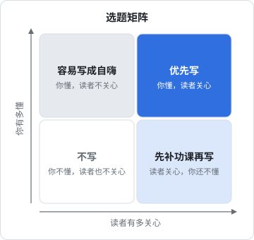
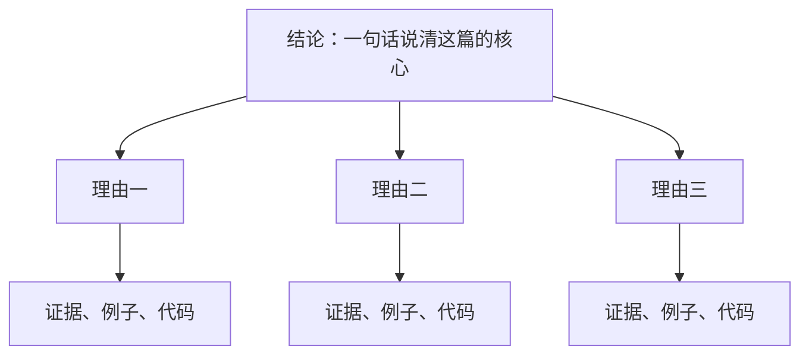

# 内容营销

内容营销的意思是：写对目标用户有用的东西，让他们因为这些东西认识你、信任你，最后用你的产品。它慢，但对一人公司几乎是最划算的获客方式，因为写一篇文章的成本只有你的时间，而一篇好文章可以被读很多年。这一章只讲「怎么写」：选什么题、用什么结构、标题和开头怎么写、怎么改稿。发在哪个平台、怎么一鱼多吃、怎么做 SEO，见《获客与增长》。

## 先想清楚：写给谁、为了什么

内容营销最常见的失败，是写成了「开发者写给开发者的技术分享」，而产品的用户根本不是开发者。

掌柜眼的用户是餐馆店主。一篇「我怎么用 Postgres 行级安全做多租户隔离」写得再好，店主也不会读。它能带来的是同行的关注、技术圈的名声、未来的合作机会，这些都有价值，但**不是掌柜眼的用户**。

所以动笔前先分清两类读者：

| 读者 | 他们想读什么 | 对你的价值 | 例子 |
|---|---|---|---|
| 产品的用户 | 解决他们自己问题的东西 | 直接带来用户 | 「小馆子怎么算一道菜到底赚不赚钱」 |
| 同行 / 开发者 | 技术、方法、复盘 | 名声、合作、招到早期支持者 | 「一个人做门店 SaaS 的半年复盘」 |

两类都可以写，但每一篇只写给一类人。混在一起写，两类人都读不下去。

## 选题

### 选题矩阵

好选题落在两件事的交集里：**你真的懂**，以及**读者真的关心**。



- **右上**：你懂、读者关心。优先写
- **左上**：你很懂、读者不关心。开发者最容易掉进这里，技术细节写得很爽，没人看
- **右下**：读者关心、你不太懂。可以写，但要先去做、去查、去问，不要靠搜来的资料拼
- **左下**：不写

### 找选题的地方

最好的选题来源不是「热点」，而是你手边已经有的东西：

| 来源 | 怎么用 |
|---|---|
| 客服和用户提问 | 同一个问题被问了三次，就值得写一篇 |
| 你踩过的坑 | 仓库里那些「为什么这么定」的说明，就是现成的选题 |
| 你做过的决策 | 选了 A 没选 B，理由是什么 |
| 产品数据里的发现 | 注意隐私，只写聚合后的结论，不写任何用户的具体数据 |
| 用户所在行业的常识 | 你为了做产品去学的行业知识，对新入行的人也有用 |

掌柜眼的 `docs/` 里有大量「为什么这么定」：为什么门店到期不做成登录失败、为什么开支要按天摊、为什么空态里不放按钮。每一条都是一个小选题。它们有一个共同的优点：**是真的**。你踩过、你想过、你做了决定，别人写不出来。

### 选题清单要写成一句话

选题不要只写几个字（「多租户」），要写成一句完整的话，说清读者读完能得到什么：

```text
不好：多租户
好：一家店的账不会被另一家看到——我为什么只靠数据库来隔离，不靠代码里的 where

不好：开支
好：房租 1 号交，为什么那天不该显示亏一大笔：小馆子算账的按天摊法
```

写不成一句话，通常说明你还没想清楚这篇要讲什么。

## 文章类型

不同类型的文章，结构不一样。先确定类型，再套结构：

| 类型 | 读者为什么读 | 结构要点 | 适合 |
|---|---|---|---|
| 教程 | 想学会做一件事 | 前置条件 → 步骤 → 结果 → 常见问题 | 用户、开发者 |
| 复盘 | 想知道别人怎么做的 | 背景 → 做了什么 → 结果（含数据）→ 学到什么 | 开发者、同行 |
| 观点 | 想看一个不同的看法 | 观点 → 理由 → 反方 → 边界 | 两类都可以 |
| 案例 | 想看真实的过程 | 问题 → 尝试 → 转折 → 结果 | 两类都可以 |
| 清单 | 想快速查 | 分组 → 每条一句话 + 一句为什么 | 用户 |

一人公司最有优势的是**复盘**和**案例**：大公司写不了这么真实，内容农场编不出这些细节。

## 结构：结论先行

技术人写文章，习惯按时间顺序写：「一开始我想……后来发现……于是……最后……」。这种结构读者要读到最后才知道你想说什么，大多数人等不到。

更好的结构是**结论先行**，也就是金字塔结构：



读者读完第一段就知道这篇讲什么、值不值得往下读。往下读的每一段都在支撑那个结论。即使只读了一半，也带走了最重要的东西。

本书每一章的开头都是这么写的：第一段说清本章要解决什么，然后展开，结尾用「本章要点」再收一次。

### 一篇复盘文的骨架

```markdown
# 标题：具体的结果 + 具体的方法

开头一段：结论。做了什么、结果怎样、最重要的一个发现。

## 背景
- 当时的情况、要解决的问题，三五句话

## 做了什么
- 按决策点组织，不按时间流水账
- 每个决策：选项有哪些、选了哪个、为什么

## 结果
- 能给数据就给数据，并说明数据怎么来的
- 好的和不好的都写

## 学到了什么
- 两三条，每条能被别人直接用上

## 如果重来
- 会怎么做不一样
```

最后一节「如果重来」很有用：它逼你提炼，也是读者最想看的部分。

## 标题

标题决定有没有人点开。好标题的共同点是**具体**和**对读者有用**。

| 套路 | 示例 | 注意 |
|---|---|---|
| 具体结果 | 一个人做门店 SaaS 的第一个半年：开了几家店、踩了哪些坑 | 数字要真实 |
| 问题 + 答案方向 | 房租那天为什么不该显示亏一大笔 | 问题要是读者真问过的 |
| 方法 | 我怎么让编码 agent 写出不像 AI 的报错文案 | 要真的有方法 |
| 对比 | 从手抄进货单到拍一张：一家小馆子的库存怎么记 | 两头都要具体 |

不要做的：

- **标题党**：「震惊」「99% 的人不知道」「看完我沉默了」。点开率可能高，但读者读完觉得被骗，下次就不来了，你积累的是反感
- **答非所问**：标题说「怎么做」，正文全是感想
- **夸大**：「彻底解决」「史上最全」。读者一眼就知道不可能

一个检验：**标题许下的承诺，正文兑现了吗**？

## 开头

标题让人点进来，开头决定他会不会读下去。几种有效的开头：

| 开头方式 | 示例 |
|---|---|
| 直接给结论 | 掌柜眼的门店到期了，店主照样能登录，只是在业务页上被拦下。这是一个故意的决定。 |
| 一个具体场景 | 月底晚上十点，店主对着一沓进货单和收银小票，想知道这个月到底赚没赚钱。 |
| 一个反常识 | 空态里放一颗「立即添加」按钮，往往是在给用户添乱。 |
| 一个问题 | 一家店的账，怎么保证不会被另一家看到？ |

不要用的开头：

- 「随着 XX 的快速发展……」「在当今时代……」：没有信息，而且是 AI 文的标志（第 7 章）
- 「最近很多人问我……」：如果真的有，直接写那个问题
- 「本文将介绍……」：直接介绍

## 改稿

初稿是写给自己的，改稿才是写给读者的。改稿分三遍，每遍只看一个层次：

| 遍数 | 看什么 | 问自己 |
|---|---|---|
| 第一遍：结构 | 段落顺序 | 结论在开头吗？每一段都在支撑结论吗？哪一段可以整段删掉？ |
| 第二遍：段落 | 每一段 | 第一句是这段的主旨吗？例子够具体吗？有没有一段讲了两件事？ |
| 第三遍：句子 | 每一句 | 能不能更短？有没有空话？术语解释了吗？ |

第一遍最重要，也最容易被跳过。很多人改稿只改字句，结构问题留着，越改越精致，还是读不下去。

### 句子层面的几条规矩

- **一句话只说一件事**，长句拆短
- **少用「的」字串联**：「基于用户反馈的产品功能的优化方案」→「根据用户反馈改了哪些功能」
- **主动句优于被动句**：「数据被系统自动同步」→「数据会自动同步」
- **具体优于抽象**：「性能有了显著提升」→「打开一本 300 页的书从 2 秒降到 0.5 秒」（数字必须是你真实测出来的）
- **删掉修饰性副词**：「非常」「极其」「真正地」大多可以删

## 最容易被忽视的内容：文档和更新日志

很多独立开发者觉得「做内容」就是写公众号文章，忽略了两种最有价值的内容：**使用文档**和**更新日志**。

- **使用文档**回答的是用户正在问的问题，读它的人几乎都是用户或潜在用户
- **更新日志**证明产品活着、在变好，持续更新本身就是信任

掌柜眼有单独的文档站，把 `docs/` 渲染成站，官网的常见问题「每一句都对过使用手册」。文档是口径的源头，官网、FAQ、客服回复都从它取。这样一来，写文档的时间不只是写文档，同时也在维护所有对外文案的一致性。

更新日志怎么写见第 1 章。一个实用的做法是：每个月从更新日志里挑出用户最能感知的两三条，扩写成一篇「这个月掌柜眼多了什么」，给老用户看，也给新用户一个「这产品在认真做」的证据。

## 本章要点

- 每一篇只写给一类读者：产品的用户，或者同行和开发者；技术分享不一定能带来用户
- 选题落在「你真的懂」和「读者真的关心」的交集里；最好的选题来自客服提问、踩过的坑和做过的决策
- 选题写成一句完整的话，写不出来说明还没想清楚
- 先定文章类型再套结构；一人公司最有优势的是复盘和案例
- **结论先行**：第一段说清核心，后面每段都在支撑它
- 标题要具体、对读者有用、正文能兑现；不做标题党
- 改稿分三遍：结构、段落、句子，第一遍最重要
- 文档和更新日志也是内容，而且是读者最精准的内容
