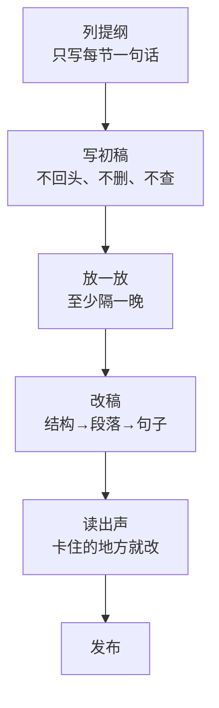

# 写作习惯

前几章讲的是怎么写好一段文字。但对一人公司来说，更难的是**持续地写**：产品要做、客服要回、bug 要修，写作永远排在最后。这一章讲怎么把写作变成和写代码一样的日常工作：素材从哪来、什么时候写、怎么从烂初稿走到能发的稿子，以及怎么用开发者熟悉的工具链管理文字。

## 写作不靠灵感，靠素材

坐下来对着空白页想「写点什么」，是最痛苦也最低效的写法。持续写作的人，几乎都有一个共同点：**素材比时间多**。坐下来的时候，要写的东西已经在那里了，只需要整理。

### 随手记下来

素材在日常工作里随处产生，问题是它们一闪而过。要做的只是记下来：

| 时刻 | 记什么 |
|---|---|
| 修完一个 bug | 这个 bug 为什么会出现、怎么发现的 |
| 做了一个决定 | 有哪些选项、为什么选这个 |
| 回完一个客服问题 | 用户原话是什么、他卡在哪儿 |
| 读到一段好文字 | 好在哪儿，可以学什么 |
| 和人聊天时有了想法 | 一句话记下来就行 |

记在哪里不重要，重要的是**只有一个地方**，并且随手可达。可以是一个 Markdown 仓库里的 `inbox.md`，也可以是手机备忘录。不要分散在五个 App 里。

### 仓库就是素材库

开发者有一个天然的素材库：代码仓库本身。

- **提交信息**：如果按第 1 章的规矩写（写改完之后是什么样），每一条都是素材
- **决策记录**：本书架 App 的 README 有一节专门记录决策；掌柜眼的每一页现行文档末尾都有「为什么这么定」
- **注释**：掌柜眼规范里要求注释写「为什么」，不写「做了什么」，那些「真删的话下次生成又会冒出来」之类的注释，就是一个个小故事
- **踩坑说明**：「跑测试之前先停掉服务端的 dev：两个 tsc 抢着写 dist，表现是一次红几十个、再跑一遍全绿」，这本身就是一篇短文的骨架

所以，**写好代码里的文字，就是在给未来的文章攒素材**。反过来，经常写文章的人，提交信息和注释也会写得更好。

## 固定时间，固定产出

「有空就写」等于不写。把写作排进日程，和写代码一样当成正经工作。

几个经过很多人验证的做法，挑适合自己的：

- **固定时段**：每天早上第一个小时，或者每周固定一个下午。精力最好的时段给最难的事
- **最小产出**：定一个低到不可能完不成的目标，比如每天 200 字。做到了就算成功，多写是奖励
- **按周交付**：每周发一篇。有截止时间，才会逼自己把半成品写完
- **写作和发布分开**：写作的时候只管写，不想平台、标题、配图。那些是后面的工序

节奏比数量重要。每周一篇坚持一年，比一个月写十篇然后停掉好得多。读者会适应你的节奏，你也会。

## 从烂初稿开始

写作最大的阻力来自「想一次写好」。一边写一边改，写三句删两句，一小时过去还在开头。

更好的流程是把写和改彻底分开：



### 列提纲

先把每一节要说的话写成一句。这一步其实已经完成了最难的思考：说什么、按什么顺序说。提纲写不出来，正文一定写不顺。

```markdown
# 门店到期为什么不做成登录失败

- 开头：到期了照样能登录，在业务页拦下，这是故意的
- 如果做成登录失败：店主以为系统坏了，或者以为密码错了
- 拦在业务页：看到「服务已到期，请联系客服续期」，知道是续费的事
- 推广：报错文案写得再好，出现的位置不对也没用
- 结尾：写报错之前，先想用户在哪一步撞上它
```

### 写初稿

照着提纲写，**不回头、不删、不查资料**。遇到想不起来的数据，写个 `TODO` 标记继续往下。遇到写不好的句子，先写个烂的放着。初稿的唯一目标是「从头写到尾」。

### 放一放

刚写完的稿子，你会觉得哪里都好，因为你脑子里装着所有没写出来的上下文。隔一晚再读，那些上下文淡了，你才能用读者的眼睛看它，发现哪里跳了、哪里没说清。

### 读出声

改完之后，把稿子读出来（小声也行）。读的时候卡住的地方、喘不过气的长句、读起来别扭的词，几乎都是要改的地方。这是检查句子最便宜的办法。

## 删减

改稿时最有效的动作是删。几乎所有初稿都可以删掉三分之一，而且删完更好读。

优先删这些：

| 删什么 | 例子 |
|---|---|
| 开头的铺垫 | 「在开始之前，我想先说一下背景……」 |
| 重复的意思 | 同一个观点换个说法又说一遍 |
| 不支撑结论的段落 | 很有趣但和这篇主题无关的小插曲 |
| 空话 | 「这是一个非常值得思考的问题」 |
| 自我保护的话 | 「当然，这只是我个人的一点浅见，可能不对」 |
| 过度的副词和形容词 | 「非常」「真正」「极其」「显著」 |

删不下手的时候，把删掉的段落挪到一个 `cut.md` 里存着。它们可能是下一篇的素材，这样删起来没有心理负担。

## 用开发者的工具链管理文字

你已经有一套管理代码的工具，用它们管理文字很自然，而且有实际的好处。

### Markdown + Git

- **Markdown**：纯文本、可以 diff、任何编辑器都能开，不会被某个写作 App 绑架
- **Git**：每次改稿都有记录，可以回看「上一版是怎么写的」；写到一半想试另一种结构，开个分支

本书架就是这么做的：书写在 `books/` 下的 Markdown 文件里，用 Git 管理，用命令行工具检查格式，推到手机上读。你的博客、文档、着陆页文案，都可以这样管理。

一个简单的写作仓库结构：

```text
writing/
├── inbox.md            # 随手记的素材
├── ideas.md            # 整理过的选题，每个一句话
├── drafts/
│   └── 2026-11-store-expired.md
├── published/
│   └── 2026-10-why-rls.md
├── cut.md              # 删掉但舍不得扔的段落
└── style.md            # 自己的写作规范和叫法表
```

### 自动检查排版

第 1 章讲的中文排版规矩（中英文间空格、全角标点），手动检查很容易漏，适合交给工具。

开源工具 AutoCorrect 专门做中文排版的检查和修复：中英文之间加空格、全角半角标点纠正等，支持 Markdown，也能接进编辑器和 CI。安装方式（Homebrew、npm 包、编辑器插件）以它官方仓库的说明为准，用法大致是：

```bash
# 检查，不改文件
autocorrect --lint drafts/

# 直接修复
autocorrect --fix drafts/
```

它的规则可以配置，代码块里的内容默认不会被改动。接进 pre-commit 或者 CI 之后，排版问题就不再需要人去盯。

除了排版，**用词规范**最好用自己写的规则检查，因为每个项目的叫法表都不一样。第 1 章给了一个检查界面文案叫法的测试，第 7 章会给一个检查「AI 腔」的脚本，原理相同：一张禁用词表加一次全文搜索。

### 用 agent 做校对，不做改写

编码 agent 很适合做校对类的工作：

```text
请校对这篇文章，只指出问题，不要直接改写：
1. 错别字和病句
2. 前后矛盾的数字和说法
3. 我在 style.md 里定的叫法有没有用错
4. 哪些段落和文章的结论无关

逐条列出，每条带原句和建议。
```

关键在「只指出问题，不要直接改写」。让它直接改，它会把你的语气改成它的语气，这个问题第 7 章细讲。

## 写一份自己的写作规范

把你自己的写作规矩写成一份 `style.md`，放在写作仓库里，也放进产品仓库的 `CLAUDE.md` 里给 agent 读。它不需要很长，但要具体：

```markdown
# 写作规范

## 读者
- 产品文案：餐馆店主，不懂技术，在店里用电脑
- 博客：独立开发者，懂 TypeScript

## 语气
- 口语，像当面说话；不用「您」，用「你」
- 说清后果，不吓唬人，不卖萌

## 格式
- 中英文之间加空格，中文用全角标点
- 引用界面上的名字用「」，书名用《》
- 不用感叹号表达普通结果

## 叫法
- 见叫法表（链接到第 1 章那张）

## 不写
- 「赋能」「抓手」「闭环」「一站式」
- 「在当今时代」「随着……的发展」开头
- 没有出处的数字
```

这份规范本身也会随着写作慢慢长出来：每次改稿时发现自己反复犯同一个错，就加一条。

## 读什么

写作能力很大一部分来自阅读。几条建议：

- **读你想写成的那种文字**：想写好产品文案，就去看你觉得好用的产品里每一句提示是怎么写的，截图存下来
- **读好的技术文档**：好的官方文档是结论先行、具体、没有废话的范本
- **读的时候带着问题**：这段为什么好读？这个开头为什么让我想读下去？
- **抄写**：遇到特别好的段落，手动敲一遍。敲的过程中你会注意到读的时候注意不到的东西

## 本章要点

- 持续写作靠素材，不靠灵感；随手记下来，只记在一个地方
- 代码仓库是天然的素材库：提交信息、决策记录、注释、踩坑说明
- 固定时间、最小产出、按周交付；节奏比数量重要
- 把写和改分开：提纲 → 不回头的初稿 → 放一晚 → 三遍改稿 → 读出声
- 改稿最有效的动作是删，舍不得删的挪到 `cut.md`
- 用 Markdown + Git 管理文字，排版交给工具检查，用词用自己的规则检查
- 让 agent 校对，只指出问题，不直接改写
- 写一份自己的 `style.md`，在改稿中让它长出来
