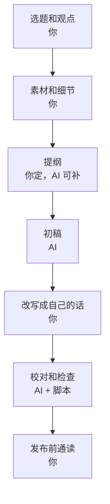

# 用 AI 写但不像 AI

你已经在用编码 agent 写代码了，顺手让它写文案、写文章再自然不过。问题是读者越来越容易认出 AI 写的东西，一旦认出来，信任会立刻打折：既然是机器生成的，作者自己大概也没怎么想过。这一章讲 AI 文为什么有「AI 腔」，有哪些可以一眼认出的标志，怎么分工让 AI 出力、你保留判断和声音，以及怎么用规则和脚本把 AI 腔挡在发布之前。

## AI 腔从哪来

大模型生成文字的方式，是根据上文预测下一个最可能的词（原理见[《大模型原理科普》](../llm-fundamentals/)）。这带来几个必然的倾向：

| 倾向 | 原因 | 表现 |
|---|---|---|
| 趋向平均 | 选的是「最常见」的说法 | 套话多，没有个人风格 |
| 过度周全 | 训练时被鼓励全面、无害 | 每个观点都配一个「当然也要注意」 |
| 结构工整 | 见过大量排比和总结式的文字 | 三点式、对仗、每段结尾小结 |
| 没有亲历 | 它没有做过你做的事 | 缺少只有亲历者才知道的细节 |
| 讨好 | 被训练成有帮助、积极 | 语气热情，形容词多，结论偏乐观 |

前四条里，最致命的是**没有亲历**。语气可以调，结构可以改，但它不知道你那天晚上为什么要把门店到期从登录页挪到业务页，不知道店主看到「登录失败」时的第一反应是什么。**这些细节只能你来提供**。

## 中文 AI 腔的标志

下面这些表达单独出现一次不说明什么，但密集出现时，读者会很快认出来：

| 类型 | 典型表达 |
|---|---|
| 空洞开头 | 在当今……的时代、随着……的快速发展、在……的浪潮下 |
| 宏大词汇 | 赋能、助力、抓手、闭环、一站式、全方位、深度融合 |
| 套路句式 | 不仅……更……、不是……而是……（反复用）、既……又…… |
| 过渡词 | 值得注意的是、需要指出的是、首先……其次……最后…… |
| 总结腔 | 总而言之、综上所述、总的来说、让我们一起…… |
| 过度对冲 | 当然，这并不意味着……、每个人的情况不同…… |
| 形容词堆叠 | 强大的、无缝的、卓越的、显著的、至关重要的 |
| 排比三连 | 更快、更强、更智能 |
| 格式滥用 | 每句都加粗、每条列表前都放 emoji、破折号连用 |
| 空泛结尾 | 希望本文对你有所帮助、未来可期 |

另一个不那么明显、但很典型的标志是**整篇没有一个具体的东西**：没有具体的人名（可以化名）、数字、时间、产品、场景、原话。读完觉得每一句都对，但什么都没记住。

### 前后对比

同一个主题，「门店到期时怎么提示」，让模型直接写和你改过之后：

```text
AI 初稿：
在 SaaS 产品的运营过程中，用户体验至关重要。当门店服务到期时，
如何优雅地提示用户，不仅关系到用户的续费意愿，更体现了产品的人文关怀。
首先，我们需要确保提示信息清晰明了；其次，要提供便捷的续费入口；
最后，还应注意语气的友好性。总而言之，良好的到期提示能够有效提升用户满意度。
```

```text
改过之后：
掌柜眼的门店到期了，店主照样能登录，只是在业务页上被拦下，看到一句
「这家门店的服务已到期，请联系客服续期」。这是故意的：要是做成登录失败，
店主撞上的第一反应会是密码错了，或者以为我们的服务挂了。
报错写得再好，出现的位置不对也没用。
```

第二段删掉了所有正确的废话，加上了只有你知道的东西：真实的文案、为什么这么做、不这么做会出什么事。

## 分工：什么交给 AI，什么留给自己

AI 写作最好的用法，不是「帮我写一篇关于 X 的文章」，而是把写作流程拆开，每一步决定谁来做：



| 环节 | 谁做 | 为什么 |
|---|---|---|
| 选题、观点 | 你 | 这是判断力，是读者来读你的原因 |
| 素材、细节、原话 | 你 | 只有亲历者才有 |
| 提纲 | 你定，AI 可以补漏 | 结构决定文章，AI 可以提醒你漏了什么 |
| 初稿 | AI | 把提纲和素材变成通顺的段落，省时间 |
| 改写 | 你 | 换成你的声音，删套话，补细节 |
| 校对 | AI + 脚本 | 找错别字、前后矛盾、叫法不一致、AI 腔 |
| 通读 | 你 | 最后对自己的名字负责 |

还有一些场景，AI 能做得比较好，可以放心多交一点：

- **改写成不同长度**：把一篇长文缩成一段简介、一条社交平台的短帖
- **列标题候选**：让它出十个，你挑一个再改
- **换个读者重写**：把写给开发者的技术说明，改写成给店主看的版本，再由你修
- **找反方意见**：「这个观点最有力的反驳是什么？」帮你补上观点的边界

## 让 AI 写得更像你

### 给它素材，而不是题目

AI 腔最大的来源是「无米之炊」：只给一个题目，它只能用平均的套话填满。给它足够的素材，它就有东西可写。

```text
不好的提示：
写一篇关于门店到期提示设计的文章。

好的提示：
根据下面的提纲和素材写初稿。只用我给的事实，不要补充我没提供的例子和数据。

提纲：
1. 开头：到期照样能登录，在业务页拦下，这是故意的
2. 做成登录失败的问题：店主以为密码错了，或者服务挂了
3. 拦在业务页的效果：看到原话，知道是续费的事
4. 推广：报错的位置和文案一样重要
5. 结尾：写报错前先想用户在哪一步撞上它

素材：
- 原文案：「这家门店的服务已到期，请联系客服续期」
- 停用时：「这家门店已停用，请联系客服」
- 两者都是 403，带机器码 store_expired / store_suspended
- 客户端收到后名字卡变黄

要求见附带的 style.md。
```

「只用我给的事实，不要补充」这句很重要。模型补充的例子和数据，往往就是编的。

### 给它你的风格规范和样本

把第 5 章的 `style.md` 附上，再附两三段你自己写的、满意的文字作为样本。比起形容「口语化、简洁」，样本更能让它抓住你的声音。

风格规范里，**禁止清单比要求清单更有效**。「写得生动」很难执行，「不用『赋能』『值得注意的是』『总而言之』」很容易执行，也很容易检查。

### 在项目里约束编码 agent

产品里的界面文案、报错，大多是编码 agent 在写代码时顺手写的。约束它的最好地方是项目的 `CLAUDE.md`。掌柜眼的做法是写成一条短规矩，细节放在文档里：

```markdown
## 写代码的调子

- 面向店主写文案：报错、空态、确认框都是中文人话，说清后果。
  报错文案在服务端写，那句中文原样穿过 `src/host/` 给店主看，客户端不重写一遍。
```

再在界面约定文档里给出具体的规矩和正反例（第 1、2 章引用的那些）。agent 改界面时会读到它们。你也可以加一条更直接的：

```markdown
- 界面文案不用：您、请您、进行、操作成功、暂无数据、系统繁忙。
  写之前先看 docs/叫法表.md。
```

## 用脚本挡住 AI 腔

和第 1 章检查叫法表一样，AI 腔的标志可以用一张词表加一次搜索来检查。下面这个脚本扫描 Markdown 文件，列出命中的位置：

```js
// scripts/ai-tone.mjs
// 用法：node scripts/ai-tone.mjs drafts/ published/
import { readFileSync, readdirSync, statSync } from 'node:fs';
import { join } from 'node:path';

const RULES = [
  { re: /在当今|随着.{1,12}的(快速)?发展|的浪潮下/, why: '空洞开头' },
  { re: /赋能|助力|抓手|闭环|一站式|全方位|深度融合/, why: '宏大词汇' },
  { re: /值得注意的是|需要指出的是|不可否认/, why: '过渡套话' },
  { re: /总而言之|综上所述|总的来说|让我们一起/, why: '总结腔' },
  { re: /至关重要|无缝|卓越|显著提升/, why: '空泛形容' },
  { re: /希望本文对你有所帮助|未来可期/, why: '空泛结尾' },
  { re: /不仅[^。]{1,30}更/, why: '「不仅……更」句式' },
];

function walk(p) {
  if (statSync(p).isDirectory()) return readdirSync(p).flatMap((n) => walk(join(p, n)));
  return p.endsWith('.md') ? [p] : [];
}

let hits = 0;
for (const file of process.argv.slice(2).flatMap(walk)) {
  let inCode = false;
  readFileSync(file, 'utf8').split('\n').forEach((line, i) => {
    if (line.trimStart().startsWith('```')) inCode = !inCode;
    if (inCode) return; // 代码块里的是原样文本，不查
    for (const { re, why } of RULES) {
      const m = line.match(re);
      if (m) {
        hits++;
        console.log(`${file}:${i + 1}  ${why}  「${m[0]}」`);
      }
    }
  });
}
// 有命中时退出码为 1，可以接进 pre-commit 或 CI
process.exit(hits ? 1 : 0);
```

运行：

```bash
node scripts/ai-tone.mjs drafts/
```

输出类似：

```text
drafts/2026-11-store-expired.md:3  宏大词汇  「赋能」
drafts/2026-11-store-expired.md:9  总结腔  「总而言之」
```

几点说明：

- 它会误报。「不仅」后面跟「更」也可能是一句正常的话，命中只是提醒你再看一眼，不是判决
- 词表要按你自己的习惯维护：你改稿时反复删掉的词，就加进去
- 跳过代码块，是因为代码块里放的常是原样引用的文本（比如本章上面那段 AI 初稿示例）
- 接进 pre-commit 时，可以只对 `drafts/` 和 `published/` 生效

脚本只能抓到词。句子层面的问题（整篇没有具体细节、每个观点都对冲一下、结构过于工整）还是要靠你通读，或者让 agent 按第 5 章的方式校对时专门检查这几项。

## 诚实的边界

用 AI 写作本身没有问题，就像用拼写检查、用模板没有问题。但有几条边界要守住：

- **不让 AI 编造事实**：数字、引文、用户评价、案例，必须是真的。AI 最擅长写出「看起来很真」的假细节，这一条最容易出事
- **不冒充亲历**：AI 写的「我当时……」如果不是你真实经历的，就删掉
- **观点是你的**：发出去的观点，你要能为它辩护。说不出为什么同意的，就不要发
- **平台和法规的要求**：一些平台对 AI 生成内容有标注要求，国内对生成式 AI 也有相关规定，具体以平台规则和主管部门的最新规定为准（合规框架见[《国内合规实务》](../opc-compliance-cn/)）
- **对读者负责**：如果一篇内容主要由 AI 生成，而读者会据此做重要决定（比如财务、法律相关），要么认真核实，要么不发

## 什么时候干脆不用 AI

有些文字，自己写反而更快、更好：

- **很短的文字**：一句报错、一个按钮，你写比解释给 AI 听更快
- **最需要你声音的文字**：关于页里的「为什么做」、一封给早期用户的信、一次道歉
- **你还没想清楚的主题**：写作本身是思考的过程，让 AI 代写等于跳过了思考
- **出了事的时候**：故障公告、退款说明、对批评的回应，读者需要感受到是一个真人在负责

## 本章要点

- AI 腔来自趋向平均、过度周全、结构工整、讨好，最致命的是**没有亲历**
- 中文 AI 腔有一批可以列出来的标志：空洞开头、宏大词汇、过渡套话、总结腔、形容词堆叠、整篇没有具体细节
- 分工：选题、观点、素材、改写、通读是你的；初稿、校对、改写长度、列候选可以交给 AI
- 给 AI 素材而不是题目，附上风格规范和你自己的样本；禁止清单比要求清单更好执行
- 在项目的 `CLAUDE.md` 和文档里约束编码 agent 写界面文案
- 用词表加脚本挡住 AI 腔，命中是提醒不是判决；句子层面的问题靠通读
- 不让 AI 编造事实，不冒充亲历；短文字、最需要你声音的文字、出事时的文字，自己写

## 接下来读什么

这本书讲的是「怎么写」。写好之后，怎么让对的人看到，是[《获客与增长》](../growth-marketing/)的内容：SEO、社交媒体、社区、ASO、冷启动和渠道评估。想知道着陆页、文章到底带来了多少转化，接着读[《数据分析与埋点》](../product-analytics/)。如果你想把界面文案和界面设计一起做好，可以读[《写给开发者的设计课》](../design-for-devs/)。
