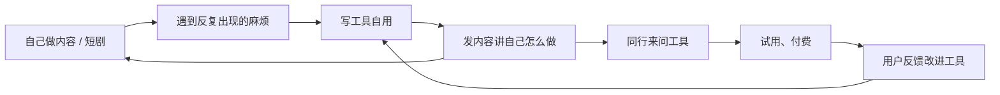

# 为什么做这个市场，以及它的坑

《自媒体与短剧一人公司全景》的「技术人的优势」一章讲到工具化的两层：先给自己做工具，再考虑卖给同行。这本书只讲第二层：**把工具做成一门生意，卖给自媒体创作者和 AI 短剧团队**。

这一章先回答两个问题：这个市场为什么适合一个人做；它有哪些坑，坑到什么程度会让你放弃。后面九章依次讲痛点地图、现有工具、产品机会、平台接口、技术方案、验证获客、定价、不要做的方向，最后给一个推荐的起步方向和 90 天计划。

## 这本书和其他书的分工

| 你想知道 | 去哪读 |
|---|---|
| 怎么选方向、怎么做最便宜的验证 | 《一人公司方法论》第 2 章「选方向」、第 3 章「快速验证」 |
| 怎么做访谈、怎么划 MVP 边界 | 《产品思维》第 2 章「用户访谈」、第 4 章「MVP 的边界」 |
| 怎么定价、怎么收钱 | 《定价与商业模式》全书 |
| 怎么获客 | 《获客与增长》全书 |
| 内容和短剧本身怎么做 | 本系列的内容基本功、AI 生产、AI 短剧几组书 |
| 本书 | 创作者工具这个**具体市场**里，上面这些方法怎么落地 |

本书不重复通用方法，遇到时直接引用章号；只写这个市场特有的东西：谁在痛、平台允许什么、哪里是红线。

## 为什么适合一人公司

### 人多、分散、工具需求碎

做内容的人非常多，从副业博主到几十人的 MCN，从一个人的 AI 漫剧号到几十人的短剧承制公司。他们的共同点是：**生产链长、环节多、每个环节的工具都不完美**。大厂能做通用工具（剪辑、生成模型），但顾不上每个细分角色的具体麻烦。

这类「碎需求」对大公司不划算，对一个人刚好：几百个付费用户就能养活一个人，而几百个用户在大公司眼里不值得立项。

### AI 短剧是新工种，工具还没长出来

AI 短剧和漫剧是近两年才成型的生产方式：剧本拆分镜、按分镜批量生成画面、挑图、做一致性、配音、剪辑。这条链上的大部分人现在用的是**表格 + 文件夹 + 聊天群**，生成记录散落在各家模型的网页历史里。

新工种的工具空白期，是小团队最好的窗口。等流程稳定下来，平台和大厂会补齐通用部分，但那时你已经有用户和数据了。

### 你自己就是用户，也自带渠道

本系列的读者既想自己做内容，也想做工具。这是一个少见的组合：

- **你是用户**：自己做 AI 短剧，就知道分镜和生成记录有多乱；自己接商单，就知道报价和回款有多容易漏
- **你有渠道**：记录「我怎么做 AI 漫剧」的账号，关注者里天然有大量同行。别的 SaaS 创业者要花钱买流量，你发一条「我给自己写了个分镜管理工具」就能收到试用申请

这个闭环是本书推荐路线的基础，第 10 章会展开成 90 天计划。

### 技术门槛对你来说不高

大部分创作者工具的核心不是算法，而是**把流程结构化**：表格变成数据模型，文件夹变成资产库，聊天群里的「这版改一下」变成带时间码的批注。这正是 TS / Node / NestJS / Expo / Electron 开发者每天在做的事。

## 坑：付费意愿

这是这个市场最大的坑，必须先讲清楚。

### 个人创作者：人多，但钱少且不稳

| 特征 | 对工具生意的影响 |
|---|---|
| 收入波动大，很多人还没赚到钱 | 订阅流失高，付费门槛要低 |
| 习惯免费工具（剪映、平台后台） | 「比免费的好一点」不足以让人掏钱 |
| 容易被「免费破解版」「群里分享的账号」吸走 | 价格敏感，且有盗版风险 |
| 决策快，一个人说了算 | 获客成本可以很低 |
| 换工具也快 | 留存难，必须持续给价值 |

经验判断（作者观点，不是统计数据）：**个人创作者愿意付钱的前提是工具直接关联收入**：帮他接到、管好、收回商单的钱；或者帮他每周省下几个小时、而这几个小时能多做一条内容。「好看」「好玩」的工具很难收钱。

### 团队客户：钱多，但要得也多

| 客户 | 付费意愿 | 要求 |
|---|---|---|
| 个人创作者 | 低到中 | 便宜、上手快、手机能用 |
| 工作室 / 小 MCN（3–20 人） | 中到高 | 多人协作、权限、能开发票 |
| AI 短剧团队 / 承制公司 | 高 | 项目管理、素材安全、可能要私有化或定制 |
| 品牌方、商家 | 高 | 他们买的是结果（内容、投放），不太买工具 |

团队客户愿意按年付、单价高，但会带来三件一人公司头疼的事：**对公转账和发票**（见《财务与税务》第 3 章「发票」）、**定制需求**（见《合同与法律文书》第 4 章「外包与定制开发合同」）、**数据安全承诺**（素材不能泄露、员工离职能收权限）。

本书的建议是：**第一个产品选个人和小团队都能用的，定价按团队设计**。具体在第 8 章。

## 坑：平台依赖

创作者的工作发生在平台上，你的工具不可避免地要和平台打交道。依赖越深，风险越大：

| 依赖程度 | 例子 | 风险 |
|---|---|---|
| 不依赖 | 分镜管理、商单管理、素材库 | 基本没有平台风险 |
| 依赖用户手动导入 | 复盘看板（用户导出后台数据上传） | 导出格式变了要适配 |
| 依赖官方开放接口 | 授权后读取账号数据、代发布 | 接口能力收紧、审核不过、调用限额 |
| 依赖非官方手段 | 模拟登录、爬取、群控 | 违反平台协议，随时被封，可能违法（第 9 章） |

还有一种更隐蔽的平台风险：**平台自己做了**。字节有剪映和即梦，快手有可灵，平台后台的数据分析也在不断变强。你做的功能如果正好在平台的路线图上，它某次更新就会免费提供。

判断方法：**这个功能对平台有没有直接的商业价值？** 帮创作者生成更多内容、投更多流，平台有动力自己做；帮短剧团队管理内部分镜、帮博主管商单回款，平台通常没兴趣。第 3 章会按类别分析。

## 坑：竞争

### AI 套壳的同质化

大模型能力普及后，「AI 写脚本」「AI 起标题」「AI 生成分镜」这类功能几乎没有门槛，几天就能做一个。市场上同类产品很多，用户分不清区别，最后拼价格。

**单纯包一层模型调用不是护城河**。护城河在于：

- 你掌握了用户的**结构化数据**（分镜、生成记录、商单历史），换工具的成本高
- 你嵌入了团队的**协作流程**，换工具要全员重新学
- 你在某个垂直场景里**比通用工具懂得多**

### 模型迭代吃掉功能

模型每几个月一大升级。你今天花一个月做的「角色一致性修复工具」，下一版模型可能原生就支持了。判断原则：**不要把产品押在「模型现在做不好的事」上，押在「模型做得再好也需要管理的事」上**。生成能力会越来越强，但生成结果的管理、挑选、版本、协作，需求只会越来越大。

## 坑：灰产的诱惑

这个市场里，**付费意愿最高的需求往往是灰产**：群控、批量发布、刷量、去重搬运、爬取对标数据。客户会主动找上门，出价也痛快。技术人很容易被「只是写个脚本」说服。

这些方向违反平台协议，部分涉及刑事风险，本书第 9 章专门列出清单，**不讲做法**。在这里先记住一条：凡是需要绕过平台规则才能实现的需求，不管对方出多少钱都不接。

## 三个用户画像

把抽象的客户分层落到具体的人身上，后面几章会反复用到这三个画像：

| 画像 | 情况 | 他的一天里最烦的事 | 他会为什么付钱 |
|---|---|---|---|
| 小林，副业知识博主 | 在职程序员，抖音和小红书各一个号，每月两三个商单，其中一半是私单 | 品牌在微信里问「上次报价多少」，翻不到；交付后三个月才想起来没收款 | 别再漏钱；每周少花一小时整理 |
| 阿周，AI 漫剧工作室主理人 | 4 个人，一个编剧兼导演、两个生成师、一个后期；同时做两部漫剧 | 导演在群里说「第 7 镜用第二张」，生成师找不到是哪张；新人不知道主角的提示词关键词 | 团队交接不出错；新人上手快 |
| 陈总，短剧承制公司负责人 | 20 多人，接平台和品牌的定制剧，多项目并行 | 每部剧到底花了多少生成费用、多少人工，结项时才算得出来 | 成本可控；素材不外泄 |

本书建议的起步用户是小林和阿周：他们就是你自己的样子，或者是你的同行。陈总付费能力最强，但需求会把一个人拖进定制和私有部署，等产品稳定后再考虑。

## 适不适合你：自查清单

| 问题 | 是 | 否 |
|---|---|---|
| 你自己在做内容或 AI 短剧，或者准备在 3 个月内开始 | 有用户视角和渠道 | 先做一段时间内容再回来 |
| 你能接受前 6 个月收入很少 | 可以开始 | 先作为副业，别辞职 |
| 你愿意和创作者、短剧团队直接聊天 | 能做验证 | 这个市场不适合闭门开发 |
| 你能对灰产需求说「不」 | 继续 | 这个市场诱惑太多，请慎重 |
| 你有一个具体的、自己经历过的麻烦 | 从它开始 | 先去做内容，等麻烦出现 |

最后一条最重要。没有亲身经历的痛点，第 2 章的痛点地图只能帮你缩小范围，不能替你确认需求。

## 本章要点

- 创作者工具适合一人公司：需求碎、大厂顾不上；AI 短剧是新工种，工具空白期是窗口；你自己是用户，账号是渠道
- 最大的坑是付费意愿：个人创作者钱少且不稳，只为「直接关联收入」或「明显省时间」的工具付钱；团队客户钱多但要发票、定制和数据安全
- 平台依赖分四级：不依赖、手动导入、官方接口、非官方手段；越往后风险越大，最后一级不做
- 不要押在「模型现在做不好的事」上，要押在「模型做得再好也需要管理的事」上
- 灰产需求付费意愿最高，也最危险，一律不接
