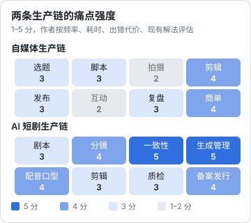
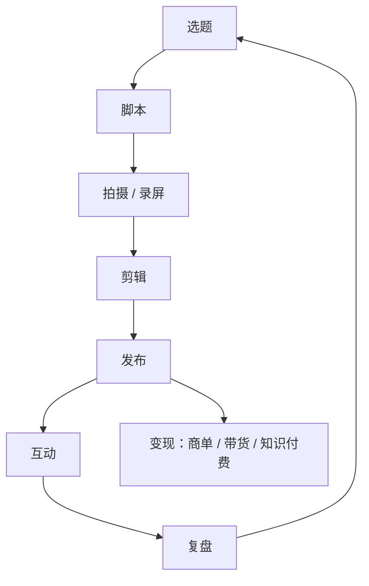
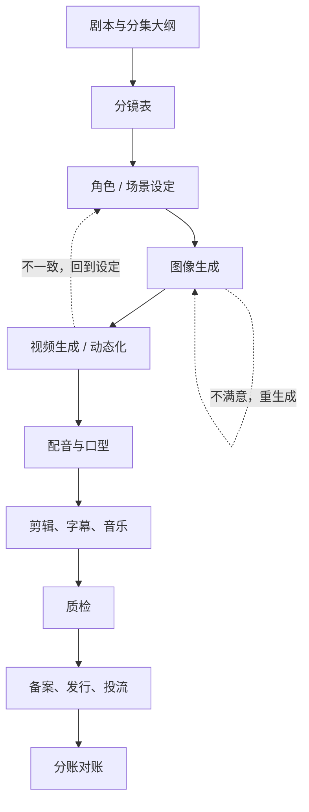

# 痛点地图

[《一人公司方法论》第 2 章](../opc-playbook/02-choosing-direction.md)说，好方向的第一个条件是痛点够强。这一章把自媒体和 AI 短剧两条生产链逐环节摊开：每个环节谁在痛、痛到什么程度、现在怎么凑合、工具有没有机会。

先说明一点：本章的强度分是**作者的判断**，依据是自己做内容和与同行交流的经验，不是调研数据。它的用处是帮你缩小范围；真正确认痛点，要靠第 7 章的访谈。

## 怎么评估一个痛点

一个环节痛不痛，拆成四个问题打分，每项 1–5：

| 维度 | 问什么 | 高分的样子 |
|---|---|---|
| 频率 | 多久遇到一次 | 每天、每条内容、每个镜头都要做 |
| 耗时 | 每次花多少时间 | 一次半小时以上，或累计每周几小时 |
| 出错代价 | 做错了会怎样 | 丢钱（商单漏回款）、返工（整集重生成）、违规（下架） |
| 现有解法差 | 现在用什么凑合 | 表格 + 聊天记录 + 记忆，没有专门工具 |

四项取平均，四舍五入就是强度分。注意「现有解法差」：如果已经有一个免费、好用的工具（比如剪映之于基础剪辑），哪怕前三项都高，留给你的空间也小。

还有一个维度单独看：**谁在痛**。同一个环节，对一个人的副业博主和对二十人的短剧团队，痛法完全不同。团队的痛通常来自协作：信息在人之间传递时丢失、版本混乱、责任不清。



## 自媒体生产链



| 环节 | 谁在痛 | 具体痛点 | 强度 | 现有解法 | 工具机会 |
|---|---|---|---|---|---|
| 选题 | 所有创作者 | 灵感散在收藏夹、备忘录、聊天记录里；不知道哪些选题做过、效果如何 | 3 | 备忘录、飞书表格、收藏夹 | 选题库：收集 + 标签 + 和复盘数据关联 |
| 脚本 | 口播、知识类博主 | 改稿多轮，多平台要不同版本 | 3 | 文档 + 大模型对话 | 模板化脚本、多平台改写；同质化严重 |
| 拍摄 | 出镜博主 | 拍摄清单、提词、补拍 | 2 | 提词器 App、手写清单 | 空间小，提词器已很成熟 |
| 剪辑 | 所有视频创作者 | 粗剪耗时、字幕校对、多尺寸导出 | 4 | 剪映、Premiere、达芬奇 | 大厂主场，只剩边角（批量导出、字幕校对） |
| 发布 | 多平台创作者 | 同一内容在多个平台发布，标题标签简介各不同；发布时间难管 | 3 | 手工逐个平台发 | 发布准备（文案、清单）；**代发布受平台接口限制**，见第 5 章 |
| 互动 | 粉丝多的创作者 | 评论区问题多，回不过来；高频问题没沉淀 | 2 | 手工回复 | 只能做「整理」，**自动回复评论属于第 9 章的红线** |
| 复盘 | 想认真做的创作者 | 每个平台后台口径不同，数据散；没人记录耗时 | 3 | 手抄 Excel | 手动导入 + 跨平台汇总看板 |
| 商单 | 有商单的创作者、小 MCN | 报价凭感觉；brief、脚本、修改意见散在微信；交付后忘了催款 | 4 | 微信、Excel、记性 | 商单管理：报价、阶段、交付、回款提醒 |

### 几个值得多看一眼的环节

**商单**。痛点直接和钱挂钩：漏一次回款就是几千上万。而且平台的商单系统（星图、蒲公英、互选等，见[《广告商单与品牌合作》](../brand-deals/)）只管平台内的单子，很多创作者还有大量**私单**（品牌直接找、通过中间人找），这部分完全靠微信和记忆。这是一个付费意愿明确的缝隙。

**复盘**。创作者都知道应该复盘，但真正坚持的很少，原因是数据收集太麻烦。工具的价值不是「分析」，而是**让记录这件事变轻**。但它的付费意愿偏低：觉得重要的人自己会建表，觉得不重要的人不会为它付钱。

**剪辑**。痛点强，但这是平台自己的主战场。剪映免费且功能强，正面竞争没有意义。只有非常垂直的辅助环节（比如字幕批量校对专业术语）还有空间。

## AI 短剧生产链

AI 短剧和漫剧的链条比自媒体长得多，而且每个环节都会产生大量**中间产物**：分镜表、提示词、候选图、候选视频、配音文件。管理这些中间产物，是这条链最大的痛点。



| 环节 | 谁在痛 | 具体痛点 | 强度 | 现有解法 | 工具机会 |
|---|---|---|---|---|---|
| 剧本与大纲 | 编剧、制片 | 多集多版本；付费卡点、钩子位置要反复调整；多人改稿 | 3 | 飞书文档、Word | 短剧格式编辑器、卡点标记、版本对比 |
| 分镜 | 导演、分镜师 | 一集几十上百个镜头；每个镜头的景别、动作、台词、状态（待生成 / 已选 / 返工）要跟踪 | 4 | Excel、飞书多维表格 | 分镜管理：镜头即任务，状态可追踪 |
| 角色 / 场景一致性 | 美术、生成师 | 同一角色在不同镜头里长得不一样；参考图、LoRA、提示词关键词散落各处 | 5 | 文件夹 + 文档 | 设定库：角色卡、参考图、生成参数集中管理 |
| 生成管理 | 生成师 | 每个镜头生成几次到几十次，提示词、种子、模型、参数、结果散在各家网页历史；选中哪一版靠截图 | 5 | 各平台历史记录、手动下载、文件夹命名 | 生成记录与素材资产管理 |
| 配音与口型 | 后期 | 角色音色对应关系、台词修改后重配；口型对不上 | 4 | 各家配音工具 + 文件夹 | 台词-音频对应管理；口型本身是模型能力，不建议自己做 |
| 剪辑 | 剪辑师 | 素材多、版本多 | 3 | 剪映、Premiere | 与剪辑软件的素材交接（按镜号自动归档） |
| 质检 | 制片、导演 | 错别字、穿帮、规格不对、AI 标识遗漏 | 3 | 人工看片 + 清单 | 规格检查、字幕检查、标识检查 |
| 备案与发行 | 制片、发行 | 材料多、流程长、各平台要求不同 | 4 | Excel + 人工 | 材料清单与进度管理；**规则以主管部门和平台为准**，见[《短剧发行、投流与备案》](../drama-distribution/) |
| 分账对账 | 制片、财务 | 多平台、多渠道收入，对账周期长 | 3 | Excel | 收入汇总；数据来源多为人工导入 |

### 生成管理为什么是最痛的环节

做过一集 AI 短剧的人都有体会：剧本和分镜是「想」，生成是「磨」。一个镜头要试很多次，每次改一点提示词、换一个种子、换一个模型。问题在于：

1. **记录散**：每家模型的网页都有自己的历史记录，换模型就换地方
2. **选中的那一版找不到出处**：三天后要补拍同一角色同一角度，已经忘了当时用的什么参数
3. **文件名乱**：下载下来是一串随机字符，要手动改名归档到「第 3 集 / 镜 12」
4. **团队里传来传去**：生成师在群里发图，导演回复「第二张」，第二张是哪张？

这四个问题都和**模型能力无关**。模型再强，也需要有人管理它产出的东西。这就是第 1 章说的「押在模型做得再好也需要管理的事上」。

### 团队规模不同，痛点不同

| 规模 | 主要痛点 | 适合的工具形态 |
|---|---|---|
| 1 人（个人 AI 漫剧号） | 生成记录乱、素材找不到 | 本地桌面工具，零配置 |
| 3–10 人工作室 | 分工交接、版本混乱、谁在做哪个镜头 | 轻量协作，云同步 |
| 10 人以上承制公司 | 多项目并行、成本核算、权限与素材安全 | 项目管理 + 权限 + 可能要私有部署 |

一个人做工具，**从 1 人和 3–10 人这两档切入最合适**：1 人档是你自己，验证快；3–10 人档付费意愿高，需求还不至于复杂到要私有部署。

## 把地图变成候选清单

看完两张表，挑出同时满足三条的环节：

1. 强度 4 分以上
2. 现有解法主要是「表格 + 文件夹 + 聊天」，没有专门工具
3. 不依赖平台接口，或只依赖官方允许的方式

满足的有：**商单、分镜、角色一致性、生成管理**。备案发行强度也高，但规则变化快、客户少，适合作为第二阶段。剪辑强度高，但不满足第 2 条。

这份清单会在第 4 章扩成 12 个具体方向，逐个打分。

## 你自己的痛点地图

本章的地图是通用版。你自己做内容时，花一周记一份「麻烦日志」，比任何地图都有用：

```text
麻烦日志（每遇到一次就记一行）

日期        环节      发生了什么                          花了多久   怎么解决的
2026-11-04  生成管理  找不到第 2 集女主侧脸那张图的提示词   25 分钟    翻了三个网页的历史记录
2026-11-04  商单      品牌问上次报价，找不到聊天记录        10 分钟    重新报了一次，可能报低了
2026-11-05  分镜      镜 17 生成了两版，不记得导演选了哪版   15 分钟    群里问，等了半天
```

一周后按「环节」汇总次数和总耗时。出现次数最多、耗时最长的那一行，就是你最该先给自己做工具的地方。

## 本章要点

- 痛点强度拆成频率、耗时、出错代价、现有解法差四项打分；本章分数是作者判断，要用访谈确认
- 自媒体链最值得做的是商单（直接关联钱，私单完全没有工具）；剪辑虽痛但是平台主场
- AI 短剧链最痛的是生成管理和角色一致性：中间产物多、记录散、团队交接乱，这些和模型能力无关
- 一个人做工具，从 1 人和 3–10 人团队切入；10 人以上的需求会把你拖进定制和私有部署
- 记一周自己的麻烦日志，比任何通用地图都可靠
