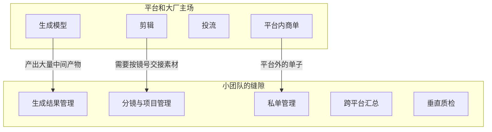

# 现有工具格局与案例拆解

做工具之前，先搞清楚这块地上已经站着谁。这一章按类别过一遍现有工具，再拆几类有代表性的产品，看它们的商业模式和留给小团队的缝隙。

> [!WARNING]
> 本章提到的产品按截至 2026-11 的公开资料整理，只用来说明格局，文中不写具体价格；**功能、价格、政策变化很快，一律以各产品官网和定价页为准**。

产品名列在这里不代表推荐，也不代表评价它们的合规性。

## 格局总览

| 类别 | 代表产品（举例） | 谁做的 | 小团队的空间 |
|---|---|---|---|
| 剪辑 | 剪映 / CapCut、必剪、Premiere、达芬奇 | 平台方、专业软件厂商 | 很小，只剩辅助环节 |
| 数据分析 | 各平台创作者后台；第三方数据服务（如新榜、蝉妈妈、飞瓜、千瓜等） | 平台、数据公司 | 小，且数据来源是合规难点 |
| AI 图像 / 视频生成 | 即梦、可灵、海螺、Vidu、通义万相；海外的 Midjourney、Runway 等 | 大厂、模型公司 | 模型层没有空间；**管理层有** |
| 本地生成工作流 | ComfyUI 及其生态 | 开源社区 | 工作流、节点、教程、服务 |
| 分镜 | Storyboarder、Boords、StudioBinder、LTX Studio 等 | 影视工具公司、AI 创业公司 | 中等：海外产品多，国内 AI 短剧场景还没有主流工具 |
| 协作与审片 | 飞书 / 腾讯文档 / 多维表格；Frame.io 等审片工具 | 大厂、专业厂商 | 中等：通用协作强，短剧垂直流程弱 |
| 素材管理 | Eagle、Billfish、网盘 | 工具公司 | 中等：通用素材库不懂「镜号」「生成参数」 |
| 版权与素材授权 | 平台商用音乐库、正版字体与图库、版权登记服务 | 平台、版权机构 | 小，偏服务 |
| 投流 | 巨量引擎、磁力引擎、腾讯广告等 | 平台 | 平台主场；第三方需服务商资质 |
| 商单 | 巨量星图、小红书蒲公英、微信互选等 | 平台 | 平台内很完整；**平台外的私单没有工具** |
| 短剧 SaaS | 小程序短剧系统、分销系统、投放回传系统 | 各类服务商 | 竞争激烈，且掺杂灰产（见下文） |

一个规律：**越靠近「生成内容」和「分发流量」，越是平台和大厂的主场；越靠近「管理流程」和「团队协作」，越有小团队的空间**。



## 类别拆解

### 剪辑：平台自建，免费为主

剪映是字节跳动做的，海外版叫 CapCut。它的商业逻辑和独立软件不同：**平台做剪辑工具，是为了让更多内容产出到自己的平台上**，工具本身赚不赚钱不是第一位的。所以它可以把大量功能免费给出，模板、素材、AI 功能不断加。

对小团队的启示：

- 不要做「更好的剪辑软件」，你打不过一个不靠它赚钱的对手
- 可以做剪辑**前后**的环节：剪辑前的素材按镜号归档，剪辑后的质检和多版本管理
- 和剪辑软件的交接点（导入哪些文件、怎么命名）是产品设计的重点

### 数据分析：平台后台 + 第三方数据服务

创作者看数据有两类来源：平台自己的创作者后台（只能看自己账号），和第三方数据服务（能看行业、对标、商品、达人榜单）。

第三方数据服务是一个成熟市场，主要客户是品牌方、MCN、商家，按年卖会员。这类产品的核心难点是**数据从哪来**：有些通过平台官方合作或开放接口获得，有些来源不透明。作为一个人的新进入者：

- 你没有官方合作，也不应该靠爬取（第 9 章）
- 所以「行业数据」「对标账号数据」这条路基本走不通
- 能做的是**创作者自己账号的数据**：用户授权的官方接口，或用户自己导出后导入

### AI 生成：模型层不碰，管理层有机会

各家生成模型更新极快，大厂和模型公司在模型能力上竞争。它们的网页端和 App 都带历史记录、收藏、简单的项目管理，但有两个共同的局限：

1. **只管自家模型**。实际生产中，一个团队常常混用两三家模型：这家人物好，那家运镜好
2. **为个人设计，不为团队设计**。生成历史属于登录的那个账号，团队里交接靠下载再转发

这就是「生成记录与素材资产管理」的机会。注意要和各家模型的服务条款兼容：只管理用户**自己生成并下载**的结果，或通过模型的官方 API 生成，不去抓取模型网页。

### 本地生成工作流：ComfyUI 生态

ComfyUI 是开源的节点式生成工作流工具，在需要精细控制（角色一致性、固定构图）的团队中很常用。它周围形成了一个生态：自定义节点、工作流分享、云端运行服务、教程和培训。

这个生态的商业模式值得看：**工具本身免费开源，钱在周边**：卖工作流、卖教程、卖算力、做定制服务。对一个人来说，这提示了另一种起步方式：先在开源生态里做一个有用的节点或工作流积累名声，再做付费产品。

### 分镜工具：海外有，国内 AI 短剧场景是空白

传统影视有成熟的分镜工具（Storyboarder 是开源免费的，Boords、StudioBinder 是海外 SaaS），近两年也出现了 AI 生成分镜的产品（如 LTX Studio）。但它们和国内 AI 短剧团队的实际流程有几处不合：

| 差异 | 传统 / 海外分镜工具 | 国内 AI 短剧团队要的 |
|---|---|---|
| 分镜的用途 | 给拍摄团队看 | 直接驱动生成：每个镜头对应一组提示词和生成结果 |
| 画面来源 | 手绘或单一 AI | 混用多家国内模型，结果要回填到分镜 |
| 竖屏 | 横屏为主 | 竖屏为主，每集 1–3 分钟 |
| 规模 | 一部片几百镜 | 一部剧几十集，每集几十镜，总量上千 |
| 语言和支付 | 英文、海外支付 | 中文、微信 / 支付宝、对公发票 |

这块是本书认为一个人最有机会的地方，第 4 章和第 10 章展开。

### 协作：通用工具强，垂直流程弱

很多短剧团队现在的「系统」是飞书多维表格：一张分镜表、一张素材表、一个群。多维表格很灵活，但：

- 图片、视频多了以后，表格里预览和对比很不方便
- 镜头状态、版本、谁选了哪张，要靠人自觉维护
- 生成参数要手动复制粘贴进去

**通用协作工具是你的竞争对手，也是你的参照物**。用户愿意从多维表格切换到你的工具，前提是你在他们最常做的那几个动作上明显更快。访谈时要问「你现在的多维表格长什么样」，第 7 章的提纲里有这一问。

### 商单：平台内完整，平台外空白

巨量星图、小红书蒲公英、微信互选这些平台商单系统，覆盖了平台内撮合、下单、结算的全流程，具体规则见[《广告商单与品牌合作》](../brand-deals/)。它们不管的是：

- 品牌直接找来的私单、通过中间人的单子
- 一个创作者在多个平台的商单汇总
- 报价历史、和每个品牌的合作记录
- 回款提醒、发票和合同的归档

小 MCN 和有一定体量的博主，这部分常常用 Excel 管。这是一个**不依赖平台接口、和钱直接挂钩**的缝隙。

### 短剧 SaaS：竞争激烈，灰产交织

围绕短剧发行，有一类成熟的 SaaS：小程序短剧系统（片源上架、付费解锁、会员）、分销系统、投放数据回传系统。这个市场：

- 客户是短剧发行方和投手，付费意愿高
- 竞争激烈，大量服务商同质化
- **掺杂高风险业务**：盗版片源分发、无资质上线、诱导付费、虚假宣传投放。监管对微短剧的管理持续加强，备案和审核要求见[《短剧发行、投流与备案》](../drama-distribution/)

一个人新进入这个市场，既打不过已有服务商，也难以控制客户把系统用在什么地方。本书不建议从这里切入。

## 三个拆解样本的共同结论

| 样本 | 商业模式 | 给你的启示 |
|---|---|---|
| 剪映（平台自建工具） | 工具服务于平台内容生态，免费为主 | 不和平台正面竞争；做它不屑于做的环节 |
| 第三方数据服务 | 按年卖会员给品牌和 MCN | 数据来源决定合规性；没有正当来源的数据生意不做 |
| ComfyUI 生态 | 开源工具免费，周边收费 | 可以先在生态里做贡献积累信任，再做付费产品 |

## 怎么做自己的竞品调研

挑定方向后，花半天做一张竞品表。来源：

- 产品官网、定价页、更新日志
- 应用商店的评价，尤其是长差评
- 小红书、B 站、即刻上搜「产品名 + 吐槽 / 替代 / 平替」
- 用户访谈里问「你试过哪些工具、为什么没继续用」

表格模板：

```text
竞品调研表

| 产品 | 目标用户 | 核心功能 | 定价模式 | 用户夸什么 | 用户骂什么 | 和我的差异 |
|------|----------|----------|----------|------------|------------|------------|
| 飞书多维表格（用户自建分镜表） | 短剧团队 | 灵活表格、协作 | 按席位 | 灵活、团队都在用 | 图片多了卡、状态靠自觉 | 镜头状态和生成记录内建 |
| ……   |          |          |          |            |            |            |
```

最有价值的是「用户骂什么」这一列。它直接告诉你**现有方案的缺口**，也是你着陆页文案的素材。

## 本章要点

- 越靠近生成内容和分发流量，越是平台和大厂主场；越靠近流程管理和团队协作，越有小团队的空间
- 剪辑、生成模型、投流、平台内商单不要正面竞争；做它们前后的环节
- 第三方数据生意的核心是数据来源，没有正当来源就不做；能做的只有用户自己账号的数据
- 国内 AI 短剧的分镜与生成管理、平台外的私单管理，是目前比较明显的空白
- 短剧发行 SaaS 竞争激烈且灰产交织，不建议一个人从这里切入
- 竞品调研重点看「用户骂什么」，那是缺口，也是文案
