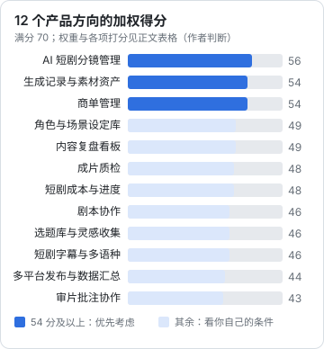

# 产品机会

第 2 章的痛点地图收窄到了几个高分环节，第 3 章看清了哪些地方已经有人站着。这一章把它们展开成 12 个具体方向，每个方向写清楚：给谁用、MVP 做到哪、技术难点、竞争情况，最后统一打分。

打分沿用[《一人公司方法论》第 2 章](../opc-playbook/02-choosing-direction.md)「选方向」的加权打分表，按这个市场的特点调整了两个维度：

| 维度 | 权重 | 问自己 |
|---|---|---|
| 痛点强度 | 3 | 第 2 章的强度分 |
| 付费意愿 | 3 | 这个痛点和钱挂不挂钩？用户是团队还是个人？ |
| 触达能力 | 3 | 你能不能通过自己的内容和社群找到前 100 个用户？ |
| 一人可做 | 2 | 开发、运维、客服扛得住吗？ |
| 平台安全度 | 2 | 不依赖平台接口给 5 分，依赖官方接口 2–3 分，依赖非官方手段直接淘汰 |
| 自用优势 | 1 | 你自己做内容时会不会天天用它？ |

满分 70。下面的分数是作者站在「在职开发者、自己也在做 AI 短剧或自媒体」这个读者画像上打的，**你的分数要按自己的情况重打**。

## 一、AI 短剧分镜管理

- **目标用户**：1–10 人的 AI 短剧 / 漫剧团队，个人 AI 漫剧创作者
- **痛点**：分镜表在 Excel 或多维表格里，镜头状态、选中的画面、返工原因靠人维护
- **MVP 范围**：导入剧本或分镜表（CSV / Markdown）→ 按集、按镜头展示 → 每个镜头可挂多张候选图 / 视频，标记「已选」→ 镜头状态（待生成 / 生成中 / 待审 / 已定稿 / 返工）→ 导出定稿素材，按「集-镜号」命名
- **不进 MVP**：在线生成、多人实时协作、权限体系、手机端
- **技术难点**：大量图片视频的本地预览性能；文件和数据库的一致性（见[《软件架构与系统设计》第 7 章](../system-design/07-object-storage.md)「文件与对象存储」）
- **竞争**：海外分镜工具不贴合国内流程；国内主要对手是多维表格
- **打分**：痛点 4、付费 3、触达 4、一人可做 4、平台安全 5、自用 5，**56 分**

## 二、生成记录与素材资产管理

- **目标用户**：AI 短剧团队的生成师、用多家模型的 AI 内容创作者
- **痛点**：生成历史散在各家模型网页里，选中的那一版找不到提示词和参数
- **MVP 范围**：把生成结果拖进来时，记录提示词、模型、种子、参数、来源（手填或从文件元数据读取）→ 按项目 / 角色 / 镜头打标签 → 全文搜索提示词 → 「复用这组参数」一键复制
- **不进 MVP**：直接调用模型 API 生成（第二版再做，且只用官方 API）
- **技术难点**：各家导出文件携带的元数据格式不一，多数要靠手填；大文件存储与去重
- **竞争**：模型网页自带历史，但只管自家；通用素材库不懂生成参数
- **打分**：4、3、4、3、5、5，**54 分**

方向一和方向二天然是一个产品的两面：分镜是「要什么」，生成记录是「得到了什么」。第 10 章的推荐起步方向就是把两者合在一起。

## 三、商单管理

- **目标用户**：有稳定商单的博主（尤其多平台、私单多的）、3–20 人的小 MCN
- **痛点**：报价凭感觉、brief 和修改意见散在微信、交付后忘了催款
- **MVP 范围**：品牌 / 联系人 → 商单（平台、形式、报价、阶段）→ 阶段流转（询价 / 报价 / 签约 / 脚本 / 拍摄 / 审核 / 发布 / 结算 / 回款）→ 到期与回款提醒 → 报价历史查询
- **不进 MVP**：对接星图 / 蒲公英接口、合同电子签、开票
- **技术难点**：几乎没有，是一个标准的 CRUD + 状态机 + 提醒，难在流程设计贴不贴合
- **竞争**：平台商单系统只管平台内；通用 CRM 太重、不懂内容行业
- **打分**：4、4、3、4、5、3，**54 分**

## 四、角色与场景设定库

- **目标用户**：做系列 AI 短剧 / 漫剧的团队
- **痛点**：角色参考图、关键提示词、服装、LoRA 文件散落，新人接手要从头找
- **MVP 范围**：角色卡（名字、外形描述、参考图、正反提示词片段、模型与 LoRA 记录）→ 场景卡 → 在分镜中引用角色卡，一键拼出提示词
- **技术难点**：提示词片段的组合规则因模型而异
- **竞争**：没有专门工具；很容易被方向一、二吸收为一个模块
- **打分**：3、2、4、4、5、4，**49 分**。单独卖偏弱，建议作为方向一的模块

## 五、内容复盘看板

- **目标用户**：认真做内容的个人创作者
- **痛点**：多平台数据口径不同，记录麻烦，没人记耗时
- **MVP 范围**：用户从各平台后台导出数据文件后上传（或手填）→ 统一字段 → 按平台、形态、开头类型分组看「关注 / 小时」（指标设计见[《自媒体与短剧一人公司全景》](../media-opc-overview/)的「技术人的优势」一章）
- **技术难点**：各平台导出格式不同且会变，需要可维护的解析层
- **竞争**：平台后台越来越强；觉得重要的人自己建表
- **打分**：3、2、4、5、4、4，**49 分**

## 六、成片质检

- **目标用户**：AI 短剧团队、批量出片的内容团队
- **痛点**：交付前人工检查规格、错别字、穿帮、AI 生成标识，容易漏
- **MVP 范围**：上传成片 → 检查分辨率、帧率、时长、码率、音量是否符合目标平台规格（规格表由用户维护，**以平台最新要求为准**）→ 字幕文件错别字与敏感词提示 → 检查清单逐项打勾、留存记录
- **技术难点**：用 ffprobe 取规格很简单；敏感词库要谨慎，只做「提示」不做「通过」的判断
- **竞争**：没有专门工具；平台审核本身会拦，但被拦就是返工
- **打分**：3、3、3、4、5、3，**48 分**

## 七、短剧成本与进度管理

- **目标用户**：承接多部短剧的工作室、制片
- **痛点**：每集花了多少生成费用、多少人工，项目赚没赚钱算不清
- **MVP 范围**：项目 / 集 / 镜头三级进度 → 生成消耗手工或批量录入 → 人工工时 → 每集成本、每部剧毛利
- **技术难点**：各家生成服务的计费单位不同（积分、次数、秒数），换算规则要用户可配置
- **竞争**：用 Excel；更大的团队用通用项目管理
- **打分**：3、4、2、4、5、3，**48 分**。客户少、付费意愿高，适合作为方向一的团队版功能

## 八、剧本协作

- **目标用户**：短剧编剧、编剧工作室
- **痛点**：短剧格式（场次、人物、台词、动作）在 Word 里排版费劲；付费卡点、钩子位置要反复调；多人改稿
- **MVP 范围**：短剧剧本格式编辑器 → 卡点 / 钩子标注 → 分集结构视图 → 导出为分镜表初稿（接方向一）
- **技术难点**：结构化编辑器开发量大；多人协同编辑（CRDT）对一个人很重
- **竞争**：飞书 / 腾讯文档足够好用；专业剧本软件有成熟产品
- **打分**：3、3、3、3、5、3，**46 分**。剧本格式规范见[《短剧编剧》](../drama-scriptwriting/)

## 九、选题库与灵感收集

- **目标用户**：个人创作者
- **痛点**：灵感散落，做过的选题和效果没关联
- **MVP 范围**：手机端快速记录（文字、截图、链接）→ 标签 → 和复盘数据关联，看哪类选题效果好
- **技术难点**：低；但**只收集用户自己主动保存的内容**，不抓取平台热榜和他人作品
- **竞争**：备忘录、flomo 一类笔记工具、飞书
- **打分**：2、2、4、5、4、4，**46 分**。做着玩很好，收钱很难

## 十、短剧字幕与多语种本地化

- **目标用户**：做短剧出海的团队
- **痛点**：一部剧几十集，翻译、字幕时间轴、多语种版本管理量大
- **MVP 范围**：导入中文字幕 → 大模型翻译初稿 → 人工校对界面（术语表、角色名统一）→ 导出各语种字幕文件
- **技术难点**：翻译质量和术语一致性；口型和时长的匹配
- **竞争**：专业本地化公司、通用字幕工具在加 AI 翻译
- **打分**：4、4、2、3、4、2，**46 分**。付费意愿高，但如果你不在出海圈子，触达难；出海发行见[《短剧发行、投流与备案》](../drama-distribution/)

## 十一、多平台发布与数据汇总

- **目标用户**：同时运营多个平台的创作者
- **痛点**：每个平台逐个发、逐个看数据
- **MVP 范围**：一次准备好各平台版本的标题、标签、简介 → 能走官方接口的平台用官方接口（用户授权）→ 不能走的平台生成「发布清单」，用户手动发 → 数据：官方接口能读的读，其余手动导入
- **技术难点**：各平台开放能力差异大、会变；审核和资质门槛（第 5 章）
- **竞争**：市面上已有多平台分发工具，实现方式各异
- **打分**：4、2、4、3、2、4，**44 分**。需求真实，但**平台安全度低**：能力取决于平台开放多少。千万不要为了补齐「一键发布到所有平台」去走模拟登录，那是第 9 章的红线

## 十二、审片批注协作

- **目标用户**：有甲方审片环节的团队（品牌定制剧、商单视频）
- **痛点**：甲方在微信里说「1 分 20 秒那里改一下」，版本一多就乱
- **MVP 范围**：上传视频生成分享链接 → 甲方在时间码上批注 → 版本对比 → 批注状态（已改 / 不改）
- **技术难点**：视频转码与分发成本、外链分享的安全
- **竞争**：海外有成熟审片产品；国内团队多用网盘 + 微信
- **打分**：3、2、3、3、5、3，**43 分**

## 汇总

| 方向 | 痛点 | 付费 | 触达 | 一人可做 | 平台安全 | 自用 | 总分 |
|---|---|---|---|---|---|---|---|
| AI 短剧分镜管理 | 4 | 3 | 4 | 4 | 5 | 5 | 56 |
| 生成记录与素材资产 | 4 | 3 | 4 | 3 | 5 | 5 | 54 |
| 商单管理 | 4 | 4 | 3 | 4 | 5 | 3 | 54 |
| 角色与场景设定库 | 3 | 2 | 4 | 4 | 5 | 4 | 49 |
| 内容复盘看板 | 3 | 2 | 4 | 5 | 4 | 4 | 49 |
| 成片质检 | 3 | 3 | 3 | 4 | 5 | 3 | 48 |
| 短剧成本与进度 | 3 | 4 | 2 | 4 | 5 | 3 | 48 |
| 剧本协作 | 3 | 3 | 3 | 3 | 5 | 3 | 46 |
| 选题库与灵感收集 | 2 | 2 | 4 | 5 | 4 | 4 | 46 |
| 短剧字幕与多语种 | 4 | 4 | 2 | 3 | 4 | 2 | 46 |
| 多平台发布与数据汇总 | 4 | 2 | 4 | 3 | 2 | 4 | 44 |
| 审片批注协作 | 3 | 2 | 3 | 3 | 5 | 3 | 43 |

用《一人公司方法论》第 2 章的 `score-ideas.ts` 脚本，把 `weights` 改成本章的六个维度，把上表填进去，就能复现这个排序，也方便你按自己的情况改分。

## 读这张表的方法

**前三名分成两条路**：

- 如果你自己在做 AI 短剧 / 漫剧：分镜管理 + 生成记录，合成一个产品
- 如果你自己在做自媒体、接商单：商单管理

**中间一档适合做模块，不适合单独卖**：角色设定库、成本进度、质检，都可以挂在分镜管理上，作为团队版的增值功能。

**付费高但触达低的方向**（字幕本地化、成本管理）：如果你恰好身在那个圈子，触达分会变成 4–5，排名就会上来。这正是要自己重打分的原因。

**多平台发布排名靠后，不是因为需求不真**，而是因为它的命运握在平台手里。下一章专门讲平台开放了什么。

## 一个方向值不值得做的最后检查

打完分，再用这五个问题过一遍前两名：

| 问题 | 要能回答 |
|---|---|
| 一句话说清它解决什么 | 「让 AI 短剧团队知道每个镜头用了哪张图、怎么生成的」 |
| 用户现在怎么凑合 | 「多维表格 + 群聊 + 文件夹」 |
| 为什么现在凑合不下去了 | 「集数多了、混用多家模型、团队到 5 个人以上」 |
| 平台或大厂明年会不会自己做 | 「模型方只管自家；多维表格不会为短剧定制」 |
| 你能找到哪 10 个人试用 | 写出具体的名字或群 |

最后一行写不出 10 个名字，就先去第 7 章，而不是先写代码。

## 本章要点

- 12 个方向用六个维度加权打分，满分 70；分数是作者站在本系列读者画像上的判断，要按自己情况重打
- 前三名：AI 短剧分镜管理（56）、生成记录与素材资产（54）、商单管理（54）；前两个适合合成一个产品
- 角色设定库、成本进度、质检适合作为模块，不适合单独卖
- 多平台发布需求真实，但能力取决于平台开放程度，不能用模拟登录补齐
- 写不出 10 个能试用的具体用户，就先去做验证，不要先写代码
