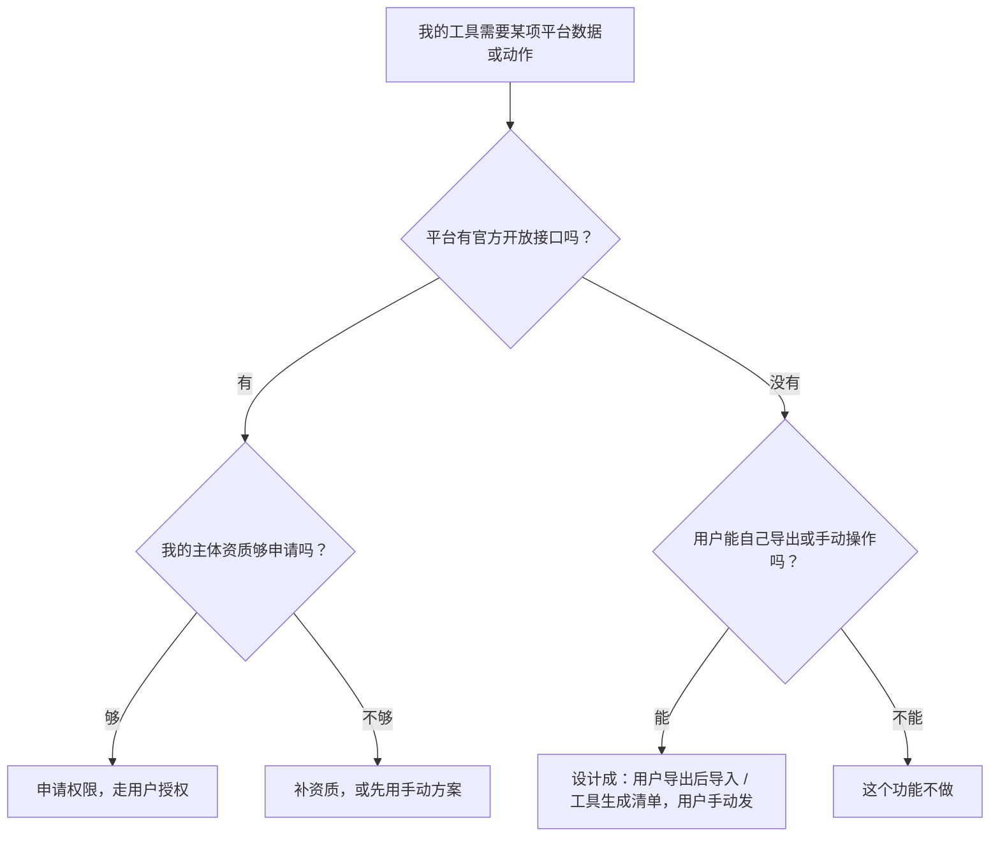

# 平台开放接口与限制

给创作者做工具，绕不开一个问题：**我的工具能不能读到用户的数据、能不能替用户发布？** 这一章讲合法的边界在哪：平台通过开放接口给了什么、没给什么、拿到这些能力要什么资质，以及接口不够用时该怎么设计产品。

> [!WARNING]
> 开放平台的能力、权限、审核标准变化很快，本章是 2026-11 查阅官方文档时的情况，抓不到原文的地方明确写了「以官网为准」；动手前以抖音、快手、微信、小红书、B 站各开放平台的最新文档和接入规范为准。

## 三条底线

在看具体平台之前，先记住三条判断原则。它们和[《自媒体与短剧一人公司全景》](../media-opc-overview/)「技术人的优势」一章里的合规边界一致：

1. **数据只取用户授权的、属于用户自己的**。通过官方授权流程（OAuth）拿到的用户自己账号的数据可以用；他人账号、他人作品、平台公开页面上批量抓取的数据，不碰
2. **动作只走官方提供的方式**。替用户发布，只用平台开放的发布接口或分享 SDK；没有开放接口的平台，让用户自己手动发
3. **不保存用户的平台账号密码**。需要用户「把账号密码给你」才能实现的功能，就是模拟登录，不做

最后一个格子很重要：**有些功能就是做不了**。一个工具不必覆盖所有平台，不完整的合法工具，好过完整的违规工具。

## 抖音开放平台

抖音开放平台（open.douyin.com，文档在 developer.open-douyin.com）是几个平台里面向第三方开发者开放程度相对较高的。

### 查得到的能力

在开放平台的 OpenAPI 列表里（2026-11 查阅），和创作者工具相关的分类有：

| 分类 | 接口举例（按文档原名） | 对工具的意义 |
|---|---|---|
| 个人资料 / 账号授权 | 抖音获取授权码、获取 access_token、刷新 refresh_token、获取用户公开信息 | 用户授权登录，拿到昵称、头像等公开信息 |
| 内容能力 | 查询视频分享结果及数据、查询视频基础信息、通过 ItemID 获取 iFrame 代码、创建投稿任务等 | 查询通过你的应用发布的视频的结果和数据 |
| 关系能力 | 获取粉丝列表、获取用户粉丝数据等 | 用户授权后看自己的粉丝数据，具体字段与权限以文档为准 |

### 代替用户发布视频

文档中「创建抖音视频」接口（2026-11 查阅）的要点：

| 项目 | 文档内容 |
|---|---|
| 所需权限 | scope 为 `video.create.bind`，需要在开放平台控制台「能力管理 > 能力实验室 > 代替用户发布内容到抖音」申请 |
| 用户授权 | 需要，请求要带用户授权后得到的 access_token 和 open_id |
| 发布流程 | 先调上传视频接口拿到 `video_id`，再创建视频 |
| 审核 | 创建后会经过审核，审核期间只有作者自己可见 |
| 频率限制 | 一个用户在一个应用下一天最多发布 75 个作品 |
| 时长与标题 | 视频时长不超过 15 分钟，标题总字数不超过 1000 字 |
| 挂载 | 小程序和 POI 锚点只支持具有企业资质或与企业资质关联的账号 |
| 话题 | 文档提醒第三方谨慎拟定话题名称，避免强导流 |

来源：抖音开放平台文档「创建抖音视频」（developer.open-douyin.com，内容能力 > 视频管理）。

这说明两件事：

- **代发布是可以合法做的**，但要申请能力、要用户逐个授权、要过审核
- 「能力实验室」意味着这项能力**需要单独申请、平台可能调整**。申请条件（个人还是企业开发者可申请、审核标准）**以官网为准**

### 拿不到的东西

即使走官方接口，也有很多数据拿不到或受限。常见的误区是以为「开放平台 = 能拿到创作者后台的所有数据」。实际上，创作者后台里的完播率、流量来源、观众画像等分析数据，开放接口是否提供、提供到什么粒度，要逐项对照文档。**设计产品前，先列出你需要的每一个字段，逐个在文档里找到出处**，找不到的就按「手动导入」设计。

## 快手开放平台

快手开放平台（open.kuaishou.com）同样面向第三方开发者，提供授权登录等能力。本书撰写时未能抓取到能力列表正文，**是否开放视频发布、作品数据查询，权限申请条件，均以官网为准**。

设计上的建议：把快手当作「可能有官方接口」的平台，在适配层里预留位置，但 MVP 先按手动导入设计。

## 微信视频号

微信开放文档里视频号相关的部分（developers.weixin.qq.com/doc/channels，2026-11 查阅）主要包括：

| 部分 | 内容 |
|---|---|
| 基础 | access_token、接口额度、错误码、IP 白名单、回调通知 |
| 本地生活 | 团购券商品、库存、核销、资金对账、售后 |
| 视频号助手 API | 直播基础信息、橱窗管理、留资组件管理、留资服务的直播数据、直播大屏数据、罗盘达人版 |
| 视频号小店 API | 商品展示、交易等电商能力 |
| 联盟带货机构 API | 面向带货机构 |

在这个目录里**没有看到发布短视频的接口，也没有单条短视频的数据接口**。视频号的开放能力集中在电商、直播、带货。对工具开发者而言：

- 做视频号**带货、直播相关**的工具，有官方接口可用，但大多面向商家和机构，需要对应主体
- 做视频号**短视频发布和数据**的工具，按「用户手动发、手动导入」设计

## 小红书

小红书有开放平台（open.xiaohongshu.com），从公开信息看主要面向电商商家和服务商。本书撰写时未能抓取到正文，**是否有面向创作者的笔记发布或笔记数据接口，以官网为准**。

在确认之前，按「没有」来设计：笔记由用户在小红书 App 内发布，数据由用户从创作者中心查看后手动记录或导出。小红书的商单平台蒲公英的规则见[《广告商单与品牌合作》](../brand-deals/)。

## B 站

B 站有开放平台（openhome.bilibili.com）。本书撰写时未能抓取到正文，**开放的能力（如稿件投递、用户授权）和入驻条件以官网为准**。

## 商单与投流平台

| 平台 | 类型 | 对第三方开发者 |
|---|---|---|
| 巨量星图、小红书蒲公英、微信互选 | 商单撮合 | 是否对第三方开放 API、需要什么服务商资质，以官网为准 |
| 巨量引擎、磁力引擎、腾讯广告 | 投流 | 都有面向代理商和服务商的开放接口（Marketing API 一类），通常需要企业资质和服务商认证，以官网为准 |

对一个人的工具而言：**商单管理不需要接这些平台的接口**。平台内的单子平台管得很好，你的价值在平台外的私单和跨平台汇总。投流工具则需要服务商资质，门槛高，不建议起步做。投流本身的方法见[《投流与数据分析》](../paid-traffic/)。

## AI 模型的 API

AI 短剧工具多半要接生成模型。国内主要模型厂商都提供 API（如火山引擎、可灵、阿里云百炼等平台），通常需要企业或个人实名认证，具体以各平台为准。这里有两件和平台接口同样重要的事：

### 生成式 AI 服务的合规

> [!WARNING]
> 本节按截至 2026-11 的《生成式人工智能服务管理暂行办法》（2023-08-15 施行）和《人工智能生成合成内容标识办法》（2025-09-01 施行）整理，备案和标识要求可能调整，以国家网信办发布的规定原文和最新公告为准。

如果你的产品**面向国内公众提供生成式 AI 服务**（用户在你的产品里输入提示词、你调模型生成内容返回给用户），就落入《生成式人工智能服务管理暂行办法》的范围，可能涉及备案或登记、内容安全、生成内容标识等要求。详细见[《国内合规实务》第 7 章](../opc-compliance-cn/07-generative-ai.md)「生成式 AI 相关规定」。

《人工智能生成合成内容标识办法》自 2025 年 9 月 1 日起施行，对生成内容的显式和隐式标识提出了要求。你的工具如果帮用户生成或处理 AI 内容，要保留而不是去掉模型添加的标识；创作者发布时的标注要求见[《自媒体与短剧合规财税》](../media-compliance/)。

### 降低合规面的设计

| 设计 | 合规面 | 适合 |
|---|---|---|
| 工具只管理用户在别处生成并下载的文件，不调用模型 | 最小 | MVP |
| 用户填自己在模型平台申请的 API Key（BYOK），工具代为调用 | 较小，但仍要复核是否构成「提供服务」 | 第二版 |
| 你统一采购模型能力，按次卖给用户 | 最大，基本等于提供生成式 AI 服务 | 有公司主体、做完合规之后 |

BYOK 并不能自动豁免合规义务，**上线前请对照最新规定或咨询专业人士**。

## 资质门槛速查

> [!WARNING]
> 下表按截至 2026-11 的规定整理，备案和许可要求可能调整，以工信部 ICP / App 备案系统和国家网信办的最新规定为准。

| 你要做的事 | 通常需要 | 参考 |
|---|---|---|
| 做纯本地桌面工具，官网放下载 | 网站要 ICP 备案（国内服务器） | [《国内合规实务》第 3 章](../opc-compliance-cn/03-icp-filing.md) |
| 做在线 SaaS，国内服务器 | ICP 备案；收费的经营性网站还可能涉及经营许可 | 《国内合规实务》第 3 章 |
| 上架 App | App 备案 | [《国内合规实务》第 4 章](../opc-compliance-cn/04-app-filing.md) |
| 申请平台开放能力（尤其企业能力） | 往往需要企业主体，个人开发者能力受限 | 各平台官网 |
| 对公收款、开发票 | 个体户或公司 | [《国内合规实务》第 1 章](../opc-compliance-cn/01-entity-choice.md) |
| 处理用户个人信息 | 隐私政策、最小必要 | [《国内合规实务》第 6 章](../opc-compliance-cn/06-pipl.md) |

起步阶段用个人身份做本地工具完全够用；准备接平台开放能力或收团队客户的钱时，再注册主体。

## 接口会变：产品怎么设计

平台接口不是你能控制的。设计时假设它**随时会收紧**：

1. **适配层隔离**：每个平台一个 adapter，核心数据模型不依赖任何平台的字段（第 6 章有代码）
2. **手动通道永远保留**：即使接了官方接口，也保留「手动导入 / 手动填写」的路径；接口出问题时用户还能用
3. **不把核心价值押在接口上**：如果某个平台关掉接口，你的产品还剩多少价值？剩不到一半，就说明方向选错了
4. **订阅开放平台的公告**：开发者公告、能力调整、协议更新，每月看一次

## 本章要点

- 三条底线：数据只取用户授权的、自己账号的；动作只走官方方式；不保存用户的平台账号密码
- 抖音开放平台有「代替用户发布」能力（scope `video.create.bind`），需在能力实验室申请、用户授权、过审核，单用户单应用每天最多 75 个作品
- 视频号开放能力集中在电商、直播、带货，未见短视频发布和单条视频数据接口；快手、小红书、B 站的创作者能力以官网为准
- 面向公众提供生成式 AI 服务有备案、标识等义务；MVP 只管理用户自己生成的文件，合规面最小
- 每个平台一个适配层，永远保留手动通道；平台关掉接口后产品还剩不到一半价值，就是方向选错了
