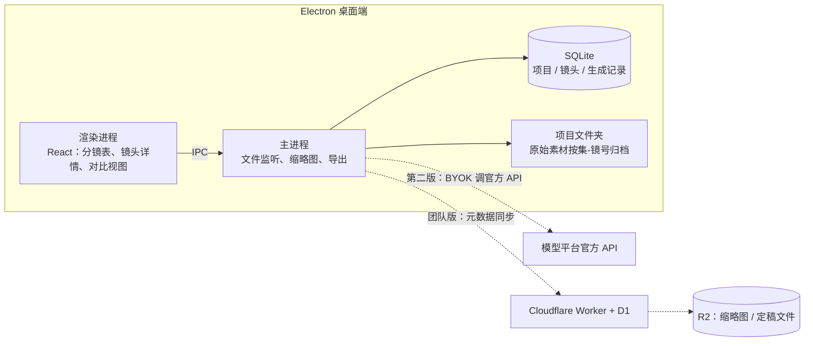
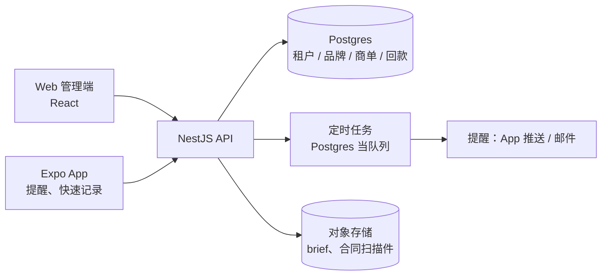
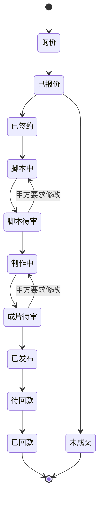
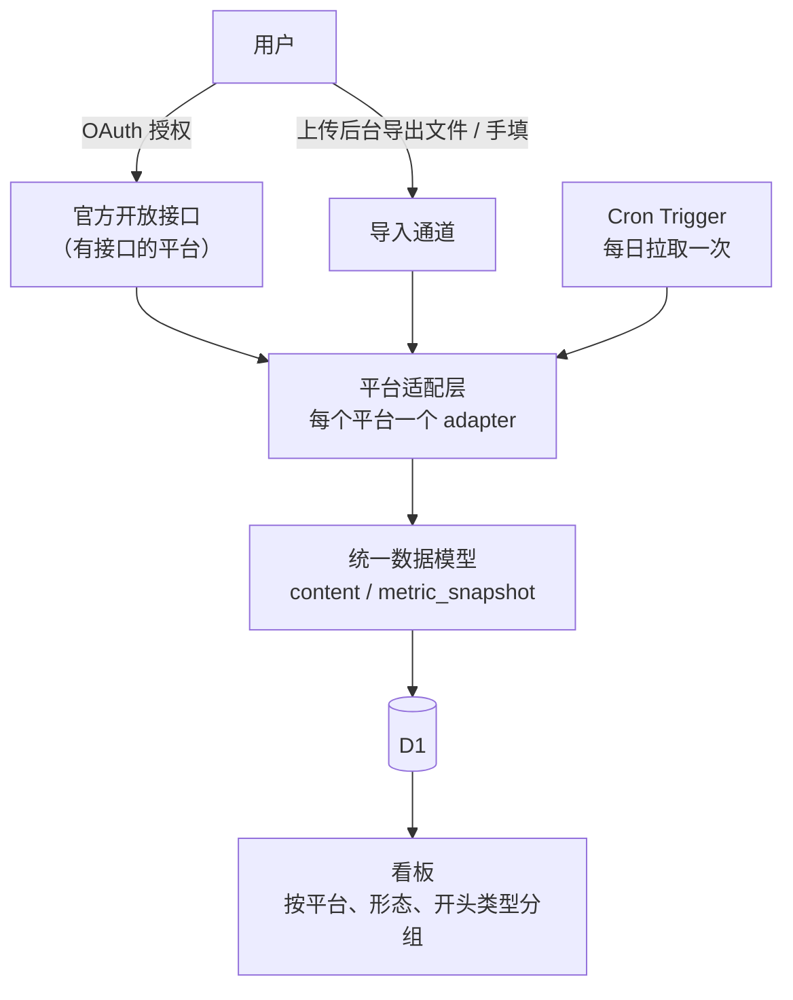

# 技术方案

这一章给第 4 章排名靠前的三个方向画架构草图：AI 短剧分镜与生成记录（桌面优先）、商单管理（SaaS）、多平台数据汇总（边缘函数 + 适配层）。三个方案都尽量复用本系列读者已有的技术栈：TS / Node、NestJS、Expo、Electron、Cloudflare Worker。

草图的目的是让你知道「第一版大概长什么样、哪里会踩坑」，不是完整实现。通用的架构问题（队列、对象存储、多租户）在[《软件架构与系统设计》](../system-design/)里讲过，这里只讲这个市场特有的部分。

## 先选形态：桌面、Web 还是 App

| 形态 | 适合 | 优点 | 缺点 |
|---|---|---|---|
| 桌面（Electron） | 大量本地文件：生成结果、视频素材 | 直接读写本地文件夹，不用上传几个 G 的素材；无服务器成本；数据在用户手里，团队更放心 | 多人协作要另做同步；分发、签名、更新（见[《Electron 桌面应用》](../electron-desktop/)第 6、7 章） |
| Web SaaS | 结构化数据为主：商单、进度、报价 | 多人协作天然；迭代快 | 服务器、备案、数据安全都是你的事 |
| 手机 App（Expo） | 提醒、随手记录 | 创作者手机不离手 | 不适合重度编辑；上架有备案和审核 |

一个经验：**文件重的用桌面，数据重的用 Web，提醒类的配手机**。AI 短剧素材动辄几十 G，强行上云会让你的存储和带宽账单比收入涨得还快。

## 方案一：AI 短剧分镜与生成记录（Electron + SQLite）

### 架构



第一版只有实线部分：一个桌面应用、一个 SQLite 文件、一个项目文件夹。虚线是第二版以后的事。

### 数据模型

```sql
-- 项目：一部剧
CREATE TABLE project (
  id          TEXT PRIMARY KEY,
  name        TEXT NOT NULL,
  aspect      TEXT NOT NULL DEFAULT '9:16',
  root_dir    TEXT NOT NULL,             -- 本地项目文件夹
  created_at  TEXT NOT NULL
);

CREATE TABLE episode (
  id          TEXT PRIMARY KEY,
  project_id  TEXT NOT NULL REFERENCES project(id),
  no          INTEGER NOT NULL,          -- 第几集
  title       TEXT,
  UNIQUE (project_id, no)
);

-- 镜头：分镜表的一行，也是一个任务
CREATE TABLE shot (
  id            TEXT PRIMARY KEY,
  episode_id    TEXT NOT NULL REFERENCES episode(id),
  no            TEXT NOT NULL,           -- 镜号，如 '012' 或 '012a'（补镜）
  shot_size     TEXT,                    -- 景别：远景 / 全景 / 中景 / 近景 / 特写
  camera        TEXT,                    -- 运镜
  action        TEXT,                    -- 画面内容
  dialogue      TEXT,                    -- 台词
  duration_s    REAL,
  status        TEXT NOT NULL DEFAULT 'todo',  -- todo / generating / review / final / redo
  redo_reason   TEXT,
  chosen_take   TEXT,                    -- 选中的生成记录 id
  UNIQUE (episode_id, no)
);

-- 生成记录：一次生成得到的一个结果文件
CREATE TABLE take (
  id           TEXT PRIMARY KEY,
  shot_id      TEXT REFERENCES shot(id),     -- 可以先不归属镜头，稍后再拖进去
  kind         TEXT NOT NULL,                -- image / video / audio
  file_path    TEXT NOT NULL,                -- 相对 root_dir
  sha256       TEXT NOT NULL,                -- 去重
  model        TEXT,                         -- 模型名与版本，用户填写
  prompt       TEXT,
  neg_prompt   TEXT,
  seed         TEXT,
  params_json  TEXT,                         -- 其余参数原样存
  source       TEXT,                         -- 'manual' / 'api' / 'import'
  note         TEXT,
  created_at   TEXT NOT NULL
);

CREATE INDEX take_shot ON take(shot_id);
CREATE VIRTUAL TABLE take_fts USING fts5(prompt, note, content='take', content_rowid='rowid');
```

几个设计选择：

- **镜头就是任务**，`status` 驱动整个界面：导演看「待审」，生成师看「待生成」和「返工」
- **生成记录可以先不归属镜头**：生成师经常先批量生成再挑，强制先选镜头会拖慢他
- **参数原样存 JSON**：各家模型参数五花八门，不要试图统一成列；搜索靠全文索引
- **sha256 去重**：同一张图被下载两次、拖进来两次是常事

### 定稿导出的命名

剪辑师要的是「按集、镜号排好的文件」。导出逻辑很简单，但它是这个工具最被感谢的功能之一：

```ts
// export-finals.ts（主进程）
import { copyFile, mkdir } from "node:fs/promises";
import { extname, join } from "node:path";

interface FinalShot {
  episodeNo: number;
  shotNo: string;
  takeFile: string; // 绝对路径
}

export async function exportFinals(shots: FinalShot[], outDir: string): Promise<string[]> {
  const written: string[] = [];
  for (const s of shots) {
    const ep = String(s.episodeNo).padStart(2, "0");
    const dir = join(outDir, `EP${ep}`);
    await mkdir(dir, { recursive: true });
    const target = join(dir, `EP${ep}_S${s.shotNo}${extname(s.takeFile)}`);
    await copyFile(s.takeFile, target);
    written.push(target);
  }
  return written;
}
```

### 难点与对策

| 难点 | 对策 |
|---|---|
| 几千张图的列表卡顿 | 主进程用 sharp 一类库生成缩略图缓存；列表虚拟滚动 |
| 用户在文件夹里手动挪了文件 | 存相对路径 + sha256；启动时扫描，按哈希找回 |
| SQLite 文件和素材文件夹不一致 | 删除走「移到回收区」，不直接删文件；参考[《软件架构与系统设计》第 7 章](../system-design/07-object-storage.md)「文件和数据库的一致性」 |
| 渲染进程安全 | 不开 nodeIntegration，文件操作全走 preload 暴露的有限 IPC，见[《Electron 桌面应用》第 3 章](../electron-desktop/03-security.md)「安全清单」 |
| 团队同步 | 第一版不做。团队版只同步元数据和定稿缩略图，原始素材仍在各自电脑或团队 NAS |

### 团队版：只同步元数据

到了要做团队版时，不要上来就做「全量云同步」。先只同步数据库里的结构化数据（镜头状态、选中的版本、批注），文件只同步缩略图和定稿：

- Cloudflare Worker + D1 存元数据（见[《云与边缘》第 5 章](../cloud-and-edge/05-storage-primitives.md)「R2、KV、D1 与 Durable Objects」）
- R2 存缩略图和定稿文件，按团队、项目分前缀
- 冲突处理用「最后写入者胜 + 操作日志」，镜头级别的冲突很少；真遇到再上更复杂的方案

## 方案二：商单管理（NestJS + Postgres + Expo）

### 架构



这是一个标准的多租户 SaaS，和 hatch-counter 的架构几乎一样，可以直接参照：多租户与 RLS 见[《软件架构与系统设计》第 8 章](../system-design/08-multi-tenancy.md)，定时任务见第 4 章「队列与异步任务」，权限见[《NestJS 后端架构》第 5 章](../nestjs-backend/05-jwt-permissions.md)。

### 商单状态机

商单管理的核心是一个状态机。把它画清楚，比写代码重要：



每个状态带一个「预期截止日」，提醒逻辑就是：**状态停留超过截止日，提醒负责人**。「待回款」是最重要的一个：发布后按合同约定的账期自动生成回款提醒。

### 核心表

```sql
CREATE TABLE deal (
  id             uuid PRIMARY KEY DEFAULT gen_random_uuid(),
  tenant_id      uuid NOT NULL,
  brand_id       uuid NOT NULL,
  creator_id     uuid NOT NULL,          -- 小 MCN 有多个达人
  platform       text NOT NULL,          -- douyin / xhs / channels / bili / private
  channel        text NOT NULL,          -- 平台商单 / 私单 / 中间人
  format         text NOT NULL,          -- 视频 / 图文 / 直播口播
  quote_amount   numeric(12,2),
  final_amount   numeric(12,2),
  status         text NOT NULL,
  status_due_at  timestamptz,
  publish_at     timestamptz,
  pay_due_at     timestamptz,            -- 应回款日
  paid_amount    numeric(12,2) NOT NULL DEFAULT 0,
  created_at     timestamptz NOT NULL DEFAULT now()
);

CREATE TABLE deal_event (                 -- 每次状态变化、修改意见、沟通记录
  id         bigserial PRIMARY KEY,
  deal_id    uuid NOT NULL REFERENCES deal(id),
  kind       text NOT NULL,              -- status / feedback / note / payment
  body       jsonb NOT NULL,
  created_at timestamptz NOT NULL DEFAULT now()
);
```

`deal_event` 是这个产品真正的价值所在：一年后，你能查到「这个品牌上次报价多少、改了几轮、拖了多久才付款」。报价方法本身见[《广告商单与品牌合作》](../brand-deals/)。

### 不要做的集成

很多人会想：能不能读取用户的微信聊天记录，自动提取 brief 和修改意见？**不能**。读取微信聊天记录没有合法的官方接口，任何「自动同步微信」都意味着模拟登录或读取本地数据库，违反微信协议，也涉及他人的个人信息。正确的做法是：在 App 里做一个「从剪贴板粘贴」的快速记录，用户自己复制，大模型帮他把一段文字整理成结构化的修改意见。

## 方案三：多平台数据汇总（Cloudflare Worker + 适配层）

### 架构



### 适配层接口

```ts
// adapters/types.ts
export type Platform = "douyin" | "kuaishou" | "xhs" | "channels" | "bili";

export interface ContentItem {
  platform: Platform;
  externalId: string;      // 平台作品 id；手动导入时用户填或自动生成
  title: string;
  publishedAt: string;     // ISO 日期
}

export interface MetricSnapshot {
  platform: Platform;
  externalId: string;
  capturedAt: string;
  views?: number;
  likes?: number;
  comments?: number;
  shares?: number;
  saves?: number;
  raw: Record<string, unknown>; // 原样保留，口径变了还能回头查
}

export interface PlatformAdapter {
  platform: Platform;
  /** 是否有官方接口可用；没有就只走 importFile */
  readonly hasOfficialApi: boolean;
  fetchRecent?(accessToken: string, since: string): Promise<{
    items: ContentItem[];
    metrics: MetricSnapshot[];
  }>;
  /** 用户从创作者后台导出的文件 */
  importFile(file: ArrayBuffer, filename: string): Promise<{
    items: ContentItem[];
    metrics: MetricSnapshot[];
  }>;
}
```

关键是 `hasOfficialApi` 这个开关和永远存在的 `importFile`：第 5 章说的「手动通道永远保留」，在代码上就是这样体现的。各平台导出文件的格式会变，`importFile` 解析失败时要给用户明确的错误（哪一列找不到），而不是静默导入一堆空值。错误返回怎么设计见[《工具设计与 MCP》第 3 章](../tools-and-mcp/03-error-returns.md)「错误返回」，那里讲的原则对普通 API 一样适用。

### 令牌安全

- access_token / refresh_token 加密后存储，密钥放 Worker 的 secret 里
- 只申请需要的最小 scope
- 用户解除授权或注销时，立即删除令牌和拉取的数据
- 隐私政策写清楚收集了什么、用来做什么，见[《国内合规实务》第 6 章](../opc-compliance-cn/06-pipl.md)「个人信息保护法」

## 三个方案的工作量估计

| 方案 | MVP 工作量（业余时间） | 运维负担 | 首先要验证的 |
|---|---|---|---|
| 分镜与生成记录（桌面） | 4–6 周 | 低：没有服务器 | 团队愿不愿意从多维表格搬过来 |
| 商单管理（SaaS） | 3–5 周 | 中：服务器、备份、多租户 | 博主会不会坚持录入 |
| 多平台数据汇总 | 3–4 周，之后持续维护适配 | 中：接口变化、导出格式变化 | 用户觉得手动导入麻不麻烦 |

工作量是作者按「每周 10 小时、一个熟练全栈开发者、借助编码 agent」估的经验值，不是标准。

## 本章要点

- 文件重的用桌面，数据重的用 Web，提醒类配手机；AI 短剧素材不要急着上云
- 分镜与生成记录：Electron + SQLite + 本地项目文件夹；镜头就是任务，生成参数原样存 JSON，sha256 去重；团队版先只同步元数据
- 商单管理：标准多租户 SaaS，核心是状态机和事件记录；不要尝试读取微信聊天记录
- 多平台数据汇总：每个平台一个 adapter，`importFile` 永远存在；令牌加密、最小 scope、注销即删
- 第一版只做实线部分，虚线留到有人付钱以后
