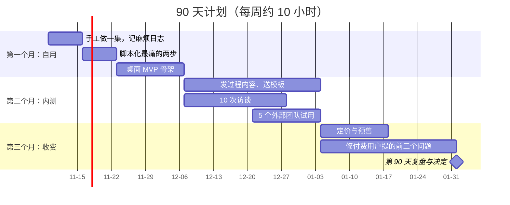

# 一个推荐的起步方向与 90 天计划

前九章给了地图、机会、边界和方法。这一章收拢成一个具体建议：如果你是本系列的典型读者（在职开发者，每周能拿出 10 小时左右，自己也在做或准备做 AI 短剧），第一个工具做什么、90 天怎么推进、什么时候该停。

## 推荐方向：AI 短剧分镜与生成记录管理

把第 4 章的方向一（分镜管理）和方向二（生成记录与素材资产）合成一个桌面工具。一句话定位：

> 给 1–10 人 AI 短剧团队用的本地工具：每个镜头要什么、生成了什么、选了哪版、用的什么参数，一目了然。

### 为什么推荐它

| 理由 | 对应章节 |
|---|---|
| 痛点强度最高的两个环节（生成管理、一致性）都在它的范围里 | 第 2 章 |
| 现有解法主要是多维表格 + 文件夹，没有贴合国内 AI 短剧流程的专门工具 | 第 3 章 |
| 加权得分最高 | 第 4 章 |
| 完全不依赖平台接口，平台安全度满分 | 第 5 章 |
| 桌面 + SQLite，无服务器成本，一个人维护得动 | 第 6 章 |
| 你自己做 AI 短剧时每天都会用，自用优势最大 | 本章 |

### 什么情况下换成商单管理

如果你做的是自媒体账号而不是 AI 短剧，并且已经开始接商单（尤其私单），那就换成商单管理：同样不依赖平台接口，和钱直接挂钩，技术上是你最熟悉的 CRUD + 状态机。90 天计划的结构完全一样，只是把下文的「一集短剧」换成「一个商单」。

### 自用优势具体是什么

自用不只是「我知道用户要什么」，它在 90 天里有三个具体作用：

1. **第一个用户免费且随时在线**：你自己。每做一集，就是一次完整的可用性测试
2. **内容素材源源不断**：「我做这集时遇到了什么麻烦、工具怎么解决的」本身就是内容
3. **可信度**：你在用自己的工具做出作品，比任何宣传都有说服力

但自用也有陷阱：**你的流程不一定是别人的流程**。所以计划里第二个月必须引入外部用户，不能一直只给自己用。

## 90 天总览



起始日期只是示例，按你开始的那周往后推。

## 第一个月：先做自己的用户

### 第 1 周：手工做一集

不写任何代码。用你现在的方式（表格 + 文件夹 + 各家模型网页）完整做一集 AI 短剧，同时记第 2 章的「麻烦日志」。剧本、分镜、生成、后期的方法分别见《短剧编剧》《AI 短剧分镜与画面生成》《AI 短剧后期》。

退出条件：一集做完，麻烦日志至少 20 条。

### 第 2 周：脚本化最痛的两步

按麻烦日志的耗时排序，挑最痛的两步写脚本。典型的是：

- 把下载下来的生成结果按「集-镜号」重命名归档
- 把分镜表转成每个镜头的提示词草稿

这一周还是用脚本，不做界面。《自媒体与短剧一人公司全景》「技术人的优势」一章的规则在这里依然成立：先手工 10 次，再自动化。

### 第 3–4 周：桌面 MVP 骨架

按第 6 章方案一，只做实线部分：

| 必须有 | 可以以后 |
|---|---|
| 导入分镜表（CSV） | 在线生成 |
| 按集、按镜头看列表和状态 | 团队同步 |
| 拖入生成结果，记录提示词、模型、参数 | 角色设定库 |
| 标记选中版本 | 成本统计 |
| 按「集-镜号」导出定稿 | 手机端 |
| 全文搜索提示词 | 自动更新 |

用它做第二集。**第二集比第一集省下多少时间**，就是你第一个可以对外讲的数字。

**第一个月的退出条件**：自己用 MVP 做完一集，并且愿意继续用它做下一集。如果连你自己都宁可回到表格，说明产品形态有问题，先改产品，不要进入第二个月。

## 第二个月：引入外部用户

### 内容与模板

每周发 1–2 条内容，类型按第 7 章的表：制作过程、模板、工具演示。第一条建议是：

```text
标题：一集 AI 漫剧 60 个镜头、400 多张生成图，我是怎么管的
结构：
1. 结果先行：做完一集，找图的时间从 X 小时降到 Y 分钟（用你自己的真实数字）
2. 问题：多家模型、记录散、选中版本找不到
3. 做法：分镜表即任务表、生成记录挂到镜头、按镜号导出
4. 送模板：评论区或私信领分镜表模板
5. 一句话：我把它写成了一个小工具，想试用的留言
```

### 10 次访谈

用第 7 章「AI 短剧团队版」提纲。对象从三类人里找：来要模板的人、发 AI 短剧制作过程的人、朋友介绍的团队。

### 5 个外部团队试用

从访谈对象里挑痛点最典型的 5 个，一对一帮他们装好、导入他们的一集分镜。每周问一次：

- 这周用了几次？做了哪几集？
- 有没有哪一步又回到表格里去做了？为什么？

**第二个月的退出条件**：5 个试用团队里，至少 2 个在第二周还在用（不是你催着用）。达不到，回第 7 章的「什么信号算数」，判断是功能问题还是需求问题。

## 第三个月：开始收费

### 定价与预售

按第 8 章设三档。对试用团队说明：

- 内测结束后的价格
- 内测用户的早鸟价（比如首年折扣），**限期**决定
- 付费用户的需求优先处理

收款方式早期可以很简单：个人版扫码，团队版对公转账，你在后台手工开通。

### 只修付费用户的问题

这个月会收到很多需求，规则只有一条：**付费用户提的、并且至少两个人提到的，优先**。其余的记进清单。优先级的取舍方法见《产品思维》第 5 章。

### 每周清单

| 每周固定事项 | 时间 |
|---|---|
| 用自己的工具做内容或短剧 | 3–4 小时 |
| 开发：修问题、做最高优先级的一项 | 3–4 小时 |
| 发 1 条内容 | 1–2 小时 |
| 和 2–3 个用户聊天 | 1 小时 |
| 周复盘：试用人数、活跃人数、付费人数、收入 | 0.5 小时 |

开发只占三到四成。这是故意的：前 90 天的瓶颈是用户和反馈，不是代码。

## 第 90 天：复盘与决定

| 指标 | 继续加码 | 调整再试 30 天 | 停下 |
|---|---|---|---|
| 付费用户 | 5 个以上，含至少 1 个团队 | 1–4 个 | 0 个 |
| 每周活跃的外部用户 | 10 个以上 | 3–9 个 | 3 个以下 |
| 自己还在用吗 | 每集都用 | 偶尔用 | 不用了 |
| 内容带来的试用申请 | 每条内容都有 | 偶尔有 | 几乎没有 |

阈值是作者建议，可按情况调整。几种结果的处理：

- **继续加码**：考虑团队版的元数据同步，开始注册主体、准备开票，参考《一人公司方法论》第 4 章「从副业到全职」，但不要急着辞职
- **调整再试**：回到访谈记录，找「用了又放弃」的人深聊；常见原因是导入太麻烦或和剪辑软件的交接不顺
- **停下**：把工具开源或留作自用，把这 90 天的经历做成内容。判断方法见《一人公司方法论》第 6 章「什么时候该放弃」

停下不等于失败。你多了一个自己每天在用的工具、一批同行关系、一个讲过程的账号，这些都会带到下一个方向。

## 90 天里最常见的五个坑

| 坑 | 表现 | 对策 |
|---|---|---|
| 一直在开发 | 第二个月还没有外部用户 | 日历上先排好访谈，再排开发 |
| 过早做 AI 功能 | 花两周做「一键拆分镜」，管理功能还很粗糙 | 第 8 章：管理本身就是价值，AI 后加 |
| 过早做团队同步 | 第一个月就上云同步 | 第 6 章：先只同步元数据，而且等有人付钱再做 |
| 被灰产需求带偏 | 试用者要「顺便批量发布到多个号」 | 第 9 章的回应模板 |
| 只给自己用 | 功能完全贴合你的流程，别人用不起来 | 第二个月必须有 5 个外部团队 |

## 全书回顾

| 章 | 一句话 |
|---|---|
| 1 为什么做这个市场 | 需求碎、AI 短剧是新工种、你自带渠道；最大的坑是付费意愿 |
| 2 痛点地图 | 生成管理和一致性最痛；商单直接挂钩钱 |
| 3 工具格局 | 越靠近生成和流量越是大厂主场，越靠近流程管理越有空间 |
| 4 产品机会 | 12 个方向加权打分，分镜管理、生成记录、商单管理领先 |
| 5 平台接口 | 只用官方接口和用户授权，永远保留手动通道 |
| 6 技术方案 | 文件重用桌面，数据重用 Web，适配层隔离平台 |
| 7 验证与获客 | 你的账号就是渠道；访谈只问过去 |
| 8 定价 | 按不会让用户少用的单位收费；算清 AI 成本 |
| 9 不要做的方向 | 十二类灰产不碰，给合法替代 |
| 10 起步与 90 天 | 自用一个月、内测一个月、收费一个月，然后按数据决定 |

## 本章要点

- 推荐起步方向：把分镜管理和生成记录合成一个本地桌面工具；做自媒体接商单的读者换成商单管理
- 第一个月自用：手工做一集、脚本化最痛两步、做 MVP 骨架；自己都不愿用就不进入下一阶段
- 第二个月内测：发过程内容和模板、10 次访谈、5 个外部团队试用，至少 2 个自发持续使用
- 第三个月收费：三档定价、早鸟限期、只修付费用户的问题；开发只占每周时间的三到四成
- 第 90 天按付费人数、活跃人数、自用情况、内容转化决定加码、调整或停下；停下也带走工具、关系和账号
