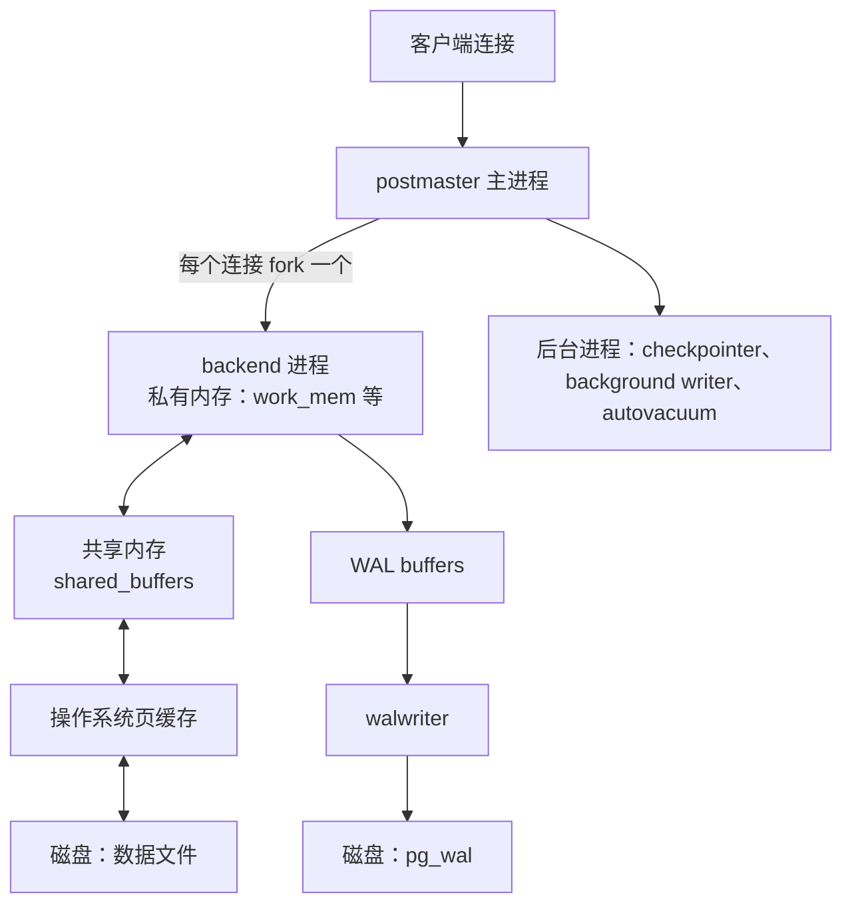
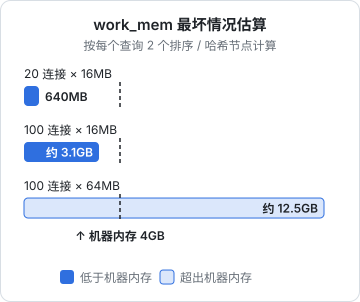

# 安装与参数调优

## 关于这本书

这本书讲 PostgreSQL 上线之后的事：参数怎么调、备份怎么做才能真恢复回来、怎么搭从库、为什么要连接池、慢查询怎么找、VACUUM 和表膨胀是怎么回事、大版本怎么升级，以及「数据库放在 Docker 里跑」到底行不行。建表、索引、事务隔离、写 SQL 这些开发视角的内容在[《数据库原理与实战》](../database-practice/)里，本书默认你已经会了。

适合这样的读者：自己写 NestJS + Drizzle 的后端，库用 `docker compose up` 起得来、迁移跑得通，但从来没有真的恢复过一次备份；看到「磁盘满了」「连接数打满」「某个查询突然变慢」时，只能先重启再说。一个人做产品，没有 DBA，数据库出事就是你出事。读完之后，你应该能写出一份照着做就能恢复数据的手册，并且知道每个参数为什么这么配。

全书以作者自己的项目 hatch-counter 为主线案例：门店管理服务端，NestJS + PostgreSQL + Drizzle，生产环境是一台云服务器上的 docker compose，里面一个 `postgres:16-alpine` 容器加一个服务端容器，前面是宿主机上的 nginx。书里引用的配置都取自这个项目，去掉了域名、镜像仓库地址和密钥。

**版本约定**：本书命令和配置**以 PostgreSQL 16 为准**（与 hatch-counter 一致），镜像是官方的 `postgres:16-alpine`。17、18 有差异的地方会单独标出来。Docker 命令以 Docker Engine + Compose v2（`docker compose`）为准。参数的默认值和行为请以你所用大版本的官方文档为准，每个大版本都会改一些默认值。

怎么读：第 1 章打底（进程模型和参数），后面都会用到；第 2–3 章是备份恢复，**最重要，建议动手做一遍**；第 4–5 章讲复制和连接池；第 6–7 章讲性能和维护；第 8 章讲升级；第 9 章回头讨论容器里跑数据库的取舍，也给出 hatch-counter 下一步的选择。

## 先认识案例

hatch-counter 生产环境的 compose 文件里，Postgres 这一段大致是这样（已脱敏）：

```yaml
name: counter

services:
  postgres:
    image: registry.example.com/counter/postgres:16-alpine
    restart: unless-stopped
    env_file: postgres.env          # POSTGRES_USER / POSTGRES_PASSWORD / POSTGRES_DB
    volumes:
      - pgdata:/var/lib/postgresql/data
    healthcheck:
      test: ["CMD-SHELL", "pg_isready -U counter -d counter"]
      interval: 10s
      timeout: 3s
      retries: 12
    # 不映射端口：服务端走 compose 内网连 postgres:5432

  api:
    image: registry.example.com/counter/api:${API_TAG}
    depends_on:
      postgres:
        condition: service_healthy

volumes:
  pgdata:
```

几个值得注意的设计，后面各章都会用到：

| 设计 | 原因 |
|---|---|
| 不映射 5432 端口 | 数据库不该被宿主机上的任意进程连到，要 psql 就 `docker compose exec postgres psql -U counter counter` |
| 数据放命名卷 `pgdata` | 放容器可写层的话，`docker rm` 一下整个库就没了 |
| 三个数据库角色 | `counter` 是表的 owner，只给迁移用；`counter_app` 跑业务，受行级安全（RLS）约束；`counter_admin` 给管理后台 |
| 备份只有云盘快照 | 作者明确记下的已知风险：退不回「昨天下午」，也捞不出单独一家店。第 2–3 章补这块 |

这里最后一条是本书的出发点：**这个库现在能整盘回滚，但做不到按时间点恢复**。

## 进程模型：参数在调什么

Postgres 是多进程架构，不是多线程。理解这张图，后面的参数就都有了落脚点：



要记住三件事：

1. **每个连接是一个进程**。连接本身就占几 MB 内存，开几百个连接，进程切换和内存都扛不住。这是第 5 章连接池的根源
2. **数据读两层缓存**：先查 `shared_buffers`，没有再找操作系统页缓存，最后才读盘。所以 `shared_buffers` 不用设得特别大，留给页缓存的内存同样在干活
3. **写入先写 WAL**（预写日志），数据页可以晚一点再刷盘。崩溃后靠重放 WAL 恢复。这也是第 3 章时间点恢复和第 4 章复制的基础

## 参数从哪里来

Postgres 的参数有好几个来源，后者覆盖前者：

| 来源 | 位置 | 怎么改 |
|---|---|---|
| 编译默认值 | 无 | 不改 |
| `postgresql.conf` | 数据目录里 | 编辑文件 |
| `postgresql.auto.conf` | 数据目录里 | `ALTER SYSTEM SET ...`，不要手改 |
| 命令行 `-c` | 启动参数 | compose 的 `command` |
| 数据库 / 角色级别 | 系统表 | `ALTER DATABASE` / `ALTER ROLE ... SET` |
| 会话级别 | 当前连接 | `SET ...` |

改完之后是否生效，取决于参数的 `context`：

```sql
SELECT name, setting, unit, context, source, pending_restart
FROM pg_settings
WHERE name IN ('shared_buffers', 'work_mem', 'max_connections', 'log_min_duration_statement');
```

- `postmaster`：必须重启（`shared_buffers`、`max_connections`、`archive_mode`）
- `sighup`：重载即可，`SELECT pg_reload_conf();`
- `user` / `superuser`：可以按会话、按角色设置（`work_mem`、`statement_timeout`）

`pending_restart = true` 表示你改了但还没重启生效，改完参数后查一下这一列，能避免「以为改了其实没改」。

### 在 compose 里怎么传参数

官方镜像有两种常见做法。参数不多时，直接用命令行 `-c`，所有配置都写在 compose 文件里、进 Git：

```yaml
services:
  postgres:
    image: postgres:16-alpine
    shm_size: 256mb
    command:
      - postgres
      - -c
      - shared_buffers=1GB
      - -c
      - effective_cache_size=3GB
      - -c
      - work_mem=16MB
      - -c
      - maintenance_work_mem=256MB
      - -c
      - random_page_cost=1.1
      - -c
      - max_wal_size=2GB
      - -c
      - log_min_duration_statement=500ms
      - -c
      - shared_preload_libraries=pg_stat_statements
```

参数多了，就挂一个配置文件进去：

```yaml
    command: ["postgres", "-c", "config_file=/etc/postgresql/postgresql.conf"]
    volumes:
      - pgdata:/var/lib/postgresql/data
      - ./postgresql.conf:/etc/postgresql/postgresql.conf:ro
```

注意这时你挂的文件要包含 `listen_addresses = '*'`，否则容器外（包括同一 compose 网络里的 api 容器）连不进来。官方镜像初始化时会把这一行写进数据目录里的那份 `postgresql.conf`，但你换成自己的文件后就没了。

**不建议用 `ALTER SYSTEM` 作为主要手段**：它写进数据卷里的 `postgresql.auto.conf`，不进 Git，换一台机器、重建一次卷就丢了，也没人记得当初改过什么。临时救火可以用，事后回写到 compose。

`shm_size` 这一行容易漏：Docker 默认给容器的 `/dev/shm` 只有 64MB，而 Postgres 的并行查询用共享内存段传数据，不够时会报 `could not resize shared memory segment`。查询偶发失败、换个时间又好了，就是这个症状。

## 关键参数逐个看

下表的「建议值」以一台 **4GB 内存、SSD 云盘、同时还跑着服务端容器**的机器为例。默认值以 PostgreSQL 16 为准。

| 参数 | 默认值 | 建议值 | 理由 |
|---|---|---|---|
| `shared_buffers` | 128MB | 1GB | 常见经验是物理内存的 25% 左右；再大收益递减，还要和页缓存、应用抢内存 |
| `effective_cache_size` | 4GB | 3GB | 不分配内存，只告诉优化器「操作系统能缓存多少」，影响走不走索引 |
| `work_mem` | 4MB | 16MB | 每个排序 / 哈希操作可用的内存，超出就写临时文件，见下文 |
| `maintenance_work_mem` | 64MB | 256MB | VACUUM、建索引用；调大能明显加快建索引 |
| `max_connections` | 100 | 100 | 不要调大，靠连接池解决（第 5 章） |
| `random_page_cost` | 4 | 1.1 | 默认值按机械盘的随机读代价设定，SSD 上会让优化器过度回避索引 |
| `max_wal_size` | 1GB | 2GB | 两次检查点之间允许的 WAL 量；太小会频繁触发检查点，写入抖动 |
| `checkpoint_completion_target` | 0.9 | 0.9 | 检查点写入摊开到整个间隔里，已是合理默认 |

### work_mem 为什么要小心

`work_mem` 不是「每个连接」的上限，而是**每个排序或哈希节点**的上限。一个复杂查询可能同时有好几个这样的节点，并行查询的每个 worker 还各算一份。最坏情况的估算是：

$$
\text{内存} \approx \text{活跃连接数} \times \text{每个查询的节点数} \times \text{work\_mem}
$$



注意 100 × 16MB 这一档虽然低于 4GB，但再加上 1GB 的 `shared_buffers`、服务端进程和操作系统，已经没有余量了。所以全局 `work_mem` 宁小勿大。真有一个报表查询需要大内存，就在那个事务里单独调：

```sql
BEGIN;
SET LOCAL work_mem = '256MB';
-- 跑那个大查询
COMMIT;
```

判断 `work_mem` 够不够，看有没有临时文件：设置 `log_temp_files = 0`，日志里出现 `temporary file: path ... size ...` 就说明有操作溢出到了磁盘。

### 日志和超时：一人运维的护栏

下面这组参数不影响性能，但能让你在出事时有线索、有兜底：

```ini
# postgresql.conf 写法；放进 compose 的话每行变成一对 -c 参数
log_min_duration_statement = 500ms          # 超过 500ms 的语句记日志（第 6 章）
log_lock_waits = on                         # 等锁超过 deadlock_timeout（默认 1s）就记一笔
log_temp_files = 0                          # 所有临时文件都记
log_autovacuum_min_duration = 10min         # 16 的默认值；想看得更细可以调小
idle_in_transaction_session_timeout = 5min  # 开了事务不提交的连接，5 分钟后踢掉
```

`idle_in_transaction_session_timeout` 值得单独说：应用代码里一个 `BEGIN` 之后抛异常没回滚、连接又被池子留着，这个事务会一直挂着，挡住 VACUUM 清理死元组（第 7 章），时间一长表就膨胀了。设一个超时，比事后排查便宜得多。

`statement_timeout` 不建议全局设置，迁移和备份可能就是要跑很久。更好的做法是按角色设置，只约束业务角色：

```sql
ALTER ROLE counter_app SET statement_timeout = '15s';
ALTER ROLE counter_app SET lock_timeout = '5s';
```

这样业务请求里一条失控的查询最多跑 15 秒，而用 `counter` 角色跑的迁移不受影响。设置在新连接上生效，改完要让服务端重连（重启 api 容器即可）。

## 改完之后怎么验证

```bash
docker compose up -d postgres          # command 变了，compose 会重建容器
docker compose exec postgres psql -U counter -d counter -c "SHOW shared_buffers;"
docker compose exec postgres psql -U counter -d counter \
  -c "SELECT name, setting, pending_restart FROM pg_settings WHERE pending_restart;"
```

第二条应该返回 `1GB`，第三条应该返回空。注意重建 Postgres 容器会断开所有连接，服务端要能自动重连；hatch-counter 用的 postgres.js 驱动会在下一次查询时重新建连接。

调参的最后一条原则：**一次只改一组，改之前记下基线**。改了五个参数之后变快了，你不知道是哪个起的作用；变慢了，也不知道该退哪个。基线怎么记，第 6 章讲 `pg_stat_statements` 时会给出方法。

## 本章要点

- 本书以 **PostgreSQL 16 + `postgres:16-alpine`** 为准，17 / 18 的差异单独标注
- Postgres 每个连接一个进程；读走 `shared_buffers` 和操作系统页缓存两层；写先落 WAL
- 参数分需要重启、重载即可、可按会话设置三类，改完查 `pg_settings.pending_restart`
- 在 compose 里用 `command: -c` 或挂配置文件传参数，配置进 Git；`ALTER SYSTEM` 只用于临时救火
- `shared_buffers` 约 25% 内存，SSD 上 `random_page_cost` 调到 1.1，`work_mem` 宁小勿大
- 记得给容器设 `shm_size`；用 `idle_in_transaction_session_timeout` 和按角色的 `statement_timeout` 做护栏

## 动手练习

以下练习都在一次性容器里做，做完 `docker rm -f pgx` 即可清理，不要连自己的真实数据库：

```bash
docker run -d --name pgx -e POSTGRES_PASSWORD=x postgres:16-alpine
docker exec -it pgx psql -U postgres
```

1. **哪些参数要重启**：在 psql 里执行 `ALTER SYSTEM SET shared_buffers = '256MB';` 和 `ALTER SYSTEM SET work_mem = '32MB';`，再执行 `SELECT pg_reload_conf();`，然后查 `pg_settings` 里这两个参数的 `setting` 和 `pending_restart`。

   验证：`work_mem` 已经变成 32MB（`setting` 显示 `32768`，单位 kB），`pending_restart` 为 `f`；`shared_buffers` 的 `pending_restart` 为 `t`。`docker restart pgx` 之后再查，两者都生效、`pending_restart` 都是 `f`。

   参考答案：`shared_buffers` 的 `context` 是 `postmaster`，要重启；`work_mem` 是 `user`，重载即生效。这也说明 `ALTER SYSTEM` 改的东西落在数据卷的 `postgresql.auto.conf` 里：`docker exec pgx cat /var/lib/postgresql/data/postgresql.auto.conf` 能看到这两行。

2. **work_mem 不够时的临时文件**：执行 `SET log_temp_files = 0; SET work_mem = '64kB';`，再跑 `SELECT g FROM generate_series(1, 2000000) g ORDER BY g DESC LIMIT 1;`。然后把 `work_mem` 调到 `256MB` 再跑一次，两次都加上 `EXPLAIN (ANALYZE)`。

   验证：64kB 时 `EXPLAIN ANALYZE` 的 Sort 节点显示 `Sort Method: external merge  Disk: ...kB`，`docker logs pgx` 里能看到 `temporary file: path ...`；调大后变成 `Sort Method: quicksort` 或 `top-N heapsort` 之类的内存排序，不再有临时文件日志。

   参考答案：排序超出 `work_mem` 就溢出到磁盘。注意带 `LIMIT 1` 时优化器可能直接用 top-N heapsort，内存需求很小；如果第一次就没看到 external merge，去掉 `LIMIT` 改成 `SELECT count(*) FROM (SELECT g FROM generate_series(1,2000000) g ORDER BY g DESC) t;` 再试。

3. **按角色的超时护栏**：建一个角色 `CREATE ROLE app LOGIN PASSWORD 'x'; ALTER ROLE app SET statement_timeout = '2s';`，然后分别用 `docker exec -it pgx psql -U app -d postgres -c "SELECT pg_sleep(5);"` 和 `-U postgres` 跑同一条语句。

   验证：`app` 那条约 2 秒后报 `canceling statement due to statement timeout`；`postgres` 那条 5 秒后正常返回。

   参考答案：`ALTER ROLE ... SET` 只在该角色的新连接上生效，所以业务角色受约束、迁移角色不受影响。容器内本地连接默认是 trust 认证，不需要输密码。
