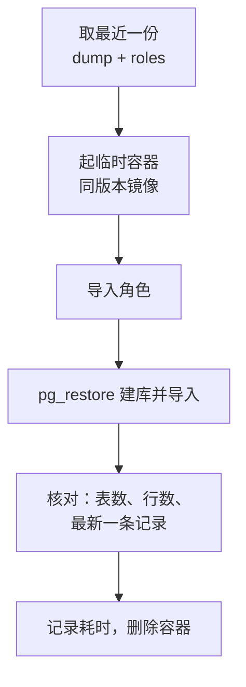

# 逻辑备份与恢复演练

备份这件事，判断标准只有一个：**能不能恢复回来**。没恢复过的备份，你只是相信它能用。本章先讲 Postgres 有哪几种备份、各自能解决什么问题，然后给 hatch-counter 搭一套每天自动跑的 `pg_dump` 备份，并完整走一遍「在一个临时容器里恢复出来、核对数据」的演练。下一章在此基础上做按时间点恢复（PITR）。

命令以 PostgreSQL 18、`postgres:18-alpine` 镜像、compose 项目名 `counter` 为准（版本约定见[第 1 章](01-install-tuning.md#关于这本书)）。

## 先想清楚要防什么

不同的事故，需要不同的备份来兜底：

| 事故 | 例子 | 云盘快照 | pg_dump | 基础备份 + WAL 归档 |
|---|---|---|---|---|
| 整台机器坏了 | 云盘损坏、误删实例 | 能（快照在同一云账号里） | 能（如果存在别处） | 能 |
| 误操作改坏数据 | 手写 `UPDATE` 忘了 `WHERE` | 只能退到快照时刻 | 只能退到备份时刻 | **能退到出事前一秒** |
| 只要一部分数据 | 只恢复一家门店、一张表 | 不能直接做 | **能** | 先整库恢复再导出 |
| 云账号出问题 | 欠费、被封、账号被盗 | 跟着一起没 | 能（存到另一家） | 能（存到另一家） |
| 大版本升级 | 16 → 18 | 不适用 | **能** | 不能跨大版本 |

两个衡量指标：

- **RPO**（恢复点目标）：最多能接受丢多少数据。每天一次 `pg_dump`，RPO 就是 24 小时
- **RTO**（恢复时间目标）：从出事到恢复服务要多久。库越大、步骤越不熟，RTO 越长

hatch-counter 目前只有云盘快照：RPO 取决于快照频率，误操作和只恢复一家店都没有办法，作者在部署文档里明确记下了这一点。本章和下一章的目标是：**`pg_dump` 每天一份存到另一处，加上 WAL 归档把 RPO 压到几分钟**。

## pg_dump 和 pg_dumpall

`pg_dump` 导出**一个数据库**的逻辑内容：表结构、数据、索引定义、函数、RLS 策略。它在一个可重复读的快照里执行，导出过程中业务照常读写，导出的内容是某一时刻的一致视图。

它**不导出**角色（用户）和其他集群级别的东西。hatch-counter 有三个角色，迁移和 RLS 策略都引用它们，恢复时角色不存在，`GRANT` 和 `ALTER ... OWNER TO` 会全部失败。所以要配合 `pg_dumpall --roles-only` 单独导出角色。

### 输出格式选哪种

| 格式 | 参数 | 特点 | 用什么恢复 |
|---|---|---|---|
| 纯 SQL | `-Fp`（默认） | 可读，可以直接 `psql` 执行 | `psql` |
| 自定义格式 | `-Fc` | 压缩；可以挑表恢复；可以看目录 | `pg_restore` |
| 目录格式 | `-Fd` | 每张表一个文件；支持并行导出 `-j` | `pg_restore`，支持 `-j` |

日常备份用 **`-Fc`**：压缩、单文件，恢复时还能只挑几张表。库大到几十 GB、导出太慢时再考虑 `-Fd -j 4`。

### 在 compose 里导出

库没有映射端口，所以通过 `docker compose exec` 在容器里执行，把输出流回宿主机：

```bash
cd /srv/counter
mkdir -p /srv/pg-backups/dump

# 数据库本身：-T 关掉伪终端，否则二进制输出会被终端处理弄坏
docker compose exec -T postgres \
  pg_dump -U counter -d counter -Fc > /srv/pg-backups/dump/counter-$(date +%F).dump

# 角色：只有几行，纯 SQL
docker compose exec -T postgres \
  pg_dumpall -U counter --roles-only > /srv/pg-backups/dump/roles-$(date +%F).sql
```

`-T` 很关键。不加的话，`docker compose exec` 默认分配伪终端，换行符会被改写，`-Fc` 的二进制文件就坏了，而且要到恢复时才发现。

两个需要注意的点：

- **RLS 与导出用户**。hatch-counter 用 RLS 做多租户隔离。如果用一个受 RLS 约束的普通角色执行 `pg_dump`，它默认会设置 `row_security = off`，遇到会被策略过滤的表时直接报错，而不是悄悄只导出一部分。所以导出要用 superuser 或表的 owner。官方镜像里 `POSTGRES_USER` 指定的 `counter` 就是 superuser，满足条件
- **角色文件里有密码哈希**。`roles.sql` 里包含 `ALTER ROLE ... PASSWORD 'SCRAM-SHA-256$...'`，虽然是哈希，也要当密钥对待：权限设成 600，加密后再送到别处

导完立刻看一眼备份有没有内容：

```bash
ls -lh /srv/pg-backups/dump/
docker compose exec -T postgres pg_restore --list < /srv/pg-backups/dump/counter-$(date +%F).dump | head -20
```

`pg_restore --list` 能列出目录，说明文件格式完好。

## 恢复演练：在临时容器里还原

不要在生产库上练恢复。起一个一次性的同版本容器，把备份还原进去，核对数据，然后删掉。



### 1. 起临时容器

```bash
docker run -d --name pg-restore-test \
  -e POSTGRES_USER=counter \
  -e POSTGRES_PASSWORD=restore-test-only \
  -e POSTGRES_DB=postgres \
  postgres:18-alpine   # 和生产同一个大版本

# 等它真的可连（initdb 时会先起一个临时实例再重启）
until docker exec pg-restore-test pg_isready -U counter -d postgres; do sleep 1; done
```

版本要和生产一致或更高。`pg_restore` 可以把旧版本的备份恢复进新版本，反过来不保证可行。

`POSTGRES_DB=postgres` 是故意的：先不建 `counter` 库，让下一步的 `pg_restore --create` 自己建，库的属性（编码、owner）就和生产一致。

### 2. 导入角色

```bash
docker exec -i pg-restore-test psql -U counter -d postgres \
  < /srv/pg-backups/dump/roles-2026-11-02.sql
```

会看到一行 `ERROR: role "counter" already exists`：临时容器启动时已经建好了 `counter`。这是预期内的，其余角色正常创建。

### 3. 恢复数据库

```bash
time docker exec -i pg-restore-test pg_restore -U counter -d postgres --create --exit-on-error \
  < /srv/pg-backups/dump/counter-2026-11-02.dump
```

- `--create`：先连到 `postgres` 库，执行 `CREATE DATABASE counter`，再切过去导入
- `--exit-on-error`：遇错就停。演练时要的就是暴露问题，不要让它带着错误跑完

从标准输入读的时候不能用并行 `-j`。库大时把文件 `docker cp` 进容器，再用 `pg_restore -j 4 /tmp/xxx.dump` 并行恢复。

### 4. 核对

恢复成功不等于数据对。至少核对三件事：

```bash
docker exec -it pg-restore-test psql -U counter -d counter
```

```sql
-- 表的数量和生产一致吗
SELECT count(*) FROM information_schema.tables WHERE table_schema = 'public';

-- 关键表的行数（在生产上跑同一条对比）
SELECT 'stores' AS t, count(*) FROM stores
UNION ALL SELECT 'stock_receipts', count(*) FROM stock_receipts;

-- 最新数据的时间，接近备份时刻吗
SELECT max(created_at) FROM stock_receipts;

-- RLS 策略和角色都还在吗
SELECT tablename, policyname FROM pg_policies LIMIT 5;
\du
```

表名请换成你自己项目里的关键表。再验证一下应用角色能否正常工作：给 `counter_app` 设个临时密码，用它连上去，确认 RLS 在生效（不设置门店上下文时查不到任何业务数据）。

### 5. 记录并清理

```bash
docker rm -f pg-restore-test
```

在运维笔记里记一行：日期、备份文件大小、恢复耗时、核对结果。这个耗时就是你的 RTO 下限，库长大后它会变，所以演练要定期做，每个季度一次比较合适。

### 只恢复一张表或一家店

`-Fc` 格式的好处在这里体现。比如只想把 `stores` 表恢复到临时库里，再挑出一家店的数据：

```bash
docker exec -i pg-restore-test pg_restore -U counter -d counter --data-only -t stores \
  < /srv/pg-backups/dump/counter-2026-11-02.dump
```

更稳妥的做法是：先整库恢复到临时容器，在临时库里用 SQL 找出要的行，导出成 CSV 或 `INSERT` 语句，人工核对之后再写回生产。**不要直接对生产库执行 `pg_restore`**，外键、触发器、RLS 和序列都可能让结果和你预想的不一样。

## 自动化：systemd timer

手动备份迟早会忘。在宿主机上写一个脚本，用 systemd timer 每天跑一次（systemd 的用法见[《Linux 系统与命令行》](../linux-essentials/)）。

`/usr/local/bin/pg-backup.sh`：

```bash
#!/usr/bin/env bash
set -euo pipefail

COMPOSE_DIR=/srv/counter
OUT=/srv/pg-backups/dump
KEEP_DAYS=14
STAMP=$(date +%F-%H%M)

umask 077
mkdir -p "$OUT"
cd "$COMPOSE_DIR"

# 先写临时文件，成功后再改名：避免中途失败留下一个「看起来存在」的坏文件
docker compose exec -T postgres pg_dump -U counter -d counter -Fc > "$OUT/counter-$STAMP.dump.tmp"
docker compose exec -T postgres pg_dumpall -U counter --roles-only > "$OUT/roles-$STAMP.sql.tmp"

# 校验：能列出目录才算成功
docker compose exec -T postgres pg_restore --list < "$OUT/counter-$STAMP.dump.tmp" > /dev/null

mv "$OUT/counter-$STAMP.dump.tmp" "$OUT/counter-$STAMP.dump"
mv "$OUT/roles-$STAMP.sql.tmp" "$OUT/roles-$STAMP.sql"

# 本地只留 14 天
find "$OUT" -name 'counter-*.dump' -mtime +"$KEEP_DAYS" -delete
find "$OUT" -name 'roles-*.sql' -mtime +"$KEEP_DAYS" -delete

echo "backup ok: $OUT/counter-$STAMP.dump ($(du -h "$OUT/counter-$STAMP.dump" | cut -f1))"
```

`/etc/systemd/system/pg-backup.service`：

```ini
[Unit]
Description=PostgreSQL logical backup
Requires=docker.service
After=docker.service

[Service]
Type=oneshot
ExecStart=/usr/local/bin/pg-backup.sh
```

`/etc/systemd/system/pg-backup.timer`：

```ini
[Unit]
Description=Daily PostgreSQL backup

[Timer]
OnCalendar=*-*-* 03:30:00
Persistent=true
RandomizedDelaySec=10min

[Install]
WantedBy=timers.target
```

```bash
sudo chmod 700 /usr/local/bin/pg-backup.sh
sudo systemctl daemon-reload
sudo systemctl enable --now pg-backup.timer
sudo systemctl start pg-backup.service      # 立刻跑一次
journalctl -u pg-backup.service -n 20       # 看结果
systemctl list-timers pg-backup.timer       # 看下次什么时候跑
```

`Persistent=true` 的作用是：机器在 3:30 恰好关机的话，开机后补跑一次。

## 3-2-1：备份要离开这台机器

上面的 dump 和数据库在同一块盘上，盘坏了一起没，它只负责应对误操作和快速恢复。按 3-2-1 原则，还要有一份加密后放到异地（最好是另一家云服务商），并且备份失败要能被看见。这些和数据库无关，是所有备份共用的做法：用 restic 把 `/srv/pg-backups` 送到异地对象存储、防止备份被攻击者一起删掉、用心跳监控发现备份失败，见[《一人运维手册》3-2-1 原则](../production-ops/02-backup-dr.md#3-2-1-原则)和后面两节。本章只负责把这份 dump 做对：一致、可恢复、恢复演练过。

## 本章要点

- 判断备份的唯一标准是能恢复；按事故类型选择备份方式，用 RPO / RTO 衡量
- `pg_dump -Fc` 导出单库，`pg_dumpall --roles-only` 导出角色，两者缺一不可
- 在 compose 里导出要加 `-T`；有 RLS 的库用 superuser 或表 owner 导出
- 恢复演练：临时容器 → 导入角色 → `pg_restore --create --exit-on-error` → 核对表数、行数、最新时间，记录耗时
- 永远不要直接往生产库里 `pg_restore`，先恢复到临时库再挑数据
- 用 systemd timer 每天备份，先写临时文件再改名；遵守 3-2-1，异地一份，失败要告警

## 动手练习

全部在一次性容器里做，不要碰生产库。先准备一个「源库」：

```bash
docker run -d --name src -e POSTGRES_USER=counter -e POSTGRES_PASSWORD=x postgres:18-alpine
until docker exec src pg_isready -U counter; do sleep 1; done
docker exec -i src psql -U counter -d counter <<'SQL'
CREATE ROLE counter_app LOGIN;
CREATE TABLE stores (id int PRIMARY KEY, name text);
INSERT INTO stores SELECT g, 'store-' || g FROM generate_series(1, 1000) g;
GRANT SELECT ON stores TO counter_app;
SQL
```

1. **`-T` 到底防什么**：分别用 `docker exec src pg_dump -U counter -d counter -Fc > a.dump` 和 `docker exec -t src pg_dump -U counter -d counter -Fc > b.dump` 导出两份，比较它们，再把两份都喂给 `pg_restore --list`。

   验证：`cmp a.dump b.dump` 报告差异，两个文件大小不同；`docker exec -i src pg_restore --list < a.dump` 正常列出目录，`b.dump` 报错或列出的内容不完整。

   参考答案：分配了伪终端后，终端驱动会把输出里的换行改写成回车加换行，二进制格式就坏了。`docker exec` 默认不分配伪终端，`docker compose exec` 默认分配，所以 compose 里要显式加 `-T`。

2. **少了角色会怎样**：用 `a.dump` 在第二个一次性容器 `docker run -d --name dst -e POSTGRES_USER=counter -e POSTGRES_PASSWORD=x -e POSTGRES_DB=postgres postgres:18-alpine` 里执行 `pg_restore -U counter -d postgres --create --exit-on-error`，**不先导入角色**。然后删掉 `dst` 重来，这次先用 `pg_dumpall --roles-only` 导出角色并导入，再恢复。

   验证：第一次在 `GRANT` 那一步停下，报 `role "counter_app" does not exist`；第二次恢复成功，`docker exec dst psql -U counter -d counter -c "SELECT count(*) FROM stores"` 返回 `1000`。

   参考答案：`pg_dump` 不导出角色，`--exit-on-error` 把这个问题当场暴露出来。导入角色时出现 `role "counter" already exists` 是预期的。

3. **只恢复一张表**：在 `src` 里执行 `DELETE FROM stores WHERE id > 10;` 模拟误删，然后用 `a.dump` 在 `dst` 里拿回被删的行，导出成 CSV 再写回 `src`（只插入缺失的行）。

   验证：最后 `src` 里 `SELECT count(*) FROM stores` 回到 `1000`。

   参考答案：先在临时库里取数据，不直接对源库 `pg_restore`。一种做法：

   ```bash
   docker exec dst psql -U counter -d counter -c "\copy (SELECT * FROM stores WHERE id > 10) TO STDOUT CSV" > lost.csv
   docker exec -i src psql -U counter -d counter -c "\copy stores FROM STDIN CSV" < lost.csv
   ```

做完 `docker rm -f src dst`。
