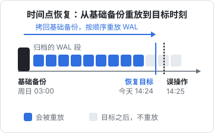
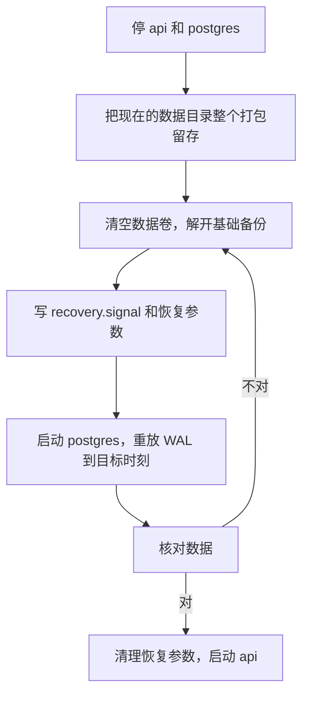

# WAL 归档与时间点恢复

上一章的 `pg_dump` 每天一份，出事时最多丢一天数据。对一个记账类系统，「今天店里录的进货单全没了」是很难向用户交代的。**时间点恢复**（Point-in-Time Recovery，PITR）能把库恢复到任意一个时刻，比如「14:25，那条手写 `UPDATE` 执行之前」。本章讲清它的原理，然后在 hatch-counter 的 compose 里把 WAL 归档配起来，完整走一遍恢复步骤。

命令以 PostgreSQL 16、`postgres:16-alpine` 镜像、compose 项目名 `counter` 为准。Alpine 版官方镜像里 `postgres` 用户的 uid 是 70（Debian 版是 999），下文的 `chown` 用的是 70。

## 原理：基础备份 + WAL 重放

第 1 章说过，Postgres 的每次修改都先写进 WAL（预写日志），WAL 按 16MB 一个段文件存放在 `pg_wal/` 目录下。崩溃恢复时，Postgres 从最后一个检查点开始重放 WAL，把数据页补到最新状态。

PITR 是把这个机制拉长：

1. **基础备份**：某个时刻数据目录的一份物理拷贝（用 `pg_basebackup` 在线制作，不用停库）
2. **WAL 归档**：从此以后每个写满的 WAL 段都复制一份到归档目录
3. **恢复**：把基础备份放回去，让 Postgres 从归档里一个个取 WAL 来重放，**重放到你指定的时刻停下**



几个直接推论：

- 只能恢复到**基础备份之后**的时刻，所以基础备份要定期做（比如每周一次）
- 恢复耗时 ≈ 拷回基础备份 + 重放这段时间的全部 WAL。基础备份越久远，要重放的 WAL 越多
- 中间缺一个 WAL 段，就只能恢复到缺口之前。归档必须连续，要监控
- 物理备份**不能跨大版本**，也不能只恢复一张表。这两件事仍然靠 `pg_dump`

| | pg_dump | 基础备份 + WAL 归档 |
|---|---|---|
| 粒度 | 某一时刻的整库 | 任意时刻 |
| 能恢复部分表 | 能 | 不能，只能整个集群 |
| 跨大版本 | 能 | 不能 |
| 大库的恢复速度 | 慢（要重建索引） | 快（拷文件 + 重放） |

两者不是二选一，而是都要。

## 配置 WAL 归档

### 1. 准备目录

先在宿主机上建好归档和基础备份目录，交给容器里的 `postgres` 用户：

```bash
sudo mkdir -p /srv/pg-backups/wal /srv/pg-backups/base
sudo chown -R 70:70 /srv/pg-backups/wal /srv/pg-backups/base
sudo chmod 700 /srv/pg-backups/wal /srv/pg-backups/base
```

真实生产里，归档目录应该在**另一块盘**上，或者由工具直接推到对象存储，否则这块盘坏了，库和归档一起丢。这里先用本地目录把流程跑通。

### 2. 改 compose

```yaml
services:
  postgres:
    image: postgres:16-alpine
    command:
      - postgres
      - -c
      - wal_level=replica
      - -c
      - archive_mode=on
      - -c
      - archive_command=test ! -f /wal-archive/%f && cp %p /wal-archive/%f
      - -c
      - archive_timeout=300
    volumes:
      - pgdata:/var/lib/postgresql/data
      - /srv/pg-backups/wal:/wal-archive
      - /srv/pg-backups/base:/base-backup
```

逐个解释：

| 参数 | 含义 |
|---|---|
| `wal_level=replica` | WAL 里记录足够的信息供归档和复制使用。16 的默认值就是 `replica`，写出来是为了明确 |
| `archive_mode=on` | 开启归档。改它**需要重启** |
| `archive_command` | 每个 WAL 段写满后执行的命令。`%p` 是段文件路径，`%f` 是文件名 |
| `archive_timeout=300` | 即使 WAL 段没写满，最多 300 秒也切换一次并归档 |

`archive_command` 里的 `test ! -f ... &&` 是官方文档推荐的写法：目标文件已存在时返回失败，**绝不覆盖已归档的段**。命令返回非 0 时，Postgres 会保留这个段并不断重试，所以归档失败不会丢数据，但 `pg_wal/` 会越积越多，最终撑满磁盘。

`archive_timeout` 决定了业务量小时的 RPO。hatch-counter 这样的系统，夜里可能几个小时都写不满 16MB，不设这个参数，最后几小时的修改一直留在没归档的段里。300 秒意味着最多丢 5 分钟数据；代价是每次切换都产生一个 16MB 的文件（压缩率很高，大部分是空的），一天最多 288 个。

```bash
docker compose up -d postgres
```

### 3. 确认归档在工作

```bash
docker compose exec postgres psql -U counter -d counter -c "SELECT pg_switch_wal();"
sleep 5
ls -lh /srv/pg-backups/wal | tail -3
docker compose exec postgres psql -U counter -d counter -c \
  "SELECT archived_count, last_archived_wal, last_archived_time, failed_count, last_failed_wal FROM pg_stat_archiver;"
```

`pg_switch_wal()` 强制切换一个段，几秒后归档目录里应该多出一个 24 位十六进制名字的文件。`pg_stat_archiver` 里 `failed_count` 应该是 0；如果在涨，看 `docker compose logs postgres`，最常见的原因是目录权限不对。

## 制作基础备份

```bash
docker compose exec postgres \
  pg_basebackup -U counter -D /base-backup/$(date +%F) -Ft -z -X stream -c fast -P
```

| 参数 | 含义 |
|---|---|
| `-D` | 输出目录。`$(date +%F)` 在宿主机的 shell 里展开 |
| `-Ft -z` | tar 格式并 gzip 压缩，输出 `base.tar.gz` 和 `pg_wal.tar.gz` |
| `-X stream` | 备份期间同时流式接收 WAL，保证这份备份自己就是一致的 |
| `-c fast` | 立即做检查点，不等下一个周期 |
| `-P` | 显示进度 |

它走的是复制协议。官方镜像初始化时，容器内本地连接是信任认证，`counter` 又是 superuser，所以在容器里直接执行即可。

完成后目录里有 `backup_manifest`、`base.tar.gz`、`pg_wal.tar.gz` 三个文件。校验一下。`pg_verifybackup` 从 13 起提供，但在 16 上只能校验 plain 格式的备份，tar 格式的校验从 18 才支持；在 16 上先用 `tar -tzf` 确认压缩包完好：

```bash
tar -tzf /srv/pg-backups/base/2026-11-02/base.tar.gz > /dev/null && echo base ok
```

把基础备份加进上一章的 systemd 体系，每周一次，比如周日 03:00；`pg_dump` 照样每天跑。

### 清理旧的 WAL

归档会一直增长。只保留**最近两份基础备份**以及它们之后的 WAL：在较早那份基础备份的 `pg_wal.tar.gz` 里找到它的起始段名，比它更早的段就可以删了。手工做容易出错，`pg_archivecleanup` 工具可以按段名删除：

```bash
docker compose exec postgres pg_archivecleanup -n /wal-archive 000000010000000000000042
```

`-n` 是演习模式，只打印要删的文件。确认无误后去掉 `-n`。

## 恢复到指定时刻

场景：今天 14:25 有人手写了一条没带 `WHERE` 的 `UPDATE`，要把库恢复到 14:24。



### 1. 停服务，留存现场

```bash
cd /srv/counter
docker compose stop api postgres
docker volume ls | grep pgdata     # 确认卷名，本书是 counter_pgdata

docker run --rm -v counter_pgdata:/data -v /srv/pg-backups:/out alpine \
  tar -C /data -czf /out/pgdata-before-restore-$(date +%F-%H%M).tar.gz .
```

**不要跳过留存这一步**。恢复的目标时刻选错了、恢复中途出问题，你需要能回到起点。这份打包也包含 `pg_wal/` 里还没来得及归档的最后几个 WAL 段。

### 2. 清空数据卷，放回基础备份

```bash
docker run --rm \
  -v counter_pgdata:/data \
  -v /srv/pg-backups/base/2026-11-02:/base:ro \
  alpine sh -c '
    find /data -mindepth 1 -delete &&
    tar -C /data -xzf /base/base.tar.gz &&
    tar -C /data/pg_wal -xzf /base/pg_wal.tar.gz &&
    chown -R 70:70 /data && chmod 700 /data
  '
```

### 3. 写恢复配置

```bash
docker run --rm -v counter_pgdata:/data alpine sh -c '
  touch /data/recovery.signal &&
  cat >> /data/postgresql.auto.conf <<EOF
restore_command = '"'"'cp /wal-archive/%f %p'"'"'
recovery_target_time = '"'"'2026-11-02 14:24:00+08'"'"'
recovery_target_action = '"'"'promote'"'"'
EOF
  chown 70:70 /data/recovery.signal /data/postgresql.auto.conf
'
```

引号嵌套看着乱，写进文件的内容其实就是三行：

```ini
restore_command = 'cp /wal-archive/%f %p'
recovery_target_time = '2026-11-02 14:24:00+08'
recovery_target_action = 'promote'
```

- `recovery.signal`：数据目录里有这个空文件，Postgres 启动时就进入归档恢复模式
- `restore_command`：怎么从归档取一个段，和 `archive_command` 正好相反
- `recovery_target_time`：**一定带上时区**，否则按服务器时区解释。官方镜像默认是 UTC，和你脑子里的北京时间差 8 小时
- `recovery_target_action = 'promote'`：到达目标后结束恢复、开始接受写入。如果想先看看数据再决定，可以设成 `pause`，确认后执行 `SELECT pg_wal_replay_resume();`

### 4. 启动并观察

```bash
docker compose up -d postgres
docker compose logs -f postgres
```

日志里应该依次看到类似这样的内容：

```text
LOG:  starting point-in-time recovery to 2026-11-02 06:24:00+00
LOG:  restored log file "000000010000000000000043" from archive
LOG:  redo starts at 0/43000028
LOG:  restored log file "000000010000000000000044" from archive
LOG:  recovery stopping before commit of transaction 51234, time 2026-11-02 06:25:03.118+00
LOG:  redo done at 0/4412A3F0
LOG:  selected new timeline ID: 2
LOG:  archive recovery complete
LOG:  database system is ready to accept connections
```

`selected new timeline ID: 2` 表示库从这里分出了一条新的时间线。之后产生的 WAL 文件名以 `00000002` 开头，归档目录里还会多一个 `00000002.history` 文件。这保证新旧两条历史不会混在一起：你以后还可以恢复到原时间线上的其他时刻。

最后一段 WAL 如果在归档里找不到，日志会出现 `cp: can't stat ...` 之类的报错。这是正常的：Postgres 就是靠「取不到下一个段」判断归档已经用完。

### 5. 核对，收尾

```bash
docker compose exec postgres psql -U counter -d counter
```

用 SQL 确认被误改的数据回来了、14:24 之前的正常数据都在。确认无误后清掉恢复参数，免得以后误导别人：

```sql
ALTER SYSTEM RESET restore_command;
ALTER SYSTEM RESET recovery_target_time;
ALTER SYSTEM RESET recovery_target_action;
```

`recovery.signal` 在恢复结束时已经被 Postgres 自动删掉了。然后启动服务端：

```bash
docker compose up -d api
```

最后**立刻做一次新的基础备份**。新时间线开始后，旧的基础备份仍然可用，但新的基础备份能让下一次恢复更简单。

## 生产上换成专门的工具

上面用 `cp` 做归档，是为了让每一步都看得见。真正长期运行时，建议换成 pgBackRest 或 WAL-G 这类工具，它们解决了手写方案的几个痛点：

- 直接推送到对象存储，归档天然就在异地
- 压缩、加密、并行传输
- 自动按保留策略清理旧的基础备份和 WAL
- 增量 / 差异备份，基础备份不必每次全量

另外，PostgreSQL 17 起 `pg_basebackup` 原生支持增量备份（`--incremental`），配合 `pg_combinebackup` 合成完整备份。如果你已经在 17 以上，可以先看看原生方案够不够用。

需要注意：这两个工具都不在官方镜像里，要自己做一个带工具的镜像，或者在宿主机上安装、通过共享卷访问数据目录。选型和版本请看各自的官方文档。

## 本章要点

- PITR = 基础备份 + 连续的 WAL 归档，恢复时重放 WAL 到指定时刻停下
- 只能恢复到基础备份之后、不能跨大版本、不能只恢复一张表；`pg_dump` 仍然要做
- `archive_command` 用 `test ! -f ... && cp ...`，绝不覆盖；`archive_timeout` 决定低峰期的 RPO
- 用 `pg_stat_archiver` 监控归档，`failed_count` 上涨就要处理，否则 `pg_wal` 会撑满磁盘
- 恢复步骤：停服务 → **留存现场** → 放回基础备份 → `recovery.signal` + `restore_command` + 带时区的 `recovery_target_time` → 观察日志 → 核对 → 清理参数
- 长期运行换成 pgBackRest / WAL-G，归档直接进异地对象存储
